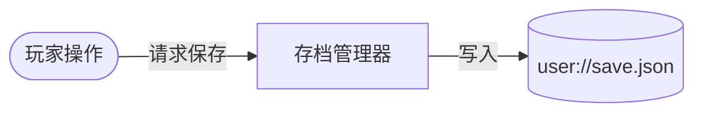

# Yaya 图解问答

把框架讨论中问过、以后还会用到的问题保存为 `framework/qa/` 下的问答。主题文件是普通 Markdown，图用 Mermaid 画，在框架全景的问答模块里查看：卡片列出每条问题，详情面板显示主题文件全文并渲染图。本 Skill 只供框架仓库使用，不随游戏项目分发；游戏项目的问答用 [qa-explainer](../../../project-source/skills/qa-explainer/SKILL.md)，两者的写法不通用。

什么时候添加、按问题类型写多少，以 [Q&A](../../../framework/qa/README.md) 的说明为准，它是框架问答的唯一正文。本 Skill 只写文件格式和步骤。

## 主题文件的格式

````markdown
---
title: 存档系统
---
本页收集关于存档系统的问答。

## 存档什么时候写入磁盘？

**结论**：一两句话的答案。

**为什么**：用具体场景说明原因、适用边界和容易误解的地方。



**依据**：权威正文的链接，或外部资料的来源。
````

- frontmatter 只写 `title`，它是框架全景里的主题名称。
- 每条问答是一个 `##` 节，标题就是问题本身。正文按“结论 / 为什么 / 依据”写，标签加粗，没有内容的段落省略。框架全景按这几个标签读出卡片上的结论和搜索用的理由，所以标签名不改。
- 图和表放在“为什么”里。内容有先后、交接、分工、对比或能与不能时，用图或表格表达，文字只补充图表说不清的原因和边界。

## 按信息形状选图

图只用 Mermaid，因为框架全景用 Pele 渲染，它支持 Mermaid 12.1 自带的全部图类型；其他图的写法在全景里显示成原始代码。

| 信息的形状 | 写法 |
| --- | --- |
| 谁连到谁、流程分支、交接 | `flowchart LR` 或 `flowchart TB`；虚线 `-.->`，分组用 `subgraph` |
| 谁做哪一步、在哪里交接 | `flowchart`，每个角色一个 `subgraph`，跨角色的连线写在 `subgraph` 外面 |
| 层级、目录、包含关系 | `flowchart LR`，父子之间用 `---` 连成树；名称和说明用 `<br>` 分两行 |
| 几个对象之间按时间传递的消息 | `sequenceDiagram`，要编号时加 `autonumber` |
| 状态和触发跳转的事件 | `stateDiagram-v2` |
| 历史或阶段 | `timeline`；事件文字里不写英文冒号，它是分隔符 |
| 几个对象的数值对比 | `xychart-beta` 的 `bar` |
| 逐项对比、能与不能 | Markdown 表格，状态写成文字（“适合”“不能”），不用符号或 `ok`、`no` 这类标记 |

节点名带空格或标点时，写成 `id["名称"]`。图里不另配颜色，因为全景让图跟着页面主题变色。没有真实数据时不画数值图。

## 步骤

1. 按 Q&A 说明判断是否提议、放进哪个主题；用户同意后再往下做。
2. 按上面的格式和 [technical-documentation-writing-yaya](../technical-documentation-writing-yaya/SKILL.md) 的写作要求写或改主题文件。再对改过的文件运行措辞检查和术语检查，按输出改写：

   ```powershell
   python -B project-source/tools/checks/check-wording.py framework/qa/<主题>.md
   python -B project-source/tools/checks/check-terminology.py --terms framework/terminology.md framework/qa/<主题>.md
   ```

3. 生成框架全景，打开问答模块，选中改过的问答，确认详情面板里的图渲染出来，没有显示“图渲染失败”：

   ```powershell
   npm --prefix framework/panorama run build
   ```

4. 按根 `AGENTS.md` 的本地提交规则提交。
5. 回复核心结论，以及新增或修改了哪几条问答。
