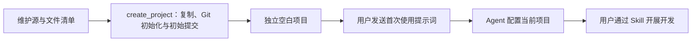

# Yaya Godot 项目起点

这里维护一套 Godot 项目的起始文件和开发 Skill，供 Windows 11 / PowerShell 7 使用。 目标是让用户与 Coding Agent 持续开发时需求清楚、任务接得上、修改有验证、结果如实记录。 Skill 提供方法，项目文件积累知识，Agent 根据任务作工程判断。

使用说明正在按[整体目录](framework/docs/blank-project/README.md)重构：操作手册负责框架、概念、配置与工具，场景速查手册负责具体情境，框架维护说明[独立归档](framework/docs/framework-maintenance/README.md)。当前先试读[八篇场景样稿](framework/docs/blank-project/quick-reference/scenario-index.md)，讨论后再迁移其余正文。只交付 Markdown，HTML 阅读版暂缓。手册不进入新项目，项目内 README 保持自身的简短导航。

## 文件放在哪里

```text
Game_idle_yaya_frame/
├── AGENTS.md                  Agent 维护约定与本地提交
├── README.md                  创建方式和维护边界
├── framework/
│   ├── commands/              复制入口；按需执行的项目工具回归入口
│   ├── project-files.json     相对路径复制清单
│   ├── prompts.json           用户操作提示词，不复制到项目
│   ├── docs/blank-project/    项目使用文档与场景样稿，不复制到项目
│   ├── docs/framework-maintenance/  框架维护文档，不复制到项目
│   ├── tests/                 复制器与项目工具的回归源码
│   └── review/                设计/场景基线与按次审核报告
└── project-source/
    ├── Project_AGENTS.md             复制为项目 AGENTS.md
    ├── Project_README.md             复制为项目 README.md
    ├── Project_Workflow_Config.json  项目的流程、环境与测试配置
    ├── skills/                      27 项开发与独立审核 Skill
    ├── agents/                      独立审核角色源配置
    ├── methodology/                 Skill 使用的流程与文档模板
    ├── agent-rules/                 Godot 工程规则
    ├── tools/                       checks/ 检查、testing/ 测试、lib/ 共享实现
    ├── addons/                      gdUnit4 与 GDScript linter
    └── defaults/                    Godot、lint、编辑器和项目文档默认值
```

维护时遵循根 [AGENTS.md](AGENTS.md)。项目级规则源文件采用不同文件名， 避免在维护框架时被当作当前项目的自动指令。

## 创建空白项目

在本目录使用已确认的 Python 3.12+ 解释器：

```powershell
python -B framework/commands/create_project.py --output D:\Games\MyGodotGame
```

脚本读取 [文件清单](framework/project-files.json) 并复制其中指定的文件或目录， 按目标路径完成重命名。完整目标路径不能含中文或空白字符，目标必须不存在或为空， 且位于本目录之外。复制失败返回具体错误并保留已复制内容，不自动清理现场。

复制完成后自动建立独立 Git 仓库并创建本地初始提交；本机需已安装 Git 并配置提交身份。 没有项目名称渲染、环境探测、Bootstrap、远程推送或测试副作用。 显示名称初始为 `New Godot Project`；后续由项目中的 Agent 按你的要求修改。

新项目包含 `main/main.tscn` 最小主入口、`game/` 与公共素材/组件/测试目录， 并携带[目录与命名判断指南](project-source/defaults/docs/game-organization.md)。 主入口只显示就绪提示；类型专属模块按需求展开，环境仍为 `incomplete`， 复制本身不代表已经启动或完成任何业务功能。

## 创建以后怎么开始

从 [prompts.json](framework/prompts.json) 的“Godot 项目开发 → 项目创建与接入 → 准备 Godot 开发环境” 取出提示词，在目标项目中发送给 Agent。完整提示词库在维护目录集中管理， 不进入项目 README 或项目文件集合；advisor 随 Skill 携带从该库生成的精选表达参考， 仅按需读取，不替代项目规范或当前授权，详见 [参考资料说明](framework/docs/blank-project/reference/skills.md#advisor-的精选表达参考)。 Agent 在该项目里确认工具路径、项目名称和准备范围，再执行你要求的初始化。 初始化与业务 Feature 分开；不会因为文件复制完成就宣称环境或测试已经通过。



项目中的全部文件由该项目自行维护。框架后续修改不会通知、校验或更新已有项目。 这里不提供项目升级、三方同步、来源锁文件或发布资格系统。

## 本次简化的边界

生成与维护层已经改为直接复制，撤去源外任务登记、发布、升级和来源哈希链。 框架复盘使用简短问题清单，不计算总分或覆盖率，不产生新的执行门槛。

当前包含 27 项 Skill 和一个独立审核角色；专业设计、规格、接入、测量与审核按需调用， 专业文档由所属 Skill 维护，Product 保留行为与引用。美术、音乐、音效制作仅保留占位说明。 具体用法见[专业工作指南](framework/docs/blank-project/guides/specialist-workflows.md)。 保留 Skill 主流程；验收方式在 Stage 1 按需求决定，manual 执行人工验收，automated 省略 Stage 5。

没有自动 Hook 注册、补丁解析或重复终态监听，也没有 `hooks/` 目录。 共享工具位于 `project-source/tools/`：`checks/` 放台账和环境检查， `testing/` 放测试入口与 Godot 辅助脚本，`lib/` 放共享实现。 结果记录脚本归入 feature-execute，测试登记表合并脚本归入 feature-plan。 具体命令与内部模块说明见 [项目工具说明](project-source/tools/README.md)。

独立测试计划、静态摘要、项目状态汇总和进度归档脚本已删除。 测试运行器直接读取当前 Feature/测试登记表。脚本解析和 lint 由 Agent 按提示词/Skill 直接调用 Godot 与插件；静态包装脚本、专用 manifest 和其校验模块已删除。资源导入由 Godot 处理。 进度、历史和结果说明由 Agent 使用普通项目文件维护。

测试每次只保留一份 `result.json` 加原始报告，删除独立尝试日志/锁、调用清单、 重复 verdict、进程归属文件与 session 收据。覆盖范围从当前台账和报告即时计算。 全量使用同一入口的 `--scope full`；不因 maintenance 分类自动升级。 普通 Feature 复用已确认环境，不重复版本探测；进展使用自然语言汇报， 不再要求逐阶段单独发言或固定句式。普通操作优先使用函数，有实际需求时才引入 Command。

初始化没有命令包装或 Bootstrap 程序；Agent 按集中管理的提示词配置实际环境。 报告保留与清理由任务明确判断，不维护另一套所有权和关闭状态。 结果记录仍核对真实运行、当前源码、报告和明确人工决定；不恢复动作拦截。

## 维护和检查

修改 → 按本次任务需要静态检查或实际验证 → 如实交付。没有固定发布流水线。 维护源使用独立 Git 仓库管理变更，后续不再创建源外备份。 修改空白项目之前先阅读手册与相关专题，修改后同步受影响说明；具体映射见 [维护与同步说明](framework/docs/framework-maintenance/updating-the-blank-project.md)。 静态检查可查看路径、引用、语法和配置。实际项目验证只在明确指定的外部项目中进行； 只要求静态检查时，不运行生成器、Godot 或测试。

[framework/README.md](framework/README.md) 说明维护命令及脚本的必要性。 [设计复盘](framework/review/baselines/design-quality.md) 与 [场景覆盖及提示词场景清单](framework/review/baselines/scenario-coverage.md) 记录当前静态基线。 [项目 README](project-source/Project_README.md) 说明项目使用方式。
