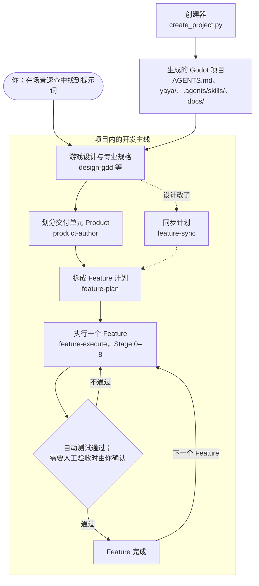

# 框架入口

`framework/` 保存维护这套 Godot 起始框架所需的全部材料：Godot 项目手册、场景速查手册与提示词、关系图、框架维护文档、创建器和各类检查工具。这些材料不复制到生成项目；框架自用 Skill 在仓库根目录的 `.agents/skills/`，`.claude/skills/` 是给 Claude Code 的相同副本，维护约定以根 [AGENTS.md](../AGENTS.md) 为准。

## 框架做什么

这套框架用创建器生成一个 Godot 项目，项目里带好开发流程、Agent 规则、Skill 和检查工具。你用场景速查找到提示词交给 Agent，Agent 按下图的主线把想法一步步做成经过验收的功能。图中方框里是负责这一步的 Skill。

这张图只画主线。不知道下一步该做什么时，项目里的 `next-step-advisor` 会根据当前状态给出建议。各文档和职责之间的完整关系见[文档系统关系图](relationship-maps/README.md#文档系统关系图)。

## 按需要找入口

| 需要什么 | 入口 |
| --- | --- |
| 理解生成的 Godot 项目：项目边界、游戏逻辑与表现、文档对象、配置、Skill 和工具用法 | [Godot 项目手册](godot-project-manual/README.md) |
| 根据当前情况找到具体处理步骤和同名提示词 | [场景速查索引](prompt-scenarios/scenarios/scenario-index.md) |
| 查看框架与游戏项目的文档职责、导航、来源和证据关系 | [文档系统关系图](relationship-maps/README.md#文档系统关系图) |
| 查看游戏项目开发场景之间的衔接关系 | [游戏项目开发场景图](relationship-maps/README.md#游戏项目开发场景图) |
| 修改框架或分发源，判断要同步哪些说明、选择哪种验证 | [框架维护](maintenance/README.md) |
| 新增或调整文档、Skill、脚本、提示词与场景的职责 | [职责设计准则](maintenance/design-guidelines/README.md) |
| 编写或修改单一场景 | [场景速查手册的编写与维护](prompt-scenarios/scenarios/README.md) |
| 编写或整理框架说明 | [Yaya 框架文档编写与整理](../.agents/skills/technical-documentation-writing-yaya/SKILL.md) |
| 修改提示词、场景或关系图 | [Yaya 提示词与关系图维护](../.agents/skills/prompt-and-graph-maintenance-yaya/SKILL.md) |
| 把外部材料中的设计经验（界面、动效、音效等）引入分发 Skill 的设计参考文件 | [设计经验引入](../.agents/skills/design-knowledge-intake-yaya/SKILL.md) |
| 一次框架修改或 demo 试验后复盘，判断哪些地方值得改、改在哪里 | [Yaya 框架复盘](../.agents/skills/framework-retro-yaya/SKILL.md) |
| 用一个真实游戏试用框架，在框架仓库观察、记录并修框架问题 | [Yaya 真实游戏试用](../.agents/skills/framework-trial-yaya/SKILL.md) |
| 测试时让 Agent 在每条回复里写出依据了哪些原则、Skill、脚本和文件 | [决策依据（框架维护）](../.agents/skills/decision-trace-yaya/SKILL.md)；Codex 用 `$decision-trace-yaya` 开启，Claude Code 用 `/decision-trace-yaya` 开启 |
| 创建空白项目、运行检查或回归 | 下文[维护命令](#维护命令) |
| 确认框架专用术语的含义和统一写法 | [框架术语](terminology.md) |

## 目录与职责

本表是 `framework/` 的唯一目录说明；子目录 README 只说明自身内容，不再重画上层目录。顶层按材料讲述的对象划分：生成的 Godot 项目、提示词与场景、关系图、框架维护、项目创建和测试。

| 路径 | 职责 |
| --- | --- |
| [AGENTS.md](AGENTS.md) | 只对 `framework/` 重要的规则：框架待办与 Lessons 的维护方式、提示词维护；Claude Code 读取 `framework/` 下的文件时自动加载，在 `framework/` 启动的 Codex 自动读取，其他情况按根 `AGENTS.md` 的路由表读取 |
| [todo.md](todo.md) | 仍需推进的工作、验证缺口和必要决定；完成即删，历史查 Git |
| [lessons.md](lessons.md) | 框架维护中 Agent 自己的流程失误及出现次数，够了就提出升级 |
| [terminology.md](terminology.md) | 框架与生成项目共用的术语写法 |
| [qa/](qa/README.md) | Q&A：用户在讨论中问过、以后还会用到的问题，按主题分文件；框架做法只写结论并链接正文，通用专业知识在这里写完整 |
| [godot-project-manual/](godot-project-manual/README.md) | Godot 项目手册：生成项目的概念、文档对象、配置、Skill 与工具用法，按专题分四个子目录；`tutorial/` 是以三消示例串起主线的三篇教程 |
| `prompt-scenarios/` | `prompts/` 两份预设提示词库；[scenarios/](prompt-scenarios/scenarios/README.md) 每条提示词对应的同名场景页、场景索引与编写要求；`tools/` 提示词、场景与场景图的检查和链接脚本 |
| [relationship-maps/](relationship-maps/README.md) | 文档系统关系图、开发场景图、读图与维护说明、Graph_Map 文件格式；`tools/` 文档图覆盖检查和连线穿过节点检查脚本 |
| [maintenance/](maintenance/README.md) | 框架维护文档：维护与同步；`design-guidelines/` 职责设计准则；`validation/` 验证范围与测试改动场景表；`dependencies/` 第三方插件与问答渲染脚本的来源和本地改动，以及设计参考条目的来源；`tools/` 仓库链接检查与孤立文档扫描，README 另说明术语检查、措辞检查和钩子 |
| `project-creation/` | 唯一复制清单 `project-files.json`；[tools/](project-creation/tools/README.md) 创建器 |
| [tests/](tests/README.md) | `repository/` 从仓库根目录运行的维护回归；`external-project/` 需要指定外部项目的工具回归、调试台分析、插件与文档语言夹具，各子目录 README 说明放置与运行 |

两本手册独立阅读、不互相引用：Godot 项目手册讲“项目里的东西是什么、怎么用”，场景速查手册讲“现在遇到这种情况该怎么处理”。场景速查手册与提示词同放在 `prompt-scenarios/`，便于按名称一一对应；关系图同时服务两者，单独放在 `relationship-maps/`。

## 两本手册的分工

两本手册都直接维护 Markdown。

- **Godot 项目手册**：按对象与契约组织，分四个专题目录。
  - `foundations/`：项目边界、游戏逻辑与表现、目录与配置。
  - `requirements-and-tasks/`：需求与规划、阶段语义。
  - `methods-and-tools/`：Skill/Agent、命令与证据、错误含义。
  - `specialist-work-and-records/`：专业来源、知识记录。
- **场景速查手册**：按“要处理什么事情”分组，覆盖 Godot 项目开发与 Yaya 框架维护两个 Project。
  - 场景名称：写清当前状态，方便从目录选择。
  - 单篇范围：一个目标，对应一条同名专用提示词；目录与文件名直接使用提示词库中的 Project、分类和提示词名称。
  - 信息栏目：保留 11 类分类规则，只展示有内容的栏目。编写要求见[场景速查手册的编写与维护](prompt-scenarios/scenarios/README.md)。

## 使用范围

只面向 Godot、只做 Windows PC、单人项目等每次都要遵守的约束，正文在根 `AGENTS.md` 的[基本约束](../AGENTS.md#基本约束)；本节只补充素材和发布的覆盖范围。

- **素材工作**：覆盖准备要求、接收和检查；视觉美术、音乐与音效制作保持待扩展边界。
- **不覆盖**：打包与发布还没有规范，待办见[框架待办](todo.md)中的「打包与发布没有规范」。

## 阅读约定

- **路径基准**：Godot 项目手册中的 `docs/`、`yaya/tools/` 等路径相对生成后的游戏项目根目录；维护文档中的 `framework/` 等路径相对本仓库。
- **示例**：示例 ID、路径和输出需换成实际对象，不代表已经完成的验证或批准。
- **权威来源**：行为以项目规则、methodology、Skill 和实际工具为准，手册只解释它们，不另建流程。

## 维护命令

脚本放在所属对象目录下的 `tools/`，用法写在同目录 README。命令都在仓库根目录、使用已确认的 Python 3.12+ 运行；`-B` 禁止生成字节码缓存，参数细节以各命令的 `--help` 为准。

| 命令 | 用途 | 用法 |
| --- | --- | --- |
| 创建器 `project-creation/tools/create_project.py` | 按复制清单创建空白项目，启用提交钩子，建立独立 Git 仓库和初始提交 | [项目创建工具](project-creation/tools/README.md) |
| 提示词与场景路径检查 `prompt-scenarios/tools/check_scenario_prompt_paths.py` | 只读核对两份提示词库与场景文件路径是否一一对应 | [提示词与场景路径检查](prompt-scenarios/tools/README.md#提示词与场景路径检查) |
| 场景图名称检查 `prompt-scenarios/tools/check_workflow_graph_names.py` | 只读核对开发场景图节点名与 Godot 提示词名称 | [检查场景图名称与链接](prompt-scenarios/tools/README.md#检查场景图名称与链接) |
| 场景图链接写入 `prompt-scenarios/tools/link_workflow_graph_scenarios.py` | 为开发场景图节点写入或更新同名场景链接；`--check` 只读 | [检查场景图名称与链接](prompt-scenarios/tools/README.md#检查场景图名称与链接) |
| 文档图覆盖检查 `relationship-maps/tools/check_document_graph_coverage.py` | 按文档系统图登记的路径检查文档覆盖 | [关系图工具](relationship-maps/tools/README.md) |
| 连线穿过节点检查 `relationship-maps/tools/check_graph_edge_crossings.py` | 只读找出两张关系图中从别的节点上穿过的连线 | [检查连线穿过节点](relationship-maps/tools/README.md#检查连线穿过节点) |
| 仓库链接检查 `maintenance/tools/check_repository_links.py` | 检查维护侧与生成项目中的 Markdown 链接和锚点，以及提示词正文中的路径与标题引用 | [检查链接与锚点](maintenance/tools/README.md#检查链接与锚点) |
| 术语检查 `project-source/tools/checks/check-terminology.py --terms framework/terminology.md` | 按框架术语找出全仓 Markdown 与两份提示词库中登记为“不用的说法”的写法（完整命令见维护工具）；`--discover` 另列候选写法 | [检查术语用词](maintenance/tools/README.md#检查术语用词) |
| 措辞检查 `project-source/tools/checks/check-wording.py` | 按同目录 `wording-check.json` 的检查项找出规则文件中不用的写法和全部文档中待复核的写法 | [检查措辞](maintenance/tools/README.md#检查措辞) |
| 提交钩子 `.githooks/pre-commit` | 提交时对暂存的文档运行术语检查、措辞检查（只查硬性）、仓库链接检查和链接文字检查；新 clone 后用 `git config core.hooksPath .githooks` 启用 | [提交钩子](maintenance/tools/README.md#提交钩子) |
| 提交说明钩子 `.githooks/commit-msg` | 提交时用框架术语检查提交说明，有不用的说法就拒绝提交；和提交钩子一起启用 | [提交说明钩子](maintenance/tools/README.md#提交说明钩子) |
| 用词提示钩子 `.claude/settings.json` | 用户每次向 Claude Code 发消息时，按框架术语检查消息正文，有不用的说法时提示 Agent 列出用词对照表；不拦截消息 | [用词提示钩子](maintenance/tools/README.md#用词提示钩子) |
| 孤立文档扫描 `maintenance/tools/find_orphan_docs.py` | 扫描全仓文档的文本引用，列出孤立候选 | [维护工具](maintenance/tools/README.md) |
| 回归测试 `tests/` 下的回归入口 | 仓库回归与指定外部项目的工具回归 | [测试与夹具](tests/README.md) |

维护脚本只处理可重复的文件与数据操作，任务范围与结果意义由 Agent 判断；不增加逐动作监督、重复状态、发布资格或自动同步。总体取舍依据根 `AGENTS.md` 的[核心决策原则](../AGENTS.md#核心决策原则)。
