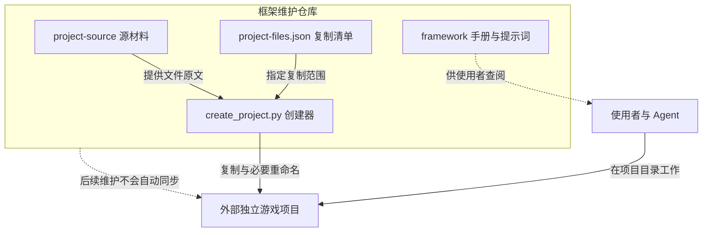
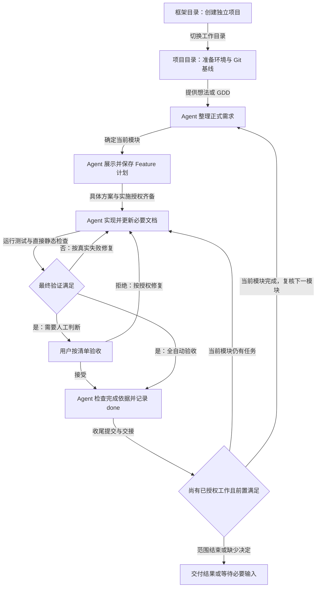

# 空白 Godot 项目使用手册

这份手册帮助你从外部空目录、游戏想法或已有 GDD 开始，使用 Coding Agent 整理需求、规划当前模块、开发并验收功能，最后留下可继续维护的独立项目。

## 先理解三个对象

| 对象 | 所在位置 | 用途 |
| --- | --- | --- |
| 框架维护仓库 | 当前 `Game_idle_yaya_frame/` | 保存创建器、复制清单、集中提示词、本手册与可复制材料 |
| 空白项目源材料 | 框架中的 `project-source/` | 提供新项目的默认文件；不在这里开发或运行具体游戏 |
| 生成后的游戏项目 | 用户指定的外部目录 | 独立拥有需求、代码、工具配置、测试和 Git 历史 |

实线表示创建或操作关系，虚线表示说明与边界。生成项目使用自己的 README、规则和工具，不查询框架；手册与完整提示词库留在框架，仅 advisor 的精选表达参考随 Skill 复制，具体用法见后文导航中的“Skill 与提示词导航”。

## 使用约定与内容依据

除创建和框架维护章节明确说明外，`docs/`、`tools/`、`.agents/skills/` 等路径都相对**生成项目根目录**。创建器在框架根目录调用；复制成功后切换到目标项目。文中的源文件链接指向框架材料，供核对依据，不能替代读取已独立维护的项目副本。

你负责提供目标与输入、决定尚未明确的需求和重要取舍，并完成适用的实际人工验收。Agent 读取项目文件、遵循 Skill、调用脚本、实施和核对结果；Skill 是 Agent 的工作方法，不是后台服务。脚本只执行各自明确的读写和检查，Godot 才负责引擎运行。

示例路径、Feature ID 和报告目录仅用于解释，均须换成真实对象；不表示仓库已有示例任务或已经运行通过。Windows 命令使用 PowerShell 7。

## 这套起点提供什么

复制结果包含 `main/`、`game/`、`components/`、`assets/`、`addons/`、`tests/` 的共同骨架、最小启动场景 `main/main.tscn`、Agent 规则和 Skill、需求与任务模板、检查工具及明确标记的资源工作台示例。Product、美术、声音、术语、本地化和架构文档预置简短用途与待定说明，未采纳想法及各文档目录也有可见入口。任务索引为空，环境状态为 `incomplete`，尚无正式玩法或业务测试；入口与示例的存在不代表已经运行或验收通过。

当前约定技术栈为 Windows 11、PowerShell 7、Godot 4.7、GDScript、gdunit4，维护命令使用 Python 3.12+。这些是项目要求，不证明本机工具已安装。创建、环境就绪、游戏可运行和实际验证通过分别判断。

## 第一次使用路线

1. **[创建空白项目](getting-started/create-project.md)**：指定外部空目录，检查后复制材料，得到独立项目；已有生成项目时跳过。
2. **[首次使用与环境准备](getting-started/first-use.md)**：进入目标项目，核实工具、填写配置、检查并保存初始化报告，按授权处理 Git 基线。
3. **[需求与规划](guides/product-and-planning.md)**：将想法或 GDD 写成正式需求，展示当前模块的拆分方案，再保存适用计划。
4. **[Feature 开发与交付](guides/feature-delivery.md)**：方案与验证范围确定后实现、检查、取得适用人工结果，完成记录与本地提交，再交接或继续已授权工作。

这是使用主线，具体方案、依赖和可选阶段由各指南展开。新界面或明显布局、资源变化要先解决视觉原型前置，见需求指南；实现授权不会代替人工接受。只讨论想法时可以提前进入需求页，不要求先运行引擎。

## 先认识需求与任务

以“点击按钮收集资源”为例：GDD 是输入，Product 总览说明游戏循环，模块需求确定“初始为 0、每次增加 1”等已确认规则，Feature 安排一次可验证交付。AC 是这项任务的可观察验收条件；计划和状态不能代替真实运行结果。

“逐个 Product 推进”指逐模块交付：可以保留全局设计，但只拆当前模块，完成其必要 Feature 后再复核下一模块。示例的文件和结果关系在需求与交付两页连续展开。

## 遇到具体问题时查检查单

已了解项目基本结构、但不确定眼前问题如何处理时，从 [场景检查单索引](guides/scenario-procedures.md) 选择入口。每个场景给出适用条件、分支、输入、操作、输出和完成判据；不用逐篇执行。

| 当前问题 | 分组指南 |
| --- | --- |
| 收到新功能、要求变化、临时插入 Product、设计过重或共享修改 | [需求与设计处置](guides/scenarios-requirements-design.md) |
| 设计界面与视觉原型、准备声音/音效/音乐、接入或替换真实素材 | [界面、音频与资源处置](guides/scenarios-interface-audio-assets.md) |
| 发现 Bug、测试或证据导入失败、准备交付或人工验收被拒绝 | [验证与恢复处置](guides/scenarios-verification-recovery.md) |
| Feature 中途插入工作、切换任务、恢复上下文或文档与实际不一致 | [上下文与交接处置](guides/scenarios-context-handoff.md) |

检查单编排已有流程；各场景标明可用的集中提示词，规则仍以项目自身规范为准。创建、迁移与独立审核等专题入口继续由索引引导，专业说明作为检查单的细节依据。

## 从哪里开始读

以下是按任务进入的分支与参考，不是首次使用必须通读的后续步骤。HTML 的上一章/下一章表示全书顺序，各页“本任务下一步”表示操作去向。

| 当前目的 | 入口 |
| --- | --- |
| 把旧项目复制到独立目标并采用当前框架 | [复制迁移已有项目](getting-started/migrate-existing-project.md) |
| 修 Bug、重构、工程维护、实验或在原项目替换框架 | [工程变更与实验](guides/engineering-changes.md) |
| 设计美术/声音、指定资源、本地化、观测测量或专业审核 | [专业设计、资源与独立审核](guides/specialist-workflows.md) |
| 单项查看/试听、组合预览、A/B 试调与保存 | [美术与音频资源工作台](guides/asset-workbench.md) |
| 维护术语、设计、架构、规则、知识，或从中断续接 | [项目文档维护与交接](guides/project-knowledge.md) |
| 查外部资料、比较方案或保存调研结论 | [按需搜索与保存调研](guides/project-knowledge.md#按需搜索与保存调研) |
| 查文件职责、复制来源、出现时机与模板区别 | [项目目录与文件职责](reference/project-layout.md) |
| 找提示词正文及对应 Skill | [Skill 与提示词导航](reference/skills.md) |
| 查配置字段、默认值和机器现值 | [配置参考](reference/configuration.md) |
| 查命令、测试选择、结果导入与内容绑定 | [命令与验证](reference/commands-and-validation.md) |
| 根据实际失败找恢复位置 | [故障排查](reference/troubleshooting.md) |
| 维护框架、处理审核或开发反馈、构建阅读版 | [维护与同步说明](maintenance/updating-the-blank-project.md) |
| 验证空白材料能否复制、初始化并在真实项目继续开发 | [框架的复制与运行验证](maintenance/validating-framework.md) |

## 本手册的事实来源

本手册解释现有行为，不另建流程规范。详细定义分别由以下来源负责：

| 需要确认的事实 | 直接来源 |
| --- | --- |
| 哪些文件进入新项目 | [复制清单](../../project-files.json) 与 [创建器](../../commands/create_project.py) |
| 项目任务如何路由 | [项目规则源文件](../../../project-source/Project_AGENTS.md) 与 [方法总览](../../../project-source/methodology/00-overview.md) |
| Stage、Feature 字段、测试和历史语义 | [methodology](../../../project-source/methodology/00-overview.md) 及其专题 |
| 某项 Skill 如何工作 | [Skill 导航](reference/skills.md) 中链接的实际 `SKILL.md` |
| 命令实际接受什么参数 | [项目工具](../../../project-source/tools/README.md) 及相应脚本 |
| 用户操作提示词正文 | [framework/prompts.json](../../prompts.json) |
| 本仓库如何维护 | [根 AGENTS.md](../../../AGENTS.md) 与 [维护工具说明](../../README.md) |

发现手册、源规范或实现不一致时，先核对差异和当前用户授权，再修正对应来源及说明。不要用手册中的概括静默覆盖更具体的真实契约，也不要把这里扩展成另一套可执行 Skill 或自动审核系统。

## HTML 阅读操作

**[打开 HTML 阅读版](blank-project-handbook.html)**。它包含全部手册正文和图表，可离线使用；独立阅读包不包含完整提示词、项目工具和源规范，带 ↗ 的链接需要完整框架或生成项目中的材料。

| 要做什么 | 操作 |
| --- | --- |
| 按当前情况开始 | 封面下“第一次使用”复用本页路线，“我遇到了具体问题”按场景分组列出检查单；点击直接进入相应步骤。 |
| 查找内容 | 按 `/` 聚焦搜索，输入界面、音效、Bug、中断等日常用语；同时匹配标题及小节正文、表格文字，正文命中定位到最近的 H2/H3。Enter 优先进入匹配的场景检查单，Ctrl + F 仍可查找包含代码的全文。 |
| 浏览目录 | “场景检查单”与开发指南分组显示；章节标题跳转，右侧按钮展开小节。清空搜索会恢复搜索前的折叠状态。 |
| 连续阅读 | 顶栏显示当前位置与进度，每章末尾可翻章；目录跟随正文，手动操作目录时暂停自动跟随。 |
| 调整阅读空间 | “目录”按钮收起侧栏；窄窗口使用覆盖式抽屉，跳转、点击遮罩或按 Esc 可关闭。 |
| 调整字号 | 右上角齿轮按钮打开“阅读设置”，提供紧凑、舒适、大字三组预设；展开分组可独立调整正文、标题、目录、辅助文字、表格与代码。 |
| 查看代码与图表 | 代码可复制或切换视觉换行；“展开图表”后可适应窗口、100% 显示、缩放、重置和拖拽平移。 |
| 保存位置 | 标题旁 `#` 复制小节链接；下次打开可点击“继续上次阅读”恢复到所记锚点。 |

字号默认采用“舒适阅读”，正文 18px。选择预设会替换所有分区数值，单项调整后可形成自定义搭配；滑块即时预览，数字框按 Enter 或离开输入框生效，“恢复默认”回到舒适阅读。字号变化尽量保持当前阅读锚点，图表内部文字通过整图缩放查看。

图表支持 Ctrl + 滚轮缩放；聚焦画布后可用方向键平移、`+`/`−` 缩放、Home 适应窗口。设置和图表弹窗均可点击遮罩或按 Esc 关闭。顶栏向下滚动时收起、向上滚动时出现，顶部、头部焦点或弹窗期间保留显示。

偏好与阅读位置只保存在当前浏览器，不写回 Markdown；存储不可用时界面会提示仅本次有效。目录过滤、视觉换行不会删改正文或复制内容。本地小节链接要求接收方能访问同一路径；单独分享 HTML 不会附带 ↗ 指向的文件。

HTML 是生成时的完整快照，打开时不会读取 MD 更新。正文只维护 Markdown，修改后按 [生成说明](maintenance/updating-the-blank-project.md#生成离线阅读版) 重新构建。
