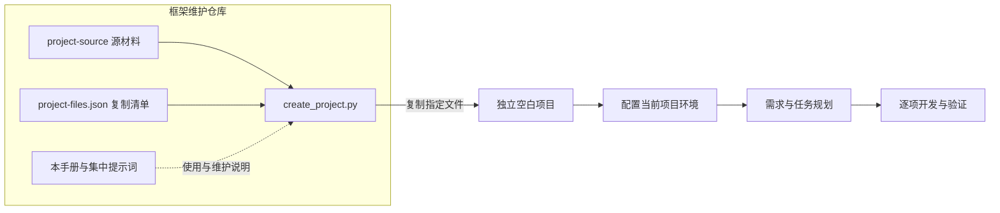

# 空白 Godot 项目使用手册

这份手册说明 Yaya 空白项目包含什么、如何开始开发、怎样组织需求与代码、如何验证和交接，以及框架维护者应在哪里修改源材料。面向使用这套起始文件的用户和维护框架的 Coding Agent。

手册保存在 `framework/docs/blank-project/`，仅属于框架维护目录，**不进入新项目**。新项目仍使用简明的 [Project_README.md](../../../project-source/Project_README.md) 作为入口，并携带自身的规则、Skill、方法说明和工具。生成后的项目可以独立开发，不需要访问本手册或框架目录。

## 先理解三个对象

| 对象 | 保存在哪里 | 负责什么 |
| --- | --- | --- |
| 框架维护仓库 | 当前 `Game_idle_yaya_frame/` | 保存可复制源材料、复制清单、集中提示词、维护工具和本手册 |
| 空白项目源材料 | `project-source/` | 保存新项目将获得的默认文件；这里不是用来开发或运行具体游戏的目录 |
| 生成后的游戏项目 | 用户指定的外部目录 | 拥有复制后的全部文件，独立维护需求、代码、环境、测试和 Git 历史 |



箭头表示创建和使用关系；框架后续修改不会自动传入已创建的项目。

## 从哪里开始读

| 当前目的 | 阅读顺序 |
| --- | --- |
| 第一次创建项目 | [创建项目](getting-started/create-project.md) → [首次使用](getting-started/first-use.md) → [需求与规划](guides/product-and-planning.md) |
| 想知道复制后有什么 | [项目目录与文件职责](reference/project-layout.md) → [配置参考](reference/configuration.md) |
| 准备实现一个任务 | [Skill 导航](reference/skills.md) → [Feature 开发流程](guides/feature-delivery.md) → [命令与验证](reference/commands-and-validation.md) |
| 修 Bug、重构或做技术调查 | [工程变更与实验](guides/engineering-changes.md) |
| 中断后继续、补架构说明或整理历史 | [项目知识与交接](guides/project-knowledge.md) |
| 命令失败或不知道为什么不能完成 | [故障排查](reference/troubleshooting.md) |
| 修改空白项目源材料 | 本页 → [维护与同步说明](maintenance/updating-the-blank-project.md) → 受影响专题与实际源文件 |

## 手册的文件架构

```text
framework/docs/blank-project/
├── README.md                            总入口、阅读路线和术语
├── getting-started/
│   ├── create-project.md                创建命令、复制边界与失败处理
│   └── first-use.md                     环境、项目名称、Git 初始状态
├── guides/
│   ├── product-and-planning.md          从想法到 Product 与 Feature
│   ├── feature-delivery.md              单项任务执行、验收与完成
│   ├── engineering-changes.md           Bug、重构、维护与实验
│   └── project-knowledge.md             规则、架构、资产、进度与历史
├── reference/
│   ├── project-layout.md                默认目录、复制映射与按需文件
│   ├── skills.md                        12 项 Skill 和提示词入口
│   ├── configuration.md                 配置字段、Godot 与 lint 默认值
│   ├── commands-and-validation.md       命令参数、测试选择和结果解释
│   └── troubleshooting.md               按现象排查问题
└── maintenance/
    └── updating-the-blank-project.md     源材料修改、文档同步与验证范围
```

## 这套起点提供什么

- **可独立使用的项目材料**：Godot 项目文件、两个插件、编辑器和 Git 文本约定。
- **需求到开发的工作方法**：轻量讨论与澄清、产品梳理、Feature 拆分与增量同步、Bug/重构/维护分类，以及单项任务的执行流程。
- **可持续读取的项目知识**：Product、Feature、测试 Catalog、当前进度、历史，按主题组织的实践经验索引，以及按需维护的 CONTEXT 术语与架构记录。
- **显式检查工具**：环境配置检查、任务台账检查、gdUnit 测试运行与完成依据记录。
- **按修改领域读取的 Godot 工程规则**：脚本、场景、资源、Shader、项目配置、导出、数据、资产和测试。

初始内容没有预制玩法、角色、存档系统、主场景或业务测试；`docs/knowledge/` 初始只有分类说明和索引，实际经验随任务积累，使用方式见[项目知识](guides/project-knowledge.md#优先查阅与积累项目知识)。`New Godot Project` 是显示名称默认值；引擎路径是待核实配置。创建成功、环境就绪、测试通过、人工接受和任务完成分别描述不同事实。

当前源材料面向 Windows 11 / PowerShell 7 / Godot 4.7 / GDScript / gdunit4，维护命令使用已确认的 Python 3.12+。这些是本仓库的目标和配置约定，不表示每台机器都已经安装工具，也不构成对其他平台或版本的验证声明。

## 常用术语

| 名称 | 在本项目中的含义 |
| --- | --- |
| Product | 玩家能观察到的目标、规则和行为，回答“做什么” |
| CONTEXT | 当前项目共用的简短术语定义与概念关系；需要时保存在 `docs/CONTEXT.md` |
| Feature | 一项可独立理解和验证的完整工作；也可承载 Bug、重构或维护 |
| AC | Acceptance Criterion，验收条件；在 Feature 内使用稳定的 `AC01` 等 ID |
| Component | 测试影响分析使用的语义组件，如 `inventory`；不等同于某个文件夹 |
| Test Catalog | 组件、测试逻辑 ID、文件与用例之间的索引 |
| Required Test Set | 根据当前 Feature、组件、历史回归、不变量和已批准补充范围计算的必需测试集合 |
| baseline / final | 修改前已有安全网验证 / 用于本次最终验证的运行阶段 |
| manual / automated | 按需求选择的人工验收 / 全自动验收方式 |
| Gate evidence | 真实测试报告引用、适用的人工决定和复审记录；不等同于所有检查结果 |
| Progress | 当前状态、阻塞、待决定事项、下一步及历史索引 |
| ADR | 一项重要技术选择的原因和取舍记录；按需建立 |
| Bootstrap | 在现有文档中指首次环境准备；当前没有独立 Bootstrap 程序 |

## 使用约定与内容依据

除创建和框架维护章节明确说明外，手册中的 `docs/`、`tools/`、`.agents/skills/` 等路径都相对**生成后的项目根目录**。可点击的源文件链接则指向当前框架，方便维护者核对。示例路径、Feature ID 和业务场景只用于解释，不是预先存在的任务或本次运行结果。

本手册解释现有行为，不另建流程规范。详细定义分别由以下来源负责：

| 需要确认的事实 | 直接来源 |
| --- | --- |
| 哪些文件进入新项目 | [复制清单](../../project-files.json) 与 [创建器](../../commands/create_project.py) |
| 项目任务如何路由 | [项目规则源文件](../../../project-source/Project_AGENTS.md) 与 [方法总览](../../../project-source/methodology/00-overview.md) |
| Stage、Feature 字段、测试和历史语义 | [methodology](../../../project-source/methodology/00-overview.md) 及其专题 |
| 某项 Skill 如何工作 | [Skill 导航](reference/skills.md) 中链接的实际 `SKILL.md` |
| 命令实际接受什么参数 | [项目工具](../../../project-source/tools/README.md) 及相应脚本 |
| 用户操作提示词正文 | [framework/prompts.json](../../prompts.json) |
| 本仓库如何维护 | [根 AGENTS.md](../../../AGENTS.md) 与 [维护工具说明](../../README.md) |

发现手册、源规范或实现不一致时，先核对差异和当前用户授权，再修正对应来源及说明。不要用手册中的概括静默覆盖更具体的真实契约，也不要把这里扩展成另一套可执行 Skill 或自动审核系统。
