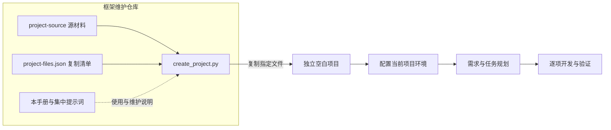

# 空白 Godot 项目使用手册

本手册说明空白 Godot 项目的创建、需求整理、任务规划、开发验收与维护。先按当前材料选择入口，再查对应专题；命令、字段和文件职责集中在参考页。

**[打开 HTML 使用手册](blank-project-handbook.html)**：单文件离线阅读，支持目录检索、章节跳转、图表缩放和分区字号设置。HTML 是 Markdown 的生成快照，打开时不读取 MD；正文只改 Markdown，再按 [生成说明](maintenance/updating-the-blank-project.md#生成离线阅读版) 更新 HTML。

手册与集中提示词留在框架，**不进入新项目**。生成项目以自身 `README.md` 为入口，携带独立的规则、Skill、规范和工具，不依赖框架目录。

## 先理解三个对象

| 对象 | 保存在哪里 | 负责什么 |
| --- | --- | --- |
| 框架维护仓库 | 当前 `Game_idle_yaya_frame/` | 保存可复制源材料、复制清单、集中提示词、维护工具和本手册 |
| 空白项目源材料 | `project-source/` | 保存新项目将获得的默认文件；这里不是用来开发或运行具体游戏的目录 |
| 生成后的游戏项目 | 用户指定的外部目录 | 拥有复制后的全部文件，独立维护需求、代码、环境、测试和 Git 历史 |



箭头表示创建和使用关系；框架后续修改不会自动传入已创建的项目。

## 从哪里开始读

| 当前目的 | 阅读顺序 |
| --- | --- |
| 第一次创建项目 | [创建项目](getting-started/create-project.md) → [首次使用](getting-started/first-use.md) → [需求与规划](guides/product-and-planning.md) |
| 已有空文件夹和外部 GDD | [判断目录状态](getting-started/create-project.md#准备目标位置) → [接入已有 GDD](guides/product-and-planning.md#接入已有-gdd)；已由框架生成的项目跳过复制 |
| 将旧框架项目复制到新框架继续开发 | [复制迁移已有项目](getting-started/migrate-existing-project.md) → 核对成果与方案 → 目标内迁移和验证 |
| 想知道复制后有什么 | [项目目录与文件职责](reference/project-layout.md) → [配置参考](reference/configuration.md) |
| 准备实现一个任务 | [Skill 导航](reference/skills.md) → [Feature 开发流程](guides/feature-delivery.md) → [命令与验证](reference/commands-and-validation.md) |
| 修 Bug、重构或做技术调查 | [工程变更与实验](guides/engineering-changes.md) |
| 中断后继续、补架构说明或整理历史 | [项目知识与交接](guides/project-knowledge.md) |
| 命令失败或不知道为什么不能完成 | [故障排查](reference/troubleshooting.md) |
| 修改空白项目源材料 | 本页 → [维护与同步说明](maintenance/updating-the-blank-project.md) → 受影响专题与实际源文件 |
| 把框架 ZIP 交给其他模型审核 | [压缩包审核说明](maintenance/updating-the-blank-project.md#把压缩包交给其他模型审核) → 提示词正文与附件 |
| 用实际小任务验证整个流程 | [动态流程审核说明](maintenance/updating-the-blank-project.md#用一个实际任务动态审核流程) → 指定新建外部项目并执行 |
| 收到外部报告，先讨论哪些意见值得采用 | [外部结果复核说明](maintenance/updating-the-blank-project.md#复核外部审核结果与讨论取舍) → 对照当前文件分析，再决定修改 |

## 手册的文件架构

```text
framework/docs/blank-project/
├── README.md                            总入口、阅读路线和术语
├── blank-project-handbook.html           由 Markdown 生成的桌面离线阅读版
├── getting-started/
│   ├── create-project.md                创建命令、复制边界与失败处理
│   ├── first-use.md                     环境、项目名称、Git 初始状态
│   └── migrate-existing-project.md      复制旧项目、保留成果与验证续接
├── guides/
│   ├── product-and-planning.md          想法或 GDD → Product → Feature
│   ├── feature-delivery.md              单项任务执行、验收与完成
│   ├── engineering-changes.md           Bug、重构、维护与实验
│   └── project-knowledge.md             规则、架构、资产、进度与历史
├── reference/
│   ├── project-layout.md                默认目录、复制映射与按需文件
│   ├── skills.md                        12 项 Skill 和提示词入口
│   ├── configuration.md                 配置字段、Godot 与 lint 默认值
│   ├── commands-and-validation.md       命令参数、测试选择和结果解释
│   └── troubleshooting.md               按现象排查问题
└── maintenance/
    └── updating-the-blank-project.md     源材料修改、文档同步与验证范围
```

## 这套起点提供什么

复制结果包含 Godot 项目与插件、规则与 Skill、文档模板和检查工具；不包含主场景、玩法实现或业务测试。Product、Feature 与测试索引从空内容开始，架构记录、术语和经验条目按实际需要建立。文件位置见 [目录参考](reference/project-layout.md)，初始值见 [配置参考](reference/configuration.md)。

当前目标环境为 Windows 11、PowerShell 7、Godot 4.7、GDScript、gdunit4，维护命令使用 Python 3.12+；目标项目仍须核实本机工具与路径。

## 从需求到交付的文件关系

| 层次 | 文件或材料 | 作用与下一步 |
| --- | --- | --- |
| 设计输入 | 想法、外部 GDD、已确认的讨论 | 提供需求来源；整理为项目 Product，不按原文件名直接视为现行规格 |
| 正式需求 | `docs/product.md`、`docs/product/NN-name.md` | 总览确定核心循环与模块关系，模块规格定义行为；每次只拆当前模块 |
| 开发计划 | `docs/feature-list.json`、`docs/features/F0XX.json` | 索引保存任务状态与依赖，详情保存范围、AC 和验证计划 |
| 验证与完成 | `docs/test-registry.json`、`reports/`、`docs/feature-completion-evidence.json` | 登记表定位测试，报告保存实际结果，完成依据引用结果与适用人工决定 |
| 续接与复用 | `docs/progress.md`、`docs/progress/`、`docs/knowledge/` | 分别保存当前交接、执行历史和可复用经验，不替代需求与任务详情 |

这些文件分别描述需求、计划、结果和当前进度。Product 写完不等于 Feature 已实现；测试通过也不替代适用的人工验收。完整文件职责见 [项目目录与文件职责](reference/project-layout.md)。

## 常用术语

| 名称 | 在本项目中的含义 |
| --- | --- |
| GDD | Game Design Document，游戏设计文档；在此作为整理正式 Product 的输入材料 |
| Product | 正式需求体系；“逐个 Product 推进”具体指按模块文档及其已确认范围规划和交付 |
| CONTEXT | 当前项目共用的简短术语定义与概念关系；需要时保存在 `docs/CONTEXT.md` |
| Feature | 一项可独立理解和验证的完整工作；也可承载 Bug、重构或维护 |
| AC | Acceptance Criterion，验收条件；在 Feature 内使用稳定的 `AC01` 等 ID |
| Component | 测试影响分析使用的语义组件，如 `inventory`；不等同于某个文件夹 |
| 测试登记表 | 组件、测试逻辑 ID、文件与用例之间的索引 |
| Required Test Set | 根据当前 Feature、组件、历史回归、不变量和已批准补充范围计算的必需测试集合 |
| baseline / final | 修改前已有安全网验证 / 用于本次最终验证的运行阶段 |
| manual / automated | 按需求选择的人工验收 / 全自动验收方式 |
| Gate evidence | 真实测试报告引用与适用的人工决定；不记录评审计数，也不等同于所有检查结果 |
| Progress | 当前状态、阻塞、待决定事项、下一步及历史索引 |
| ADR | 一项重要技术选择的原因和取舍记录；按需建立 |
| Bootstrap | 在现有文档中指首次环境准备；当前没有独立 Bootstrap 程序 |

## 使用约定与内容依据

除创建和框架维护章节明确说明外，手册中的 `docs/`、`tools/`、`.agents/skills/` 等路径都相对**生成后的项目根目录**。可点击的源文件链接则指向当前框架，方便维护者核对。示例路径、Feature ID 和业务场景只用于解释，不是预先存在的任务或本次运行结果。

本手册解释现有行为，不另建流程规范。详细定义分别由以下来源负责：

| 需要确认的事实 | 直接来源 |
| --- | --- |
| 哪些文件进入新项目 | [复制清单](../../project-files.json) 与 [创建器](../../commands/create_project.py) |
| 项目任务如何路由 | [项目规则源文件](../../../project-source/Project_AGENTS.md) 与 [方法总览](../../../project-source/methodology/00-overview.md) |
| Stage、Feature 字段、测试和历史语义 | [methodology](../../../project-source/methodology/00-overview.md) 及其专题 |
| 某项 Skill 如何工作 | [Skill 导航](reference/skills.md) 中链接的实际 `SKILL.md` |
| 命令实际接受什么参数 | [项目工具](../../../project-source/tools/README.md) 及相应脚本 |
| 用户操作提示词正文 | [framework/prompts.json](../../prompts.json) |
| 本仓库如何维护 | [根 AGENTS.md](../../../AGENTS.md) 与 [维护工具说明](../../README.md) |

发现手册、源规范或实现不一致时，先核对差异和当前用户授权，再修正对应来源及说明。不要用手册中的概括静默覆盖更具体的真实契约，也不要把这里扩展成另一套可执行 Skill 或自动审核系统。
