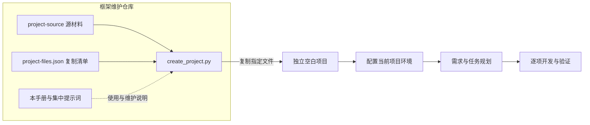

# 空白 Godot 项目使用手册

这份手册帮助你从空目录、游戏想法或已有 GDD 开始，使用 Coding Agent 整理需求、规划任务、实现并验收游戏功能。

**[打开 HTML 阅读版](blank-project-handbook.html)**，目录检索、字号与图表操作见 [HTML 阅读操作](#html-阅读操作)。阅读版包含全部手册正文与图表，可离线使用；独立阅读包不包含完整提示词、项目工具和源规范。实际操作需要完整框架或生成项目中的对应文件，带 ↗ 的链接用于定位这些材料。

## 这套起点提供什么

创建后，你会得到 Godot 项目文件与插件、Agent 规则和 Skill、需求与任务模板、检查工具。玩法代码、主场景和业务测试由后续任务建立；初始 Product 和任务索引为空。

当前目标环境为 Windows 11、PowerShell 7、Godot 4.7、GDScript、gdunit4，维护命令使用 Python 3.12+。创建器只复制文件，Agent 随后在目标项目核实工具并准备开发环境。

## 第一次使用路线

1. **[创建空白项目](getting-started/create-project.md)**：你指定外部空目录，Agent 按清单复制材料；已生成框架项目时跳过这一步。
2. **[准备首次使用](getting-started/first-use.md)**：你提供必要的项目选择，Agent 核实工具、记录配置与实际准备结果，并按授权处理初始 Git 基线。
3. **[整理需求与计划](guides/product-and-planning.md)**：你提供想法或 GDD，Agent 整理 Product 总览与模块需求，只澄清关键缺口，再拆分当前模块的 Feature。
4. **[开发与验收 Feature](guides/feature-delivery.md)**：你确认具体方案与适用的人工结果，Agent 完成实现、验证和提交；已有具体授权可以连续推进。

只想讨论设计时，可以从需求指南开始；已有完整材料无需重新口述。下一章表示全书阅读顺序，各页的“本任务下一步”表示当前工作应进入的操作。

## 先认识需求与任务

以“玩家点击按钮收集资源”为例：Product 总览说明这项玩法在整款游戏中的作用，模块需求明确数量和交互规则，Feature 则安排一项可实现、可验证的工作。

| 名称 | 用来判断什么 |
| --- | --- |
| GDD | 已有游戏设计输入中，哪些意图和规则需要纳入本项目？ |
| Product 总览 | 游戏的核心循环是什么，模块之间如何配合？ |
| 模块需求 | 当前模块应该表现出哪些行为，哪些内容暂不做？ |
| Feature | 本次要交付什么，依赖哪些任务？ |
| AC（验收条件） | 用哪些可观察结果判断这项任务达到预期？ |

文档中的“逐个 Product 推进”指按模块交付：可以先保留整款游戏的设计，再逐个拆分并完成模块任务。计划文件只描述待做工作，实际结果由测试报告和适用的人工验收记录证明。

## 从哪里开始读

| 当前目的 | 阅读顺序 |
| --- | --- |
| 已有空文件夹和外部 GDD | [判断目录状态](getting-started/create-project.md#准备目标位置) → [接入已有 GDD](guides/product-and-planning.md#接入已有-gdd)；已由框架生成的项目跳过复制 |
| 修 Bug、重构或做技术调查 | [工程变更与实验](guides/engineering-changes.md) |
| 中断后继续、补架构说明或整理历史 | [项目知识与交接](guides/project-knowledge.md) |
| 将旧框架项目复制到新框架继续开发 | [复制迁移已有项目](getting-started/migrate-existing-project.md) → 核对成果与方案 → 目标内迁移和验证 |
| 保留项目数据，在当前项目直接替换框架 | [原地替换项目框架](guides/engineering-changes.md#原地替换项目框架) → 必要差异审核 → 替换、最小适配与一次提交 |
| 想知道复制后有什么 | [项目目录与文件职责](reference/project-layout.md) → [配置参考](reference/configuration.md) |
| 准备实现一个任务 | [Skill 导航](reference/skills.md) → [Feature 开发流程](guides/feature-delivery.md) → [命令与验证](reference/commands-and-validation.md) |
| 命令失败或不知道为什么不能完成 | [故障排查](reference/troubleshooting.md) |
| 修改空白项目源材料 | 本页 → [维护与同步说明](maintenance/updating-the-blank-project.md) → 受影响专题与实际源文件 |
| 通过 GitHub 请其他模型审核框架 | [GitHub 审核说明](maintenance/updating-the-blank-project.md#通过-github-交给其他模型审核) → 读取仓库并固定被审提交 |
| 用实际小任务验证整个流程 | [动态流程审核说明](maintenance/updating-the-blank-project.md#用一个实际任务动态审核流程) → 指定新建外部项目并执行 |
| 收到外部报告，先讨论哪些意见值得采用 | [外部结果复核说明](maintenance/updating-the-blank-project.md#复核外部审核结果与讨论取舍) → 对照当前文件分析，再决定修改 |
| 从实际项目转发 Codex 输出，判断框架是否需要改进 | [开发反馈复盘说明](maintenance/updating-the-blank-project.md#从实际开发反馈复盘框架) → 核对证据与归属，再讨论最小修改 |

## 先理解三个对象

| 对象 | 保存在哪里 | 负责什么 |
| --- | --- | --- |
| 框架维护仓库 | 当前 `Game_idle_yaya_frame/` | 保存可复制源材料、复制清单、集中提示词、维护工具和本手册 |
| 空白项目源材料 | `project-source/` | 保存新项目将获得的默认文件；这里不是用来开发或运行具体游戏的目录 |
| 生成后的游戏项目 | 用户指定的外部目录 | 拥有复制后的全部文件，独立维护需求、代码、环境、测试和 Git 历史 |



箭头表示创建和使用关系；框架后续修改不会自动传入已创建的项目。手册与集中提示词留在框架，生成项目使用自身 README、规范与工具独立开发。

## 从需求到交付的文件关系

| 层次 | 文件或材料 | 作用与下一步 |
| --- | --- | --- |
| 设计输入 | 想法、外部 GDD、已确认的讨论 | 提供需求来源；整理为项目 Product，不按原文件名直接视为现行规格 |
| 正式需求 | `docs/product.md`、`docs/product/NN-name.md` | 总览确定核心循环与模块关系，模块规格定义行为；每次只拆当前模块 |
| 开发计划 | `docs/feature-list.json`、`docs/features/F0XX.json` | 索引保存任务状态与依赖，详情保存范围、AC 和验证计划 |
| 验证与完成 | `docs/test-registry.json`、`reports/`、`docs/feature-completion-evidence.json` | 登记表定位测试，报告保存实际结果，完成依据引用结果与适用人工决定 |
| 续接与复用 | `docs/progress.md`、`docs/progress/`、`docs/knowledge/` | 分别保存当前交接、执行历史和可复用经验，不替代需求与任务详情 |

这些文件分别描述需求、计划、结果和当前进度。Product 写完不等于 Feature 已实现；测试通过也不替代适用的人工验收。完整文件职责见 [项目目录与文件职责](reference/project-layout.md)。

## 常用术语

| 名称 | 在本项目中的含义 |
| --- | --- |
| GDD | Game Design Document，游戏设计文档；在此作为整理正式 Product 的输入材料 |
| Product | 正式需求体系；“逐个 Product 推进”具体指按模块文档及其已确认范围规划和交付 |
| CONTEXT | 当前项目共用的简短术语定义与概念关系；需要时保存在 `docs/CONTEXT.md` |
| Feature | 一项可独立理解和验证的完整工作；也可承载 Bug、重构或维护 |
| AC | Acceptance Criterion，验收条件；在 Feature 内使用稳定的 `AC01` 等 ID |
| Component | 测试影响分析使用的语义组件，如 `inventory`；不等同于某个文件夹 |
| 测试登记表 | 组件、测试逻辑 ID、文件与用例之间的索引 |
| Required Test Set | 根据当前 Feature、组件、历史回归、不变量和已批准补充范围计算的必需测试集合 |
| baseline / final | 修改前已有安全网验证 / 用于本次最终验证的运行阶段 |
| manual / automated | 按需求选择的人工验收 / 全自动验收方式 |
| Gate evidence | 当前 Feature 的真实测试报告引用与适用人工决定，用于完成检查 |
| Progress | 当前状态、阻塞、待决定事项、下一步及历史索引 |
| ADR | 一项重要技术选择的原因和取舍记录；按需建立 |
| Bootstrap | 在现有文档中指首次环境准备；当前没有独立 Bootstrap 程序 |

## HTML 阅读操作

| 要做什么 | 操作 |
| --- | --- |
| 查找内容 | 按 `/` 聚焦目录搜索，Enter 跳到匹配项；Ctrl + F 搜索正文。章节标题跳转，右侧按钮展开小节。 |
| 连续阅读 | 顶栏显示当前位置与进度，每章末尾可翻章；目录跟随正文，手动操作目录时暂停自动跟随。 |
| 调整阅读空间 | “目录”按钮收起侧栏；窄窗口使用覆盖式抽屉，跳转、点击遮罩或按 Esc 可关闭。 |
| 调整字号 | 右上角齿轮按钮打开“阅读设置”，提供紧凑、舒适、大字三组预设；展开分组可独立调整正文、标题、目录、辅助文字、表格与代码。 |
| 查看代码与图表 | 代码可复制或切换视觉换行；“展开图表”后可适应窗口、100% 显示、缩放、重置和拖拽平移。 |
| 保存位置 | 标题旁 `#` 复制小节链接；下次打开可点击“继续上次阅读”恢复到所记锚点。 |

字号默认采用“舒适阅读”，正文 18px。选择预设会替换所有分区数值，单项调整后可形成自定义搭配；滑块即时预览，数字框按 Enter 或离开输入框生效，“恢复默认”回到舒适阅读。字号变化尽量保持当前阅读锚点，图表内部文字通过整图缩放查看。

图表支持 Ctrl + 滚轮缩放；聚焦画布后可用方向键平移、`+`/`−` 缩放、Home 适应窗口。设置和图表弹窗均可点击遮罩或按 Esc 关闭。顶栏向下滚动时收起、向上滚动时出现，顶部、头部焦点或弹窗期间保留显示。

偏好与阅读位置只保存在当前浏览器，不写回 Markdown；存储不可用时界面会提示仅本次有效。目录过滤、视觉换行不会删改正文或复制内容。本地小节链接要求接收方能访问同一路径；单独分享 HTML 不会附带 ↗ 指向的文件。

HTML 是生成时的完整快照，打开时不会读取 MD 更新。正文只维护 Markdown，修改后按 [生成说明](maintenance/updating-the-blank-project.md#生成离线阅读版) 重新构建。

## 手册的文件架构

```text
framework/docs/blank-project/
├── README.md                            总入口、阅读路线和术语
├── blank-project-handbook.html           由 Markdown 生成的桌面离线阅读版
├── getting-started/
│   ├── create-project.md                创建命令、复制边界与失败处理
│   ├── first-use.md                     环境、项目名称、Git 初始状态
│   └── migrate-existing-project.md      复制旧项目、保留成果与验证续接
├── guides/
│   ├── product-and-planning.md          想法或 GDD → Product → Feature
│   ├── feature-delivery.md              单项任务执行、验收与完成
│   ├── engineering-changes.md           Bug、重构、维护与实验
│   └── project-knowledge.md             规则、架构、资产、进度与历史
├── reference/
│   ├── project-layout.md                默认目录、复制映射与按需文件
│   ├── skills.md                        12 项 Skill 和提示词入口
│   ├── configuration.md                 配置字段、Godot 与 lint 默认值
│   ├── commands-and-validation.md       命令参数、测试选择和结果解释
│   └── troubleshooting.md               按现象排查问题
└── maintenance/
    └── updating-the-blank-project.md     源材料修改、文档同步与验证范围
```

## 使用约定与内容依据

除创建和框架维护章节明确说明外，手册中的 `docs/`、`tools/`、`.agents/skills/` 等路径都相对**生成后的项目根目录**。可点击的源文件链接则指向当前框架，方便维护者核对。示例路径、Feature ID 和业务场景只用于解释，不是预先存在的任务或本次运行结果。

本手册解释现有行为，不另建流程规范。详细定义分别由以下来源负责：

| 需要确认的事实 | 直接来源 |
| --- | --- |
| 哪些文件进入新项目 | [复制清单](../../project-files.json) 与 [创建器](../../commands/create_project.py) |
| 项目任务如何路由 | [项目规则源文件](../../../project-source/Project_AGENTS.md) 与 [方法总览](../../../project-source/methodology/00-overview.md) |
| Stage、Feature 字段、测试和历史语义 | [methodology](../../../project-source/methodology/00-overview.md) 及其专题 |
| 某项 Skill 如何工作 | [Skill 导航](reference/skills.md) 中链接的实际 `SKILL.md` |
| 命令实际接受什么参数 | [项目工具](../../../project-source/tools/README.md) 及相应脚本 |
| 用户操作提示词正文 | [framework/prompts.json](../../prompts.json) |
| 本仓库如何维护 | [根 AGENTS.md](../../../AGENTS.md) 与 [维护工具说明](../../README.md) |

发现手册、源规范或实现不一致时，先核对差异和当前用户授权，再修正对应来源及说明。不要用手册中的概括静默覆盖更具体的真实契约，也不要把这里扩展成另一套可执行 Skill 或自动审核系统。
