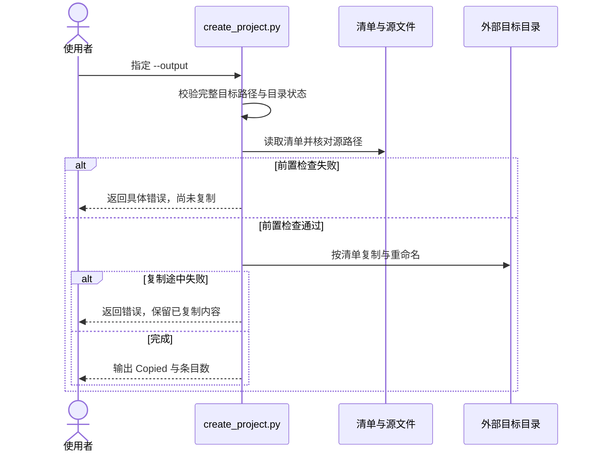

# 创建空白项目

[返回手册](../README.md) · 下一步：[首次使用](first-use.md)

创建项目的结果是一份独立的文件集合。复制成功后，环境准备和游戏开发在目标项目中分别进行。

## 准备目标位置

目标必须是维护仓库之外的新目录或空目录。检查的是**完整路径**，包括父目录和解析后的路径：

| 目标情况 | 结果 |
| --- | --- |
| `D:\Games\MyGodotGame` 不存在或为空 | 可以创建 |
| `D:\Games\My Game` 或 `D:\My Games\Game` | 因空白字符被拒绝 |
| `D:\游戏\MyGame` | 因中文路径被拒绝 |
| 当前维护仓库的子目录 | 被拒绝 |
| 包含维护仓库的祖先目录 | 被拒绝，不能把源仓库包含在输出中 |
| 已有文件的目录、已有普通文件 | 被拒绝，不覆盖已有项目 |

目录名和 Godot 显示名称是两个概念。项目路径遵循上述限制；后续修改 `project.godot` 的 `config/name` 不会重命名目录。示例统一使用简短 ASCII 路径。

## 执行复制

在**框架根目录**运行以下命令。本机使用个人规则指定的解释器；在其他机器上应先换成已确认的 Python 3.12+ 完整路径。

```powershell
Set-Location -LiteralPath 'D:\A_Games\Game_idle_yaya_frame'
& 'C:\Users\89523\anaconda3\envs\codex-python\python.exe' -B framework/commands/create_project.py --output 'D:\Games\MyGodotGame'
$LASTEXITCODE
```

`--output` 是唯一业务参数且必填。`-B` 属于 Python，用于避免本次进程写字节码缓存。上述路径是调用示例，不表示本手册已经为你创建了该项目。

创建器从自身位置找到维护仓库，再读取 [project-files.json](../../../project-files.json)。它先核对目标与全部清单源路径，再创建目录并复制；文件可以改名，目录会连同子目录内容一起复制。它没有模板替换步骤。



成功输出的数量是**清单条目数**，不是文件总数；一个目录条目可能包含很多文件。以退出码和实际输出判断复制是否完成。

## 复制完成后的初始状态

| 项目内容 | 初始状态 |
| --- | --- |
| 项目说明与规则 | `Project_README.md`、`Project_AGENTS.md` 分别成为根 `README.md`、`AGENTS.md` |
| 开发 Skill | `skills/` 成为 `.agents/skills/` |
| 环境配置 | `Project_Config.json` 成为 `docs/methodology-config.json`，状态仍为 `incomplete` |
| Product | `docs/product.md` 是空文件 |
| Feature 与测试登记表 | 空索引、空修订记录、空组件与测试集合 |
| Godot | 显示名称为 `New Godot Project`，未设置主场景 |
| Git | 创建器不执行 `git init`，没有由它建立的提交 |
| 实际验证 | 没有执行环境检查、Godot、lint 或测试 |

完整映射见 [项目目录与文件职责](../reference/project-layout.md)。复制器保留源文件原文，因此部分模板起始文字是英文；后续生成项目知识时由配置中的 `document_language` 决定人类可读内容的语言。

## 为什么本手册不会进入项目

清单只选择 `project-source/` 中的交付材料。本手册位于 `framework/docs/blank-project/`，与 `framework/prompts.json`、维护回归和复盘材料一样，不在复制范围内。

这个边界由目录位置和复制清单共同表达，不依赖“复制后删除文档”的步骤。增加章节时不修改复制清单；项目 README 继续负责简短导航，也不要求生成项目回查本仓库。

## 复制失败后如何处理

1. 先阅读 `Copy failed` 后的实际原因，区分目标不合法、缺少源文件、路径越界和读写权限问题。
2. 前置检查失败时修正输入或源材料，不把它解释为 Godot 环境失败。
3. 复制途中失败会保留现场。检查目标内容后，再由本次任务决定如何处理这份未完成输出；创建器没有回滚或覆盖重试模式。
4. 不直接对半成品再次执行复制：非空目标仍会被拒绝。不要为重试删除用户文件，也不要把新路径当作自动获得创建更多项目的授权。

修复框架源材料不会更新已存在的游戏项目。需要处理某个已有项目时，应在明确指定的项目中单独进行。

创建成功后，打开目标项目继续 [首次使用](first-use.md)。

## 对应源文件

- [create_project.py](../../../commands/create_project.py)：路径检查、复制顺序与错误返回。
- [project-files.json](../../../project-files.json)：实际文件选择与重命名。
- [复制器回归源码](../../../tests/test_generation.py)：已有边界用例；阅读源码不等于已运行回归。
