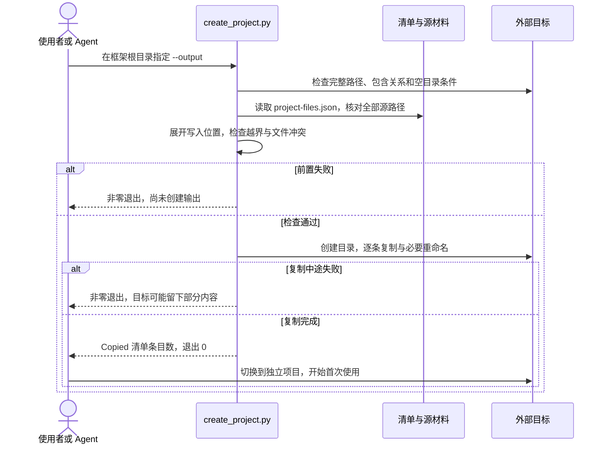

# 创建空白项目

[返回手册](../README.md) · 下一步：[首次使用](first-use.md)

创建器按复制清单把源材料复制到外部目录，得到独立项目文件。它不配置环境、不导入 GDD、不初始化 Git，也不运行游戏或测试；这些工作在目标项目中按后续任务进行。

## 创建时发生什么



清单指定文件来源与目标名称，源文件原文直接复制，没有模板渲染。失败处置见本页末尾；部分输出不能作为非空覆盖重试入口。

## 准备目标位置

目标必须是维护仓库之外的新目录或空目录。你已经手动创建的空文件夹可以直接作为目标；已生成框架文件的项目应跳过复制，进入 [首次使用](first-use.md)。已有 GDD 留在原位置，复制完成后再按 [GDD 接入说明](../guides/product-and-planning.md#接入已有-gdd) 整理需求。

检查的是**完整路径**，包括父目录和解析后的路径：

| 目标情况 | 结果 |
| --- | --- |
| `D:\Games\MyGodotGame` 不存在或为空 | 可以创建 |
| `D:\Games\My Game` 或 `D:\My Games\Game` | 因空白字符被拒绝 |
| `D:\游戏\MyGame` | 因中文路径被拒绝 |
| 当前维护仓库的子目录 | 被拒绝 |
| 包含维护仓库的祖先目录 | 被拒绝，不能把源仓库包含在输出中 |
| 已有文件的目录、已有普通文件 | 被拒绝，不覆盖已有项目 |

目录名和 Godot 显示名称是两个概念。项目路径遵循上述限制；后续修改 `project.godot` 的 `config/name` 不会重命名目录。示例统一使用简短 ASCII 路径。

## 执行复制

在**框架根目录**运行以下命令。本机使用个人规则指定的解释器；在其他机器上应先换成已确认的 Python 3.12+ 完整路径。

```powershell
Set-Location -LiteralPath 'D:\A_Games\Game_idle_yaya_frame'
& 'C:\Users\89523\anaconda3\envs\codex-python\python.exe' -B framework/commands/create_project.py --output 'D:\Games\MyGodotGame'
$LASTEXITCODE
```

`--output` 是唯一业务参数且必填。`-B` 属于 Python，用于避免本次进程写字节码缓存。上述路径是调用示例，不表示本手册已经为你创建了该项目。

创建器从自身位置找到维护仓库，再读取 [project-files.json](../../../project-files.json)。它先核对目标、全部清单源路径与展开后的实际写入位置，再创建目录并复制；文件可以改名，目录会连同子目录内容一起复制。目录允许合并，但重复写入同一文件、文件占据目录或父目录位置会在写入前被拒绝。它没有模板替换步骤。

成功输出的数量是**清单条目数**，不是文件总数；一个目录条目可能包含很多文件。以退出码和实际输出判断复制是否完成。

## 复制完成后的初始状态

结果是独立项目文件：根 README/AGENTS、开发 Skill、配置、规范、工具与插件已经就位；`docs/product.md` 为空，Feature/测试索引为空，环境仍为 `incomplete`。默认 Godot 显示名为 `New Godot Project`，尚无主场景、业务测试、Git 初始化或实际验证。

逐项来源和默认目录见 [项目目录与文件职责](../reference/project-layout.md#源材料到项目的映射)。部分模板同时保留在 `methodology/templates/` 并复制为初始 `docs/` 文件；后续由 Agent 按 `document_language` 写入正文，创建器不翻译。

## 为什么本手册不会进入项目

清单只选择 `project-source/` 中的交付材料。本手册、集中提示词和维护工具留在框架，不先复制再删除；对象边界见 [手册入口](../README.md#先理解三个对象)。

## 复制失败后如何处理

1. 先阅读 `Copy failed` 后的实际原因，区分目标不合法、缺少源文件、路径越界、清单目标冲突和读写权限问题。`Copy target conflict` 指出重复文件或文件/目录冲突的位置，须修正清单或选中的源材料。
2. 前置检查失败时修正输入或源材料，不把它解释为 Godot 环境失败。
3. 复制途中失败会保留现场。检查目标内容后，再由本次任务决定如何处理这份未完成输出；创建器没有回滚或覆盖重试模式。
4. 不直接对半成品再次执行复制：非空目标仍会被拒绝。不要为重试删除用户文件，也不要把新路径当作自动获得创建更多项目的授权。

修复框架源材料不会更新已存在的游戏项目。需要保留旧项目并使用当前框架继续开发时，使用[复制迁移已有项目](migrate-existing-project.md)入口；不对已有内容运行创建器。

创建成功后，打开目标项目继续 [首次使用](first-use.md)。

## 对应源文件

[创建器](../../../commands/create_project.py) 定义路径校验与复制行为，[复制清单](../../../project-files.json) 定义文件选择与重命名，[回归源码](../../../tests/test_project_copy.py) 保存已有边界用例。
