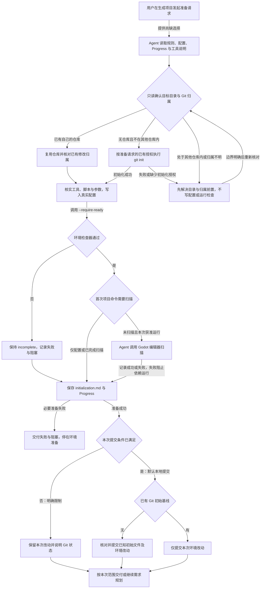

# 首次使用与环境准备

[返回手册](../README.md) · 前一步：[创建项目](create-project.md) · 本任务下一步：[需求与规划](../guides/product-and-planning.md)

复制完成后，你在目标项目中向 Agent 发送“准备 Godot 开发环境”提示词，并提供项目名称、文档语言或工具位置等尚未确定的选择。Agent 核实配置、记录真实准备结果，之后即可按授权进入需求整理与开发。已有设计文档可直接使用 [GDD 入口](../guides/product-and-planning.md#接入已有-gdd)。

## 环境准备的交接顺序



配置 ready、完成编辑器扫描、存在主场景和真实测试通过是四个独立事实。配置请求本身不要求建立玩法、运行空测试或补造成功记录；延后扫描的项目必须在首次获准的 CLI 测试或项目脚本运行前完成它。

## 打开正确的工作目录

你将 Coding Agent 的工作目录切换到生成项目。Agent 先读取项目自己的 `AGENTS.md`、`README.md`、`docs/methodology-config.json`、`docs/progress.md` 和 `tools/README.md`，再按任务加载 Skill 与规则。

不要在 `project-source/` 中打开业务开发任务。那里文件名和目录尚处于复制前形态，例如 Skill 位于 `skills/`，配置也不在项目最终位置。

从完整框架的 [集中提示词](../../../prompts.json) 中选择“Godot 项目开发 → 项目创建与接入 → 准备 Godot 开发环境”，填写后在目标项目发送。只有独立阅读包时，需要另取该提示词正文；生成项目运行时不依赖框架目录。

## 首次 Git 状态如何处理

创建器本身不建立 Git 仓库。**配置写入、工具版本探针和引擎运行前**，先只读确认目标目录及 Git 归属。已有独立仓库直接复用并核对差异；处于其他仓库内或归属不明时，先处理目录边界，不继续产生修改。当前集中管理的环境准备提示词**显式授权**：若目标没有自己的仓库，先核对不位于其他仓库内，再执行本地 `git init`；配置和必要检查完成后，按项目 Git 规则**默认本地提交**，明确的不提交要求或其他提交条件优先；不创建远程、不 push。

首次环境配置与 Git 初始基线分别判断：环境尚未配置的项目也可能已经有提交。尚无基线时，核对并提交属于本次初始化的已知初始文件和环境改动；已有基线时，仅提交本次环境改动，不重新建立基线。具体暂存、差异核对与提交后检查沿用项目 Git 规则。

后续更换工具路径或更新环境时，同样只提交本次明确范围内通过必要检查的改动。归属不明或必要检查失败时，报告原因并停止依赖该前置的提交。明确要求不提交时，保留本次改动并记录原因；之后按同一任务的已有授权续接，真正缺少提交决定时才询问。工作区干净后再开始新的修改任务，不把未完成的初始化改动混入第一个业务 Feature。

如果使用其他初始化请求，以该请求已经给出的范围为准。已有仓库直接复用，无关工作保持原样；仓库发现和文件归属存在疑问时先查清，不执行清理、覆盖或暂存。

## 环境准备需要确认的内容

| 内容 | 如何确认 | 保存位置 |
| --- | --- | --- |
| Python | Agent 用所选解释器核实实际版本为 3.12+，不能只查文件存在；本机遵循个人解释器约定 | `python_executable` |
| Godot | 直接核对已配置路径，执行 `--version` 并保留真实输出 | `environment_bootstrap` |
| 插件 | 检查项目 `addons/gdUnit4/` 与 `addons/gdscript-linter/` 的实际文件 | 初始化报告；不建立另一份插件清单 |
| 测试入口 | 按项目工具实际参数组成可调用命令 | `test_cmd` |
| 显示名称 | 用户提供名称时修改；未提供时保留现值 | `project.godot` 的 `config/name` |
| 文档语言 | 使用已确认的持久文档语言；生成 Product 前解决尚未确认的选择 | `document_language` |

初始 Godot 路径已经写入配置，准备环境时直接使用它。路径不可用就报告该路径和失败原因；只有用户要求更换位置或提供新路径时才修改。预填路径不证明安装存在，也不应自动搜索另一个版本替代。

Godot 配置按绝对路径或相对项目根目录的文件路径解析，不通过 PATH 查找。使用相对路径时，直接命令也从项目根目录运行，并保留 `./` 等路径前缀以明确选择项目内文件。

可执行文件字段保存单独的完整路径，不附加参数或 shell 引号；带参数的测试命令保存在 `test_cmd`。具体字段和转义示例见 [配置参考](../reference/configuration.md)。

## 配置就绪的判定

Agent 核实 Python 版本、Godot 实际输出、插件与测试入口后填写真实配置，将 `environment_bootstrap.status` 设为 `ready` 后运行就绪检查。失败时恢复或保持 `incomplete`，在 Progress 与初始化报告记录原因。

以下是 Agent 在目标项目根目录使用的检查命令；普通检查与就绪检查的结果含义见表格：

以下变量读取的是**已由 Agent 核实并填写的配置**；初始占位值不能当作确认结果。

```powershell
$projectConfig = Get-Content -LiteralPath 'docs/methodology-config.json' -Raw | ConvertFrom-Json
$projectPython = $projectConfig.python_executable
& $projectPython --version
$LASTEXITCODE
& $projectPython -B tools/checks/check-project-environment.py --require-ready
$LASTEXITCODE
```

| 检查 | 能说明什么 | 仍不能说明什么 |
| --- | --- | --- |
| 不带 `--require-ready` | 配置满足脚本检查的结构要求，合法的 `incomplete` 可以通过 | 工具已可用、路径正确、游戏可运行 |
| 带 `--require-ready` | 已标记 ready；Python 与测试命令首个程序解析到现存文件；Godot 文件存在，实时 `--version` 成功、为 4.7.x 且与记录完全匹配 | Python 版本已达要求或能够运行所有依赖、测试脚本存在及后续参数正确、完整测试/解析/lint 已通过 |

`--version` 是 Agent 对 Python 的独立核实，不是环境检查器的能力。检查器不会自动安装依赖、配置项目、运行测试或初始化 Git。准备环境的 Agent 仍需核对测试脚本与参数；一个字符串能找到解释器，不代表整个测试命令已经实际成功。

普通 Feature 复用已确认配置。安装位置、工具版本或命令改变，以及实际调用失败需要诊断时，再进行相关就绪核对；不用为每项任务重复搜索安装位置。

## 首次命令行运行前的扫描

配置 ready 不会生成 Godot 的全局类缓存或导入资源。新项目尚未在编辑器中打开时，直接运行 CLI 测试可能报找不到 `GdUnitTestCIRunner`；此时用例尚未执行，不能据此判断业务行为是否正确。

Agent 在首次获授权的命令行测试或项目脚本运行前，让配置中的 Godot 完成一次编辑器扫描，确认进程结束并检查退出码和解析、导入错误。已正常打开过的项目可复用已有准备；失败时按实际错误排查。

仅核对配置时可以暂不扫描，Agent 在初始化报告中注明未执行；实际扫描遵守项目 `AGENTS.md` 的权限与审批约束。完整命令见 [项目工具的首次扫描说明](../../../../project-source/tools/README.md#首次-godot-扫描)，独立阅读包用户应在完整框架或生成项目的 `tools/README.md` 查阅。

生成文件按项目资产与引用规则处理，不能把 `.import`、`.uid` 与 `.godot` 都当作可删除缓存。

## 最小入口与业务测试的边界

初始 `project.godot` 已将 `run/main_scene` 指向 `res://main/main.tscn`。这是供后续组装使用的最小场景，没有正式玩法或业务测试套件。复制成功、环境 ready、实际启动成功和业务测试通过分别记录；仅核对文件或配置不能声称后两项通过。

后续获批任务从 `game/` 中的实际模块实现首个行为，并在 `main/` 接入必要组装；组件、专属资源与测试按需要添加，具体判断见项目 `docs/game-organization.md`。环境准备不自动运行入口或补造业务测试，也不为了给初始化报告填写成功结果而虚构 Feature。

## 初始化报告和下一步

首次配置将实际环境、步骤与命令、检查及失败、Git 状态和剩余事项完整写入 `reports/initialization.md`。后续更新只追加本次差异、实际检查、必要失败信息、Git 结果和剩余问题，引用仍有效的环境信息，保留旧记录而不重写整份报告。`docs/progress.md` 保存当前结果、阻塞、下一步和报告链接。

默认项目 `.gitignore` 使初始化报告仅保存在本地；提交 Progress 不会连带提交报告。按[环境约定](../../../../project-source/methodology/05-document-language.md#project-environment-bootstrap)核对项目实际忽略规则，用户明确要求纳入版本控制时再按授权处理。

你查看报告中的工具版本、修改、命令结果、未执行项和 Git 状态，便可判断准备是否完成以及剩余问题。后续 Agent 也从这些记录续接。

仅使用环境准备提示词时，完成报告与适用的本地提交后交付并结束；已有具体后续授权则继续其范围。准备完成且 Git 状态满足项目规则后，可从 [想法或 GDD 整理 Product](../guides/product-and-planning.md)继续；只讨论设计可以提前进行。

## 对应源文件

[环境配置约定](../../../../project-source/methodology/05-document-language.md#project-environment-bootstrap) 定义准备要求，[环境检查器](../../../../project-source/tools/checks/check-project-environment.py) 定义实际检查，[初始化提示词](../../../prompts.json) 限定当前动作与 Git 授权，[项目规则](../../../../project-source/Project_AGENTS.md) 约束后续开发。
