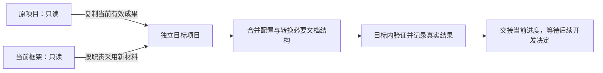

# 复制并迁移旧框架项目

[返回手册](../README.md) · [创建空白项目](create-project.md)

**需要保留原项目并复制到独立目标时阅读本章。** 希望审核后直接更新当前项目时，使用 [原地替换项目框架](../guides/engineering-changes.md#原地替换项目框架)。新建项目直接进入 [需求与规划](../guides/product-and-planning.md)；只有外部 GDD、尚无旧实现和任务时，使用 [GDD 接入说明](../guides/product-and-planning.md#接入已有-gdd)。

已有代码、Product、Feature 或进行中任务的旧项目，使用 [集中提示词](../../../prompts.json) 中的“Godot 项目开发 → 项目初始化 → 复制并迁移旧框架项目”。这是由 Agent 按具体方案完成的一次性接入，创建器仍只负责空白复制。

## 输入与执行位置

填写原项目、当前框架、新目标、本次授权范围以及 Git/数据选择。目标须在两个输入之外、互不包含、不属于其他仓库且不存在或为空，完整路径不含中文或空白；用户也可明确允许 Agent 自行选择。

默认先只读分析，再讨论方案。已有具体实施授权时，Agent 展示方案后继续完成获选范围，不逐文件重复确认。编写或阅读提示词本身不会启动迁移。

原项目继续保存在原位置。“不迁移”表示不纳入目标，原件不删除；验证的配置、存档和输出也应与原项目及共享用户数据隔离。所有运行和 Git 写入仅在目标进行，不能通过链接、worktree 或共享对象把写入引回原件。

## 成果与框架材料如何处理

| 对象 | 使用者应预期的结果 |
| --- | --- |
| 当前工作区 | 包含应保留的未提交、未跟踪和忽略文件；恢复历史后仍落实当前删除，不只复制最后一次提交 |
| 业务实现与资源 | 保留有效代码、场景、测试、UID、导入设置及许可；不因框架迁移重做功能 |
| 纯框架材料 | 采用当前版本，先识别项目定制；旧自动监督和废弃状态不继续作为活动入口 |
| 混合配置与规则 | 保留游戏设置和有效项目约束，合并当前工具契约，避免被空白默认值覆盖 |
| 活动需求与任务 | 保留语义、编号、依赖和完成事实，转换全部被当前索引读取的必要格式 |
| 历史材料 | 当前续接或追查需要的材料可选择性复制；其余留在原项目，不要求全量改写旧文档 |

对应关系根据职责、内容和实际读写方确定。同名文件可能采用不同格式，改名也可能同时涉及结构和配置变化。现行格式以 [Feature 与测试登记规范](../../../../project-source/methodology/02-feature-list-schema.md) 为准，提示词不提供长期旧格式兼容层。

默认保留当前分支的可达 Git 历史，并把实际工作区成果纳入独立目标；不照搬原仓库管理目录、Hook 或 worktree 关联，不配置远程。目标的输入基线提交只表示保存成果，不代表原有未完成任务已通过验收。选择新 Git 历史时，报告说明旧提交的追查限制。

## 状态、验证与交接

已完成的 Feature 保留历史完成事实；进行中的 Feature 保留真实停点，不重演从零开发，也不自动转为完成。无法确认的历史字段如实说明，不能用迁移时间或本次测试补造过去的完成、批准和验收。

旧测试记录不能当作当前运行结果。根据迁移影响执行环境、台账、解析/lint 及真实测试；跨工具和大量引用的迁移通常需要一次完整现有业务回归，同次运行已覆盖的子集无需重复。现有 UI、音频或手感工作尚待人工验收时，迁移通过仍不代表业务验收完成。

目标的 `reports/framework-migration.md` 保存一次性迁移报告，现有 Progress 指向报告并说明真实下一步；已有同名报告未获覆盖授权时使用不冲突名称。报告区分实际通过、失败、未执行、历史记录及来源未变核对，不额外建立同步台账。目标 README、规则和工具继续描述项目自身使用，维护手册与提示词库不进入目标项目。

迁移完成后停止，再由用户决定是否续接原任务。完整开发流程仍使用 [Feature 开发说明](../guides/feature-delivery.md)，框架不会自动更新这个项目。
