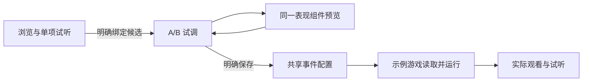

# 美术与音频资源工作台

[返回手册](../README.md) · 相关：[专业设计](specialist-workflows.md)、[框架验证方式](../maintenance/validating-framework.md)

工作台是项目内可按需运行的 Godot 开发场景，提供单项查看/试听和事件组合预览。
它随框架复制，但不会初始化环境、设置主场景、生成 Product/Feature 或替代人工体验。

## 首期已经提供的能力

打开 `examples/asset_workbench/example-workbench.tscn`，按 F6。
左侧浏览候选资源；中央触发示例奖励按钮事件；右侧调整尺度、动画时长、音量、音高、延迟和总线。
素材保持原色；默认白底黑字，可切换深灰底白字，或仅在预览区打开透明棋盘格。
背景与主题只影响查看，不修改资源或保存的事件配置。
三个内容栏各自支持纵向滚动，窄窗口的内容区支持横向滚动，不强制把宿主窗口扩大到固定高度。
独立工作台优先 1600×900，并按屏幕可用区域缩小；嵌入编辑器时服从宿主，显式命令行尺寸优先。
这不修改正式游戏的项目分辨率，`Fit larger workspace` 可再次适配。
完整操作、保存边界和许可见随项目复制的 [示例说明](../../../../project-source/examples/asset_workbench/README.md)。

同一工作台中可单独试听素材，再明确绑定到当前 A/B 方案；普通选择不会误改事件。
A/B、单次、连续和快速触发用于观察不同组合；停止与切换取消旧效果。
打开或重载后 A 使用已保存配置，B 在存在其他声音候选时只替换声音；顶部显示当前事件实际绑定的声音文件。
保存只修改一个明确的 `.tres`，示例游戏直接读取它，无需再手抄参数。

首期示例只有一个图标脉冲、放射线效果和一段声音，资源文件统一以 `example-` 开头。
这些是示例身份标记，不是资源已适合当前游戏的结论。
浏览器尺寸、时长来自 Godot 导入资源；第二阶段增加独立的源文件分析，仍不作为预览前置条件。
高级频谱、语义风格推断、通用时间轴或完整音乐工作流未实现。

## 第二阶段：后台基础分析

在实际项目按 [Analyzer 说明](../../../../project-source/tools/asset_analyzer/README.md) 安装明确版本依赖。
框架创建器只复制源文件；不会自动安装 Python 包，也不会把测试环境和缓存复制进新项目。
分析在 Windows 11 / Godot 4.7.1 / Python 3.12 上验证，使用项目现有 `python_executable` 配置。

从原浏览器点击 `Analyze selected source`，在非模态分析窗口把当前选择放入分析 A 或 B。
返回原浏览器即可换另一个候选，不建立第二套资源清单。分析 A/B 不改变事件 A/B、播放或保存目标。
可查看指标、不可用原因、音频峰值/RMS 包络、颜色与 Alpha 分布，滚轮缩放图表并同坐标比较。
整窗与指标表支持滚动，关闭窗口会取消其后台任务。

音频 Adapter 使用 PyAV 与 pyloudnorm，图像 Adapter 使用 Pillow/NumPy；所有后端返回统一 Schema v1，
Godot 仅消费指标和数据序列。版本与许可证见 [依赖记录](../../../../project-source/tools/asset_analyzer/DEPENDENCIES.md)。
短音频、静音、未支持指标、执行失败分别显示状态，不以零值补齐；源文件分析不包含 Godot 导入和播放参数。
首尾静音规则在 Godot 侧检查，独立于测量算法；不生成审美分数。

内容哈希、参数、Analyzer/后端及 Schema 版本共同确定项目本地 JSON 缓存。
`Reanalyze` 强制重算；依赖缺失、超时、取消、损坏输出和解码失败不会阻断原工作台。
新增指标优先扩展 Adapter 的 metrics/series，现有界面自动消费，不改音频播放插件。

## 第三阶段：资源分组与交互组合场景

原浏览器的 `Add filtered candidates to group` 打开分组窗口，也可添加指定目录中的源资源。
批量分析共用第二阶段队列与缓存，支持取消、逐项失败、同类统计、明确阈值及相对中位数偏差。
Ctrl 选择两项同类结果送回原 A/B 图表；分组/规则可保存，分析结果可显式保存为历史快照。
完整操作和上限见 [分组批量说明](../../../../project-source/tools/asset_analyzer/README.md#分组批量分析与一致性检查)。

`Open composition scene` 打开三个可点击对象的真实 Godot 场景。
选中对象后，原工作台继续负责它的属性、A/B 和保存；对象之间保留各自试调。
组合窗口提供同时触发、整体音量试调、逐文件保存与全场景资源分析，保存后可运行独立场景读取同一数据。
配置和源素材分离，批量保存会明确部分成功与冲突；测量仍针对源资源，不冒充最终画面或混音测量。

Agent 可根据画面描述编写/组合原生 `.tscn`，接入已有表现接口和数据；本例提供这条接入路径。
运行时尚无自然语言场景生成、通用拖拽编辑或任意节点属性修改。真实对象应适配自身表现接口，不复制第二套游戏关系模型。
分组数值偏差只提示具体差异；聚类、语义风格判断、跨历史趋势比较仍按实际需求另行评估。

## 在真实任务中使用

沿用原型、资源接入或当前 Feature 的授权与记录。需要试调时进入工作台；参数已经明确的普通替换不必走完整链路。
提示词仍使用“验证视觉、玩法或技术假设”或“接入或替换游戏资源”等已有入口，不新增工作台 Stage 或专属完成状态。

接入真实对象前，复用它已有的表现组件、Scene/Resource 和音频服务，明确一个实际写回目标。
本例的 `FeedbackCue` 只表达图标脉冲；不要求把已有游戏改造成该模型。
预览入口隔离掉落、存档、网络、业务 Autoload 等副作用；仅选择场景文件不能证明它安全独立。

专业规格仍由原有美术、音频与 UI Skill 维护。源资源、Godot 导入结果、工作台画面与正式场景表现各有验证边界。
记录实际观察和待确认项，随后在真实场景验证；示例通过不自动完成具体 Feature 或人工验收。

## 工程归属

| 内容 | 位置与边界 |
| --- | --- |
| 可复用工作台、表现组件和薄播放封装 | `tools/asset_workbench/`、`components/feedback/`；通过复制成为项目自己的文件 |
| 分析源代码与项目本地开发依赖 | `tools/asset_analyzer/` 随框架复制；实际项目安装的 `reports/asset-analyzer/runtime/`、缓存和运行证据不进入框架 |
| 可操作示例与许可 | `examples/asset_workbench/`；可替换或按引用检查后移除，不预设游戏需求 |
| 音频第三方代码 | `addons/sound_manager/`；固定提交和 MIT 许可，默认不启用全局插件 |
| 框架回归用例和维护报告 | 只在 `framework/`；运行时按范围放入指定外部测试项目 |
| 本机路径、正式主场景、生产导出设置 | 初始化后的实际项目；不得把测试项目的这些设置复制回框架默认值 |

正式导出应选择实际入口及依赖，排除仅用于开发的工作台和示例；组件被正式游戏使用时保留。
工作台不会自动修改导出预设或全局音频服务。
