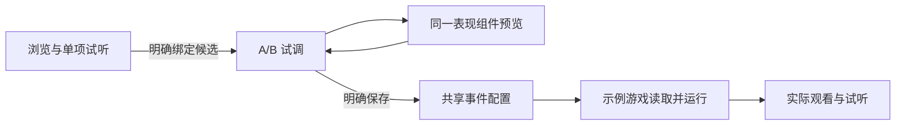

# 美术、音频与视觉效果资源工作台

[返回手册](../README.md) · 相关：[专业设计](specialist-workflows.md)、[框架验证方式](../maintenance/validating-framework.md)

工作台是项目内可按需运行的 Godot 开发场景，提供单项查看/试听和事件组合预览。
它随框架复制，但不会初始化环境、设置主场景、生成 Product/Feature 或替代人工体验。

## 按当前任务进入

先在实际游戏项目完成 [环境准备](../getting-started/first-use.md)，再打开所需场景按 F6。各入口独立运行，不必按顺序遍历。

| 现在要做什么 | 从这里开始 | 完成检查 |
| --- | --- | --- |
| 查看候选、独立试听 | [查看与独立试听](#查看与独立试听) | 知道选中了什么，当前对象绑定未改变 |
| 检查图像或音频源文件 | [源资源分析](#分析图像与音频源文件) | 结果对应正确文件，失败或未知值有说明 |
| 比较对象的素材、声音与效果 | [组合预览与试调](#组合预览与试调) | 当前对象、A/B、播放与修改范围清楚 |
| 把选定参数用于实际场景 | [保存后验证](#保存后验证消费场景) | 明确保存目标，并在消费场景查看已保存效果 |

四个工作台及对应消费入口集中在 [示例操作导航](../../../../project-source/examples/asset_workbench/README.md#打开与操作)。`example_` 前缀只标识示例，不表示素材已适合当前游戏。

## 查看与独立试听

1. 打开 `examples/asset_workbench/single/example_workbench.tscn`，按 F6。
2. 在左侧“资源候选”筛选并选择文件，查看摘要；音频可独立试听或停止试听。
3. 确定要使用该候选时，才点击“应用到对象 A/B”，继续在当前入口 [预览与试调](#组合预览与试调)。

**影响范围：** 浏览、元数据与独立试听不会修改对象资源。Inspector 的“资源绑定”显示对象实际使用的文件，左侧高亮只代表候选。浏览器尺寸与时长来自 Godot 导入资源；独立试听条件不等于 Cue 的播放参数。

**完成检查：** 能区分候选文件与对象绑定；未点击应用或编辑参数时，草稿保持原值。首次 Cue 读取失败仍可浏览、试听和分析候选；修正文件后从“对象更多”重载恢复对象操作。

### 窗口与外观

- 宽窗口为可拖动三栏，左侧列表和右侧属性各自滚动；对象信息、播放、停止与保存保留在固定区域。
- 窄窗口通过“资源候选 / 组合预览 / 对象属性”切换。真实组合布局不重排，容不下时在预览内部滚动；布局不持久化。
- 默认白底黑字，可切深色或在适用图像预览启用透明棋盘格。外观设置不改变素材颜色、草稿或保存结果。

项目默认视口和工作台/分析窗口均为 1600×900。编辑器嵌入时服从宿主区域，显式命令行尺寸可覆盖默认值。

## 分析图像与音频源文件

**前置：** 按 [Analyzer 说明](../../../../project-source/tools/asset_analyzer/README.md) 准备依赖和项目 `python_executable`。创建器不安装依赖。缺少分析依赖不妨碍预览和播放。

1. 选择候选，点击“分析候选源文件”；在独立窗口中使用“分析对比 A/B”。
2. 先核对两侧文件名、类型和状态，再查看问题摘要、指标及图表。更换候选不会给旧结果换名。
3. 按需查看音频峰值/RMS 包络、颜色与 Alpha 分布；滚轮缩放图表，或滚动查看详细指标。

**影响范围：** 分析 A/B 不改变对象 A/B、播放或保存目标。结果针对原始图像/音频，不包含导入后变化、Cue 增益、最终混音或 Shader/粒子画面，也不生成审美分数。

**结果不完整或过期时：** 短音频、静音、未支持指标和失败分别说明，不用零值代替未知。修改分析参数后旧结果标为 STALE；版本、后端、参数或单位不兼容时停止叠图，可按当前参数同时重算两侧。“重分析”强制重算；关闭窗口取消其后台任务。

非文件资源、不支持格式、解码失败、超时或损坏输出会显示原因，不阻断原工作台。大图有限采样与音频预算以实际状态为准；缓存、Adapter、Schema、扩展指标及上限由 [Analyzer 技术说明](../../../../project-source/tools/asset_analyzer/README.md) 承接，版本与许可见 [依赖记录](../../../../project-source/tools/asset_analyzer/DEPENDENCIES.md)。

### 批量分析与比较

1. 用“候选更多 → 将筛选结果加入批量分析”收集候选；也可在集合菜单指定目录，或用对象/场景更多菜单收集对应当前方案的图片和音频。
2. 核对实际新增、已有和跳过项。原集合成员保留；间接纹理或音频 Resource 显示跳过原因，不自动展开内部依赖，也不收集 Shader。
3. 运行批量分析，查看逐项状态和同类统计；Ctrl 选择两项同类结果送回分析 A/B 图表。

可取消运行、保存分组/规则，或显式保存结果历史。明确阈值和相对中位数偏差只提示数值差异；不据此推断语义风格。完整操作、容量限制和失败处理见 [分组批量说明](../../../../project-source/tools/asset_analyzer/README.md#分组批量分析与一致性检查)。

## 组合预览与试调

**选择入口：** 已打开工作台时继续当前入口；需要三对象示例时，打开 `examples/asset_workbench/composition/example_workbench.tscn` 按 F6。不同入口各自持有配置，不能靠切换入口转移草稿。

1. 多对象入口先在中央点击目标，这会选中并触发它；单对象入口直接使用当前对象。
2. 确认 Inspector 顶部对象名称和当前 A/B，再应用候选或修改右侧参数。对象之间保留各自草稿。
3. 使用预览下方的触发、连续或快速触发检查效果；需所有对象一起播放时使用预览上方“触发全部”。

**作用范围：** 对象 A/B 只切当前对象，场景 A/B 切全部对象；混用时显示“混合方案”。打开或重载后 A 使用已保存配置；原配置有声音且存在其他候选时，B 只换声音，静音配置保持静音。这些方案是效果参数试调，不切换完整 UI 布局。

**停止与低频操作：** “停止全部”清除全部对象、延迟、循环与独立试听；“停止试听”只作用于候选。对象的分析、复制、恢复和重载在“对象更多”；场景分析、统一增益与逐文件保存在“全场景更多”。统一增益只改各对象当前方案。

**完成检查：** 当前对象、当前方案、资源绑定和未保存状态符合本次选择；随后按 [保存后验证](#保存后验证消费场景) 检查实际消费。

### Shader 与独立资源组合

打开 `examples/asset_workbench/shader_composition/example_workbench.tscn`，可试调外描边、溶解与无图片噪声三个预设。图片、声音与 Shader 分别替换或留空，全空配置也允许保存；单对象和普通组合入口同样支持可选绑定。

无图片时沿用白色矩形承载面，不补选图片。各对象保持独立材质和参数，源预设只读；“触发全部”从初态触发，再按各自声音/Shader 延迟播放。

目前支持 2D `canvas_item` 及既定强度、颜色、时序参数；没有任意参数编辑、3D、全屏后处理或多 Shader 堆叠。候选配置、参数适用性、契约与许可见 [Shader 示例说明](../../../../project-source/examples/asset_workbench/README.md#shader-与独立资源组合)。

### 粒子与动画组合预览

打开 `examples/asset_workbench/effects_composition/example_workbench.tscn`，在 Inspector 选择粒子、Tween 或 AnimationPlayer 片段，仍只编辑当前对象当前草稿。两个组合实例展示六个对象；共用 Cue 的对象也独立持有 A/B。

图像、声音、Shader、粒子与片段分别可选；粒子可使用自己的贴图，运动目标为空时不补素材。运行实例和材质按对象隔离，动画不移动名称或选中边框。

粒子/运动重触发从头开始；声音与图标脉冲仍可重叠。持续粒子的发射时长与存活时间不同；停止全部立即隐藏并取消待播放内容，下次触发重置模拟。

预设、局部/场景坐标、组合变换和层级在原生 Godot 场景/Animation 资源中制作，工作台不提供任意轨道编辑。参数与素材来源见 [粒子与动画说明](../../../../project-source/examples/asset_workbench/README.md#粒子tween-与-animationplayer)。

### 局部管理与有限时间编排

在粒子动画入口点击“播放编排 / 循环编排”，使用各对象当前 A/B，依次播放 A 组、B 组，再让两组核心并行。播放不修改或保存 Cue；停止全部和方案切换取消后续编排与循环。

**体验时注意：** 片段截止会截断声音和粒子余尾；错过的窗口不会补播，尚未结束的窗口从效果开头触发。示例只允许三个受管对象同时播放，延迟音频也占预算；它不是 GPU、显存或全场景声部保证。

编排在原生 Godot Inspector 制作，工作台不提供时间轴编辑、暂停或跳转。消费场景可试验分组触发/取消和优先级。局部 Manager、句柄、时钟与 API 的实现说明集中在 [管理与编排说明](../../../../project-source/examples/asset_workbench/README.md#场景局部管理与有限编排)。

## 保存后验证消费场景

**保存前：** 看固定底栏中的目标文件与影响范围。保存当前方案只写当前 Cue，不修改源图片、声音或共享预设；所有引用同一 Cue 的消费场景会读到该保存结果。

1. 点击“保存当前方案”，核对成功或冲突消息；需要完整路径时查看并复制保存目标。
2. 用“对象更多 → 打开消费场景”，或按 [入口导航](../../../../project-source/examples/asset_workbench/README.md#打开与操作) 打开对应场景按 F6。
3. 实际观看、操作和试听，确认消费场景读到已保存效果；未保存的 A/B 草稿不会传入。

**保存全场景：** 沿用逐文件保存，不是多文件事务。多个对象共用 Cue 且内容相同时只写一次；内容分歧或磁盘冲突时跳过并说明，其他文件仍可能成功。单对象保存不替换其他对象的内存草稿。

**重载：** 明确确认后丢弃当前对象两份草稿。需要保留试调时先保存选定方案，不能把重载当作撤销最后一步。

效果组合的消费入口为 `effects_composition/example_consumer.tscn`，可检查不同摆放、旋转和缩放。正式导出还应按 [消费接入与导出](../../../../project-source/examples/asset_workbench/README.md#消费接入与导出) 包含实际引用、运行脚本与许可，并从独立包验证；F6 成功不证明导出依赖完整。

## 在真实任务中使用

### 先讨论按钮与布局

沿用提示词库“Godot 项目开发 → 需求设计 → 设计界面与交互”，对应 `design-ui-spec`，不需要新增布局专用流程。
输入界面目标、主要/次要操作、1600×900 显示条件、实际文本及参考界面。按 [UI 场景检查单](scenarios-interface-audio-assets.md) 推进：

1. 先确定信息层级、按钮分组、常用动作和需要确认的保存/覆盖行为，给出 ASCII 线框及状态说明。
2. 讨论并选择布局，把已确认要求、试验尺寸和待决定项记录在项目 `docs/ui/<interface>-design.md`。
3. 用已有“验证视觉、玩法或技术假设”入口或当前任务授权，制作可运行 Godot 原型，检查裁切、滚动、可读性、焦点与真实操作。
4. 根据实际体验调整后再实现依赖该布局的功能，并回归预览、保存等行为；已有充分授权可连续推进，不要求机械重发全部提示词。

完整界面方案由 Agent 编写独立 `.tscn` 原型，工作台可辅助其中的资源与反馈试调。它不提供自然语言场景生成、通用拖拽编辑或任意节点属性修改，示例布局也不等于实际游戏已确认的 UI 设计。

### 接入实际对象

沿用原型、资源接入或当前 Feature 的授权与记录。需要试调时进入工作台；参数已经明确的普通替换不必走完整链路。
提示词仍使用“验证视觉、玩法或技术假设”或“接入或替换游戏资源”等已有入口，不新增工作台 Stage 或专属完成状态。

接入真实对象前，复用它已有的表现组件、Scene/Resource 和音频服务，明确一个实际写回目标。
本例的 `FeedbackCue` 表达可选媒体、粒子与有限动画表现；不要求把已有游戏改造成该模型。
预览入口隔离掉落、存档、网络、业务 Autoload 等副作用；仅选择场景文件不能证明它安全独立。

专业规格仍由原有美术、音频与 UI Skill 维护。源资源、Godot 导入结果、工作台画面与正式场景表现各有验证边界。
记录实际观察和待确认项，随后在真实场景验证；示例通过不自动完成具体 Feature 或人工验收。

## 工程归属

| 内容 | 位置与边界 |
| --- | --- |
| 可复用工作台、表现组件和薄播放封装 | `tools/asset_workbench/`、`components/feedback/`；通过复制成为项目自己的文件 |
| 分析源代码与项目本地开发依赖 | `tools/asset_analyzer/` 随框架复制；实际项目安装的 `reports/asset-analyzer/runtime/`、缓存和运行证据不进入框架 |
| 可操作示例与许可 | `examples/asset_workbench/`；可替换或按引用检查后移除，不预设游戏需求 |
| 音频第三方代码 | `addons/sound_manager/`；固定提交和 MIT 许可，默认不启用全局插件 |
| 框架回归用例和维护报告 | 只在 `framework/`；运行时按范围放入指定外部测试项目 |
| 本机路径、正式主场景、生产导出设置 | 初始化后的实际项目；不得把测试项目的这些设置复制回框架默认值 |

工作台/Analyzer 可从正式导出排除；示例目录只有不再被正式场景引用时才能整体排除。工作台不会自动修改导出预设或全局音频服务，保存与独立消费检查见 [保存后验证](#保存后验证消费场景)。
