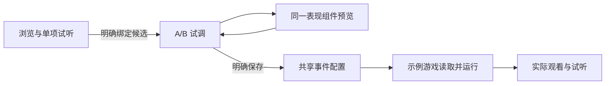

# 美术与音频资源工作台

[返回手册](../README.md) · 相关：[专业设计](specialist-workflows.md)、[框架验证方式](../maintenance/validating-framework.md)

工作台是项目内可按需运行的 Godot 开发场景，提供单项查看/试听和事件组合预览。
它随框架复制，但不会初始化环境、设置主场景、生成 Product/Feature 或替代人工体验。

## 首期已经提供的能力

打开 `examples/asset_workbench/example-workbench.tscn`，按 F6。
左侧浏览候选资源；中央触发示例奖励按钮事件；右侧调整尺度、动画时长、音量、音高、延迟和总线。
素材保持原色；默认白底黑字，可切换深灰底白字，或仅在预览区打开透明棋盘格。
背景与主题只影响查看，不修改资源或保存的事件配置。
完整操作、保存边界和许可见随项目复制的 [示例说明](../../../../project-source/examples/asset_workbench/README.md)。

同一工作台中可单独试听素材，再明确绑定到当前 A/B 方案；普通选择不会误改事件。
A/B、单次、连续和快速触发用于观察不同组合；停止与切换取消旧效果。
保存只修改一个明确的 `.tres`，示例游戏直接读取它，无需再手抄参数。

首期示例只有一个图标脉冲、放射线效果和一段声音，资源文件统一以 `example-` 开头。
这些是示例身份标记，不是资源已适合当前游戏的结论。
它没有专业响度、频谱、风格分析、批量管理、通用时间轴或完整音乐工作流。
后续分析能力根据实际问题调研接入，不作为当前预览的前置条件。

## 在真实任务中使用

沿用原型、资源接入或当前 Feature 的授权与记录。需要试调时进入工作台；参数已经明确的普通替换不必走完整链路。
提示词仍使用“验证视觉、玩法或技术假设”或“接入或替换游戏资源”等已有入口，不新增工作台 Stage 或专属完成状态。

接入真实对象前，复用它已有的表现组件、Scene/Resource 和音频服务，明确一个实际写回目标。
本例的 `FeedbackCue` 只表达图标脉冲；不要求把已有游戏改造成该模型。
预览入口隔离掉落、存档、网络、业务 Autoload 等副作用；仅选择场景文件不能证明它安全独立。

专业规格仍由原有美术、音频与 UI Skill 维护。源资源、Godot 导入结果、工作台画面与正式场景表现各有验证边界。
记录实际观察和待确认项，随后在真实场景验证；示例通过不自动完成具体 Feature 或人工验收。

## 工程归属

| 内容 | 位置与边界 |
| --- | --- |
| 可复用工作台、表现组件和薄播放封装 | `tools/asset_workbench/`、`components/feedback/`；通过复制成为项目自己的文件 |
| 可操作示例与许可 | `examples/asset_workbench/`；可替换或按引用检查后移除，不预设游戏需求 |
| 音频第三方代码 | `addons/sound_manager/`；固定提交和 MIT 许可，默认不启用全局插件 |
| 框架回归用例和维护报告 | 只在 `framework/`；运行时按范围放入指定外部测试项目 |
| 本机路径、正式主场景、生产导出设置 | 初始化后的实际项目；不得把测试项目的这些设置复制回框架默认值 |

正式导出应选择实际入口及依赖，排除仅用于开发的工作台和示例；组件被正式游戏使用时保留。
工作台不会自动修改导出预设或全局音频服务。
