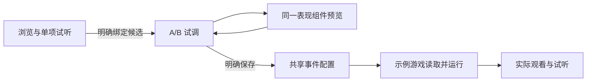

# 美术、音频与 Shader 资源工作台

[返回手册](../README.md) · 相关：[专业设计](specialist-workflows.md)、[框架验证方式](../maintenance/validating-framework.md)

工作台是项目内可按需运行的 Godot 开发场景，提供单项查看/试听和事件组合预览。
它随框架复制，但不会初始化环境、设置主场景、生成 Product/Feature 或替代人工体验。

## 首期已经提供的能力

打开 `examples/asset_workbench/single/example-workbench.tscn`，按 F6。
左侧浏览候选资源；中央触发示例奖励按钮事件；右侧调整尺度、动画时长、音量、音高、延迟和总线。
素材保持原色；默认白底黑字，可切换深灰底白字，或仅在预览区打开透明棋盘格。
背景与主题只影响查看，不修改资源或保存的事件配置。
宽窗口使用可拖动三栏，候选列表与右侧参数分别滚动；对象名称、对象方案、未保存状态、播放与保存留在固定区域。
窄窗口通过“资源候选 / 组合预览 / 对象属性”切换区域，停止与当前保存始终可访问；不强制扩大最小窗口。
真实组合预览保留原场景布局，容不下时仅在预览内部滚动。布局不持久化。
框架的空白 `project.godot` 默认视口为 1600×900，新建项目继承此值；单对象、组合、分析及批量窗口默认统一为此尺寸。
嵌入编辑器时服从宿主区域，显式命令行尺寸可覆盖默认值，不再按屏幕比例自动缩小。
完整操作、保存边界和许可见随项目复制的 [示例说明](../../../../project-source/examples/asset_workbench/README.md)。

同一工作台中可单独试听素材，再明确绑定到当前 A/B 方案；普通选择不会误改事件。
A/B、单次、连续和快速触发用于观察不同组合；停止与切换取消旧效果。
打开或重载后 A 使用已保存配置，B 在原配置有声音且存在其他候选时只替换声音；静音配置保持静音。
Inspector 的“资源绑定”分别显示实际图像、音频和 Shader；左侧是候选，普通选择不会改变这些绑定。
对象 A/B 使用互斥选中态，未保存状态用文字及颜色表达；固定保存栏显示目标文件与影响范围，完整路径可查看复制。
保存只修改一个明确的 `.tres`，示例游戏直接读取它，无需再手抄参数。

首期示例只有一个图标脉冲、放射线效果和一段声音，资源文件统一以 `example-` 开头。
这些是示例身份标记，不是资源已适合当前游戏的结论。
浏览器尺寸、时长来自 Godot 导入资源；第二阶段增加独立的源文件分析，仍不作为预览前置条件。
高级频谱、语义风格推断、通用时间轴或完整音乐工作流未实现。

## 第二阶段：后台基础分析

在实际项目按 [Analyzer 说明](../../../../project-source/tools/asset_analyzer/README.md) 安装明确版本依赖。
框架创建器只复制源文件；不会自动安装 Python 包，也不会把测试环境和缓存复制进新项目。
分析在 Windows 11 / Godot 4.7.1 / Python 3.12 上验证，使用项目现有 `python_executable` 配置。

从候选区点击“分析候选源文件”，在非模态“源资源分析”窗口把当前选择放入“分析对比 A/B”。
返回原浏览器即可换另一个候选，不建立第二套资源清单。分析 A/B 不改变事件 A/B、播放或保存目标。
两侧结果始终各自显示源文件名、类型及状态；候选变化不会给旧结果换名。先显示核心测量和问题摘要，再显示完整指标、图表及折叠详情。
可查看指标、不可用原因、音频峰值/RMS 包络、颜色与 Alpha 分布，滚轮缩放图表并同坐标比较。
整窗与指标表支持滚动，关闭窗口会取消其后台任务。
修改分析参数后旧结果标记 STALE；版本、后端、参数或单位不兼容时明确说明并停止图表叠加，可用当前参数同时重算两侧。

音频 Adapter 使用 PyAV 与 pyloudnorm，图像 Adapter 使用 Pillow/NumPy；所有后端返回统一 Schema v1，
Godot 仅消费指标和数据序列。版本与许可证见 [依赖记录](../../../../project-source/tools/asset_analyzer/DEPENDENCIES.md)。
短音频、静音、未支持指标、执行失败分别显示状态，不以零值补齐；源文件分析不包含 Godot 导入和播放参数。
首尾静音规则在 Godot 侧检查，独立于测量算法；不生成审美分数。

内容哈希、参数、Analyzer/后端及 Schema 版本共同确定项目本地 JSON 缓存。
“重分析”强制重算；依赖缺失、超时、取消、损坏输出和解码失败不会阻断原工作台。
新增指标优先扩展 Adapter 的 metrics/series，现有界面自动消费，不改音频播放插件。
大图按块统计并明确标记有限采样调色板；音频基础量流式累计，响度使用单独预算。调度数量和 Windows 进程内存限制共同约束后台成本。
Schema 为两端共同读取的字段契约，语义损坏缓存会重算；非文件资源、不支持格式与损坏输入有不同错误提示。具体上限见 Analyzer 说明。

## 第三阶段：资源分组与交互组合场景

“候选更多 → 将筛选结果加入批量分析”打开分组窗口，也可在集合菜单中添加指定目录的源资源。
批量分析共用第二阶段队列与缓存，支持取消、逐项失败、同类统计、明确阈值及相对中位数偏差。
Ctrl 选择两项同类结果送回原 A/B 图表；分组/规则可保存，分析结果可显式保存为历史快照。
完整操作和上限见 [分组批量说明](../../../../project-source/tools/asset_analyzer/README.md#分组批量分析与一致性检查)。

直接运行 `examples/asset_workbench/composition/example-workbench.tscn`，中央显示三个可点击对象。
它与 `single/` 是独立目录和入口，不通过单对象工作台按钮打开。选中对象后，在组合工作台自身调整属性、A/B 和保存；对象之间保留各自试调。
组合窗口提供同时触发、整体音量试调、逐文件保存与全场景资源分析，保存后可运行独立场景读取同一数据。
场景 A/B 作用于所有对象；只切换一个对象后若出现混用，显示“混合方案”，不保留错误的统一选中态。
常用的场景 A/B 与触发全部放在预览上方；全场景分析、统一增益及逐文件保存位于“全场景更多”。
当前播放在预览下方，唯一可见的“停止全部”清除全部对象、延迟、循环与独立试听；“停止试听”仅作用于候选试听。
“对象更多”集中分析当前对象源资源、复制、恢复、重载与打开消费场景。重载仍确认丢弃该对象两份草稿。
配置和源素材分离，批量保存会明确部分成功与冲突；测量仍针对源资源，不冒充最终画面或混音测量。

Agent 可根据画面描述编写/组合原生 `.tscn`，接入已有表现接口和数据；本例提供这条接入路径。
运行时尚无自然语言场景生成、通用拖拽编辑或任意节点属性修改。真实对象应适配自身表现接口，不复制第二套游戏关系模型。
分组数值偏差只提示具体差异；聚类、语义风格判断、跨历史趋势比较仍按实际需求另行评估。

## Shader 与独立资源组合

运行 `examples/asset_workbench/shader_composition/example-workbench.tscn`。
该入口复用现有组合工作台，提供外描边、溶解、无需图片的噪声三个真实 Shader 示例。
图片、声音、Shader 分别选择或留空，任意一项替换不会自动更换其他项；全空配置允许保存。
原有单对象/组合入口同样支持可选绑定，额外 Shader 候选由场景的 `shader_candidates` 指定。

每个对象保持自己的 A/B 与 Shader 参数。“场景 A / B”切换全部对象各自的草稿，
“触发全部”从初态一起触发，再按各自独立的声音/Shader 延迟形成联动；“停止全部”取消所有播放与待触发效果。
预设材质和源资源只读共享，运行材质按表现对象复制，避免共享 uniform 串改。
保存只写当前明确 Cue，独立组合场景读取同一配置。

无图片时 Shader 绘制在普通白色矩形上，具体效果由 Shader 本身决定；本例的噪声不需要图片。
目前支持 2D `canvas_item` 材质及明确的强度/颜色/时序契约，不提供任意参数编辑、3D、全屏后处理或多 Shader 堆叠。
源文件 Analyzer 继续只测图片和声音，不代表测量最终 Shader 画面。
操作、扩展契约和复制来源许可集中在 [Shader 示例说明](../../../../project-source/examples/asset_workbench/README.md#shader-与独立资源组合)。

## 在真实任务中使用

### 粒子与动画组合预览

新增 `examples/asset_workbench/effects_composition/example-workbench.tscn` 独立 F6 入口，原有三个入口继续保留。
它提供一次性/持续 GPU 粒子、Tween 跃动与 AnimationPlayer 预制片段，和已有图像、声音及 Shader 共用组合工作台、对象 A/B、保存与消费场景。
图像、声音、Shader、粒子与动画片段分别可选；粒子可使用自己的贴图，运动目标为空时不补入其他素材。

Inspector 新增粒子和动画片段绑定，以及粒子、Tween/动画参数组；只改当前对象当前草稿，预设只读共享，运行实例和材质按对象隔离。
Tween 与片段各自拥有内部变换层，不与已有图像尺寸计算竞争，也不移动对象名称或选中边框。
粒子/运动重触发重新开始；声音与旧图标脉冲仍可重叠。持续粒子区分发射时长与存活时间，停止全部立即隐藏并取消待播放内容，下一次触发重置模拟。

工作台只选择有限预设及必要参数，原生 Godot 场景/Animation 资源负责制作。没有新增 Manager、统一时间轴或任意轨道编辑。
第四入口以两个原生组合实例演示六个对象，实例身份与保存文件分开；共用 Cue 的对象仍独立持有 A/B。
全场景保存对内容一致的共享目标只写一次，内容分歧则跳过并说明；单对象保存不替换其他对象的内存草稿，后续写回仍检查磁盘冲突。
局部/场景粒子坐标、组合根变换与 `z_index` 在原生预设/场景中定义，工作台显示适用含义，不增加任意属性编辑。
保存后打开 `effects_composition/example-consumer.tscn` 验证不同摆放、旋转和缩放下的真实消费；源分析继续只针对图片和音频。
具体范围、参数、停止语义和素材来源见 [粒子与动画说明](../../../../project-source/examples/asset_workbench/README.md#粒子tween-与-animationplayer)。

### 先讨论按钮与布局

沿用提示词库“Godot 项目开发 → 需求设计 → 设计界面与交互”，对应 `design-ui-spec`，不需要新增布局专用流程。
输入界面目标、主要/次要操作、1600×900 显示条件、实际文本及参考界面。按 [UI 场景检查单](scenarios-interface-audio-assets.md) 推进：

1. 先确定信息层级、按钮分组、常用动作和需要确认的保存/覆盖行为，给出 ASCII 线框及状态说明。
2. 讨论并选择布局，把已确认要求、试验尺寸和待决定项记录在项目 `docs/ui/<interface>-design.md`。
3. 用已有“验证视觉、玩法或技术假设”入口或当前任务授权，制作可运行 Godot 原型，检查裁切、滚动、可读性、焦点与真实操作。
4. 根据实际体验调整后再实现依赖该布局的功能，并回归预览、保存等行为；已有充分授权可连续推进，不要求机械重发全部提示词。

本示例提供功能布局，其按钮分组不等于实际游戏已确认的 UI 设计。入口与分辨率已按本次决定落实，其余布局仍可按上述方式讨论。

### 接入实际对象

沿用原型、资源接入或当前 Feature 的授权与记录。需要试调时进入工作台；参数已经明确的普通替换不必走完整链路。
提示词仍使用“验证视觉、玩法或技术假设”或“接入或替换游戏资源”等已有入口，不新增工作台 Stage 或专属完成状态。

接入真实对象前，复用它已有的表现组件、Scene/Resource 和音频服务，明确一个实际写回目标。
本例的 `FeedbackCue` 表达可选媒体、粒子与有限动画表现；不要求把已有游戏改造成该模型。
预览入口隔离掉落、存档、网络、业务 Autoload 等副作用；仅选择场景文件不能证明它安全独立。

专业规格仍由原有美术、音频与 UI Skill 维护。源资源、Godot 导入结果、工作台画面与正式场景表现各有验证边界。
记录实际观察和待确认项，随后在真实场景验证；示例通过不自动完成具体 Feature 或人工验收。

## 工程归属

| 内容 | 位置与边界 |
| --- | --- |
| 可复用工作台、表现组件和薄播放封装 | `tools/asset_workbench/`、`components/feedback/`；通过复制成为项目自己的文件 |
| 分析源代码与项目本地开发依赖 | `tools/asset_analyzer/` 随框架复制；实际项目安装的 `reports/asset-analyzer/runtime/`、缓存和运行证据不进入框架 |
| 可操作示例与许可 | `examples/asset_workbench/`；可替换或按引用检查后移除，不预设游戏需求 |
| 音频第三方代码 | `addons/sound_manager/`；固定提交和 MIT 许可，默认不启用全局插件 |
| 框架回归用例和维护报告 | 只在 `framework/`；运行时按范围放入指定外部测试项目 |
| 本机路径、正式主场景、生产导出设置 | 初始化后的实际项目；不得把测试项目的这些设置复制回框架默认值 |

正式导出应选择实际入口及依赖，排除仅用于开发的工作台和示例；组件被正式游戏使用时保留。
工作台不会自动修改导出预设或全局音频服务。
