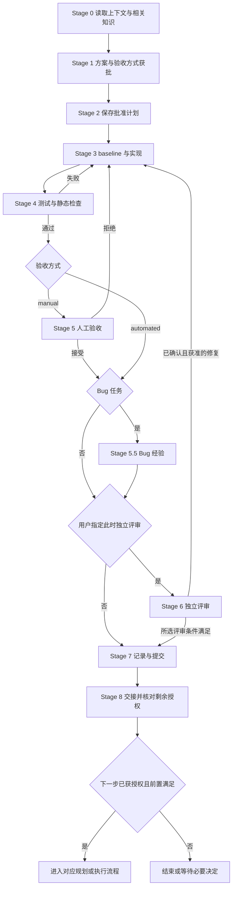

# 开发、验收与交付一个 Feature

[返回手册](../README.md) · 前一步：[需求与规划](product-and-planning.md) · 相关：[命令与验证](../reference/commands-and-validation.md)

开始本章前，应已有确定的 Feature、所需需求和可用开发环境。Agent 通过 `execute-next-feature` 实现这项任务，交付代码、验证结果、适用的人工验收记录与本地提交；中断任务从实际停点继续。

## 你与 Agent 各自做什么

你主要提供实施范围、解决关键设计选择，并在需要时体验实际结果。Agent 负责读取当前任务、提出具体方案、实现和验证；已有具体授权直接沿用，不因进入新阶段重复询问。

| 时机 | 你的参与 | Agent 留下的结果 |
| --- | --- | --- |
| 开始实现前 | 确认具体方案，决定材料中尚未明确的重要取舍 | 任务范围、验收方式与验证计划 |
| 实现与自动验证 | 出现超出原范围的选择或阻塞时参与决定 | 代码、测试、实际运行与静态检查结果 |
| 需要人工验收时 | 按清单实际操作并返回观察 | 绑定当前内容的清单，随后记录你的结果 |
| 交付时 | 查看结果并决定未授权的后续工作 | 完成状态、报告、提交与剩余事项 |

正常路线是“确认方案 → 实现与验证 → 适用的人工验收 → 记录与提交”。Bug 经验和用户指定的独立评审按条件执行；需要定位阶段编号时，再查 [Stage 0–8](#stage-08-的使用路线)。

## 沿用资源收集示例完成交付

继续 [需求指南中的教学片段](product-and-planning.md#用一个收集资源的例子理解层次)：示例 F001 要实现点击收集与数量显示。以下说明如何取得结果，**不表示本仓库存在该任务，也不预填任何通过记录**。

1. **把 AC 变成检查方法。** Agent 根据已确认的“初始 0、点击后 1、再次点击后 2”设计自动测试；若需求还包含按钮辨识或操作手感，就在方案中加入对应人工检查。
2. **实现并取得证据。** Agent 编写计数与显示行为，运行适用测试和静态检查。测试失败先查实际原因，再在原范围修复；验证方法与文件位置见命令参考。
3. **交付真实结果。** 报告分别说明数值与显示测试是否实际执行、人工项是否完成、还有什么问题。需要人工验收时，你的有效结果文件或明确口头反馈才提供接受依据。

示例中的 0、1、2 是预期值，实际日志与报告才说明执行结果。若操作链未验证或人工项尚未完成，报告应停留在对应事实，不能只因代码已提交就说功能已验收。

## Stage 1 为什么先决定验收方式

涉及画面、声音、动画、手感或其他人的判断时采用 `manual`；所有 AC 都可用自动方式充分验证时可以选择 `automated`。选择从需求出发，不能根据“人工检查列表为空”倒推不需要人工验收。

例如资源计算和存档字段的确定性结果可以自动检查；按钮是否容易辨认、声音是否刺耳或角色移动是否合适仍需要人在实际体验中判断。manual Feature 也可以包含大量自动测试。

Stage 1 一次说明任务范围、影响组件、已有安全网、新测试、资源依赖、人工检查和全量测试理由。用户已经对这个具体范围作出批准就沿用，不在后续阶段重复问同一件事；实现批准仍不等于用户已经验收结果。

## 实现与测试怎么配合

Agent 先运行与变更相关的已有测试，作为修改前的安全网。空项目尚无相关测试时如实说明；已有测试本来就失败时保留原始错误，不记成本次修改引入，也不自行吸收无关修复。

适用 TDD 的新行为先建立对应测试，确认失败来自缺失或错误行为，再实现并取得通过。解析错误、环境故障和无测试发现不是有意义的 RED。窄范围运行支持调试，最终验证按当前 Feature 和测试登记表计算。

需求变化涉及旧测试时，同步报告说明要处理的断言、方法/文件和当前引用，批准后交给对应 Feature notes。实现阶段按该范围实际删除或替换，并更新有效映射与注册路径；同一文件里的有效用例继续保留。测试登记表的 `retired` 只表示记录退役，仍在被选中套件内的旧方法仍可能执行。已完成 Feature 和退役记录保留历史用途，详见 [失效测试处理约定](../../../../project-source/methodology/08-testing-strategy.md#requirement-changes-and-stale-tests)。

最终默认使用 `--scope auto` 运行受影响测试集合（affected），必要时执行全量（full）。一次覆盖充分且内容仍匹配的全量成功可同时满足必需集合（Required）和受影响集合，不必重复运行。命令、报告与静态检查见 [命令与验证](../reference/commands-and-validation.md)。

## 人工验收应如何操作

manual Feature 按 [人工验收文件契约](../../../../project-source/methodology/manual-acceptance-files.md) 交付清单并接收结果。每项检查对应批准的 AC 或必要回归，写清入口场景、起始状态、输入、预期反馈和重置方法；设备、时长或随机种子影响结果时再补充。

| 步骤 | 执行者与文件 | 结果 |
| --- | --- | --- |
| 准备 | Agent 编写 JSON 清单，运行 `prepare-manual` 绑定最终内容 | 在 `reports/manual-acceptance/` 保存原清单并提供可点击路径；初始项为 pending，Feature notes 只留决定与链接 |
| 验收 | 用户实际操作，返回单独的结果 JSON | 与清单共用结构，每项填写 passed/failed，comment 记录观察；未执行项保留 pending |
| 接收 | Agent 阅读反馈，再导入原清单与结果 | 对照用例 ID、定义、覆盖和版本，记录 accepted/rejected/pending；完成前重读原件 |

你保留原清单，另存结果文件；用例 ID、版本、步骤和预期保持不变，只填写 `status` 与 `comment`。项目不限定操作工具，截图可以辅助说明，不能代替实际结果。

清单的完整字段、模板与导入命令由项目 `methodology/manual-acceptance-files.md` 定义；只有独立阅读包时，需要从完整框架或生成项目取得这份文件。普通验收者可直接填写 Agent 提供的清单，无需自行拼装结构。

你提交的有效结果中所有必需项均为 `passed`，且范围、版本和反馈一致，即表示明确接受该范围，不再要求重复说“验收通过”。任何失败登记 `rejected`，仍有未执行项则保持 `pending`。也可直接在对话中明确报告当前范围的接受或拒绝，无需再补一份结果文件；有歧义时只澄清具体问题。

文件缺失、旧版本结果或改变预期不能当作当前通过；导入成功只表示已记录结果，不表示 Feature 已完成。报告保存和普通使用说明变化不会自动使业务测试失效。复验保留仍需引用的失败原件，不覆盖原清单。

失败按已有授权修复；反馈改变了需求含义时，回到对应 Product/计划修订路线，不悄悄改 AC 迎合结果，也不把注释中的建议当作新增实施授权。automated 模式省略 Stage 5，不生成空人工清单或虚构接受。

## 完成记录与 Git

Agent 完成前核对 AC 与最终差异、测试原件、适用人工决定和直接解析/lint，并满足你明确指定的评审条件。完成依据工具负责检查测试与适用人工接受，其他检查仍由 Agent 根据实际结果确认。

显式检查通过后才把 Feature 记为 `done` 并填写完成时间。随后保留长期 notes，将执行历史归档一份到 `docs/progress/`，在当前 Progress 中链接它。

本次形成的成功做法、排障方法或失败教训，有复用价值时在提交前写入 `docs/knowledge/` 对应主题并更新索引；原任务经过仍在 Feature notes，知识条目链接过去。Stage 8 汇报已有条目，不在提交后再开始补文档。纯知识 Markdown 不使业务测试证据失效；新增脚本、规则或验收契约仍按其实际影响验证。

项目默认在当前分支提交本任务明确路径或检查过的差异块，提交前查看暂存区完整差异和检查结果；用户要求不提交时遵守该要求。Feature 提交标题采用 `<type>(F0XX): <中文行为摘要>`，正文包含 `Work item: docs/features/F0XX.json`，非简单变更补充原因和主要验证。提交后再次核对状态，不自动 push 或改写历史。

## 交付后如何继续

Agent 在 Stage 8 汇报实际交付、验证范围与报告路径、提交和工作区状态，以及占位资源、未处理事项和下一项候选。你据此判断哪些成果可用、哪些仍需决定；已有具体授权继续有效，候选本身不授予执行权限。

只有本次范围已完成、你要求暂停、缺少必要决定或前置受阻时停止。若后续任务已经具体获批，Agent 可继续执行；当前模块的所需 Feature 完成后，再按授权复核下一模块需求。

## Stage 0–8 的使用路线

| 阶段 | 主要工作 | 留下的结果或控制点 |
| --- | --- | --- |
| 0 | 确定任务、环境、上下文和规则，优先查阅相关知识 | 当前任务与修改边界清楚 |
| 1 | 测试影响分析、资源预检、验收方式和方案 | 明确批准后才能开始实现；已有具体授权继续有效 |
| 2 | 标记 `in_progress`，写入批准的验证计划 | AC 映射、测试登记表和完成依据初始化 |
| 3 | 已有安全网 baseline、适用的 TDD、实现 | 有意义的失败原因与通过结果；必要占位资源登记 |
| 4 | 运行相关或必要全量测试，直接解析与 lint | 原始结果；manual 模式准备可重复验收步骤 |
| 5 | 仅 manual 模式执行人工验收 | 用户对实际范围的明确接受或拒绝 |
| 5.5 | 仅 Bug 任务记录经验 | 根因、触发条件、回归与防范原则 |
| 6 | 用户指定时才执行独立评审，可合并多项 Feature | 默认省略；报告问题与证据，按用户选择处理 |
| 7 | 检查完成依据、更新台账和历史、整理有价值的知识、本地提交 | 当前最终内容满足适用检查，提交只含本任务 |
| 8 | 交接结果并核对后续范围、授权和前置条件 | 已授权则继续；范围完成、要求暂停或缺少必要决定时停止 |

各阶段详细行为由 [执行规范](../../../../project-source/methodology/03-execute-loop.md) 统一定义，[execute-next-feature](../../../../project-source/skills/execute-next-feature/SKILL.md) 提供操作入口与按需参考。这张图用于查找人工验收、Bug 经验和指定评审等分支；各分支的实际要求见对应小节。

## 按需独立评审与再次验证

独立评审默认不启动，也不在每项 Feature 完成时例行询问。你可以通过“Godot 项目开发 → 验证与收尾 → 独立审查指定修改”选择单项、多个 Feature、提交范围或明确差异，并说明评审时机。多项评审核对当前合并成果及直接受影响的调用者，输出一份报告，不逐项重复审查整套内容。日常实现仍由作者核对 AC、范围、规则和最终差异，不另建自查阶段或报告。

可以等选定 Feature 完成并提交后再集中评审，之前各项无需停留在未完成状态；明确要求“评审后再继续”时，Agent 遵守该顺序。具体授权沿用原会话，不另建队列、开关或待评审状态。

执行评审时使用新的独立上下文，读取实际差异、需求、规则和原始证据，分别给出“需求符合性”和“代码质量”的结论及依据；同一根因映射到相关 Feature，问题注明维度和严重程度。缺少依据或独立上下文时如实说明限制，不把作者自查称为独立评审。详细方法以执行规范 Stage 6 为准。

只要求评审时交付发现并停止，问题等级不是修改授权。分别核实问题与改法，在已选修复范围内处理；仅保留已接受且有用的后续事项，不把每条建议变成 TODO。当前任务中的确认缺陷回到实现阶段，已完成 Feature 保留历史并走已有工程修复入口。确认的完成阻断缺陷不能因评审可选而被忽略。

当前运行结果在只读评审后仍有效时可复用。修复改变最终内容则更新失效验证，影响已接受行为时更新对应人工验收；再次评审依据用户约定或尚未解决的具体问题，不机械重跑全部检查。

## 开始前读取什么

| 需要确认什么 | 读取依据 |
| --- | --- |
| 当前工作及修改归属 | Git 状态、Progress、Feature 索引与详情；新修改任务要求干净工作区，续接任务保留并核对现有差异 |
| 预期行为与实现边界 | 相关 Product、实际代码，已有 CONTEXT、架构地图与 ADR 的相关部分 |
| 工程约束与环境 | Coding Rules、按领域路由的工程规则、已确认的工具配置 |
| 可复用经验 | 先查 `docs/knowledge/README.md` 及相关条目，核对适用条件后再拟方案或补查外部资料 |

只沿实际任务、依赖与未解引用展开阅读；续接复用有效上下文，空知识索引不阻塞。Stage 0 将任务、关键资料、约束、修改范围与验证汇成简短快照，在 Stage 1 展示一次，后续只补实质变化。用户指定 Stage 6 时，评审者也读取相关定义、规则和知识。

无关改动保持原状，不通过自动 stash、删除或恢复来制造干净工作区；普通任务复用已准备的环境和命令。

模块交付顺序见 [任务拆分](product-and-planning.md#feature-如何拆分)。Agent 核对当前模块需求与 Feature 的真实完成情况；没有依赖就绪的候选不能直接判定模块已完成。

## 没有自动测试义务时

只有有效的 manual 计划确实没有 Required、affected 或全量测试义务时，才省略自动运行和 `record-tests`，保留初始化的 `test_runs: []`，说明自动测试为 `not_required`。这不表示“空测试通过”：人工验收和适用的静态检查仍需完成，当前内容上的失败或未完成运行也不能被省略操作掩盖。已登记但缺失的测试路径仍是错误。

完整条件与实际命令见 [完成依据参考](../reference/commands-and-validation.md#记录完成依据)。

## 中断和失败时怎么继续

继续之前读取 [Progress 与任务记录](project-knowledge.md)，确认最后真实阶段、当前差异和哪些依据仍适用于现有内容。不能只凭上一轮“通过”的文字就把任务置为完成。

| 当前状态 | 接下来做什么 |
| --- | --- |
| 等待 Stage 1 批准 | 保留方案和问题，不开始依赖该批准的实现 |
| 实现中或测试失败 | 读取真实失败和原件，在原任务范围内修复 |
| 等待人工验收 | 提供已批准检查路径，等待用户实际结果 |
| 评审发现问题 | 先核实问题与改法，在已授权范围内修复并验证；已完成任务保留历史 |
| 验证后又改了代码、AC 或测试登记表 | 核对并更新失效的验证依据 |
| 只是整理 Progress 历史 | 保留引用；不据此虚构业务内容改变或强制重跑 |
