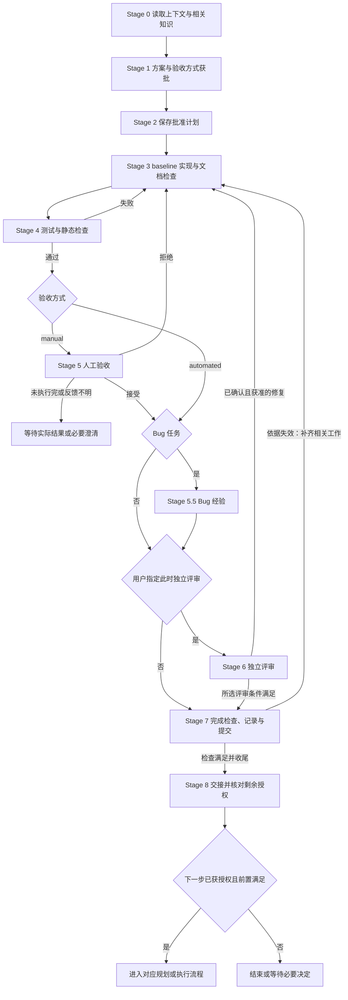
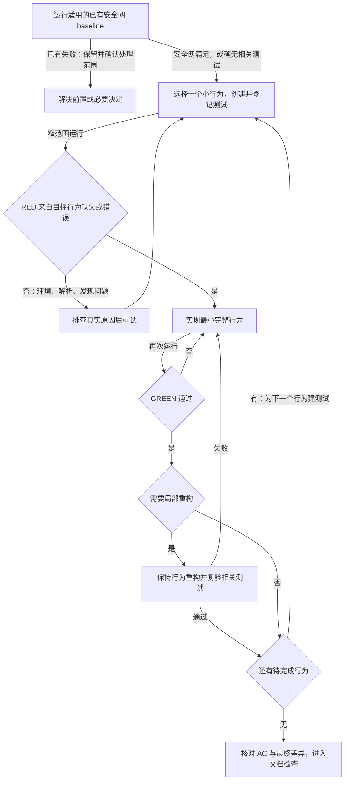
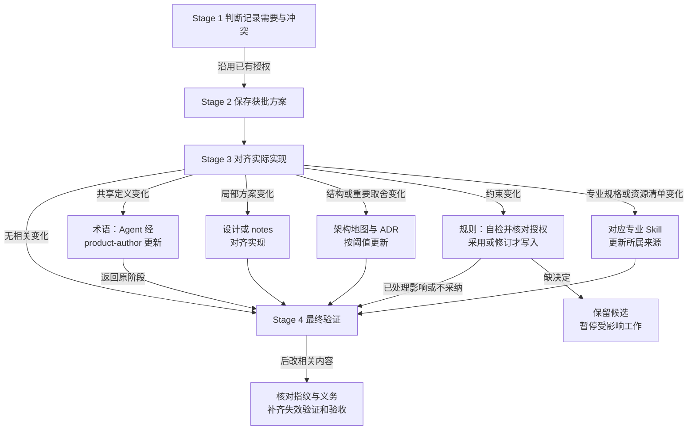

# 开发、验收与交付一个 Feature

[返回手册](../README.md) · 前一步：[需求与规划](product-and-planning.md) · 相关：[命令与验证](../reference/commands-and-validation.md)

实现已完成、需要逐项判断能否交付时，使用 [交付检查单](scenarios-verification-recovery.md#实现完成后判断能否交付)；中断后无法确定停点时，使用 [上下文恢复检查单](scenarios-context-handoff.md#上下文不足时恢复现场并续接)。

开始本章前，应已有确定的 Feature、所需需求和可用开发环境。Agent 通过 `feature-execute` 实现这项任务，交付代码、验证结果、适用的人工验收记录与本地提交；中断任务从实际停点继续。

需要主动发起开发时，在目标项目使用 [提示词导航](../reference/skills.md#从哪里取得操作提示词) 中的“Godot 项目开发 → 日常开发 → 执行指定或下一项 Feature”，说明目标任务与本次范围。已有明确实施授权的任务可直接续接，无需重新发送同一批准。

## Stage 0–8 的使用路线



阶段号是 Agent 定位当前工作的顺序，不是新增自动状态机，也不要求逐阶段批准。方案已有具体授权就沿用；规则新决定、适用人工验收和用户指定评审分别按真实条件处理。

| 阶段 | 主要工作 | 留下的结果或控制点 |
| --- | --- | --- |
| [Stage 0](#开始前读取什么) | 确定任务、环境、上下文和规则，优先查阅相关知识 | 当前任务与修改边界清楚 |
| [Stage 1](#stage-1-为什么先决定验收方式) | 测试影响分析、资源预检、验收方式，评估设计说明、ADR 与规则冲突 | 明确批准后才能开始实现；已有具体授权继续有效 |
| [Stage 2](#stage-2-把批准方案交给实现) | 标记 `in_progress`，写入批准的验证计划与必要设计、决策 | AC 映射、测试登记表和完成依据初始化；按需保存详细设计 |
| [Stage 3](#实现与测试怎么配合) | baseline、逐行为 TDD、实现与按逻辑分批提交；包含 [3D 文档检查](#最终验证前完成文档更新) | 真实失败与通过；术语、设计、架构和规则在最终验证前按需更新 |
| [Stage 4](#stage-4-取得最终验证结果) | 运行相关或必要全量测试，直接解析与 lint | 原始结果；manual 模式准备可重复验收步骤 |
| [Stage 5](#人工验收应如何操作) | 仅 manual 模式执行人工验收 | 用户对实际范围的明确接受或拒绝 |
| [Stage 5.5](#stage-55-记录-bug-经验) | 仅 Bug 任务记录经验 | 根因、触发条件、回归与防范原则 |
| [Stage 6](#按需独立评审与再次验证) | 用户指定时才执行独立评审，可合并多项 Feature | 默认省略；报告问题与证据，按用户选择处理 |
| [Stage 7](#完成记录与-git) | 检查完成依据、更新台账和历史、整理有价值的知识、收尾提交 | 当前最终内容满足适用检查，提交剩余实现与完成记录 |
| [Stage 8](#交付后如何继续) | 交接结果并核对后续范围、授权和前置条件 | 已授权则继续；范围完成、要求暂停或缺少必要决定时停止 |

各阶段详细行为由 [执行规范](../../../../project-source/methodology/03-execute-loop.md) 统一定义，[feature-execute](../../../../project-source/skills/feature-execute/SKILL.md) 提供操作入口与按需参考。这张图用于查找人工验收、Bug 经验和指定评审等分支；各分支的实际要求见对应小节。

## 开始前读取什么

Stage 0 在生成项目根目录确定一项任务、修改归属和必要前置，再读取下列文件；后续步骤沿用这些已核实信息。

| 需要确认什么 | 读取依据 |
| --- | --- |
| 当前工作及修改归属 | Git 状态、Progress、Feature 索引与详情；新修改任务要求干净工作区，续接任务保留并核对现有差异 |
| 预期行为与实现边界 | Feature 的主来源、适用专业次要来源及验证条件，相关 Product、实际代码，已有术语文档、Feature 设计、架构地图与 ADR 的相关部分 |
| 工程约束与环境 | `docs/project-rules.md`、按领域路由的 `agent-rules/`、已确认的工具配置 |
| 可复用经验 | 先查 `docs/knowledge/README.md` 及相关条目，核对适用条件后再拟方案或补查外部资料 |

按 [专业来源发现规则](specialist-workflows.md#专业来源怎样进入任务)，从当前需求、实际引用、共享适用范围与依赖定位资料；共享规格缺少直接链接不代表不适用。只展开与任务有关的来源，续接复用有效上下文，空知识索引不阻塞。Stage 0 将任务、关键资料、约束、修改范围与验证汇成简短快照，在 Stage 1 展示一次，后续只补实质变化。用户指定 Stage 6 时，评审者也读取相关定义、规则和知识。

无关改动保持原状，不通过自动 stash、删除或恢复来制造干净工作区；普通任务复用已准备的环境和命令。

模块交付顺序见 [任务拆分](product-and-planning.md#feature-如何拆分)。Agent 核对当前模块需求与 Feature 的真实完成情况；没有依赖就绪的候选不能直接判定模块已完成。

## Stage 1 为什么先决定验收方式

涉及画面、声音、动画、手感或其他人的判断时采用 `manual`；所有 AC 都可用自动方式充分验证时可以选择 `automated`。选择从需求出发，不能根据“人工检查列表为空”倒推不需要人工验收。

例如资源计算和存档字段的确定性结果可以自动检查；按钮是否容易辨认、声音是否刺耳或角色移动是否合适仍需要人在实际体验中判断。manual Feature 也可以包含大量自动测试。

Stage 1 一次说明任务范围、影响组件、已有安全网、新测试、资源依赖、人工检查和全量测试理由；同时判断是否需要详细 Feature 设计说明、是否达到 ADR 阈值，以及术语或项目规则是否存在冲突。用户已经对这个具体范围作出批准就沿用，不在后续阶段重复问同一件事；实现批准仍不等于用户已经验收结果。

涉及新界面或布局、资源明显变化时，先核对 [视觉原型基础](product-and-planning.md#先验证视觉原型再接入依赖它的逻辑)。需要独立原型 Feature 时先交付并取得适用的人工验收，再实现依赖它的逻辑；原型的视觉接受不代表正式功能已经接受。已有有效基础直接复用。

## Stage 2 把批准方案交给实现

Agent 确认 Stage 1 的具体方案已获批准后，将决定保存到现有文件；尚缺决定时保留方案，不先改成进行中或写入未经批准的测试计划。

| 交接文件 | 此时写入什么 | 谁接着读取 |
| --- | --- | --- |
| `docs/feature-list.json` | 当前项 `in_progress`、`completed_at: null` | 续接与台账检查 |
| 当前 Feature JSON | 验收方式、AC 测试/人工映射、回归 ID、附加测试与全量理由 | 实现 Agent、测试选择器与完成检查 |
| `docs/test-registry.json` | 尚未创建的验收/回归测试登记为 planned；组件没有套件则保留空路径数组 | Stage 3 创建测试后补路径/case 并激活 |
| `docs/progress.md` | 当前阶段、阻塞、待决定与方案链接 | 中断续接 |
| 可选设计、ADR 与规则 | 保存已批准且确有必要的内容，notes 留相对链接 | Stage 3 按实际实现对齐；详细维护见文档指南 |
| `docs/feature-completion-evidence.json` | 调用 `initialize` 初始化本 Feature 的测试引用与人工记录 | Stage 4–7 记录并校验当前依据 |

写入协调完成后运行完整台账检查。初始化不是失败恢复或清除失败的按钮；命令及副作用见 [完成依据参考](../reference/commands-and-validation.md#记录完成依据)。

## 实现与测试怎么配合

Stage 3 从批准方案开始，先取得已有行为的基线，再推进实现。

操作围绕小的可观察行为循环；图中每个动作由 Agent 实施，测试通过实际运行器执行。



Agent 先运行与变更相关的已有测试，作为修改前的安全网。空项目尚无相关测试时如实说明；已有测试本来就失败时保留原始错误，不记成本次修改引入，也不自行吸收无关修复。

适用 TDD（测试驱动开发）的新行为先建立对应测试，确认失败来自缺失或错误行为，再实现并取得通过。这里的 RED 指测试因目标行为尚未实现或存在错误而失败；解析错误、环境故障和未发现测试用例不属于这种有效失败。窄范围运行支持调试，最终验证按当前 Feature 和测试登记表计算。

按一个小的可观察行为完成 RED → GREEN → 必要重构 → 相关测试，再进入下一个行为；一条 AC 可以包含多个循环。Stage 1 可以提前设计整体验证策略，但不要求先写完所有测试再集中实现。已有实现交付和不适用自动 TDD 的内容仍遵循各自规则，不补造过去的 RED。

首次生成验证产物前按 [报告保留与清理](project-knowledge.md#报告保留与清理) 选择位置，正常收尾核对本次产物和证据链接；报告归组与历史清理各按已授权范围处理。

若需求变化涉及旧测试，同步报告先说明要处理的断言、方法/文件和当前引用，批准后交给对应 Feature notes。实现阶段按该范围实际删除或替换，并更新有效映射与注册路径；同一文件里的有效用例继续保留。测试登记表的 `retired` 只表示记录退役，仍在被选中套件内的旧方法仍可能执行。已完成 Feature 和退役记录保留历史用途，详见 [失效测试处理约定](../../../../project-source/methodology/08-testing-strategy.md#requirement-changes-and-stale-tests)。

## 最终验证前完成文档更新

**Stage 3D：文档检查。** Stage 1 判断是否需要记录，Stage 2 保存获批方案，此处在 Stage 3 内对齐实际实现，再进入 Stage 4。遇到含义或规则冲突时立即处理，不能等到最后再解决影响当前工作的决定。



图中的去向按需选择，不要求每类都创建文件。术语只保存共享定义，跨 Product/Feature 约束进入项目规则，局部实现选择保留在设计或 notes。Feature JSON 仍负责 AC、组件和验证义务；设计文件不是第二份台账。

详细的创建阈值、更新及历史保留集中在 [项目文档维护](project-knowledge.md#何时维护项目术语)；规则自检见 [规则修订](project-knowledge.md#维护项目规则与读取工程规则)。当前 Feature 的辅助文档工作保留原归属，完成后返回执行，不另起要求干净工作区的同步任务覆盖现场。

术语、规则、设计、架构与 ADR Markdown 通常按原始字节参与指纹，即使含义未变也可能使旧依据失效；notes 的过程字段豁免不传递给其链接的设计文件。Stage 5.5 等较晚节点改动同样适用，确切边界见 [内容绑定与失效判断](../reference/commands-and-validation.md#内容绑定与失效判断)。

## Stage 4 取得最终验证结果

先确认文档检查已完成，再从当前 Feature/Registry 计算测试义务。默认用 `--feature <实际 ID> --scope auto` 执行 affected，计划要求时升级为 full。一次当前内容上覆盖充分的全量成功可以同时满足 Required 和 affected，不为凑多份记录重复运行。

Agent 读取运行器打印的真实 `result.json` 及原始报告，调用 `record-tests` 导入引用；同时直接执行并判断 Godot 解析和 lint。两条检查线的职责与文件流转见 [结果到完成](../reference/commands-and-validation.md#从运行结果到完成状态)。

必要检查失败时回 Stage 3 处理，不能先进入人工验收。有效 manual 计划确无自动测试义务时，按 [无自动义务分支](#没有自动测试义务时) 记录 `not_required`；automated 模式须有每条 AC 的自动覆盖。需要人工判断时准备下节清单，全部自动验收则省略 Stage 5。

## 人工验收应如何操作

Stage 5 只用于 manual Feature。Agent 按 [人工验收文件契约](../../../../project-source/methodology/manual-acceptance-files.md) 交付清单并接收结果。每项检查对应批准的 AC 或必要回归，写清入口场景、起始状态、输入、预期反馈和重置方法；设备、时长或随机种子影响结果时再补充。

Agent 先编写初始项为 `pending` 的 JSON 清单，运行 `prepare-manual` 绑定最终内容，并提供 `reports/manual-acceptance/` 中原清单的可点击路径。Feature notes 只留决定与链接。

你按清单完成实际检查后，可以返回结果 JSON，也可以在对话中明确反馈当前范围的接受或拒绝。同一次决定只需采用一种反馈方式；有歧义时，Agent 只澄清具体问题。两种方式都以清单和实际检查为前提。

**使用结果文件时，按以下步骤操作：**

| 步骤 | 执行者与文件 | 结果 |
| --- | --- | --- |
| 留存清单 | 用户保留原清单，另存结果 JSON | 结果与清单共用结构，不覆盖原清单 |
| 填写结果 | 用户按实际观察填写 `status` 与 `comment` | 每项填写 passed/failed，未执行项保留 pending；用例 ID、版本、步骤和预期保持不变 |
| 接收 | Agent 阅读反馈，再导入原清单与结果 | 对照用例 ID、定义、覆盖和版本，记录 accepted/rejected/pending；完成前重读原件 |

项目不限定操作工具，截图可以辅助说明，不能代替实际结果。

清单的完整字段、模板与导入命令由项目 `methodology/manual-acceptance-files.md` 定义；只有独立阅读包时，需要从完整框架或生成项目取得这份文件。普通验收者可直接填写 Agent 提供的清单，无需自行拼装结构。

你提交的有效结果中所有必需项均为 `passed`，且范围、版本和反馈一致，即表示明确接受该范围，不再要求重复说“验收通过”。任何失败登记 `rejected`，仍有未执行项则保持 `pending`。

采用文件反馈时，文件缺失、旧版本结果或改变预期不能当作当前通过；导入成功只表示已记录结果，不表示 Feature 已完成。内容变化按 [指纹边界](../reference/commands-and-validation.md#内容绑定与失效判断) 判断，不能凭“只是文档”继续使用旧清单。复验保留仍需引用的失败原件，不覆盖原清单。

失败按已有授权修复；反馈改变了需求含义时，回到对应 Product/计划修订路线，不悄悄改 AC 迎合结果，也不把注释中的建议当作新增实施授权。automated 模式省略 Stage 5，不生成空人工清单或虚构接受。

## Stage 5.5 记录 Bug 经验

仅 `engineering_change: bug` 执行此步，其余任务直接进入下一适用环节。根因、触发条件、回归覆盖与防范原则留在本 Feature notes；是否形成长期规则按 [Bug 经验与规则维护](engineering-changes.md#bug-先查归属再查根因) 判断，不自动升级每条教训。较晚采纳的规则仍须处理当前任务影响并补齐失效依据。

## 按需独立评审与再次验证

**Stage 6：用户指定的独立评审。** 默认不启动，也不在每项 Feature 完成时例行询问。你可以通过“Godot 项目开发 → 验证与收尾 → 独立审查代码或指定变更”选择单项、多个 Feature、提交范围或明确差异，并说明评审时机。

多项评审核对当前合并成果及直接受影响的调用者，输出一份报告，不逐项重复审查整套内容。日常实现仍由作者核对 AC、范围、规则和最终差异，不另建通用自查阶段或报告；项目规则增删改保留专门的对话自检要求。

可以等选定 Feature 完成并提交后再集中评审，之前各项无需停留在未完成状态；明确要求“评审后再继续”时，Agent 遵守该顺序。具体授权沿用原会话，不另建队列、开关或待评审状态。

执行评审时使用新的独立上下文，按范围加载 `review-code` 或适用的专业审核 Skill。代码审核分别判断需求符合性与代码质量；同一根因关联相关 Feature。共享方法见 [独立审核规范](../../../../project-source/methodology/12-independent-review.md)，Stage 6 保留时机、范围和后续处理。角色配置的存在不证明实际加载或权限隔离，作者自己加载审核 Skill 仍是自查。

被审成果、原证据与验收记录保持只读；允许的针对性验证需把缓存、日志、导入和测试数据一并隔离，条件不足时说明未验证项。交接提供范围、权威来源、版本差异与原始证据，作者解释属于待核实陈述。审核报告交付不等于必要覆盖已通过，也不替代用户人工验收。专业审核与测量边界见 [专业工作指南](specialist-workflows.md#审核保持独立)。

同一入口也可检查指定模块、文件或提交快照的代码现状。此时走方法总览的普通只读审核路由，对照当前需求、项目规则和直接调用关系，复用上述独立性与证据要求；不要求存在变更、Feature 或 AC，不虚构比较基线，也不启动 Feature 交付阶段。需求或验证依据缺失时保留为审查限制，不把未知写成通过。

只要求评审时交付发现并停止，问题等级不是修改授权。分别核实问题与改法，在已选修复范围内处理；仅保留已接受且有用的后续事项，不把每条建议变成 TODO。当前任务中的确认缺陷回到实现阶段，已完成 Feature 保留历史并走已有工程修复入口。确认的完成阻断缺陷不能因评审可选而被忽略。

当前运行结果在只读评审后仍有效时可复用。修复改变最终内容则更新失效验证，影响已接受行为时更新对应人工验收；再次评审依据用户约定或尚未解决的具体问题，不机械重跑全部检查。

## 完成记录与 Git

Stage 7 中，Agent 完成前核对 AC 与最终差异、测试原件、适用人工决定和直接解析/lint，并满足你明确指定的评审条件。完成依据工具负责检查测试与适用人工接受，其他检查仍由 Agent 根据实际结果确认。

执行 `validate --feature <实际 ID>` 与台账的 `--completion-feature` 检查，且 Agent 负责的其他必要检查满足后，才把索引中的 Feature 记为 `done` 并填写本次实际完成时间。更新后再次运行完整台账检查，保留长期 notes，将执行历史归档一份到 `docs/progress/`，在当前 Progress 中链接它。完成工具不会替 Agent 更新状态。

本次形成的成功做法、排障方法或失败教训，有复用价值时在 Stage 7 收尾提交前写入 `docs/knowledge/` 对应主题并更新索引；原任务经过仍在 Feature notes，知识条目链接过去。Stage 8 汇报已有条目，不在收尾提交后再开始补文档。纯知识 Markdown 不使业务测试证据失效；新增脚本、规则或验收契约仍按其实际影响验证。

### 自动分批提交

Agent 在开发过程中，每完成一个可独立理解且通过相关验证的逻辑变更，就自动创建本地提交，无需再次询问。同一个 Feature 可以有多个提交，后续提交可以依赖前面已提交的成果；简单任务一次提交即可。不按时间、文件数量或固定次数拆分，必须一起实现和验证的改动放在同一批。

每批提交后的版本应保持可用，包含所需代码、测试、资源和记录；不能依赖留在工作区而未提交的配套修改，也不提交失败的 RED 测试。验证按本批变更及受影响行为选择，最终仍须完成整个 Feature 的验证与适用人工验收。

人工验收尚未完成时，可以提交已经验证的完整逻辑变更；你明确要求“验收或评审后才能提交”时遵守该条件。中途提交保持 Feature 为 `in_progress`，只有 Stage 7 检查通过才记为 `done`。工作区干净不代表任务完成，Agent 应继续已授权的剩余工作。

项目默认在当前分支提交本任务明确路径或检查过的差异块，提交前查看暂存区完整差异和检查结果；用户要求不提交时遵守该要求。最终审查覆盖该 Feature 的全部提交和剩余差异，Stage 7 提交剩余实现与完成记录，Stage 8 汇报提交列表或经核实的范围。提交后再次核对状态，不自动 push 或改写历史。

### 提交文本

Feature 提交标题采用 `<type>(F0XX): <本批中文行为摘要>`；正文的 `Feature:` 使用 `docs/feature-list.json` 中对应任务的真实 `title`，`Work item:` 指向详情文件。非简单修改说明本批内容、原因、关键取舍和实际验证。剩余工作由 Feature 与 Progress 管理，提交正文不要求重复；只有影响理解或使用本次修改的限制才按需说明。除两个身份字段外，不强制正文栏目或条数，简单修改省略重复说明；没有单一所属 Feature 的任务不虚构名称和路径。

以下是格式示例，不表示已经执行这些测试：

```text
feat(F012): 增加背包容量检查并拒绝超量入库

Feature: 增加背包物品管理

内容：入库前检查剩余容量，超量时返回失败并保持原有物品数量。
原因：避免容量不足时部分写入，导致调用方无法判断实际入库结果。
验证：容量边界与失败后数量不变的测试通过；相关解析和 lint 通过。

Work item: docs/features/F012.json
```

详细规则以 [Git 提交规范](../../../../project-source/agent-rules/00-core/git-worktree-and-commits.md) 和 [执行规范](../../../../project-source/methodology/03-execute-loop.md#incremental-commits-and-whole-feature-review) 为准。

## 交付后如何继续

Agent 在 Stage 8 汇报实际交付、验证范围与报告路径、提交和工作区状态，以及占位资源、未处理事项和下一项候选。你据此判断哪些成果可用、哪些仍需决定；已有具体授权继续有效，候选本身不授予执行权限。

只有本次范围已完成、你要求暂停、缺少必要决定或前置受阻时停止。若后续任务已经具体获批，Agent 可继续执行；当前模块的所需 Feature 完成后，再按授权复核下一模块需求。

## 沿用资源收集示例完成交付

继续 [需求指南中的教学片段](product-and-planning.md#用一个收集资源的例子理解层次)。下列 F001、测试名称与路径均是**说明用的候选**，本仓库没有建立或运行这项示例；实际使用须换成真实对象。

| 交接 | 本例如何落到文件 | 能据此判定什么 |
| --- | --- | --- |
| 需求 → 当前任务 | 示例模块 `docs/product/01-gathering.md` 被 F001 的 source 引用，AC01 初始 0，AC02 点击后依次 1、2 | 确定预期；不证明已实现 |
| 任务 → 测试映射 | Stage 1–2 可规划 `F001-AC01`、`F001-AC02`；Stage 3 在 Registry 关联实际创建的套件与 case，例如 `tests/features/F001/collection_test.gd::test_collect_twice` | 只有真实存在且被发现的测试才提供执行覆盖 |
| 映射 → 运行结果 | Stage 4 使用实际 F001 运行，读取命令打印的 `reports/gdunit-wrapper/run-<实际值>/result.json` | 原始结果证明实际覆盖与成败，0、1、2 仍是预期值 |
| 结果 → 完成依据 | `record-tests` 导入该路径及内容引用；若按钮辨识或手感属于需求，再绑定清单并取得用户结果 | 自动结果和人工决定分别核对当前内容 |
| 依据 → 状态 | 满足全部适用检查后 Agent 才记 done；人工项未完成则保持 in_progress 并在 Progress 说明等待内容 | 提交代码、导入成功或数值测试通过均不单独等于验收完成 |

本例通常无需详细设计文件或 ADR。真实方案若出现需长期解释的边界或重要决策，再按阈值建立，不从示例反推必备产物。

## 接管已有实现的交付

功能早于正式记录实现时，先按 [需求补齐说明](product-and-planning.md#从已有实现补齐需求与任务) 确认 Product 与当前 Feature。只补文档不进入执行；已明确授权验证与收尾时，Agent 核对现有实现覆盖、验收方式、剩余工作与测试影响，再记录当前计划和证据。

符合 AC 的代码直接复用。已有测试按实际覆盖登记，缺少的测试围绕确认的需求及边界补充；对未改变的已有行为，新测试可以立即通过，但只能说明本次验证，不能写成过去做过 TDD，也不故意破坏功能来制造 RED。后续新增行为或修复仍按正常基线与 TDD 规则处理。

最终审查覆盖相关现有实现与每条 AC，不能只看本次补录文档的差异。原始变更可追查时复用真实历史；无法恢复修改前版本时说明限制，检查当前实现及直接调用关系，不伪造开发前基线。旧报告只有仍满足当前内容与覆盖契约时才可复用；完成仍须取得适用的测试、直接静态检查、人工验收及用户指定评审结果。

必要条件满足后按 Stage 7 正式完成，时间记录为本次实际完成时间。具体规则见 [已有实现交付规范](../../../../project-source/methodology/03-execute-loop.md#delivery-of-existing-implementation)，使用原有状态和完成证据格式。

## 用 Goal 连续规划与开发

希望 Agent 自主拆分并连续执行时，选择“Godot 项目开发 → 日常开发 → 以 Goal 逐个推进 Product 至人工验收”。填写本次推进的 Product 范围与排除项，把完整正文设为目标，或在实际项目发送正文让 Agent 创建 Goal；讨论或编写提示词不会启动开发。Goal 的持续执行与证据终点说明见 [OpenAI Goals 文档](https://developers.openai.com/cookbook/examples/codex/using_goals_in_codex)。

本入口授权必要环境准备、当前 Product 的规划、实现、验证与按项目规则提交。已有计划和进行中任务直接复用；一个 Product 的必要 Feature 真正完成后，再拆分和执行范围内的下一个 Product，不提前展开全部后续计划。范围以启动时已纳入当前版本的 Product 和用户限制为准；关键产品决定不明仍需用户参与。

每次初次拆分仍先展示 [拆分预览](product-and-planning.md#写入前看拆分预览)，让你看到数量与各项内容，再写入计划和测试登记表。本入口已明确授权自主拆分，展示后直接继续；普通规划入口的默认确认步骤按预览规范处理。

首个需要人工验收的 Feature 先做到可运行、适用自动检查通过，并备妥绑定当前版本的验收清单，然后结束本段 Goal。Feature 和 Product 保留未完成状态，不跳过它继续其他工作。若范围内全部 Product 已真正完成，也可结束目标；验证失败、环境受阻和预算耗尽不是成功终点。

原型的两种承载方式沿用 [视觉原型规范](product-and-planning.md#先验证视觉原型再接入依赖它的逻辑)：当前 Feature 内的小范围原型尚待必要视觉确认时，只停止依赖该决定的实现，不表示整个 Feature 已准备好最终验收或 Goal 已达成，也不越过当前 Feature。独立原型 Feature 完成其全部适用自主工作并备妥体验入口与验收材料后，可以到达本段 Goal 的人工交接终点；其验收只覆盖原型范围。

用户提供有效人工结果并明确继续后，Agent 从原停点修复或收尾，再推进后续任务；旧 Goal 已结束时按继续授权启动下一段。Goal 的交接终点与 Feature 完成不同，实际人工接受始终单独核对。完整授权正文只保存在提示词库，项目无需新增 Skill、队列或 Goal 台账。

## 没有自动测试义务时

只有有效 manual 计划确实没有 Required、affected 或全量义务，才省略自动运行和 `record-tests`，保留 `test_runs: []` 并报告 `not_required`。人工接受与适用直接静态检查仍须满足；不能用此分支掩盖当前内容上的失败、未完成运行或缺失测试路径。完整条件见 [完成依据参考](../reference/commands-and-validation.md#记录完成依据)。

## 中断和失败时怎么继续

继续之前读取 [Progress 与任务记录](project-knowledge.md)，确认最后真实阶段、当前差异和哪些依据仍适用于现有内容。不能只凭上一轮“通过”的文字就把任务置为完成。

| 当前状态 | 接下来做什么 |
| --- | --- |
| 等待 Stage 1 批准 | 保留方案和问题，不开始依赖该批准的实现 |
| 实现中或测试失败 | 读取真实失败和原件，在原任务范围内修复 |
| 等待人工验收 | 提供已批准检查路径，等待用户实际结果 |
| 评审发现问题 | 先核实问题与改法，在已授权范围内修复并验证；已完成任务保留历史 |
| 验证后又改了代码、AC、测试登记表或纳入指纹的治理文档 | 核对并更新失效的验证依据 |
| 只是整理 Progress 历史 | 保留引用；不据此虚构业务内容改变或强制重跑 |
