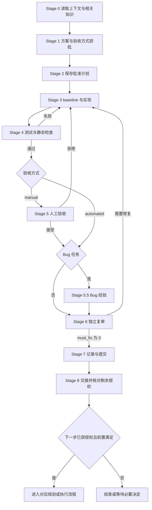

# 开发、验收与交付一个 Feature

[返回手册](../README.md) · 相关：[命令与验证](../reference/commands-and-validation.md)、[项目知识与交接](project-knowledge.md)

`execute-next-feature` 每次执行一项已经确定的工作。交接后，已有具体授权覆盖下一步且前置条件满足时继续；范围完成、用户要求暂停或缺少必要决定时停止。它也可以从当前任务的真实阶段继续。

## 开始前读取什么

Agent 读取当前项目 Git 状态、Progress、Feature 索引与详情、相关 Product、适用 Coding Rules、环境配置和受影响工程规则。由各模块 README 按主题选择相关章节，不把一种文件类型等同于整目录必读。已有 `docs/CONTEXT.md` 时读取相关概念定义，已有架构地图或相关 ADR 时一并查看，核对实际代码和需要修改的路径。Stage 6 复审也读取这些相关定义，检查命名与含义是否一致。

提出方案或查外部资料前，优先从 `docs/knowledge/README.md` 进入相关主题，读取适用于本任务的经验条目并核对条件。Stage 6 也参考相关知识；继续原任务时复用已读内容，不重复通读目录。初始索引为空或没有相关经验时正常继续。

新修改任务按项目规则要求干净工作区；继续当前任务时，按真实差异确认任务归属。保留无关文件，不通过自动 stash、删除或恢复解决归属问题。环境须已准备，普通任务复用确认过的命令。

Stage 0 准备当前任务、关键资料、实际约束、修改范围和验证的简短快照，在 Stage 1 方案中展示一次，不限定规则条数。继续任务时引用已有快照，仅补充实质变化。

Product 开发保持逐个推进：先完成当前 Product 所需的 Feature，再复核并拆分下一 Product。Stage 8 说明当前 Product 的剩余任务或真实阻塞，按已有授权衔接后续执行或下一 Product 的规划。`--eligible` 只说明依赖就绪，没有候选不能直接判定 Product 已完成。已有后续计划保留，工程修复仍按其实际授权处理。

## Stage 0–8 的使用路线

| 阶段 | 主要工作 | 留下的结果或控制点 |
| --- | --- | --- |
| 0 | 确定任务、环境、上下文和规则，优先查阅相关知识 | 当前任务与修改边界清楚 |
| 1 | 测试影响分析、资源预检、验收方式和方案 | 明确批准后才能开始实现；已有具体授权继续有效 |
| 2 | 标记 `in_progress`，写入批准的验证计划 | AC 映射、测试登记表和完成依据初始化 |
| 3 | 已有安全网 baseline、适用的 TDD、实现 | 有意义的失败原因与通过结果；必要占位资源登记 |
| 4 | 运行相关或必要全量测试，直接解析与 lint | 原始结果；manual 模式准备可重复验收步骤 |
| 5 | 仅 manual 模式执行人工验收 | 用户对实际范围的明确接受或拒绝 |
| 5.5 | 仅 Bug 任务记录经验 | 根因、触发条件、回归与防范原则 |
| 6 | 一次独立上下文的需求和代码质量复审 | 处理 `must_fix`；保留必要建议；修复后验证 |
| 7 | 检查完成依据、更新台账和历史、整理有价值的知识、本地提交 | 当前最终内容满足适用检查，提交只含本任务 |
| 8 | 交接结果并核对后续范围、授权和前置条件 | 已授权则继续；范围完成、要求暂停或缺少必要决定时停止 |

流程详细行为由 [执行规范](../../../../project-source/methodology/03-execute-loop.md) 统一定义，[execute-next-feature](../../../../project-source/skills/execute-next-feature/SKILL.md) 提供操作入口与按需参考。本手册不增加阶段、固定发言句式或另一套状态表。

## Stage 1 为什么先决定验收方式

涉及画面、声音、动画、手感或其他人的判断时采用 `manual`；所有 AC 都可用自动方式充分验证时可以选择 `automated`。选择从需求出发，不能根据“人工检查列表为空”倒推不需要人工验收。

例如资源计算和存档字段的确定性结果可以自动检查；按钮是否容易辨认、声音是否刺耳或角色移动是否合适仍需要人在实际体验中判断。manual Feature 也可以包含大量自动测试。

Stage 1 一次说明任务范围、影响组件、已有安全网、新测试、资源依赖、人工检查和全量测试理由。用户已经对这个具体范围作出批准就沿用，不在后续阶段重复问同一件事；实现批准仍不等于用户已经验收结果。

## 实现与测试怎么配合

先运行与变更相关的已有安全网。它若本来就失败，应保留原始错误并说明，不能记成本任务引入，也不能自行吸收无关修复。

适用 TDD 的新行为先建立对应测试，确认失败来自缺失或错误行为，再实现并取得通过。解析错误、环境故障和无测试发现不是有意义的 RED。窄范围运行支持调试，最终验证按当前 Feature 和测试登记表计算。

需求变化涉及旧测试时，同步报告说明要处理的断言、方法/文件和当前引用，批准后交给对应 Feature notes。实现阶段按该范围实际删除或替换，并更新有效映射与注册路径；同一文件里的有效用例继续保留。测试登记表的 `retired` 只表示记录退役，仍在被选中套件内的旧方法仍可能执行。已完成 Feature 和退役记录保留历史用途，详见 [失效测试处理约定](../../../../project-source/methodology/08-testing-strategy.md#requirement-changes-and-stale-tests)。

最终默认 `--scope auto` 运行 affected 集合，必要时升为 full。一次覆盖充分、内容仍匹配的全量成功可以覆盖 Required 和 affected；无需为填多处状态重复跑同一范围。测试选择、报告和静态检查详见 [命令与验证](../reference/commands-and-validation.md)。

只有有效的 manual 计划确实没有 Required、affected 或全量测试义务时，才省略自动运行和 `record-tests`，保留初始化的 `test_runs: []`，说明自动测试为 `not_required`。这不表示“空测试通过”：人工验收、独立复审和适用的静态检查仍需完成，当前内容上的失败或未完成运行也不能被省略操作掩盖。已登记但缺失的测试路径仍是错误。

## 人工验收应如何操作

人工步骤围绕批准的 AC 展开：入口场景、起始状态、实际输入、预期反馈和必要重置。输入时长、设备、随机种子或参数会影响结果时再说明。

例如检查一个已实现的面板重开行为，应写清进入哪个场景、如何打开和关闭面板、何时切场景、再次打开时应看到什么，以及如何从初始状态重做。截图可以标明观察位置，但不单独证明操作链成立或用户已经接受。

用户明确接受当前范围后才能登记 `accepted`；验收失败登记 `rejected` 并修复。反馈改变了需求含义时，回到对应 Product/计划修订路线，不悄悄改 AC 迎合结果。automated 模式省略 Stage 5，也不写入虚构的人工接受。

## 独立复审与再次验证

Stage 6 使用新的独立上下文，同时检查两方面：每项 AC 与实际证据是否对应，以及最终代码的职责、依赖、重复、生命周期和工程质量是否合理。复审读取实际差异和原件，不能只复述实现者总结。

结果分别给出“需求符合性”和“代码质量”的结论及依据，问题注明所属维度后可按严重程度汇总；缺少依据时明确说明，不能用一维无问题代替另一维的判断。`record-smell` 保存合并计数和内容快照，不执行复审；是否审查到两方面，应查看结论与证据引用。“独立审查指定修改”提示词沿用同样的双维输出约定。

需要清理旧测试的变更，复审结合最终差异、受影响的当前引用与实际发现/运行结果核对清理是否完成、有效覆盖是否保留。必要清理尚未完成时列为 `must_fix`；交接说明实际处理与剩余工作，不能仅凭 `retired` 或待办记录宣称完成。复用原有 notes、Progress 和复审，不增加清理台账或脚本。

`must_fix` 必须修复；`suggest` 作为必要的 TODO 进入 Feature notes；`acceptable` 不自动成为技术债。当前运行结果在复审后仍有效且代码未变时可复用。修复改变最终内容则重新验证受影响范围；改变已经人工接受的行为时，还需更新对应人工验收。

## 完成记录与 Git

完成前分别核对测试原件、适用的人工决定、`must_fix: 0` 复审，以及 Agent 直接执行的解析和 lint。完成依据脚本只负责自己的契约，不能替代静态检查或补出用户决定。

显式检查通过后才把 Feature 记为 `done` 并填写完成时间。随后保留长期 notes，将执行历史归档一份到 `docs/progress/`，在当前 Progress 中链接它。

本次形成的成功做法、排障方法或失败教训，有复用价值时在提交前写入 `docs/knowledge/` 对应主题并更新索引；原任务经过仍在 Feature notes，知识条目链接过去。Stage 8 汇报已有条目，不在提交后再开始补文档。纯知识 Markdown 不使业务测试证据失效；新增脚本、规则或验收契约仍按其实际影响验证。

项目默认在当前分支提交本任务明确路径或检查过的差异块，提交前查看暂存区完整差异和检查结果；用户要求不提交时遵守该要求。Feature 提交标题采用 `<type>(F0XX): <中文行为摘要>`，正文包含 `Work item: docs/features/F0XX.json`，非简单变更补充原因和主要验证。提交后再次核对状态，不自动 push 或改写历史。

## 中断和失败时怎么继续

继续之前读取 [Progress 与任务记录](project-knowledge.md)，确认最后真实阶段、当前差异和哪些依据仍适用于现有内容。不能只凭上一轮“通过”的文字就把任务置为完成。

| 当前状态 | 接下来做什么 |
| --- | --- |
| 等待 Stage 1 批准 | 保留方案和问题，不开始依赖该批准的实现 |
| 实现中或测试失败 | 读取真实失败和原件，在原任务范围内修复 |
| 等待人工验收 | 提供已批准检查路径，等待用户实际结果 |
| 复审发现问题 | 修复、验证，并检查是否影响已接受行为 |
| 验证后又改了代码、AC 或测试登记表 | 核对并更新失效的验证依据 |
| 只是整理 Progress 历史 | 保留引用；不据此虚构业务内容改变或强制重跑 |

Stage 8 交付应包含结果、实际验证范围、报告路径、提交或不提交原因、工作区状态、占位资源和未处理事项，以及下一项候选。候选可执行不代表已获授权；已有具体批准可沿用，每项 Feature 仍完成其适用验收、独立复审和提交。规则变更需要的同步也按实际授权处理，不能跳过前置。
