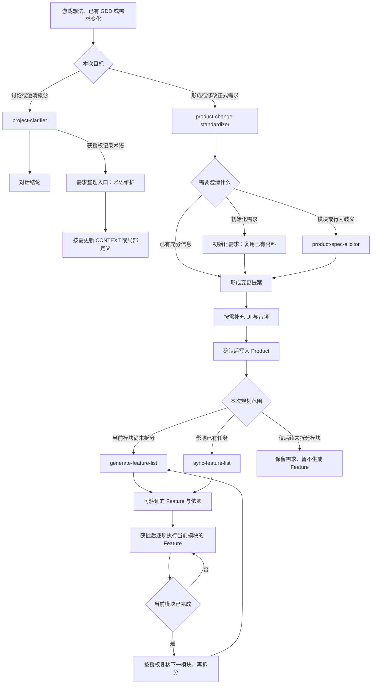

# 从想法或 GDD 到 Product 与 Feature

[返回手册](../README.md) · 本任务下一步：[开发与交付 Feature](feature-delivery.md)

你提供游戏想法、已有 GDD 或已确认的设计，Agent 将它们整理成 Product 总览与模块需求，再把当前模块拆成 Feature。本章帮助你判断需求写到什么程度、任务如何验收，以及规划结果还缺什么；尚未明确的关键设计仍由你选择。

在目标项目使用 [提示词库](../../../prompts.json) 的“Godot 项目开发 → 需求设计 → 从想法或已有 GDD 整理 Product”，填写材料、限制与本次范围。默认交付需求与适用规划，不开始游戏实现。

有现成 GDD 可以直接提供路径或附件。目录状态、原件保留和新旧材料冲突的处理见 [接入已有 GDD](#接入已有-gdd)，无需重新口述全部设计。

## 只整理外部需求内容

外部对话中的一段文本、需求摘录、文件或附件，如果需要先适配当前工作流、暂不写入项目，使用 [提示词库](../../../prompts.json) 的“Godot 项目开发 → 需求设计 → 只读适配外部需求内容”。提供材料、已有决定与整理范围即可，粘贴文本无需先保存成文件。

Agent 只读核对相关项目资料，输出一个完整的 Markdown 草稿代码块，保留原意并区分需求、外部建议与待定事项。草稿标注“待确认、未写入、未执行”，说明规范化需求、建议承接位置、适用入口和必要前置；缺少上下文时如实标明，不编造需求或执行结果。没有引用 Skill 的原文不一定有问题，适配只补充实际需要的衔接。

该入口不创建 Product、Feature 或其他文件，不运行测试或实现任务，也不调用会写入的 Skill。你可复制草稿继续讨论，明确选择后续写入或实施范围后，再使用对应入口。需要直接形成正式 Product 与适用规划时，使用本章的 GDD 整理入口；两者的区别是交付范围，不是输入必须为文本还是文件。

## 从已有实现补齐需求与任务

已经写出功能、但缺少 Product 或 Feature 时，在目标项目使用 [提示词库](../../../prompts.json) 的“Godot 项目开发 → 需求设计 → 从已有实现补齐需求与任务”。提供已有实现与相关材料、已确认意图和本次范围；默认只补文档和当前模块计划，也可明确要求同时完成必要验证与收尾，并说明允许修复的范围。

Agent 先核对相关实现、提交或讨论，区分正式意图、代码现状、缺陷、占位与实验。已有决定直接沿用；仍会改变行为或验收含义的选择由你决定。例如代码允许余额不足时购买，不能仅因为它已实现，就把允许负余额写成正式需求。

Product 保存现在确认的行为与边界，已有文档增量补充。当前模块的 Feature 按可独立验收的结果组织，复用已有任务、实现和测试，不倒推虚构的历史编码步骤。新记录初始仍为 `pending`、`completed_at: null`，在现有 notes 中注明“实现早于正式记录”、可核实来源和剩余工作。原实现时间有证据时保留在 notes；过去没有的批准、测试和验收不补造。后续模块先保留 Product，不因已有代码就跳过当前模块的交付顺序。

| 本次范围或实际状态 | 交付与下一步 |
| --- | --- |
| 只补文档和计划 | 完成必要文档/台账检查与本地提交，分别说明已实现范围、真实缺口和待验证项，不将新 Feature 标为完成 |
| 已授权验证与收尾，功能符合需求 | [接管现有实现](feature-delivery.md#接管已有实现的交付)，补充缺少的验证与适用验收，不重写功能 |
| 发现遗漏或缺陷 | 在已授权范围内补齐；超出修复范围时说明具体缺口，保留已有成果和失败依据 |
| 当前完成条件全部满足 | 由现有执行流程记录 `done`，完成时间使用本次实际时间，不倒填成原编码时间 |

未提交成果仍按现有 Git 归属规则处理：同任务续接需要核实归属，未知或混合修改不能为补录而自动清理、暂存或吸收；无法写入时先交付可确认的只读分析和具体前置。补录不自动成为实现、测试或人工验收通过的证明。

规划与状态语义见 [已有实现的规划接管规范](../../../../project-source/methodology/02-feature-list-schema.md#adopting-existing-implementation)。只想判断手动修改是否冲突、暂不补记录时，使用 [手动修改一致性检查](engineering-changes.md#手动修改后检查需求一致性)。

## 用一个收集资源的例子理解层次

假设输入只有：“玩家点击按钮收集资源，并能看到当前数量。”为了讲解，以下约定初始值为 0，每次有效点击增加 1，暂不包含存档或自动生产。**这些是教学片段，不是已批准需求、完整模板或仓库中的实际任务。**

Product 总览先说明游戏的核心循环是“收集资源 → 看到数量反馈”，并列出资源收集模块。它提供全局入口，不展开按钮和计数器的全部细节。

模块需求再把这段想法变成可判断的规则：初始数量为 0，有效点击增加 1，界面显示当前数量。输入含义、界面反馈与暂缓范围在这里确定；GDScript 类名和节点布局留给实现方案。

Feature 则确定一次交付：示例 `F001` 实现计数、收集输入和数量显示。它引用模块需求，用 AC（验收条件）约束结果，例如初始显示 0，连续两次有效点击后依次显示 1、2。计划还要区分哪些结果适合自动测试、哪些需要人工体验。

这几步分别增加全局关系、行为细节、任务边界与结果证据。原始设计由正式需求承接，Feature 引用需求，报告记录实际观察，避免把同一份正文抄进所有文件。[交付指南](feature-delivery.md#沿用资源收集示例完成交付) 会继续说明这项示例工作如何验收。

## Product 分成总览和模块

| 文件 | 回答的问题 | 内容边界 |
| --- | --- | --- |
| `docs/product.md` | 整款游戏做什么，各模块如何配合？ | 定位、玩家、核心循环、模块清单与依赖、视听方向、变更历史；通过链接进入模块细节 |
| `docs/product/NN-name.md` | 这个模块具体应怎样表现？ | 行为、数据含义、状态、UI、音频、数值、验收条件、暂缓边界及变更历史 |

数据字段的业务含义保存在模块需求中，GDScript 类型、节点布置和算法选择由实现方案或工程记录承接。

模块文件使用两位编号和 ASCII kebab-case 名称，例如 `01-gathering.md`。已有模块编号保持稳定；新增模块追加可用编号。模块废弃按规范保留可追溯历史，不为重新排序而批量改名。

模板必需章节保留，不适用时说明原因。共享概念可引用 CONTEXT，具体行为仍写在负责的模块中，不复制多份定义。

完整结构见 [Product 规范](../../../../project-source/methodology/01-product-doc-structure.md)。

## 从当前已有内容出发

| 当前情况 | 入口与处理 |
| --- | --- |
| 想先讨论想法、概念或方案 | `project-clarifier` 只补问影响当前判断的缺口，默认只在对话中给结论 |
| 希望记录已确认的项目术语 | `project-clarifier` 澄清后由 `product-change-standardizer` 按授权写定义和链接，纯术语整理不拆 Feature |
| `docs/product.md` 为空，已有想法或 GDD | `product-change-standardizer` 复用输入整理初始需求；需要补问时调用 `product-init-elicitor` |
| 已有功能，缺少 Product 或 Feature | [从已有实现补齐](#从已有实现补齐需求与任务)，确认意图、记录当前覆盖与缺口，按授权接管验证 |
| 有 Product，需要补充或修改行为 | `product-change-standardizer` 按歧义使用 `product-spec-elicitor` |
| 需要界面布局或声音需求 | 按需使用 `product-ui-sketcher` 或 `product-audio-sketcher`；实际布局与资源效果按下文视觉原型验证 |
| 当前模块已确认且尚未拆分；前一模块的 Feature 已完成 | `generate-feature-list` 只拆当前模块，追加到现有台账 |
| 已有 Feature 受到 Product 或 Coding Rules 变化影响 | `sync-feature-list` 增量对齐，后续未拆分 Product 暂不生成任务 |
| 产品预期明确，代码表现错误 | [工程变更](engineering-changes.md) 的 Bug 路线 |

已有明确答案直接沿用。需求整理、拆分或同步结束后，Agent 按本次授权决定下一步：只要求文档或规划时交付后结束，已明确授权实现时进入任务执行。仍会改变验收含义的关键选择由你决定。

## Feature 如何拆分

**Agent 每次拆分一个模块的已确认需求，完成其所需 Feature 后，再拆下一模块。** 一个模块对应 `docs/product/NN-name.md`；推进顺序根据总览中的实际依赖确定，稳定文件编号只用于定位。

后续模块可以先保留已有设计，轮到它时再复核需求、分配 Feature ID、详细 AC 和测试登记。这样既能保存全局设计，也能结合已实现结果调整后续计划。

任务拆分入口 `generate-feature-list` 将新任务追加到现有索引，保留历史 Feature、测试登记与修订记录。当前模块已有计划时直接复用，需要改变计划则由 `sync-feature-list` 增量同步。

一项 Feature 交付可独立验证的完整行为或工程结果，工作量为 `small` 或 `medium`，过大的工作继续拆分。Agent 复用已有基础设施，只补当前模块必需的运行基础；模块所需前置未完成时，先调整推进顺序。

新界面或布局、资源明显变化时，按 [视觉原型](#先验证视觉原型再接入依赖它的逻辑) 确定前置：可独立验收的视觉基础使用普通 Feature，依赖它的逻辑通过 `depends_on` 后续推进；已有合适基础直接复用，不把全游戏美术齐备设为开发前提。

进入下一模块前，Agent 对照当前模块已确认需求、Feature 来源与状态确认交付完整。仍有待做、进行中或受阻任务时，应说明剩余工作；没有可执行候选或模块文档标为 `done` 不能代替这一判断。拆分规则见 [逐模块规划规范](../../../../project-source/methodology/02-feature-list-schema.md#product-by-product-planning)，授权续接见交付指南。

规划产物的分工见 [文件职责参考](../reference/project-layout.md#文档与执行文件如何配合)：索引定位任务，详情定义范围，测试登记表连接验证，修订记录保留需求变化对计划的影响。

`F001` 等 ID 记录分配顺序，不直接决定执行先后。`depends_on` 构成无环依赖图；只有前置任务均为 `done` 的 `pending` 项才可被列为下一项候选。同样可执行时再用稳定 ID 顺序选择。

### 写入前看拆分预览

每次初次拆分当前模块时，Agent 先在对话中展示预览，再写入 Feature 与测试登记表。你会看到当前 Product 和范围、本次拟新增的数量、台账总数的前后变化，以及每项 Feature 的名称、简要内容、可观察的完成结果与依赖。Agent 简述拆分颗粒度的理由，并在同一规划方案中保留需求覆盖对应关系；数量由完整工作单元决定，不预设固定个数。

普通拆分默认等你确认具体方案后再写入。你可以先要求合并、继续拆分或调整某项边界；数量、工作边界或依赖有实质变化时先更新预览。已确认且未改变的方案跨轮次沿用，不重复询问；确认 Product 需求本身不等于确认尚未展示的拆分方案。

明确授权自主拆分并继续推进时，例如使用 [Goal 连续开发入口](feature-delivery.md#用-goal-连续规划与开发)，Agent 仍在写入前展示预览，但可直接继续；仅开启 Goal 模式不代表已有此授权。缺少关键产品决定或超出范围时仍需你决定，规划确认也不替代实施授权或人工验收。

预览留在现有对话方案中，写入后更新实际 ID、数量和剩余工作，不额外生成预览文件。完整约定见 [拆分预览规范](../../../../project-source/methodology/02-feature-list-schema.md#decomposition-preview)；这是 Agent 的流程要求，台账检查器不能证明对话中已经展示或确认。

## 验收条件和测试 ID

每条 AC 使用稳定 ID，例如 `AC01`。条件写成可观察的结果，避免“体验好”“性能高”这类缺少判据的描述。机器可验证内容关联逻辑测试 ID，人工判断内容记录可重复的检查步骤。

| 标识示例 | 意义 |
| --- | --- |
| `F012-AC01` | F012 的 AC01 自动验收测试 |
| `F012-AC01-02` | 同一 AC 下的另一个自动测试 |
| `F052-RT01` | F052 修复 Bug 时建立的回归测试 |
| `INV-LIFECYCLE-01` | 跨 Feature 的生命周期不变量 |
| `resource_collection` | 资源收集语义组件，用来选择相关安全网 |

规划阶段 `verification.acceptance_mode` 可以为 `null`，表示尚未决定；正式执行在 Stage 1 先根据需求选择 `manual` 或 `automated`，再填验证项。初始空列表不表示自动选择了全自动验收。

允许先登记 `planned` 的验收/回归测试，随后在实现中创建并改为 `active`。组件的 `unit_test_paths` 只登记已存在套件，没有套件时用空数组；不要用未来目录冒充现有安全网。

## 测试登记表的作用与位置

`docs/test-registry.json` 是项目的测试登记表（Test Registry），固定保存在这个位置。它将组件、Feature / AC 和实际测试文件、测试函数关联起来：组件记录已存在的单元测试路径，测试条目记录逻辑 ID、用途、来源、组件及 planned / active / retired 状态。

例如，后续 Feature 改动资源收集行为时，Agent 声明影响 `resource_collection` 组件，选择器便可找到已登记的计数单元测试及相关历史测试。空项目尚无这些记录，随实际规划和实现建立；登记表提供查询关系，真实报告才说明是否通过。

## 规划完成时应能回答

**哪些需求已经规划？** Agent 根据实际写入结果，列出当前模块的已确认需求位置、对应 Feature/AC，以及拟采用的自动测试或人工检查。逐项检查遗漏与重复，不能用来源链接或任务编号代替覆盖判断。

**还缺哪些工作？** 报告分别说明尚未覆盖的当前需求、尚未实现的功能、尚未编写的测试和尚未执行的验证。后续模块和已确认排除的范围只说明去向；增量同步只展开本次变化及真实下游影响。

**下一步从哪里继续？** 可执行事项留在所属 Feature 或当前 Progress，已有具体授权继续有效。规划对齐不等于实现或验收通过；正式字段与覆盖检查见 [Feature 规范](../../../../project-source/methodology/02-feature-list-schema.md#requirement-coverage-review)。

## 接入已有 GDD

**现有 GDD 可以直接作为需求整理的输入，不必重新口述整套设计。** 使用 [提示词库](../../../prompts.json) 的“Godot 项目开发 → 需求设计 → 从想法或已有 GDD 整理 Product”，提供文件路径或附件、材料中的当前有效范围和本次要完成的工作。

### 先判断项目目录状态

| 目录现状 | 接入方式 |
| --- | --- |
| 只有一个空文件夹 | 按 [创建说明](../getting-started/create-project.md) 向该空目录复制框架材料，再进入目标目录整理需求；GDD 先留在原处，避免目标提前变成非空目录 |
| 已由当前框架生成，尚无实质 Product | 跳过创建器，按 [首次使用](../getting-started/first-use.md) 核对准备状态，再以 GDD 整理初始 Product |
| 已有实质 Product 或 Feature | 对照 GDD 与现有规格，按实际差异增量修改；文件更完整或日期更新不构成覆盖已有决定的依据 |
| 已有其他框架的代码、规则或任务 | 使用 [复制迁移已有项目](../getting-started/migrate-existing-project.md)，先处理项目结构与成果续接 |

只阅读、讨论 GDD 不要求运行 Godot；正式写入需要遵循项目文档语言与 Git 约定，进入实现前须完成环境准备。

### 按内容对应到正式文件

| GDD 中的内容 | 整理后的归属 |
| --- | --- |
| 游戏定位、目标玩家、版本核心循环、模块依赖、整体美术与声音方向 | `docs/product.md`，保持为可快速浏览的总览 |
| 玩法流程、数据含义、状态转换、UI 交互、声音触发、数值和可观察结果 | 对应 `docs/product/NN-name.md`，保留模板章节语义 |
| 多处共用且容易混淆的概念 | 优先复用模块定义；确有跨模块需要时整理到 `docs/CONTEXT.md` |
| 引擎类、节点布局、算法或存储格式等技术建议 | 与产品行为分开说明；经采用的技术选择进入实现方案或相应工程记录 |
| 备选方案、未来版本、待定数值或互相矛盾的描述 | 标明待定或暂缓范围；只解决影响当前模块与其依赖的关键决定 |

按语义和模块责任建立对应关系，不按 GDD 章节数机械生成模块，也不直接把整个 GDD 改名为 `product.md`。读取范围应覆盖总览、当前模块及其依赖；不可读附件、缺失图表和外链材料明确列为缺口，不能以推测补齐。整理时用简短的“GDD 章节 → Product 位置 → 待处理内容”对应说明检查有无遗漏。

### 保留原件，确定后续维护位置

外部 GDD 原件保留在原位置。通常直接读取即可；需要让目标项目保留独立参考副本时，按授权复制原文和必要附件，使用能说明用途的名称，并注明它是参考快照。复制不移动原件，不覆盖已有项目文件。

整理完成后，已确认的 Product 是后续规划与实现依据。原 GDD 保留来源价值，不与 Product 双向同步；日后引入新版 GDD，仍通过 Product 变更入口核对差异。来源定位写在相关 Product 内容或现有变更记录中即可。

### 从整理结果继续开发

Agent 先复用 GDD 中已明确的设计，分别列出已确认内容、提议和关键冲突；材料中有答案的事项不重新访谈。已有具体授权继续有效，重要未决选择不由 Agent 静默决定。

接入 GDD 后沿用 [逐模块拆分](#feature-如何拆分) 路线。你可以继续选择“拆分当前 Product 的 Feature”或“执行指定或下一项 Feature”，也可明确一段连续执行范围；完整设计本身不等于实现授权。

## 需求变化后怎样保留历史

已有计划由 `sync-feature-list` 对照真实 Git 源差异、规划基线和当前文件增量更新。已有变更说明直接复用；无法恢复可靠基线时，按授权对当前完整规格与计划做核对，明确历史未知，使用现有修订字段记录新基线。最后一次 notes 提交或复制空台账的提交都不能冒充规划基线。

| 变化 | 处理方式 |
| --- | --- |
| 已完成行为需要改变 | 通常新增 Feature，保留旧 AC、测试 ID 和完成事实 |
| 未完成任务修改、拆分或合并 | 更新当前详情、下游依赖、替代任务和测试映射，记录修订关系 |
| 旧工作被替代 | `obsolete` 表示未完成即废弃，`obsolete_done` 表示曾完成；未完成任务不能继续依赖这些旧项 |
| 旧 AC 或测试失效 | 退役记录保留历史来源；planned/active 测试仍关联当前 AC，不能为消除失败无依据地删测试 |
| 只需重跑有效下游测试 | 归入当前变更 Feature 的 notes 与 Stage 1 验证范围，不另建任务、不改变原测试归属 |
| 后续未拆分模块变化 | 不影响现有工作时只改 Product；轮到该模块再读取完整最新规格，不能因早于同步基线而漏拆 |

写入顺序为：先合并新增组件，再更新 Feature、测试和修订关系，最后检查完整台账。无单元套件时登记空路径数组；保留已有数据，同名冲突须解决，不能重置登记表让检查通过。本次写入错误在原授权内修正，已有损坏或权限问题按实际边界处理。

独立实现、修复或单独交付的回归工作才新增任务。仍需执行的测试不能以备注免除，尚未实现的替代测试不能作为完成依据；真实测试删除与替换方式见 [实现与测试](feature-delivery.md#实现与测试怎么配合)。

## 先讨论，按需留下术语

`project-clarifier` 默认只讨论；按实际缺口提问，用具体情景检验概念，上游决定变化后只复核受影响结论。需求与音频澄清入口沿用同一方法，返回草案或补丁；已知信息直接复用，不设置问答、模块或 AC 数量下限。

跨模块或 Feature 使用的稳定概念按需放在 `docs/CONTEXT.md`，局部定义已有合适位置时保留原处。每个概念只维护一份定义，其他位置链接过去。具体职责见 [项目知识](project-knowledge.md#何时维护-context)。

仅记录已同意的区别、统一名字或移动定义，且含义和行为不变时，不要求 Product 初始化或 Feature 同步。若定义变化实际改变玩法、数值或验收条件，就先解决产品决定，再按授权更新 Product 并同步任务，不能把它当成纯文字整理。

## UI 与声音产物的边界

`product-ui-sketcher` 在布局或交互需要澄清、或用户要求草图时返回 ASCII 线框、交互意图、状态差异和必要的视觉基础规格，包括已知显示条件、资源参考及待验证问题。已确认且影响体验的尺寸、字体和可读性要求可以保留；试验参数与具体节点设置留在实现中。已有明确交互的文案或数值调整可直接更新需求。HTML/Tailwind 探索仅按实际用途或用户请求生成，不能证明 Godot 中的适配和手感。

`product-audio-sketcher` 返回声音触发、时长、风格、可用样本引用和必要试听问题。真实资源保留原路径；尚缺资源时才给出稳定的 `_placeholder_` 文件名，不为命名约定创建空文件或重命名真实素材。缺少参考不妨碍整理需求，但文件名或静音不能证明听觉效果。它不生成音频、不直接写 Product 或 Feature，也不实现播放。

这些辅助 Skill 形成 Product 草案或补丁，Product 的正式写入由 `product-change-standardizer` 负责。确认界面或音频需求后，仍需在 Feature 中说明具体实现和人工验收范围。

## 先验证视觉原型，再接入依赖它的逻辑

新界面或较大的布局、资源变化，先明确当前界面的用途和主要状态，再准备代表性资源与初步规格，制作独立 Godot 视觉原型；实际操作后调整布局和规格，再开发依赖这些决定的正式逻辑，最后细化美术。资源与布局允许迭代，不要求一次定稿所有素材、配色或后续模块。

原型由 Agent 在规划和实现前按条件识别，也可以由你主动提出；没有后台自动触发程序。只讨论或整理需求时，先给出需要原型的判断和计划；已有明确开发授权时可以继续准备和搭建，实际人工验收仍由你完成。需要你准备素材时，先交付下文的 [资源需求清单](#按清单准备资源再继续原型)。

| 环节 | 实际要得到的结果 |
| --- | --- |
| 需求与样本准备 | 目标窗口及必要缩放条件、主要内容与操作、代表性真实资源和缺口；两个草图 Skill 提供相关输入 |
| 独立场景 | 可单独运行的 `.tscn`，放在项目已有场景组织中；核心区域、物品、按钮、文字与周围界面一起呈现 |
| 允许的交互 | Hover、按下、选中、禁用、弹窗、滚动或样本播放等评估所需反馈；使用本地样例状态，不接正式规则、存档和业务数据流程 |
| 实际验证 | 运行 Godot，检查资源比例与裁切、相对尺度、文字和按钮使用、空内容与密集内容等相关状态；涉及声音时实际试听，人工判断不能由截图或静态检查替代 |
| 采纳与衔接 | 确认的体验要求由 Product 入口写回原 UI/音频章节；节点参数保存在场景、资源或实现记录中，正式功能仍需自己的验证 |

代表性资源按实际需要选择图像、字体、视频、音乐和音效，不要求每个原型都包含全部类型。图片要区分文件像素尺寸、画面显示尺寸与透明留白后的主体大小；缺失样本应说明尚未验证的内容，不能用文字占位宣称实际资源效果已通过。最终装饰与配色可以后置，当前文字对比和状态辨识必须足以支持操作检查。

正式开发中的原型复用普通 Feature 和人工验收；小范围验证可放在当前 Feature 内，相关视觉决定明确后再接依赖它的逻辑。若只想先探索一个布局问题，可使用“需求设计 → 验证玩法或技术假设”，填写视觉问题、资源路径、允许范围与预算，按 [实验路线](engineering-changes.md#原型与技术实验) 交付结论。

已有验收过的布局能覆盖当前任务时直接复用，纯逻辑或未受影响模块不必等待。经检查可复用原型中的布局、主题和资源，接入正式功能时移除样例状态；独立原型失去用途后按授权归档或清理，避免长期维护两套界面。入口、观察和文件去向记录在现有 Feature notes 或 Progress；已有资源清单时链接过去，不重复抄写资源缺口。

完整职责与采纳边界以 [视觉原型规范](../../../../project-source/methodology/01-product-doc-structure.md#visual-prototype-before-dependent-implementation) 为准。

### 按清单准备资源，再继续原型

在目标游戏项目使用“资源、性能与数据 → 分析并整理任务资源清单”，提供当前开发任务、已有资源位置和清单输出位置。Agent 先核对相关需求及实际资源，整理最小文件集合，保存到项目内 `docs/resource-requirements/<用途明确的名称>.md`，例如 `inventory-visual-prototype.md`。同一范围已有清单时直接更新，不按 Feature 重复创建，也不向空白项目预置空清单。

清单包含“资源需求概览、资源文件列表、待确认事项”。主表保留资源编号、资源文件名称、资源类型、资源用途、像素尺寸、风格、文件格式、状态、备注九个字段；来源或实际路径、项目目标路径、预期显示尺寸或相对尺度放在备注或按资源编号组织的详细说明中。编号如 `RES-001` 在单份清单内唯一即可。

只列当前任务需要的资源：同一素材的不同用途合并说明，已有主题或程序表现能完成的内容不要求额外文件。格式已知时文件名包含完整后缀；格式未定时标注后缀待确认或提供明确标为建议的候选，不能由命名反推一项未经确认的格式要求。音频像素尺寸等填“不适用”，适用但未知的规格填“待确认”，建议值与从现有文件得到的实测值分别注明。

| 交接步骤 | 你与 Agent 的操作 |
| --- | --- |
| 生成清单 | UI/audio Skill 提供相关需求，当前 Agent 汇总已有资源、规格与缺口；清单链接放入已有任务或 Progress |
| 准备资源 | 你依据缺失项制作、寻找或复用素材，提供来源文件，或放到清单指定的项目目标位置；实际运行素材不放在被忽略的文档目录中 |
| 核对接入 | 明确继续后，Agent 检查实际文件内容、适用格式、尺寸或时长，按授权复制或导入，更新同一清单；已有不相关文件和来源原件保留 |
| 继续原型 | 资源满足当前验证需要后，继续已授权的场景搭建与实际操作、试听；准备状态不代表视觉或声音已经接受 |

清单保存具体准备信息，Product 保存体验要求，场景和资源保存实际参数。清单不改变 Product 需求或新增 Feature；影响设计的新决定仍走现有需求入口。只暂停依赖缺失素材的工作，并遵守本次任务已有的停止边界；资源已经齐备时无需再等待一次“准备完成”确认。

单独使用清单提示词时，本次只分析、保存和交接，不自动制作、购买、复制素材或搭建场景。已有完整实施授权的开发任务可以直接把清单作为准备工作，无需逐条重发提示词。完整字段和职责见 [资源准备与交接规范](../../../../project-source/methodology/01-product-doc-structure.md#resource-preparation-list-and-handoff)。

## 按需查看完整流程

下面的图供查找讨论、需求整理、初次拆分与增量同步之间的关系。首次使用先沿“整理需求 → 拆分当前模块 → 开发验收”主线阅读；发生术语、UI、声音或已有任务变化时，再查看对应分支。

