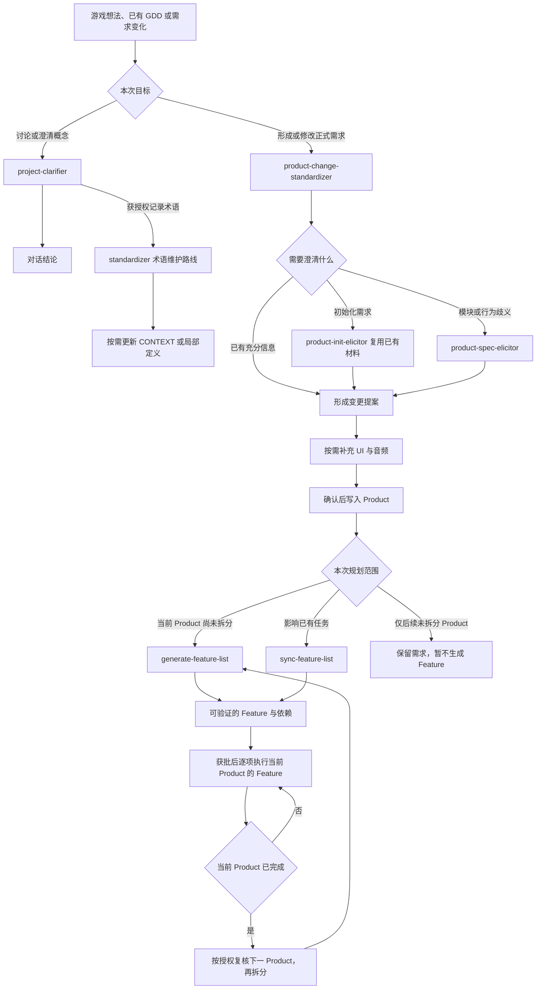
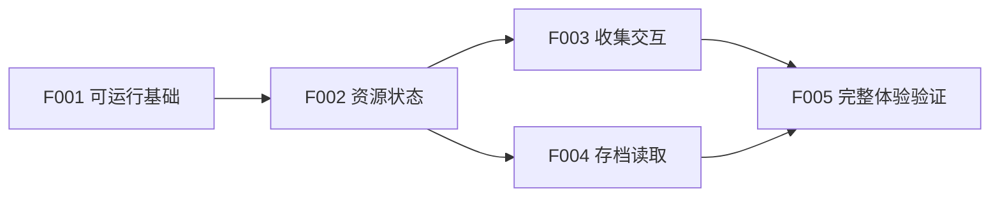

# 从想法或 GDD 到 Product 与 Feature

[返回手册](../README.md) · 相关：[Skill 导航](../reference/skills.md)、[Feature 开发流程](feature-delivery.md)

本页说明如何把设计输入整理成正式需求，再拆成可验证的工作。`docs/product.md` 是全局总览，`docs/product/NN-name.md` 是模块规格；下文“当前 Product”指当前要交付的一个模块及其已确认范围，Feature 是该范围内的具体任务。

## 从当前已有内容出发

| 当前情况 | 入口与处理 |
| --- | --- |
| 想先讨论想法、概念或方案 | `project-clarifier` 只补问影响当前判断的缺口，默认只在对话中给结论 |
| 希望记录已确认的项目术语 | `project-clarifier` 澄清后由 `product-change-standardizer` 按授权写定义和链接，纯术语整理不拆 Feature |
| `docs/product.md` 为空，已有想法或 GDD | `product-change-standardizer` 组织初始需求整理；elicitor 复用输入，只补充关键缺口 |
| 有 Product，需要补充或修改行为 | `product-change-standardizer` 按歧义使用 `product-spec-elicitor` |
| 需要界面布局或声音需求 | 在 Product 流程中按需使用 UI / audio sketcher |
| 当前 Product 已确认且尚未拆分；前一 Product 的 Feature 已完成 | `generate-feature-list` 只拆当前 Product，追加到现有台账 |
| 已有 Feature 受到 Product 或 Coding Rules 变化影响 | `sync-feature-list` 增量对齐，后续未拆分 Product 暂不生成任务 |
| 产品预期明确，代码表现错误 | [工程变更](engineering-changes.md) 的 Bug 路线 |

已有明确答案不重复询问。仍会改变验收含义的关键选择需要说明并解决，不能把 Agent 的推测写成用户已经批准的行为。Product、拆分和同步 Skill 完成本职工作后返回调用流程；已有具体授权覆盖实现时继续进入执行 Skill，只要求文档或规划时交付对应结果后结束。

## 接入已有 GDD

**现有 GDD 可以直接作为需求整理的输入，不必重新口述整套设计。** 使用 [提示词库](../../../prompts.json) 的“Godot 项目开发 → 需求设计 → 从想法或已有 GDD 整理 Product”，提供文件路径或附件、材料中的当前有效范围和本次要完成的工作。这个入口复用现有 Product 流程，不增加导入器或新的文档体系。

### 先判断项目目录状态

| 目录现状 | 接入方式 |
| --- | --- |
| 只有一个空文件夹 | 按 [创建说明](../getting-started/create-project.md) 向该空目录复制框架材料，再进入目标目录整理需求；GDD 先留在原处，避免目标提前变成非空目录 |
| 已由当前框架生成，尚无实质 Product | 跳过创建器，按 [首次使用](../getting-started/first-use.md) 核对准备状态，再以 GDD 整理初始 Product |
| 已有实质 Product 或 Feature | 对照 GDD 与现有规格，按实际差异增量修改；文件更完整或日期更新不构成覆盖已有决定的依据 |
| 已有其他框架的代码、规则或任务 | 使用 [复制迁移已有项目](../getting-started/migrate-existing-project.md)，先处理项目结构与成果续接 |

只阅读、讨论 GDD 不要求运行 Godot；正式写入需要遵循项目文档语言与 Git 约定，进入实现前须完成环境准备。

### 按内容对应到正式文件

| GDD 中的内容 | 整理后的归属 |
| --- | --- |
| 游戏定位、目标玩家、版本核心循环、模块依赖、整体美术与声音方向 | `docs/product.md`，保持为可快速浏览的总览 |
| 玩法流程、数据含义、状态转换、UI 交互、声音触发、数值和可观察结果 | 对应 `docs/product/NN-name.md`，保留模板章节语义 |
| 多处共用且容易混淆的概念 | 优先复用模块定义；确有跨模块需要时整理到 `docs/CONTEXT.md` |
| 引擎类、节点布局、算法或存储格式等技术建议 | 与产品行为分开说明；经采用的技术选择进入实现方案或相应工程记录 |
| 备选方案、未来版本、待定数值或互相矛盾的描述 | 标明待定或暂缓范围；只解决影响当前模块与其依赖的关键决定 |

按语义和模块责任建立对应关系，不按 GDD 章节数机械生成模块，也不直接把整个 GDD 改名为 `product.md`。读取范围应覆盖总览、当前模块及其依赖；不可读附件、缺失图表和外链材料明确列为缺口，不能以推测补齐。整理时用简短的“GDD 章节 → Product 位置 → 待处理内容”对应说明检查有无遗漏，无需新增长期映射台账。

### 保留原件，确定后续维护位置

外部 GDD 原件保留在原位置。通常直接读取即可；需要让目标项目保留独立参考副本时，按授权复制原文和必要附件，使用能说明用途的名称，并注明它是参考快照。复制不移动原件，不覆盖已有项目文件，也不要求每个项目新增固定的 GDD 目录。

整理完成后，已确认的 Product 是后续规划与实现依据。原 GDD 保留来源价值，不与 Product 双向同步；日后引入新版 GDD，仍通过 Product 变更入口核对差异。来源定位写在相关 Product 内容或现有变更记录中即可。

### 从整理结果继续开发

Agent 先复用 GDD 中已明确的设计，分别列出已确认内容、提议和关键冲突；材料中有答案的事项不重新访谈。已有具体授权继续有效，重要未决选择不由 Agent 静默决定。

Product 总览可以包含整款游戏，后续模块也可以保留已有细节；**Feature 仍只拆当前模块**。当前模块所需 Feature 完成后，再复核下一模块。初始提示词默认交付 Product 及适用规划，不开始实现；你可以接着选择“拆分当前 Product 的 Feature”或“执行指定或下一项 Feature”，也可另行明确一段连续执行范围。完整 GDD 本身不表示所有功能已经实现或获得实施授权。

## 先讨论，按需留下术语

`project-clarifier` 默认只讨论；按实际缺口提问，用具体情景检验概念，上游决定变化后只复核受影响结论。init/spec/audio elicitor 沿用同一方法，返回草案或补丁；已知信息直接复用，不设置问答、模块或 AC 数量下限。

跨模块或 Feature 使用的稳定概念按需放在 `docs/CONTEXT.md`，局部定义已有合适位置时保留原处。每个概念只维护一份定义，其他位置链接过去。具体职责见 [项目知识](project-knowledge.md#何时维护-context)。

仅记录已同意的区别、统一名字或移动定义，且含义和行为不变时，不要求 Product 初始化或 Feature 同步。若定义变化实际改变玩法、数值或验收条件，就先解决产品决定，再按授权更新 Product 并同步任务，不能把它当成纯文字整理。

## Product 分成总览和模块

| 文件 | 回答的问题 | 内容边界 |
| --- | --- | --- |
| `docs/product.md` | 整款游戏做什么，各模块如何配合？ | 定位、玩家、核心循环、模块清单与依赖、视听方向、变更历史；通过链接进入模块细节 |
| `docs/product/NN-name.md` | 这个模块具体应怎样表现？ | 行为、数据含义、状态、UI、音频、数值、验收条件、暂缓边界及变更历史 |

例如描述一个资源收集玩法时，应明确玩家做什么、何时增加资源、何时不能操作、界面如何反馈，以及哪些结果可以验证。数据结构字段的业务含义属于 Product；具体 GDScript 类型、节点布置和算法选择交给实现或工程记录。

模块文件使用两位编号和 ASCII kebab-case 名称，例如 `01-gathering.md`。已有模块编号保持稳定；新增模块追加可用编号。模块废弃按规范保留可追溯历史，不为重新排序而批量改名。

模板必需章节保留，不适用时说明原因。共享概念可引用 CONTEXT，具体行为仍写在负责的模块中，不复制多份定义。

完整结构见 [Product 规范](../../../../project-source/methodology/01-product-doc-structure.md)。

## UI 与声音产物的边界

`product-ui-sketcher` 在布局或交互需要澄清、或用户要求草图时返回 ASCII 线框、交互意图和状态差异。已有明确交互的文案或数值调整可直接更新需求。HTML/Tailwind 探索须有实际用途或用户请求，不在每次 UI 修改后固定追加询问；探索稿不等同于已实现的 Godot 界面，也不能证明适配和手感。

`product-audio-sketcher` 返回声音触发、时长、风格和稳定的 `_placeholder_` 文件名等要求。它复用已知信息和共同声音约定，只补问有影响的缺口，不要求每个声音完成固定次数的问答；不生成正式音频资产，播放实现或调试仍走工程入口。

这些辅助 Skill 形成 Product 草案或补丁，Product 的正式写入由 `product-change-standardizer` 负责。确认界面或音频需求后，仍需在 Feature 中说明具体实现和人工验收范围。

## Feature 如何拆分

**Product 按实际执行顺序逐个拆分，当前 Product 的 Feature 完成后，再拆下一个 Product。** 在现有结构中，以一个 `docs/product/NN-name.md` 模块及其已确认范围为单位。Product 总览说明依赖和推进顺序，文件编号保持稳定，不代替实际执行顺序。

先把当前 Product 拆成所需的完整、可验证 Feature，完成它们后再根据实际结果复核下一 Product 的需求。后续 Product 可以先有描述，但不预分配 Feature ID、Feature 的详细 AC 或测试登记。这样后续调整主要发生在需求文档中，不必同时维护一整批尚未执行的任务。

`generate-feature-list` 用于第一份以及后续每份 Product 的初次拆分。默认空台账可直接开始；已有历史时沿用同一台账，在最大 ID 后追加，保留以前的 Feature、测试登记表和修订记录。当前 Product 已有计划就复用；修改该计划交给 `sync-feature-list`。

一项 Feature 应是可独立验证的完整行为或工程结果。复用已有基础设施，只补当前 Product 必需的可运行基础；最终工作量使用 `small` 或 `medium`，过大的工作继续拆分。若当前 Product 依赖尚未完成的另一 Product，先调整推进顺序，不同时拆出两份完整计划。

判断是否可以进入下一 Product，要核对当前范围、Feature 来源和完成状态。有 `pending`、`in_progress` 或 `blocked` 工作就还未完成；没有可执行候选、没有任务或 Product 文档标为 `done` 都不等于功能已交付。Stage 8 依据剩余具体授权决定续接或停止，下一 Product 的规划同样需要实际授权。详见 [逐个 Product 规划规则](../../../../project-source/methodology/02-feature-list-schema.md#product-by-product-planning)。

规划产物的分工见 [文件职责参考](../reference/project-layout.md#文档与执行文件如何配合)：索引定位任务，详情定义范围，测试登记表连接验证，修订记录保留需求变化对计划的影响。

`F001` 等 ID 记录分配顺序，不直接决定执行先后。`depends_on` 构成无环依赖图；只有前置任务均为 `done` 的 `pending` 项才可被列为下一项候选。同样可执行时再用稳定 ID 顺序选择。

此图假设这些工作都属于当前同一个 Product，只演示内部依赖；仓库没有预置这些业务任务。F003 与 F004 依赖就绪也不自动授权并行开发或连续执行。

## 测试登记表的作用与位置

`docs/test-registry.json` 是项目的测试登记表（Test Registry），固定保存在这个位置。它将组件、Feature / AC 和实际测试文件、测试函数关联起来：组件记录已存在的单元测试路径，测试条目记录逻辑 ID、用途、来源、组件及 planned / active / retired 状态。

例如，Feature 声明影响 `inventory` 组件后，选择器结合登记表找到背包单元测试、相关历史验收与回归测试，再加入本次明确要求的测试。影响范围由 Agent 核实，登记表提供查询关系；测试是否通过仍取决于真实运行报告。空白项目的 components 和 tests 为空，后续随实际规划和测试实现维护。

## 验收条件和测试 ID

每条 AC 使用稳定 ID，例如 `AC01`。条件写成可观察的结果，避免“体验好”“性能高”这类缺少判据的描述。机器可验证内容关联逻辑测试 ID，人工判断内容记录可重复的检查步骤。

| 标识示例 | 意义 |
| --- | --- |
| `F012-AC01` | F012 的 AC01 自动验收测试 |
| `F012-AC01-02` | 同一 AC 下的另一个自动测试 |
| `F052-RT01` | F052 修复 Bug 时建立的回归测试 |
| `INV-LIFECYCLE-01` | 跨 Feature 的生命周期不变量 |
| `inventory` | 语义组件，用来选择相关安全网 |

规划阶段 `verification.acceptance_mode` 可以为 `null`，表示尚未决定；正式执行在 Stage 1 先根据需求选择 `manual` 或 `automated`，再填验证项。初始空列表不表示自动选择了全自动验收。

允许先登记 `planned` 的验收/回归测试，随后在实现中创建并改为 `active`。组件的 `unit_test_paths` 只登记已存在套件，没有套件时用空数组；不要用未来目录冒充现有安全网。

## 需求变化后怎样保留历史

已有计划由 `sync-feature-list` 对照真实 Git 源差异、规划基线和当前文件增量更新。已有变更说明直接复用；无法恢复可靠基线时，按授权对当前完整规格与计划做核对，明确历史未知，使用现有修订字段记录新基线。最后一次 notes 提交或复制空台账的提交都不能冒充规划基线。

| 变化 | 处理方式 |
| --- | --- |
| 已完成行为需要改变 | 通常新增 Feature，保留旧 AC、测试 ID 和完成事实 |
| 未完成任务修改、拆分或合并 | 更新当前详情、下游依赖、替代任务和测试映射，记录修订关系 |
| 旧工作被替代 | `obsolete` 表示未完成即废弃，`obsolete_done` 表示曾完成；未完成任务不能继续依赖这些旧项 |
| 旧 AC 或测试失效 | 退役记录保留历史来源；planned/active 测试仍关联当前 AC，不能为消除失败无依据地删测试 |
| 只需重跑有效下游测试 | 归入当前变更 Feature 的 notes 与 Stage 1 验证范围，不另建任务、不改变原测试归属 |
| 后续未拆分模块变化 | 不影响现有工作时只改 Product；轮到该模块再读取完整最新规格，不能因早于同步基线而漏拆 |

写入顺序为：先合并新增组件，再更新 Feature、测试和修订关系，最后检查完整台账。无单元套件时登记空路径数组；保留已有数据，同名冲突须解决，不能重置登记表让检查通过。本次写入错误在原授权内修正，已有损坏或权限问题按实际边界处理。

独立实现、修复或单独交付的回归工作才新增任务。仍需执行的测试不能以备注免除，尚未实现的替代测试不能作为完成依据；真实测试删除与替换方式见 [实现与测试](feature-delivery.md#实现与测试怎么配合)。

## 规划完成时应能回答

拆分或同步报告用简短表格或清晰列表串起“需求位置与当前含义 → Feature / AC → 测试或人工检查的处理 → 缺口与下一步”。首次拆分核对当前 Product 的完整已确认范围；增量同步只展开本次变化及真实下游影响。双向阅读需求和 AC，查找遗漏、重复和不合适的任务范围，不能只凭来源链接、ID 或旧 `done` 判断已经覆盖。

写入后用实际文件刷新同一份报告。明确哪些只是计划已对齐，哪些实现、测试编写或验证尚未完成；未覆盖的当前需求不能默认为已同步。后续未拆分 Product 和已确认排除的范围简述去向即可，不提前创建任务。可执行的后续事项沿用所属 Feature 或当前 Progress，不新增覆盖台账，也不为补齐报告编造测试 ID。详见 [需求覆盖复核](../../../../project-source/methodology/02-feature-list-schema.md#requirement-coverage-review)。

报告明确当前行为、需求依据、影响组件、依赖、验收方法与未决选择。规划对齐、实现获批和验收通过分别记录。

下一步使用 [Feature 开发流程](feature-delivery.md)。字段细节与历史约束以 [Feature schema](../../../../project-source/methodology/02-feature-list-schema.md) 为准。
