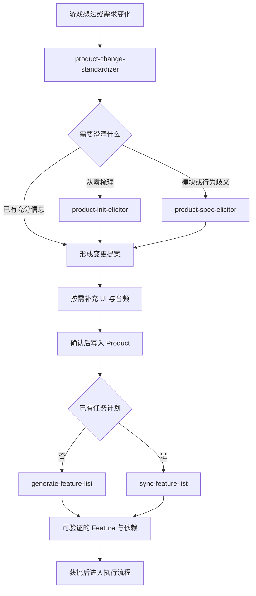
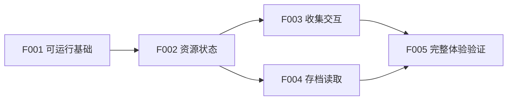

# 从游戏想法到可执行任务

[返回手册](../README.md) · 相关：[Skill 导航](../reference/skills.md)、[Feature 开发流程](feature-delivery.md)

Product 保存玩家行为的意图，Feature 保存可逐项交付的工作。先说清楚需要什么，再决定怎样拆分和验证，可以减少边写代码边猜规则造成的返工。

## 从当前已有内容出发

| 当前情况 | 入口与处理 |
| --- | --- |
| `docs/product.md` 为空，只有一句游戏想法 | `product-change-standardizer` 组织 `product-init-elicitor` 梳理定位、核心循环和模块 |
| 有 Product，需要补充或修改行为 | `product-change-standardizer` 按歧义使用 `product-spec-elicitor` |
| 需要界面布局或声音需求 | 在 Product 流程中按需使用 UI / audio sketcher |
| Product 和 Coding Rules 已确认，还没有任务计划 | `generate-feature-list` 首次拆分 |
| 已有 Feature，Product 或 Coding Rules 发生变化 | `sync-feature-list` 增量对齐 |
| 产品预期明确，代码表现错误 | [工程变更](engineering-changes.md) 的 Bug 路线 |

已有明确答案不重复询问。仍会改变验收含义的关键选择需要说明并解决，不能把 Agent 的推测写成用户已经批准的行为。

## Product 分成总览和模块

`docs/product.md` 让人快速了解整个游戏：定位、目标玩家、当前版本的核心循环、模块列表、依赖、视觉和声音方向、变更历史。详细模块使用 `docs/product/NN-name.md`，保存行为流程、数据含义、状态转换、UI、音频、数值规则、验收条件和暂缓边界。

例如描述一个资源收集玩法时，应明确玩家做什么、何时增加资源、何时不能操作、界面如何反馈，以及哪些结果可以验证。数据结构字段的业务含义属于 Product；具体 GDScript 类型、节点布置和算法选择交给实现或工程记录。

模块文件使用两位编号和 ASCII kebab-case 名称，例如 `01-gathering.md`。已有模块编号保持稳定；新增模块追加可用编号。模块废弃按规范保留可追溯历史，不为重新排序而批量改名。

模板中的必需章节应保留；不适用时说明原因。术语确实影响行为判断时，在所属模块记录简短定义。例如“物品定义”和“玩家持有的一件物品”是否有不同身份，会影响堆叠和存档规则；已经清楚的概念无需另建词典。

完整结构见 [Product 规范](../../../../project-source/methodology/01-product-doc-structure.md)。

## UI 与声音产物的边界

`product-ui-sketcher` 返回 ASCII 线框、交互意图和状态差异，按需提供独立 HTML/Tailwind 视觉探索。探索稿帮助确认布局，不等同于已经实现的 Godot 界面，也不能证明场景中的适配和手感。

`product-audio-sketcher` 返回声音触发、时长、风格和稳定的 `_placeholder_` 文件名等要求。它不自动生成正式音频资产。

这些辅助 Skill 形成 Product 草案或补丁，Product 的正式写入由 `product-change-standardizer` 负责。确认界面或音频需求后，仍需在 Feature 中说明具体实现和人工验收范围。

## Feature 如何拆分

一项 Feature 应是可独立验证的完整行为或工程结果。首次计划先建立必要的可运行基础，再按依赖展开业务；最终工作量使用 `small` 或 `medium`，过大的工作继续拆分。

任务结构分工如下：

| 文件 | 保存什么 |
| --- | --- |
| `docs/feature-list.json` | ID、标题、状态、依赖、范围和完成时间 |
| `docs/features/F0XX.json` | 行为描述、影响组件、AC、验证映射、来源和 notes |
| `docs/test-catalog.json` | 组件、已有单元套件、验收/回归/不变量测试索引 |
| `docs/feature-list-revisions.json` | Product / Coding Rules 的增量同步关系与历史 |

`F001` 等 ID 记录分配顺序，不直接决定执行先后。`depends_on` 构成无环依赖图；只有前置任务均为 `done` 的 `pending` 项才可被列为下一项候选。同样可执行时再用稳定 ID 顺序选择。

此图只演示依赖，仓库没有预置这些业务任务。F003 与 F004 依赖就绪也不自动授权并行开发或连续执行。

## 验收条件和测试 ID

每条 AC 使用稳定 ID，例如 `AC01`。条件写成可观察的结果，避免“体验好”“性能高”这类缺少判据的描述。机器可验证内容关联逻辑测试 ID，人工判断内容记录可重复的检查步骤。

| 标识示例 | 意义 |
| --- | --- |
| `F012-AC01` | F012 的 AC01 自动验收测试 |
| `F012-AC01-02` | 同一 AC 下的另一个自动测试 |
| `F052-RT01` | F052 修复 Bug 时建立的回归测试 |
| `INV-LIFECYCLE-01` | 跨 Feature 的生命周期不变量 |
| `inventory` | 语义组件，用来选择相关安全网 |

规划阶段 `verification.acceptance_mode` 可以为 `null`，表示尚未决定；正式执行在 Stage 1 先根据需求选择 `manual` 或 `automated`，再填验证项。初始空列表不表示自动选择了全自动验收。

允许先登记 `planned` 的验收/回归测试，随后在实现中创建并改为 `active`。组件的 `unit_test_paths` 只登记已存在套件，没有套件时用空数组；不要用未来目录冒充现有安全网。

## 需求变化后怎样保留历史

已有计划采用 `sync-feature-list`，它对照实际 Git 源差异、历史锚点、当前任务和 Catalog，区分编辑性调整与行为变化，并记录新增、修订、拆分、合并或退役关系。

对于已完成行为，新的实质需求通常建立新的 Feature；保留旧任务的历史 AC、测试 ID 和完成事实。不要重写旧记录，让它看起来从一开始就实现了新行为。

拆分或合并时同时处理下游依赖、替代任务和测试映射。`obsolete` 表示未完成工作已废弃，`obsolete_done` 保留曾完成但后来被替代的历史；未完成任务不能继续依赖它们。旧测试退役必须有对应需求来源和替代关系，不能仅因为它失败就删掉。

`generate-feature-list` 的全量重建是需要明确范围的替换操作，不能当作普通增量更新使用。已经建立的历史和工程任务不能被首次生成流程顺带抹掉。

## 规划完成时应能回答

现在要实现的行为是什么、依据哪个 Product、受影响组件有哪些、前置任务是否完成、AC 怎么检查、有哪些尚未确定的选择。规划完成说明工作可理解，不代表已批准 Stage 1 实现或已经通过验收。

下一步使用 [Feature 开发流程](feature-delivery.md)。字段细节与历史约束以 [Feature schema](../../../../project-source/methodology/02-feature-list-schema.md) 为准。
