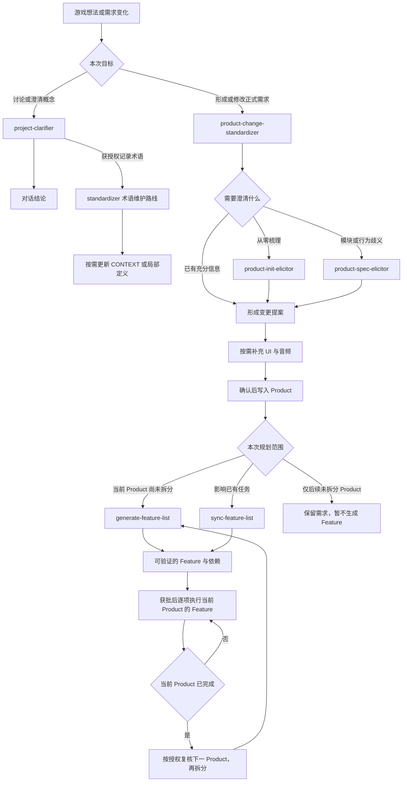
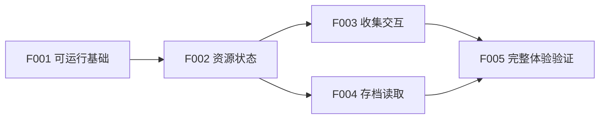

# 从游戏想法到可执行任务

[返回手册](../README.md) · 相关：[Skill 导航](../reference/skills.md)、[Feature 开发流程](feature-delivery.md)

Product 保存玩家行为的意图，Feature 保存可逐项交付的工作。先说清楚需要什么，再决定怎样拆分和验证，可以减少边写代码边猜规则造成的返工。

## 从当前已有内容出发

| 当前情况 | 入口与处理 |
| --- | --- |
| 想先讨论想法、概念或方案 | `project-clarifier` 只补问影响当前判断的缺口，默认只在对话中给结论 |
| 希望记录已确认的项目术语 | `project-clarifier` 澄清后由 `product-change-standardizer` 按授权写定义和链接，纯术语整理不拆 Feature |
| `docs/product.md` 为空，明确要求整理初始需求 | `product-change-standardizer` 组织 `product-init-elicitor` 梳理定位、核心循环和模块 |
| 有 Product，需要补充或修改行为 | `product-change-standardizer` 按歧义使用 `product-spec-elicitor` |
| 需要界面布局或声音需求 | 在 Product 流程中按需使用 UI / audio sketcher |
| 当前 Product 已确认且尚未拆分；前一 Product 的 Feature 已完成 | `generate-feature-list` 只拆当前 Product，追加到现有台账 |
| 已有 Feature 受到 Product 或 Coding Rules 变化影响 | `sync-feature-list` 增量对齐，后续未拆分 Product 暂不生成任务 |
| 产品预期明确，代码表现错误 | [工程变更](engineering-changes.md) 的 Bug 路线 |

已有明确答案不重复询问。仍会改变验收含义的关键选择需要说明并解决，不能把 Agent 的推测写成用户已经批准的行为。

## 先讨论，按需留下术语

`project-clarifier` 将询问深度与是否写文档分开：问题已经清楚就直接回答，缺一个关键条件就只问那个条件，较大设计才按依赖顺序分几轮。用实际情景检验概念区别；上游决定改变时，只重查受影响的结论。它不维护问卷状态、轮数或评分，也不要求每轮固定格式。

只讨论时不会创建文件，空项目不必先准备 Godot 环境或补完整 Product。需要留下词汇时，沿用已确认的答案和写入授权，由 `product-change-standardizer` 统一落盘。init/spec elicitor 复用同一套提问方法，继续返回各自的 Product 草案或补丁，不再启动一轮独立访谈。

跨模块或 Feature 使用的稳定概念按需放在 `docs/CONTEXT.md`，局部定义已有合适位置时保留原处。每个概念只维护一份定义，其他位置链接过去。具体职责见 [项目知识](project-knowledge.md#何时维护-context)。

仅记录已同意的区别、统一名字或移动定义，且含义和行为不变时，不要求 Product 初始化或 Feature 同步。若定义变化实际改变玩法、数值或验收条件，就先解决产品决定，再按授权更新 Product 并同步任务，不能把它当成纯文字整理。

## Product 分成总览和模块

`docs/product.md` 让人快速了解整个游戏：定位、目标玩家、当前版本的核心循环、模块列表、依赖、视觉和声音方向、变更历史。详细模块使用 `docs/product/NN-name.md`，保存行为流程、数据含义、状态转换、UI、音频、数值规则、验收条件和暂缓边界。

例如描述一个资源收集玩法时，应明确玩家做什么、何时增加资源、何时不能操作、界面如何反馈，以及哪些结果可以验证。数据结构字段的业务含义属于 Product；具体 GDScript 类型、节点布置和算法选择交给实现或工程记录。

模块文件使用两位编号和 ASCII kebab-case 名称，例如 `01-gathering.md`。已有模块编号保持稳定；新增模块追加可用编号。模块废弃按规范保留可追溯历史，不为重新排序而批量改名。

模板中的必需章节应保留；不适用时说明原因。例如“物品定义”和“玩家持有的一件物品”是否有不同身份，会影响堆叠和存档规则。概念定义可引用 CONTEXT，具体堆叠、存档行为仍写入负责的 Product 模块；已有清楚定义不再复制一份。

完整结构见 [Product 规范](../../../../project-source/methodology/01-product-doc-structure.md)。

## UI 与声音产物的边界

`product-ui-sketcher` 返回 ASCII 线框、交互意图和状态差异，按需提供独立 HTML/Tailwind 视觉探索。探索稿帮助确认布局，不等同于已经实现的 Godot 界面，也不能证明场景中的适配和手感。

`product-audio-sketcher` 返回声音触发、时长、风格和稳定的 `_placeholder_` 文件名等要求。它不自动生成正式音频资产。

这些辅助 Skill 形成 Product 草案或补丁，Product 的正式写入由 `product-change-standardizer` 负责。确认界面或音频需求后，仍需在 Feature 中说明具体实现和人工验收范围。

## Feature 如何拆分

**Product 按实际执行顺序逐个拆分，当前 Product 的 Feature 完成后，再拆下一个 Product。** 在现有结构中，以一个 `docs/product/NN-name.md` 模块及其已确认范围为单位。Product 总览说明依赖和推进顺序，文件编号保持稳定，不代替实际执行顺序。

先把当前 Product 拆成所需的完整、可验证 Feature，完成它们后再根据实际结果复核下一 Product 的需求。后续 Product 可以先有描述，但不预分配 Feature ID、Feature 的详细 AC 或测试登记。这样后续调整主要发生在需求文档中，不必同时维护一整批尚未执行的任务。

`generate-feature-list` 用于第一份以及后续每份 Product 的初次拆分。默认空台账可直接开始；已有历史时沿用同一台账，在最大 ID 后追加，保留以前的 Feature、测试登记表和修订记录。当前 Product 已有计划就复用；修改该计划交给 `sync-feature-list`。

一项 Feature 应是可独立验证的完整行为或工程结果。复用已有基础设施，只补当前 Product 必需的可运行基础；最终工作量使用 `small` 或 `medium`，过大的工作继续拆分。若当前 Product 依赖尚未完成的另一 Product，先调整推进顺序，不同时拆出两份完整计划。

判断是否可以进入下一 Product，要核对当前范围、Feature 来源和完成状态。有 `pending`、`in_progress` 或 `blocked` 工作就还未完成；没有可执行候选、没有任务或 Product 文档标为 `done` 都不等于功能已交付。执行流程仍在 Stage 8 交接后停止，下一 Product 的规划沿用用户实际授权。详见 [逐个 Product 规划规则](../../../../project-source/methodology/02-feature-list-schema.md#product-by-product-planning)。

任务结构分工如下：

| 文件 | 保存什么 |
| --- | --- |
| `docs/feature-list.json` | ID、标题、状态、依赖、范围和完成时间 |
| `docs/features/F0XX.json` | 行为描述、影响组件、AC、验证映射、来源和 notes |
| `docs/test-registry.json` | 组件、已有单元套件、验收/回归/不变量测试索引 |
| `docs/feature-list-revisions.json` | Product / Coding Rules 的增量同步关系与历史 |

`F001` 等 ID 记录分配顺序，不直接决定执行先后。`depends_on` 构成无环依赖图；只有前置任务均为 `done` 的 `pending` 项才可被列为下一项候选。同样可执行时再用稳定 ID 顺序选择。

此图假设这些工作都属于当前同一个 Product，只演示内部依赖；仓库没有预置这些业务任务。F003 与 F004 依赖就绪也不自动授权并行开发或连续执行。

## 测试登记表的作用与位置

`docs/test-registry.json` 是项目的测试登记表（Test Registry），固定保存在这个位置。它将组件、Feature / AC 和实际测试文件、测试函数关联起来：组件记录已存在的单元测试路径，测试条目记录逻辑 ID、用途、来源、组件及 planned / active / retired 状态。

例如，Feature 声明影响 `inventory` 组件后，选择器结合登记表找到背包单元测试、相关历史验收与回归测试，再加入本次明确要求的测试。影响范围由 Agent 核实，登记表提供查询关系；测试是否通过仍取决于真实运行报告。空白项目的 components 和 tests 为空，后续随实际规划和测试实现维护。

## 验收条件和测试 ID

每条 AC 使用稳定 ID，例如 `AC01`。条件写成可观察的结果，避免“体验好”“性能高”这类缺少判据的描述。机器可验证内容关联逻辑测试 ID，人工判断内容记录可重复的检查步骤。

| 标识示例 | 意义 |
| --- | --- |
| `F012-AC01` | F012 的 AC01 自动验收测试 |
| `F012-AC01-02` | 同一 AC 下的另一个自动测试 |
| `F052-RT01` | F052 修复 Bug 时建立的回归测试 |
| `INV-LIFECYCLE-01` | 跨 Feature 的生命周期不变量 |
| `inventory` | 语义组件，用来选择相关安全网 |

规划阶段 `verification.acceptance_mode` 可以为 `null`，表示尚未决定；正式执行在 Stage 1 先根据需求选择 `manual` 或 `automated`，再填验证项。初始空列表不表示自动选择了全自动验收。

允许先登记 `planned` 的验收/回归测试，随后在实现中创建并改为 `active`。组件的 `unit_test_paths` 只登记已存在套件，没有套件时用空数组；不要用未来目录冒充现有安全网。

## 需求变化后怎样保留历史

已有计划采用 `sync-feature-list`，它对照实际 Git 源差异、历史锚点、当前任务和测试登记表，区分编辑性调整与行为变化，并记录新增、修订、拆分、合并或退役关系。

首次同步不能直接用“最近修改 Feature 的提交”作为需求基线。例如先规划、后改 Product、再整理 notes，最后一次 notes 提交并未吸收前面的需求变化。应核对实际规划提交和对应源内容；复制空台账的提交也不等于规划完成。无法可靠恢复基线时，在明确授权下比较当前完整源文档和计划，说明历史未知；使用现有修订字段记录当前 HEAD 作为新基线，不虚构历史差异。

同步新增组件时，先按已批准方案复用现有合并入口登记组件，再更新 Feature、替代测试、退役关系和修订记录，最后对完整集合做台账检查。无套件组件使用空路径数组；保留原有组件和测试，不能重置测试登记表或覆盖同名冲突来让检查通过。

对于已完成行为，新的实质需求通常建立新的 Feature；保留旧任务的历史 AC、测试 ID 和完成事实。不要重写旧记录，让它看起来从一开始就实现了新行为。

未完成 Feature 经批准修订并删除旧 AC 时，对应 `retired` 测试保留历史 AC ID，通过来源、修订和替代测试追溯，不要求把旧 AC 留在当前详情中。`planned`、`active` 测试仍必须关联当前 AC；替代测试尚未实现时不能据此完成 Feature。

拆分或合并时同时处理下游依赖、替代任务和测试映射。`obsolete` 表示未完成工作已废弃，`obsolete_done` 保留曾完成但后来被替代的历史；未完成任务不能继续依赖它们。旧测试退役必须有对应需求来源和替代关系，不能仅因为它失败就删掉。

仅修改后续尚未拆分的 Product，且不影响已有任务时，保留文档变化并暂缓拆分。若改变了现有行为依赖的契约，则处理真正受影响的任务和回归；不借同步一次性展开所有 Product。

轮到下一 Product 时，生成入口读取它当时的完整规格。即使其文档修改早于最近一次同步锚点，也不能漏拆；反过来，同步时已被先前规划吸收的变化不重复生成 Feature。历史与已有工程任务始终保留，不使用全量重建来推进下一 Product。

## 规划完成时应能回答

拆分或同步报告用简短表格或清晰列表串起“需求位置与当前含义 → Feature / AC → 测试或人工检查的处理 → 缺口与下一步”。首次拆分核对当前 Product 的完整已确认范围；增量同步只展开本次变化及真实下游影响。双向阅读需求和 AC，查找遗漏、重复和不合适的任务范围，不能只凭来源链接、ID 或旧 `done` 判断已经覆盖。

写入后用实际文件刷新同一份报告。明确哪些只是计划已对齐，哪些实现、测试编写或验证尚未完成；未覆盖的当前需求不能默认为已同步。后续未拆分 Product 和已确认排除的范围简述去向即可，不提前创建任务。可执行的后续事项沿用所属 Feature 或当前 Progress，不新增覆盖台账，也不为补齐报告编造测试 ID。详见 [需求覆盖复核](../../../../project-source/methodology/02-feature-list-schema.md#requirement-coverage-review)。

现在要实现的行为是什么、依据哪个 Product、受影响组件有哪些、前置任务是否完成、AC 怎么检查、有哪些尚未确定的选择。规划完成说明工作可理解，不代表已批准 Stage 1 实现或已经通过验收。

下一步使用 [Feature 开发流程](feature-delivery.md)。字段细节与历史约束以 [Feature schema](../../../../project-source/methodology/02-feature-list-schema.md) 为准。
