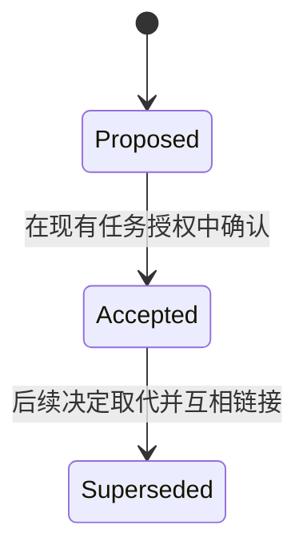
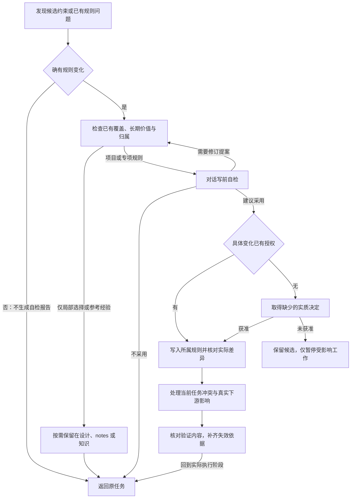

# 项目文档维护与交接

[返回手册](../README.md) · 相关：[目录参考](../reference/project-layout.md)、[工程变更](engineering-changes.md)

从具体中断或信息冲突开始处理时，使用 [上下文与交接检查单](scenarios-context-handoff.md)；本页集中解释各类文档的职责、维护时机与记录方式。

在生成项目中，Agent 随已授权任务维护必要的定义、设计、规则和经验；需要续接时再用 Progress 定位真实停点。本页先按文档维护时机组织，后半部说明报告保留与中断交接。不因存在模板就创建全部文档，也不因任务结束才集中补写会影响验证的内容。

## 信息应该放在哪里

完整文件职责、出现时机与主要读写方集中在 [目录参考](../reference/project-layout.md#文档与执行文件如何配合)。本页只解释何时维护、如何保留历史和从哪里续接；当前 Feature 的 Stage 1–4 衔接见 [最终验证前文档更新](feature-delivery.md#最终验证前完成文档更新)。

美术、声音、UI、资源与本地化文档由对应专业 Skill 直接维护，Product 保存行为与引用。
来源变化、缺陷分类和设计/接入/审核边界见 [专业工作指南](specialist-workflows.md)。

## 按需搜索与保存调研

主 Agent 根据问题、已有证据与项目条件，自主判断是否搜索、直接查询还是委派 `researcher`。需求讨论、规划、实现或排错都可以使用；没有必经的调研阶段，也不要求每个 Feature 搜索一次。已有信息充分时直接继续，简单查询可以只在对话中引用来源。

需要独立调研时，主 Agent 传入具体问题、适用版本、项目约束和已有资料，并决定是否保存、保存到哪里。`researcher` 使用当前可用的 anysearch Skill 调查，返回结论、来源、建议和未确认项；主 Agent 判断适用性并继续原任务。需要报告时由子 Agent 直接写指定文件，主 Agent 负责核对、必要的原任务链接与提交。角色与报告格式的唯一指令正文是 [researcher.toml](../../../../project-source/agents/researcher.toml)，正式项目使用自己的 `.codex/agents/researcher.toml`。

anysearch 保持用户级安装，通常位于 `~/.agents/skills/anysearch/`；项目不复制它的实现、密钥或本机运行配置，也不写死个人绝对路径。换机器时核对可用安装。Skill 不可用或搜索失败时，researcher 自主选择其他可用搜索方式并说明实际渠道；不能执行未通过来源完整性核验的脚本。没有可用渠道时返回已有依据和缺口，不把未查证写成已确认。

涉及引擎、库或 API 时，查询写明项目实际确认的具体版本，并核对命中页面的版本；`stable`、`latest` 不代替版本号，旧版本只能作为明确标注的比较。技术事实追到实际读过的一手来源，区分文档事实、项目推断与本地实测。若网页抽取损坏代码排版或遗漏内容，子 Agent 在结果中简短提示并附原文链接；主 Agent 实际使用时再决定恢复和验证，未使用的代码不要求修复。

| 内容 | 保存与使用方式 |
| --- | --- |
| 有长期参考价值的外部调研 | 按需创建 `docs/research/<用途明确的主题>.md`，纳入 Git；同主题优先更新已有文件，重要结论变化保留日期、原因和被引用的历史 |
| 报告最低信息 | 标题、调研日期、适用版本/环境、关联任务；问题与范围、结论、依据与分析、项目建议、未确认项。短章节可合并，不适用元数据可省略，正文跟随 `document_language` |
| 原始下载、临时探查材料及运行证据 | 沿用 `reports/scratch/<task>/` 及现有任务报告位置；不混入调研正文目录 |
| 调研被采纳后的决定 | 回到 Product、专业规格、Feature 设计或 ADR，链接调研依据；报告建议不自动成为需求 |
| 项目实践产生的可复用经验 | 提炼到 `docs/knowledge/` 并链接调研与真实验证，外部说法不能冒充项目已验证经验 |

调研报告从现有 Feature 设计、notes 或 Progress 链接进入；只有数量确实需要时才增加普通索引，不新增研究台账、固定数量配额或空白报告。纯调研 Markdown 与知识正文一样不使业务测试证据失效，需求和验收约束不能只放在其中，代码与非 Markdown 文件仍按实际内容绑定。

主动请求调查可使用“Godot 项目开发 → 需求设计 → 调研外部资料与技术方案”，填写问题、项目限制和报告偏好。它只授权本次调研及所选报告输出；若调研嵌在已有实施任务中，结果返回后继续其已授权范围。路由见 [External research](../../../../project-source/methodology/00-overview.md#external-research)，产物边界见 [调研归属](../../../../project-source/methodology/09-artifact-lifecycle.md#external-research)。

## 何时维护项目术语

当同一项目中的概念需要反复解释，或在不同模块、Feature 中出现同名异义、异名同义时，使用 `project-clarifier` 通过具体情景澄清。需要保存的已确认定义由 `product-author` 按授权写入 `docs/terminology.md`；缺少该文件不阻塞讨论或开发，也不预先放一个空模板。

文件记录长期复用的标准名称、定义和适用范围，按需说明概念关系、别名、旧称或易混淆项。定义以足够消除歧义为准，不限制固定句数。例如区分“物品定义”“持有物品”“堆叠”，随后链接到 Product 的实际堆叠规则。已有定义直接复用，集中整理时将范围内的重复定义改为链接。

术语持续维护，新增、重命名、废弃或语义变化都应检查已有定义及引用。需求整理时处理当时已知的问题；Feature 执行中发现歧义立即澄清，并在 Stage 3 的文档检查中筛选已确认、具有长期价值的定义，在最终验证前完成必要更新。没有新增价值就不写入，也不生成空文件。

详细行为、数值和状态转换由 Product 负责；设计约束和技术取舍由设计、架构与规则文档负责；待定想法、聊天记录、实现计划和当前进度不放在术语文档。保持含义的术语维护走轻量路线；实质行为变化仍走需求变更。Feature 内调用 product-author 的术语维护路线时，沿用原任务的修改归属、文档授权和提交流程；完成后返回原执行阶段，继续实现与验证。它不是一个要求清空工作区的新任务。规范与格式见 [项目术语约定](../../../../project-source/methodology/01-product-doc-structure.md#project-terminology-optional)。

## 何时单独保存 Feature 设计说明

当设计需要较长解释，或你希望保留详细方案时，使用 `docs/features/F0XX-design.md`，在对应 Feature JSON 的 `notes` 中用 `[设计说明](F0XX-design.md)` 相对链接。Stage 1 判断是否需要，Stage 2 保存获批方案，Stage 3 按实际实现补充结果和偏差；简单任务仍可只用 notes，不为每个 Feature 机械创建文件。

设计说明可以展开目标与边界、已有实现、实际采用的规则及其应用方式、组件职责、状态和生命周期、接口与调用流程、失败处理、实现顺序及验证理由。引用原始规则或资料并解释为何适用，不复制整份 `agent-rules`。篇幅由需要解释的设计决定。

AC、可执行测试映射/义务和状态仍以 Feature JSON 及登记表为准，设计说明链接这些记录；专项测量、时长、显示或试听条件可在设计中说明，不复制第二份台账。跨 Feature 当前结构进入架构地图，重要取舍进入 ADR；已完成设计保留历史。可选模板 `methodology/templates/feature-design.md.tmpl` 不要求填写全部章节。设计与专业规格 Markdown 参与内容指纹，不继承 JSON notes 的豁免；编辑后按 [内容绑定](../reference/commands-and-validation.md#内容绑定与失效判断) 核对依据。结构见 [Feature 设计说明规范](../../../../project-source/methodology/02-feature-list-schema.md#feature-design-and-implementation-notes-optional)。

## 何时需要架构地图

当仅从源码已经难以看清模块职责、状态归属和依赖方向时，按需建立 `docs/architecture.md`。复杂子系统展开到单独文件，总览保持可浏览。

采用地图后，给出模块主要位置与关键场景、脚本或资源的阅读入口；已有模块 README 能提供导航时直接链接，有帮助时再链接相关验证入口，不枚举全部文件或测试。需要解释项目如何组装时，指向实际启动/装配位置与常驻状态归属，不预设项目拥有 Bootstrap 或 Autoload 层。子系统省略运行流程详情时仍保留基本导航。

对理解当前结构有帮助的关键选择，地图简述它解决的问题，并链接已有 [Feature 设计说明](#何时单独保存-feature-设计说明)、notes 或 [ADR](#何时使用-adr)。完整方案与历史决定保留在原记录中；当前理由变化时更新地图，不把旧决定改写成一直如此。缺少历史记录时不补造理由或来源，也不为填满地图强制创建 ADR。

地图区分实际直接协作及其用途，与允许的依赖方向及划分理由。需要说明运行过程时，在子系统文档记录触发、参与者、状态变化、结果、Godot 生命周期和失败处理。可用 flowchart 展示依赖、sequenceDiagram 展示交互顺序、stateDiagram-v2 展示真实状态转换；图中说明箭头代表代码依赖、场景装配、继承还是消息，不把不同关系混为一种。只画有助于理解的内容，不要求固定图集。

已有地图记载的职责、归属、协作、依赖约束、路径或入口变化时，更新受影响部分；仅移动或重命名也可能需要更新导航。在现有 Stage 3D 中核对受影响链接和阅读入口、总览与子系统、图与文字的一致性，不新建检查台账。具体维护约定见 [地图维护规范](../../../../project-source/methodology/10-architecture-overview.md#maintaining-a-map)；地图 Markdown 仍按现有内容指纹规则处理，最终验证前完成必要更新。

生成的引用关系只说明解析器看到了什么。动态加载、运行时 Signal 和状态归属不能仅靠文本搜索确定。观察、推断、提议和已实现行为要区分，图表也不是依赖设计的自动批准。

## 何时使用 ADR

ADR 保存在 `docs/architecture/adr-NNNN-<slug>.md`，按决策触发，不是每个 Feature 或 Stage 的固定产物。创建阈值同时考虑三点：撤销决定存在实质成本；未来仅从源码和当前架构难以恢复原因；存在真实候选方案及值得保留的取舍。跨模块状态归属、持久化格式或核心依赖选择可能达到阈值，普通局部选择通常保留在 Feature 设计说明或 notes。

Stage 1 判断是否达到阈值，Stage 2 在决定已确认后保存理由，Stage 3 发现新的重要选择时及时补充，再继续依赖该决定的实现与最终验证。独立架构讨论也可以按授权创建 ADR，不必虚构 Feature。记录问题、约束、候选方案、决定、收益、接受的成本、依据和有用的重新考虑条件。



这些是普通 Markdown 状态，不需要注册表。`Accepted` 说明决定得到确认，不证明相关 API 或运行行为已经测试；`Superseded` 保留旧理由并链接替代 ADR。真实任务已经确认的决定直接沿用，不额外增加一轮批准。

Product 保存对外行为与验收意图，ADR 保存架构取舍及其理由，不能自行改变 Product 或绕过项目约束。架构地图保存当前结构，Feature 设计说明保存详细局部设计，notes 与 Progress 保留所需链接。按需更新边界变化，不把缺少可选文档当成门禁失败。

## 维护项目规则与读取工程规则

Agent 在原任务中检查候选，以下分支不产生新任务状态或后台机制。



项目根 `AGENTS.md` 是路由入口，`docs/project-rules.md` 保存项目级长期约束，适用于相关 Product、Feature、设计与实现；`agent-rules/` 按实际修改领域提供具体工程语义。流程和测试追踪由 `methodology/` 负责。项目规则区分硬约束 `MUST`、默认偏好 `PREFER` 和需明确判断的 `REVIEW`，不把普通建议误作不可例外的禁令。

需求整理和 Stage 0–1 先核对相关规则。Stage 2 保存已批准的规则决定，Stage 3 的文档检查发现可复用约束后筛选增量更新；Bug 复盘等节点发现问题时沿用同一机制。Agent 主动检查与提出修订，不自动把一次经验或个人偏好升级为硬约束。已有明确授权继续有效，新的或实质改变的约束由用户决定。

每次新增、修改或删除项目规则与专项规则，写前都在对话中自检；可合并说明一批修订，但每项必须能对应到下表。

| 自检内容 | 要说明的事实或决定 |
| --- | --- |
| 规则与变化 | 来源、增改删操作、原文与拟写内容；新增或删除明确标出 |
| 原因与依据 | 真实需要、已确认决定及证据，区分推断 |
| 价值与归属 | 是否跨任务复用，是否应保留在规则、架构、ADR 或局部设计 |
| 范围与强度 | MUST/PREFER/REVIEW、适用条件及例外是否改变 |
| 覆盖与冲突 | 已有规则、Product、已接受决定是否重复或矛盾 |
| 影响与处理 | 受影响的 Product、任务、实现、验证及本次处理去向 |
| 结论与授权 | 采用、修订或不采用；已有批准和仍缺决定分别说明 |

删除须说明原约束为何不再需要或由何处接替；纯措辞/链接修订也简述含义、强度和范围不变。没有规则变化就不输出这份报告。

自检全文默认保留在对话，不另建规则报告或登记表。长期有用的理由按归属进入规则本身、Feature 设计或 ADR，并保留来源链接；Git 保存变化历史。当前 Feature 内发现规则变化，先解决对当前方案与实现的真实影响，保留原任务归属及必要后续范围；不能另起要求干净工作区的 feature-sync 任务覆盖未完成差异，也不能一律推迟到下一 Feature。需要下游同步时，按原流程保存已确认规则来源，并在下一受影响 Feature 前完成已授权同步。较晚写入也须补齐失效的测试与适用人工接受。

这份自检由作者核对拟写规则，不是 [Stage 6 独立评审](feature-delivery.md#按需独立评审与再次验证)，也不能证明代码或规则效果已运行通过。字段和执行细则以 [规则增量维护规范](../../../../project-source/methodology/04-coding-rules-4-layers.md#incremental-rule-maintenance) 为准。

| 修改领域 | 对应规则入口 |
| --- | --- |
| 所有任务 | [00-core](../../../../project-source/agent-rules/00-core/README.md) |
| GDScript | [10-gdscript](../../../../project-source/agent-rules/10-gdscript/README.md) |
| Scene / `.tscn` | [20-scenes](../../../../project-source/agent-rules/20-scenes/README.md) |
| Resource / `.tres` | [21-resources](../../../../project-source/agent-rules/21-resources/README.md) |
| Shader | [30-shaders](../../../../project-source/agent-rules/30-shaders/README.md) |
| 项目配置 | [40-project-config](../../../../project-source/agent-rules/40-project-config/README.md) |
| 导出配置 | [41-export-config](../../../../project-source/agent-rules/41-export-config/README.md) |
| JSON、CSV 等规范数据 | [50-data-files](../../../../project-source/agent-rules/50-data-files/README.md) |
| 图像、音频、字体和导入资产 | [60-assets](../../../../project-source/agent-rules/60-assets/README.md) |
| 测试、fixture、运行器 | [70-tests](../../../../project-source/agent-rules/70-tests/README.md) |

领域可叠加，例如测试 `.gd` 同时遵循脚本和测试规则，Resource fixture 同时遵循资源和测试规则。先读相应 README，再按路由读具体规则，避免每次加载全部规则或遗漏跨领域约束。

## 优先查阅与积累项目知识

新项目只携带 [知识目录入口](../../../../project-source/defaults/docs/knowledge/README.md) 与主题索引，实际经验随任务积累：

```text
docs/knowledge/
├── README.md                         总索引与使用约定
├── godot-runtime/README.md           Godot 运行时
├── gdscript/README.md                GDScript 编码
├── debugging-testing/README.md       调试与测试
└── tools-pipeline/README.md          工具与管线
```

每条独立经验使用单独的 Markdown 文件，索引只放链接与简短说明。实际内容需要时可增加游戏模块或更细子目录；不按每个 Feature 机械建文件夹，也不把一条经验复制到多个主题。

Agent 开始规划、调查、开发、调试或复审时，先确认当前任务与规则，再从知识总索引定位相关主题和条目。可按模块、现象、API 或工具缩小范围；继续原任务时复用仍有效的已读内容，无需通读整个知识库。相关分类为空时，仍可继续工作。

采用已有经验前，Agent 核对版本、场景和证据是否适用于当前任务。知识条目提供参考，不能覆盖用户意图、Product、已接受决定或工程规则。完成核对后再拟定方案，必要时补查外部资料。

经验正文保存场景、有效做法或根因、适用范围和真实依据。成功做法说明观察到的收益与限制，不必编造“根因”；有项目独有条件的做法也可以保留。版本和平台影响结论时明确记录，疑点标为未确认，不把一次运行现象当成通用引擎事实。

**经验写在哪里？** Agent 先检查已有条目，再更新或新增有价值的知识与最近一级索引。Feature notes 保留原事件和局部决定，知识条目提炼适用做法并链接原件；技术决定与工程约束仍分别由 ADR 和规则负责。

**何时写入？** 在已授权任务的文档整理中完成。Feature 相关知识在 Stage 7 提交前落盘，Stage 8 汇报链接；只读或讨论任务不会因此取得写入授权。

**改后检查什么？** Agent 核对事实、适用条件与来源链接。纯知识 Markdown 不使业务测试证据失效；代码、测试或契约变化仍需验证。

没有新知识就不新增条目。目录只链接实际运行脚本、数据或报告原件，维护沿用现有任务流程。现有经验已经不适用时明确修正适用条件，跨项目吸收和规则升级仍按原授权处理。

## 资源、数据与占位内容

空白项目不指定业务素材目录。资源文件按游戏模块与实际资产流程组织，修改前核对源文件、运行资源、导入信息和生成缓存的归属。

占位内容使用 `_placeholder_` 前缀，并在当前 Feature notes 说明用途、替换方式和未完成的验收。替换素材时核对引用、UID/路径与实际场景；外观、声音、动画和手感仍按需求保留人工验收。

数据格式改变时核对已有内容和加载方，再决定版本、迁移与兼容范围。资产来源和许可证按现有规则记录。工具生成的输出不应成为可复用脚本或重要项目决定的唯一副本。

## 报告保留与清理

首次生成产物前按 [目录参考](../reference/project-layout.md#开发中按需出现的内容) 选择位置：工具和人工验收原件沿用固定路径，Feature 自定义结果进入 `reports/features/<Feature-ID>/`，其他维护报告进入 `reports/maintenance/<任务>/`，验证副本与辅助输入进入 `reports/scratch/<任务>/`。目录按需创建，正式验证结果不与临时输入混放；需要保留不同轮次时再设运行子目录，避免覆盖已引用原件。

gdUnit 已保存结构化结果、引擎日志和原始报告，通常直接引用这些文件；额外控制台日志应保留原件中没有的有用信息。当前状态从 Progress 阅读，单项结论与证据从 Feature 历史阅读，不另建报告总索引；文件名中的 `final` 或 `delivery` 不代替证据引用。

正常收尾核对本次产物位置与链接。临时材料需要跨任务或交接保留时，在已有 Feature notes 或 Progress 中说明用途及可结束保留的条件，例如待验收完成或排障结束。可复用生成器和夹具回到正常源码目录，提交说明、候选输入和一次性探针按临时材料管理。

当前验证、人工验收、未解决失败或后续工作需要的报告，以及保留的历史和知识条目引用的证据继续保留。默认报告不进入 Git，因此代码提交不保证另一台机器拥有报告原件。需要跨目录或跨机器交接时说明实际可用证据，缺失原件不能靠提交说明补成通过。

已有目录的整理须同时核对生成命令、读取脚本、当前证据及历史/知识链接，不能只移动文件；工具运行目录与人工验收原件保留原路径。归组和修复引用不包含删除或改写历史证据的授权。`scratch` 名称不表示内容可以删除，其中仍被验收或失败调查使用的工程与证据同样需要保留。

清理报告是明确的维护动作：读取拟处理目录和当前引用，只清理已理解且获授权的输出。目录较旧、后面有成功运行、文件未被 Git 跟踪，都不自动授权删除。测试运行器不会自动清理旧报告，也不需要额外的保留登记表。

依据：[历史与报告规范](../../../../project-source/methodology/09-artifact-lifecycle.md)、[架构与 ADR 规范](../../../../project-source/methodology/10-architecture-overview.md)。

## Progress 如何帮助继续任务

当前 Progress 只需清楚记录：活动 Feature 或获批批次、真实阶段、阻塞、待决定事项、下一步，以及计划和报告链接。不能从“下一步实施”这句话推断用户已经批准。

任务完成后将执行历史归档一份到 `docs/progress/<key>.md`，保留原文和证据链接；已有归档先读取，不能覆盖或重复复制。未解决问题仍留在当前交接中。移动历史不要求翻译原文，新写的项目知识遵循 `document_language`。

接手时按 Progress → 当前 Feature → 相关历史/证据 → 实际差异的顺序读取，核对已有授权和现在的代码。历史完成与当前内容是否重新验证是不同事实；后续迁移不应伪造过去曾做过的检查。

## 换到新线程继续

对话过长、经过多次压缩，或需要换一个任务继续时，可以让原线程先生成交接提示词。按实际需要使用，不设置必须换线程的压缩次数。

1. 在原线程发送提示词库中“Godot 项目开发 → 验证与收尾 → 整理进度与任务交接”，填入当前任务与用途。Agent 在现有授权和修改归属允许时整理必要的现有 Progress/历史，并生成一个完整的交接代码块；写入前置不满足时，保留文件现状，只读生成交接正文，列明未整理记录、未知或混合修改及接收方需核对的事项。
2. 检查输出是否包含原始目标与最新要求、实际项目/worktree 路径、当前分支、修改归属、真实停点、已有授权、实际检查和下一步。交接内容应当已经填好具体信息；未知事项保留为未知。
3. 在同一个实际项目目录或原 worktree 中打开新任务，把整个代码块复制过去。复制的是原线程生成的结果；库中的提示词用于让原线程整理上下文。原线程输出后停止实施，避免两边继续改同一份文件。
4. 新线程先读取项目规则、相关记录与实际差异，确认原任务现场后，从真实阶段继续。已有具体授权仍然有效；未取得的人工验收、未运行的检查和失效的旧结果仍须如实处理。

交接内容还应区分会话中仍有效的协作原则、当前步骤限制与已被后续明确要求替代的旧限制。生成交接文本这一步的文档整理或只读范围、代码块输出和停止约定，不作为接收方后续任务的永久限制；原任务仍有效的范围继续保留。

交接摘要帮助定位事实，项目原文和实际文件仍需核对。无需为了换线程提交未完成代码、清空工作区、另开分支、重建台账或重跑所有检查；未提交修改按项目规则确认归属并保留。若原线程仍有命令运行，交接写明已知状态，新线程先确认是否结束及结果是否可用，再继续相关操作。

框架维护中的未完成任务使用“Yaya 框架维护 → 维护与复盘 → 生成新线程交接提示词”。该入口只读仓库与会话，保留框架和具体游戏的职责边界，不建立维护 Progress 或交接状态文件。两类正式提示词都只维护在 [提示词库](../../../prompts.json)，这里不复制正文，也不自动创建或投递新任务。
