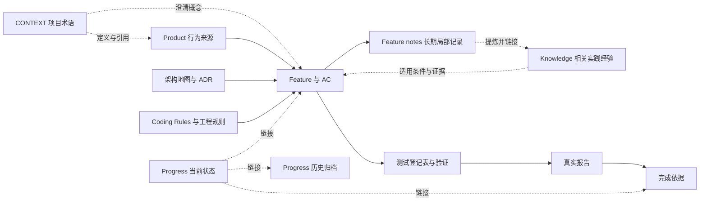
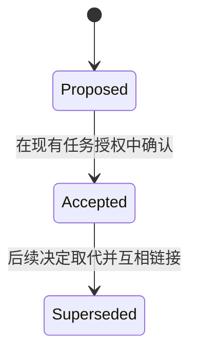

# 项目知识、架构与交接

[返回手册](../README.md) · 相关：[目录参考](../reference/project-layout.md)、[工程变更](engineering-changes.md)

中断后继续任务时，你需要知道做到哪里、还缺什么、下一步是否已获授权。Agent 用 Progress 交代当前停点，用任务历史保留执行经过；值得复用的经验再进入知识目录。以下先说明续接，再介绍其他记录的使用时机。

## Progress 如何帮助继续任务

当前 Progress 只需清楚记录：活动 Feature 或获批批次、真实阶段、阻塞、待决定事项、下一步，以及计划和报告链接。不能从“下一步实施”这句话推断用户已经批准。

任务完成后将执行历史归档一份到 `docs/progress/<key>.md`，保留原文和证据链接；已有归档先读取，不能覆盖或重复复制。未解决问题仍留在当前交接中。移动历史不要求翻译原文，新写的项目知识遵循 `document_language`。

接手时按 Progress → 当前 Feature → 相关历史/证据 → 实际差异的顺序读取，核对已有授权和现在的代码。历史完成与当前内容是否重新验证是不同事实；后续迁移不应伪造过去曾做过的检查。

## 换到新线程继续

对话过长、经过多次压缩，或需要换一个任务继续时，可以让原线程先生成交接提示词。按实际需要使用，不设置必须换线程的压缩次数。

1. 在原线程发送提示词库中“Godot 项目开发 → 验证与收尾 → 整理进度与任务交接”，填入当前任务与用途。Agent 只整理必要的现有 Progress/历史，并生成一个完整的交接代码块。
2. 检查输出是否包含原始目标与最新要求、实际项目/worktree 路径、当前分支、修改归属、真实停点、已有授权、实际检查和下一步。交接内容应当已经填好具体信息；未知事项保留为未知。
3. 在同一个实际项目目录或原 worktree 中打开新任务，把整个代码块复制过去。复制的是原线程生成的结果；库中的提示词用于让原线程整理上下文。原线程输出后停止实施，避免两边继续改同一份文件。
4. 新线程先读取项目规则、相关记录与实际差异，确认原任务现场后，从真实阶段继续。已有具体授权仍然有效；未取得的人工验收、未运行的检查和失效的旧结果仍须如实处理。

交接内容还应区分会话中仍有效的协作原则、当前步骤限制与已被后续明确要求替代的旧限制。生成交接文本这一步的文档整理或只读范围、代码块输出和停止约定，不作为接收方后续任务的永久限制；原任务仍有效的范围继续保留。

交接摘要帮助定位事实，项目原文和实际文件仍需核对。无需为了换线程提交未完成代码、清空工作区、另开分支、重建台账或重跑所有检查；未提交修改按项目规则确认归属并保留。若原线程仍有命令运行，交接写明已知状态，新线程先确认是否结束及结果是否可用，再继续相关操作。

框架维护中的未完成任务使用“Yaya 框架维护 → 维护与复盘 → 生成新线程交接提示词”。该入口只读仓库与会话，保留框架和具体游戏的职责边界，不建立维护 Progress 或交接状态文件。两类正式提示词都只维护在 [提示词库](../../../prompts.json)，这里不复制正文，也不自动创建或投递新任务。

## 信息应该放在哪里

| 信息 | 主要位置 | 其他记录如何使用 |
| --- | --- | --- |
| 跨模块、Feature 或会话复用的项目术语 | 按需创建的 `docs/CONTEXT.md` | Product、规划、实现和复审读取相关定义并引用，避免重复维护 |
| 本任务局部决定、占位资源、Bug 经验、TODO | Feature 的 `notes` | 历史和后续任务引用，避免再抄一遍 |
| 可复用的成功做法、排障方法与失败教训 | `docs/knowledge/`，按主题分层 | 任务开始时优先查阅相关条目，条目链接原任务与证据 |
| 当前做到了哪里、阻塞、待决定与下一步 | `docs/progress.md` | 新会话先读取 |
| 一项任务或获批批次的执行历史 | `docs/progress/<key>.md` | 当前 Progress 保留索引 |
| 当前模块、状态归属、依赖方向 | `docs/architecture.md`、子系统文档 | 执行与复审读取相关部分 |
| 重要技术选择的原因与取舍 | `docs/architecture/adr-NNNN-<slug>.md` | 架构地图与 Feature 链接该决定 |
| 可复用工程约束 | `docs/coding_rules.md`、`agent-rules/` | 读取现有规则，新增按明确授权处理 |
| 本次真实执行输出 | `reports/` | 完成依据和任务记录引用原件 |



这张图表示信息关系，不要求每个项目创建全部可选文档。

## 优先查阅与积累项目知识

新项目只携带 [知识目录入口](../../../../project-source/defaults/docs/knowledge/README.md) 与主题索引，实际经验随任务积累：

```text
docs/knowledge/
├── README.md                         总索引与使用约定
├── godot-runtime/README.md           Godot 运行时
├── gdscript/README.md                GDScript 编码
├── debugging-testing/README.md       调试与测试
└── tools-pipeline/README.md          工具与管线
```

每条独立经验使用单独的 Markdown 文件，索引只放链接与简短说明。实际内容需要时可增加游戏模块或更细子目录；不按每个 Feature 机械建文件夹，也不把一条经验复制到多个主题。

规划、调查、开发、调试或复审开始时，先明确当前任务和规则，再查总索引与相关主题、条目，随后决定方案或补查外部资料。按模块、现象、API、工具缩小范围，继续原任务时复用已读内容；不要求每次通读整个知识库。优先参考不等于自动适用：还要核对当前版本、场景和证据，知识不能覆盖用户意图、Product、已接受决定或工程规则。分类为空也不阻塞工作。

经验正文保存场景、有效做法或根因、适用范围和真实依据。成功做法说明观察到的收益与限制，不必编造“根因”；有项目独有条件的做法也可以保留。版本和平台影响结论时明确记录，疑点标为未确认，不把一次运行现象当成通用引擎事实。

**经验写在哪里？** Agent 先检查已有条目，再更新或新增有价值的知识与最近一级索引。Feature notes 保留原事件和局部决定，知识条目提炼适用做法并链接原件；技术决定与工程约束仍分别由 ADR 和规则负责。

**何时写入？** 在已授权任务的文档整理中完成。Feature 相关知识在 Stage 7 提交前落盘，Stage 8 汇报链接；只读或讨论任务不会因此取得写入授权。

**改后检查什么？** Agent 核对事实、适用条件与来源链接。纯知识 Markdown 不使业务测试证据失效；代码、测试或契约变化仍需验证。

没有新知识就不新增条目。目录只链接实际运行脚本、数据或报告原件，维护沿用现有任务流程。现有经验已经不适用时明确修正适用条件，跨项目吸收和规则升级仍按原授权处理。

## 何时维护 CONTEXT

当同一项目中的概念需要反复解释，或在不同模块、Feature 中出现同名异义、异名同义时，使用 `project-clarifier` 通过具体情景澄清。需要保存的已确认定义由 `product-change-standardizer` 按授权写入 `docs/CONTEXT.md`；缺少该文件不阻塞讨论或开发，也不预先放一个空模板。

文件只需简短背景、术语名称和一两句话的定义，按需说明概念关系、别名或易混淆项。例如区分“物品定义”“持有物品”“堆叠”，随后链接到 Product 的实际堆叠规则。已有定义直接复用，移入 CONTEXT 时将范围内的重复定义改为链接。

详细行为、数值和状态转换由 Product 负责；实现状态归属和技术取舍由架构文档负责；待定想法、聊天记录和当前进度不放在 CONTEXT。仅保持含义的术语维护不会触发完整 Product 初始化或 Feature 拆分；实质行为变化仍走需求变更。规范与格式见 [项目术语约定](../../../../project-source/methodology/01-product-doc-structure.md#project-terminology-and-context-optional)。

## 何时需要架构地图

当仅从源码已经难以看清模块职责、状态归属和依赖方向时，建立 `docs/architecture.md`。复杂子系统展开到单独文件，总览保持可浏览。

地图应指向实际模块，解释谁拥有状态、谁可以调用谁，以及为什么这样划分。需要说明运行过程时，在子系统文档记录触发、参与者、状态变化、结果、Godot 生命周期和失败处理。使用 flowchart 展示依赖，用 sequenceDiagram 展示交互顺序，用 stateDiagram-v2 展示真实状态转换；只画能帮助读者判断的内容。

生成的引用关系只说明解析器看到了什么。动态加载、运行时 Signal 和状态归属不能仅靠文本搜索确定。观察、推断、提议和已实现行为要区分，图表也不是依赖设计的自动批准。

## 何时使用 ADR

某项技术选择跨多个 Feature、长期约束项目或代价较高时，可建立 ADR。记录问题、约束、候选方案、决定、收益、接受的成本、依据和有用的重新考虑条件。普通局部选择保留在 Feature notes 即可。



这些是普通 Markdown 状态，不需要注册表。`Accepted` 说明决定得到确认，不证明相关 API 或运行行为已经测试；`Superseded` 保留旧理由并链接替代 ADR。真实任务已经确认的决定直接沿用，不额外增加一轮批准。

架构地图保存当前结构，ADR 保存跨任务理由，Feature notes 保存局部决定，Progress 保存当前链接。按需更新边界变化，不为每次改函数写 ADR，也不把缺少可选地图当成门禁失败。

## 资源、数据与占位内容

空白项目不指定业务素材目录。资源文件按游戏模块与实际资产流程组织，修改前核对源文件、运行资源、导入信息和生成缓存的归属。

占位内容使用 `_placeholder_` 前缀，并在当前 Feature notes 说明用途、替换方式和未完成的验收。替换素材时核对引用、UID/路径与实际场景；外观、声音、动画和手感仍按需求保留人工验收。

数据格式改变时核对已有内容和加载方，再决定版本、迁移与兼容范围。资产来源和许可证按现有规则记录。工具生成的输出不应成为可复用脚本或重要项目决定的唯一副本。

## 报告保留与清理

当前验证、人工验收、未解决失败或后续工作需要的报告继续保留。默认报告不进入 Git，因此代码提交不保证另一台机器拥有报告原件。需要跨目录或跨机器交接时说明实际可用证据，缺失原件不能靠提交说明补成通过。

清理报告是明确的维护动作：读取拟处理目录和当前引用，只清理已理解且获授权的输出。目录较旧、后面有成功运行、文件未被 Git 跟踪，都不自动授权删除。测试运行器不会自动清理旧报告，也不需要额外的保留登记表。

依据：[历史与报告规范](../../../../project-source/methodology/09-artifact-lifecycle.md)、[架构与 ADR 规范](../../../../project-source/methodology/10-architecture-overview.md)。

## 读取工程规则

项目根 `AGENTS.md` 是路由入口，`docs/coding_rules.md` 保存协作和通用架构原则，`agent-rules/` 按实际修改领域提供具体工程语义。流程和测试追踪由 `methodology/` 负责。

| 修改领域 | 对应规则入口 |
| --- | --- |
| 所有任务 | [00-core](../../../../project-source/agent-rules/00-core/README.md) |
| GDScript | [10-gdscript](../../../../project-source/agent-rules/10-gdscript/README.md) |
| Scene / `.tscn` | [20-scenes](../../../../project-source/agent-rules/20-scenes/README.md) |
| Resource / `.tres` | [21-resources](../../../../project-source/agent-rules/21-resources/README.md) |
| Shader | [30-shaders](../../../../project-source/agent-rules/30-shaders/README.md) |
| 项目配置 | [40-project-config](../../../../project-source/agent-rules/40-project-config/README.md) |
| 导出配置 | [41-export-config](../../../../project-source/agent-rules/41-export-config/README.md) |
| JSON、CSV 等规范数据 | [50-data-files](../../../../project-source/agent-rules/50-data-files/README.md) |
| 图像、音频、字体和导入资产 | [60-assets](../../../../project-source/agent-rules/60-assets/README.md) |
| 测试、fixture、运行器 | [70-tests](../../../../project-source/agent-rules/70-tests/README.md) |

领域可叠加，例如测试 `.gd` 同时遵循脚本和测试规则，Resource fixture 同时遵循资源和测试规则。先读相应 README，再按路由读具体规则，避免每次加载全部规则或遗漏跨领域约束。
