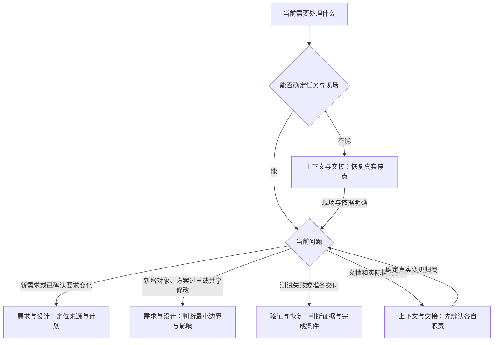

# 按当前问题选择场景检查单

[返回手册](../README.md) · 相关：[Skill 与提示词导航](../reference/skills.md)、[故障排查](../reference/troubleshooting.md)

这组指南用于已经了解项目基本结构、现在需要处理一个具体问题的读者。先找到当前现象，再按对应场景逐步核对。它把现有方法整理为操作检查单，不新增 Stage、审批、任务状态或必须填写的检查单文件。

## 先选正在发生的情况

| 分组 | 具体情况 | 从这里开始 |
| --- | --- | --- |
| 需求与设计 | 收到新功能，尚未形成当前模块的可执行计划 | [新功能进入正式开发](scenarios-requirements-design.md#收到新功能后进入正式开发) |
| 需求与设计 | 已确认行为或专业规格变了，现有任务可能受影响 | [要求变化后对齐已有计划](scenarios-requirements-design.md#已确认要求变化后对齐已有计划) |
| 需求与设计 | 准备新增模块、系统或核心实体，或方案明显超过当前需要 | [重新判断设计边界](scenarios-requirements-design.md#新增核心对象或发现设计过重时重新判断边界) |
| 需求与设计 | 准备改公共组件、项目工具或框架源，担心影响其他调用者 | [先界定共享修改影响](scenarios-requirements-design.md#修改共享能力前界定归属与影响) |
| 验证与恢复 | 测试、运行器或证据导入失败，不确定错在何处 | [按失败层定位和恢复](scenarios-verification-recovery.md#测试或证据导入失败时定位并恢复) |
| 验证与恢复 | 代码已写完，需要判断能否交付、等待验收或记 done | [实现完成后逐项核对交付](scenarios-verification-recovery.md#实现完成后判断能否交付) |
| 上下文与交接 | 换线程、压缩或中断后，不确定正在做什么及能否继续 | [恢复上下文并续接](scenarios-context-handoff.md#上下文不足时恢复现场并续接) |
| 上下文与交接 | Product、任务、说明、代码或结果互相矛盾 | [核对事实并修复正确位置](scenarios-context-handoff.md#文档与实际状态不一致时确定修复位置) |

“要求变化”用于新意图已明确的情况；“文档与实际状态不一致”用于尚不清楚哪一方有错的情况。开发中发现方案违反已确认要求，也从后者开始，不先改需求使方案看起来正确。

## 检查单怎样使用

1. **确认适用条件。** 默认工作目录为生成项目根目录；框架源修改的目录边界在相应场景中单列。示例中的 `F0XX`、模块和路径占位须换成真实对象；可选文档不存在时不要为了检查单先创建它。
2. **沿步骤读取和处理。** 每行给出输入、执行者、判断与动作、预期输出和可继续的判据。用户提供目标、缺少的实质决定及真实体验结果；Agent 查文件、遵循 Skill、执行获准动作并核对原件。
3. **完成判据成立才转下一步。** 已完成且仍有效的步骤直接复用；失败时进入本行指定的恢复位置，不能把“命令已启动”“文件已生成”勾成通过。可只在对话中指出停在哪一步，无需另建勾选台账。
4. **区分场景终点与 Feature 完成。** 需求场景可能只得到计划，诊断场景可能只得到归属，交接场景可能只得到续接材料。只有交付场景满足全部适用条件时，才进入正式完成记录。

已有具体授权跨步骤沿用；读到一个动作不等于新增授权。仅讨论、仅检查或仅文档的请求保留其范围；缺少决定只暂停依赖它的工作。实际执行细则仍由项目自己的 methodology、Skill 与规则负责。

生成项目中，新写入任务须从干净工作区开始；续接任务须证明所有未提交改动都属于原任务，混合或未知修改未厘清前停止写入。只读定位与讨论仍可继续。不能用检查单中的下一步绕过这些前置，也不能为满足前置自动暂存、清空或提交别人的工作。

## 与提示词库如何配合

各场景开头列出 [framework/prompts.json](../../../prompts.json) 中的 **Project → 分类 → 提示词名称**，并说明应填写什么输入。这些是已有入口，不是新增提示词；选择符合本次目标的一条，不必依次发送整组。

| 材料 | 负责什么 |
| --- | --- |
| 本组场景指南 | 解释适用条件、顺序、分支、输入输出、完成判据及恢复位置 |
| 集中提示词 JSON | 保存可直接交给 Agent 的紧凑任务指令、本次输入和授权范围 |
| 生成项目中的规范与 Skill | 定义实际来源归属、规划、执行、测试和交接契约 |
| 项目中的 Feature、Progress 与原始证据 | 记录这一次任务的事实；手册示例不提供真实通过或批准 |

生成项目仍独立工作，不需要访问框架手册。提示词引用项目内部规范，手册解释同一套规范；不会让执行者必须先取得本手册才能继续。若发现解释与源规范冲突，先明确具体差异，不让场景步骤静默改写原流程。

## 已有完整流程直接复用

以下内容已经包含输入、分支、产物和返回入口，本轮只提供入口，不再复制成另一份教程。

| 当前情况 | 现有说明与可用提示词 |
| --- | --- |
| 从空目录建立项目、准备 Python/Godot 与 Git | [创建](../getting-started/create-project.md)、[首次使用](../getting-started/first-use.md)；“项目创建与接入 → 创建空白项目 / 准备 Godot 开发环境” |
| 将旧项目迁到独立目录，或在原项目采用新框架 | [复制迁移](../getting-started/migrate-existing-project.md)、[原地替换](engineering-changes.md#原地替换项目框架)；“复制并迁移旧框架项目 / 审核并原地替换项目框架” |
| 已有功能，缺正式需求与任务记录 | [已有实现补齐](product-and-planning.md#从已有实现补齐需求与任务)；“需求设计 → 从已有实现补齐需求与任务” |
| 准备素材、接入现有音效或验证界面原型 | [专业要求到接入交付](specialist-workflows.md#从专业要求到接入交付)、[视觉原型](product-and-planning.md#先验证视觉原型再接入依赖它的逻辑)；按目标选择资源清单、资源接入或实验提示词 |
| 独立审核代码、界面、美术、声音等成果 | [独立审核交接](specialist-workflows.md#独立审核怎样交接)；“验证与收尾 → 独立审查代码或指定变更 / 独立审核专业成果” |
| 填写人工验收结果或整理已完成阶段的经验 | [人工验收](feature-delivery.md#人工验收应如何操作)、[知识维护](project-knowledge.md#优先查阅与积累项目知识)；“整理人工验收与反馈 / 阶段性总结与复用脚本沉淀” |

公开发布、制作工具选型和试玩分析不属于这组场景。无需为了目录完整补入尚未提供的方法。
