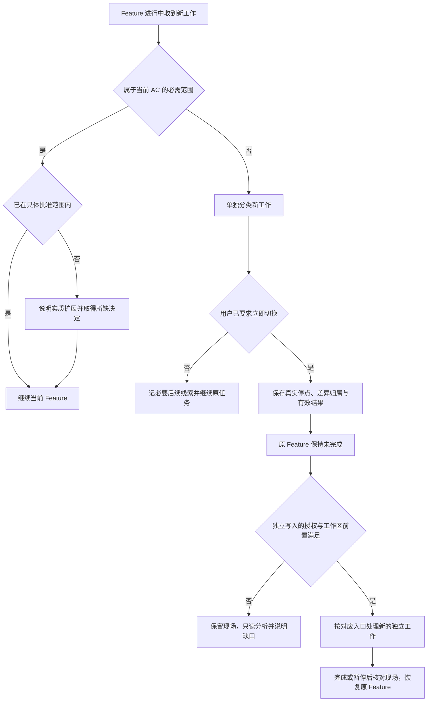
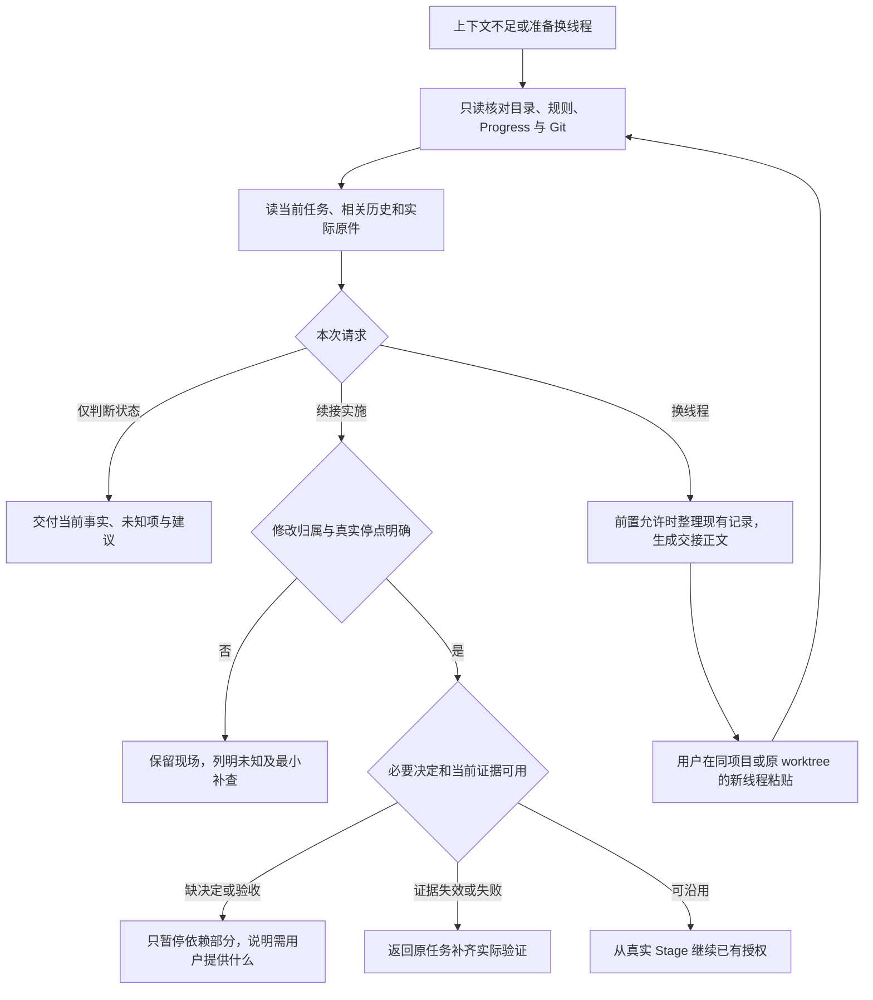
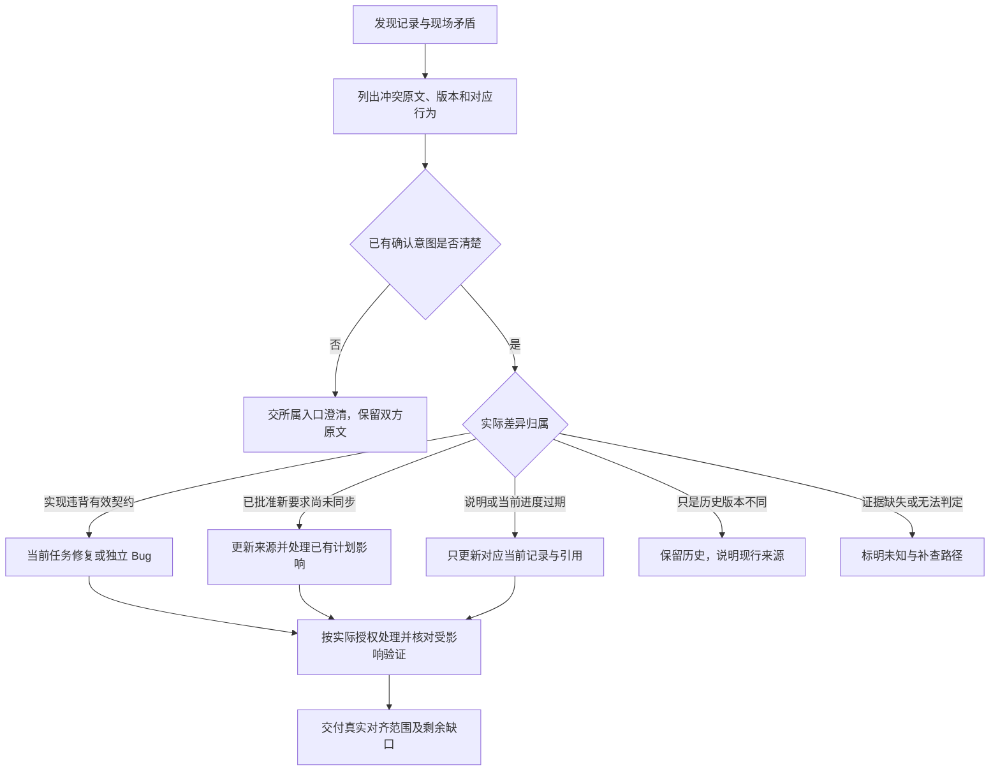

# 场景处置：上下文与交接

[场景索引](scenario-procedures.md) · [需求与设计](scenarios-requirements-design.md) · [界面、音频与资源](scenarios-interface-audio-assets.md) · [验证与恢复](scenarios-verification-recovery.md)

本组处理“我现在究竟在哪一步”以及“记录与现场为什么对不上”。项目使用现有 Progress、Feature、来源和证据恢复事实，不创建 `CONTEXT.md`、Handoff 文件或新的状态台账。

## Feature 中途切换、中断或临时插入其他工作

**适用条件：** 当前 Feature 未完成，又来了一个 Bug、Product change、资源或维护工作，需要决定继续还是中断、切换。新增模块的结构和顺序另见 [插入 Product](scenarios-requirements-design.md#开发中临时插入-product-或模块)；这里处理当前任务的停点和返回。

**目标：** 给新工作正确归属，保护当前有效成果和验证，按明确优先顺序推进，回来后从真实停点续接。

**可用 Prompt：** 仅判断用“Godot 项目开发 → 日常开发 → 判断当前状态与下一步”；需要交接用“验证与收尾 → 整理进度与任务交接”；恢复原任务用“日常开发 → 继续中断的当前任务”。新工作使用其 Bug、需求、资源或工程维护现有入口，提供本次要立即切换还是留后续的决定；不新增“插队”提示词或状态。

| 步骤 / 操作 | 输入与需要检查的内容 | 执行说明与条件分支 | 预期输出与完成判据 |
| --- | --- | --- | --- |
| 1. 判断是否属于当前任务 | 当前 Feature/AC、批准范围、新请求与真实影响 | 当前 AC 必需且授权已覆盖→继续；实质扩展→说明具体增加内容并取得所缺决定。无关工作单独分类，不能悄悄加入当前 Feature。 | 原范围与新工作边界清楚；同一 Feature 的必要修复不重复建项。 |
| 2. 确定优先顺序 | 用户最新要求、真实阻塞、已有依赖 | 没有立即切换要求时，保留必要后续线索并继续原任务；明确要求切换时直接沿用，不重复询问。新增必要前置会改变 Product 顺序时先走对应场景。 | 知道为什么继续或切换；提出想法本身不自动暂停当前工作。 |
| 3. 保存当前停点 | Git 差异与归属、当前 Stage、已完成行为、验证原件、Progress | 在现有 Progress 记录真实停点、阻塞、下一动作及有效结果链接。已验证且可独立使用的完整逻辑改动可按现有 Git 规则提交；不能为了切换提交破损半成品。 | 原任务仍未完成；提交、暂停、切换均不等于 `done`，不新增 Handoff 文件或状态台账。 |
| 4. 检查独立写入前置 | 实际 Git 状态、新工作授权和对应流程 | 新写入任务须从干净工作区开始。仍有原任务 WIP 时保留现场，不自动 stash、清空或吸收入新任务；先做只读分类并说明所缺安排，不能只改 Progress 就声称前置满足。 | 前置满足才开始新的修改；无法满足时明确可继续的只读范围。原任务内辅助工作保持原归属，不因此另设工作区关卡。 |
| 5. 进入正确入口 | 新工作预期、资源/来源、复现和范围 | Bug→[定位修复](scenarios-verification-recovery.md#发现-bug-后定位修复并回归)；Product change→[来源与计划对齐](scenarios-requirements-design.md#已确认要求变化后对齐已有计划)；资源→[接入](scenarios-interface-audio-assets.md#已有资源文件后接入或替换)；maintenance→[工程维护](engineering-changes.md#工程维护如何确定边界)。 | 新工作有自己的责任范围与真实结果，不借新任务完成来关闭旧 Feature。 |
| 6. 恢复原 Feature | 新工作完成/暂停结果、原 Progress、实际差异和旧证据 | 按下方恢复检查单核对现场，从原 Stage 和有效计划继续。切换期间源码或规格变化可能使旧证据失效，应补适用验证，不重新规划整个 Feature。 | 原任务的下一动作、仍有效成果和剩余义务明确；无需重演已完成且仍有效步骤。 |

**最终产物与返回入口：** 当前 Progress 的必要停点、按规则可提交的完整逻辑成果、新工作的正确归属，或明确工作区阻塞；返回 [上下文恢复与续接](#上下文不足时恢复现场并续接)。依据：[执行异常处理](../../../../project-source/methodology/03-execute-loop.md#exception-handling)、[Git 任务归属](../../../../project-source/agent-rules/00-core/git-worktree-and-commits.md#clean-worktree-and-task-ownership)。

## 上下文不足时恢复现场并续接

**适用条件：** 对话压缩、中断、换线程或较久未继续后，无法确定当前任务、已有修改、批准范围或验证状态。任务事实已清楚且只问下一步时，用只读指导入口即可，不必重新交接整个项目。

**目标：** 得到有依据的当前任务、真实停点、修改归属、有效授权和第一步动作；可继续时从原阶段执行，有阻塞时说明具体缺口。

**可用 Prompt：** 同线程续接用“Godot 项目开发 → 日常开发 → 继续中断的当前任务”；仅诊断状态用“判断当前状态与下一步”。换线程前用“验证与收尾 → 整理进度与任务交接”，填写当前任务和交接用途；该入口先在原线程生成可复制结果，不自动建立新线程或执行后续工作。

| 步骤 / 操作 | 输入与需要检查的内容 | 执行说明与条件分支 | 预期输出与完成判据 |
| --- | --- | --- | --- |
| 1. 确认实际现场 | 项目/worktree 绝对路径、`AGENTS.md`、Git 分支/状态/相关提交、`docs/progress.md` | Agent 先区分原任务续接与新任务。列出已暂存、未暂存、未跟踪内容及已知归属；摘要称“干净”但实际有差异时以文件为证据，不自动 stash、恢复或提交。 | 目录、分支和现场清楚。归属未知或混有其他任务时保留所有内容，先说明需核对哪些路径。 |
| 2. 恢复任务与决定 | 轻量索引、当前 `docs/features/F0XX.json`、相关设计/来源、Progress 指向的历史和原会话中的明确决定 | 先读当前记录，再按缺口展开必要历史。区分计划、已实施、失败尝试、已放弃方案；只有摘要而没有批准依据时标未知。架构/ADR、术语和知识只读与当前问题有关的部分。 | 可指出当前 Feature、Stage、未完成行为和仍有效的决定。没有 Feature 的维护/讨论按实际说明，不为续接创建一个。 |
| 3. 核对验证与运行状态 | 当前源码/契约差异、完成依据引用、真实 result/日志/人工原件及未结束命令 | 判断原结果对应哪个版本、覆盖什么。原件缺失不据摘要补 PASS；未结束命令先查是否仍运行及结果是否已落盘，不假定旧会话句柄能继续。纯 Progress 归档不强制重跑；源码/规格变化则处理失效依据。 | 已执行、失败、未执行和过期证据分开，下一步能定位到具体义务；缺证据转 [验证与恢复](scenarios-verification-recovery.md)。 |
| 4. 判定能否继续 | 任务目标、原始具体授权、用户最新补充及实际人工反馈 | 已批准且未改变的工作继续；“继续”不会替代缺失的产品决定或人工接受。只要求状态时不执行建议。真正范围变化或关键冲突才补充决定，不因换线程重复批准原方案。 | 明确可执行的第一步，或需补的具体输入。仅暂停依赖缺口的工作，沿用仍有效的其余范围。 |
| 5. 准备交接或直接续接 | 已核实的事实、现有 Progress/历史、实际差异与用户请求 | 同线程执行从原 Stage 继续；换线程时仅在写入前置满足时更新必要 Progress/历史，否则保留文件并生成只读交接。正文包含目录、现场、真实停点、有效授权、证据和下一步；未知照实标注，不复制全部聊天。 | 可直接粘贴给接收方的完整文本，或已恢复的原任务。交接不依赖先提交、清空现场、重跑测试或创建新状态文件。 |
| 6. 接收并复核 | 用户粘贴的交接正文、同一项目或原 worktree 中的实际记录与差异 | 原线程输出后停止实施；新线程再核对目录、规则、任务和差异，确认交接未过期后继续。材料与现场不一致回到对应步骤，不直接执行摘要里的旧指令。 | 接收方知道第一步及停止条件，不要求访问旧对话。已有授权有效，缺少人工验收仍需真实取得。 |

**示例判断：** Progress 写着“等待验收”，但接手时专业规格已经修改，旧人工结果不能直接用于当前内容；先恢复受影响验证。反之，只把已完成历史移到 `docs/progress/`，不能据此断言所有测试失效。

**阶段结束时更新什么：** 若本次只完成实现、仍待验证，在 Progress 记录真实 Stage 和剩余义务，Feature 仍未完成。若验证满足但尚待人工体验，链接清单及实际入口，保留等待项。只有正式完成后才按既有流程归档一次、保留完成事实与当前后续工作；不要把每次阶段切换都复制成一份报告。

**最终产物与返回入口：** 现有 Progress 的必要更新、可用的交接正文或已恢复的原任务；原始证据继续保留在约定路径。规范依据：[报告与 Progress](../../../../project-source/methodology/09-artifact-lifecycle.md)、[换线程操作](project-knowledge.md#换到新线程继续)。框架维护任务用框架的“生成新线程交接提示词”，不建立游戏项目式维护 Progress。

## 文档与实际状态不一致时确定修复位置

**适用条件：** Product、专业规格、Feature/AC、设计说明、源码、测试或进度出现冲突，尚不能确定哪一方应改。已确认的新需求直接走 [要求变更](scenarios-requirements-design.md#已确认要求变化后对齐已有计划)；确认的实现缺陷进入 Bug；不是把所有文档强行改成当前代码。

**目标：** 区分意图、实现和历史证据，确认冲突归属，按已有授权修正正确来源及依赖，保留无法恢复的事实与历史结论。

**可用 Prompt：** 手工修改后用“Godot 项目开发 → 验证与收尾 → 检查手动修改与需求的一致性”，填写修改对象、意图、实际比较基线。该入口要求独立新上下文的 `review-code`，只做静态检查；作者按本表核对属于自查，不能冒称独立审核。仅问状态用“日常开发 → 判断当前状态与下一步”。

| 步骤 / 操作 | 输入与需要检查的内容 | 执行说明与条件分支 | 预期输出与完成判据 |
| --- | --- | --- | --- |
| 1. 把冲突具体化 | 冲突文件/段落、Feature ID、实际行为、用户修改意图、Git 差异或提交范围 | 列出双方分别声称什么、对应哪个版本。未给基线时检查相关未提交变化；已提交修改须定位实际提交。工作区干净不代表没有偏差，未知历史基线不能靠猜测补齐。 | 能指出具体不一致，例如“来源每次加 1，当前代码加 5”，而非泛称文档过期。 |
| 2. 确认各自职责 | Product/专业来源及采用决定、AC、实现、测试、Progress 和原始报告 | Product/专业文件定义获确认的要求；代码显示实际实现；AC 定义交付；报告证明本次观察；Progress 导航当前工作。文件存在、提交较新或测试通过都不自动授权新意图。 | 区分哪份是预期、哪份是实现、哪份只是历史。确认来源互相矛盾时先解决决定，不能任选一份消除报错。 |
| 3. 选择正确处理路线 | 已确认意图、任务完成状态、实际下游引用与本次检查权限 | 预期有效而代码错误→原任务修复/独立 Bug；已批准新意图未落盘→来源与计划同步；仅导航或当前状态落后→更新对应说明/Progress；历史记录准确描述过去→保留并链接现行来源。静态审核只交结论，不执行这些修改。 | 每项问题都有依据、归属和最小改法；不把设计建议列成缺陷，不改旧 AC 或历史验收掩盖新变化。 |
| 4. 在授权内修正并检查影响 | 已获准范围、所属规范、实际引用与测试/验收义务 | 作者任务处理写入；规则按自检、专业规格按所属入口。改来源/任务契约时沿同步规则，改实现则验证行为。只修路径/进度也要检查链接与事实；改纳入指纹的治理文档仍须恢复失效依据。 | 当前文件与已确认决定一致，实际受影响消费者已处理或列明未完成；审核者不自行修复被审成果。 |
| 5. 如实交付 | 最终差异、检查原件、仍待定内容和当前任务 | 区分“文档已对齐”“实现已修复”“测试通过”“人工已接受”。尚未运行或原件不可用的部分保留限制。需要后续任务时记录具体责任，不凭文档整理把 Feature 标 done。 | 用户可找到改了哪一处、为何改、验证到何种程度及下一步；确认无需修改也是有效结果。 |

**示例判断：** 旧 Feature 的设计记录写的是过去使用的接口，而当前架构已由后续任务更换。这可以是正确历史，不应全部改写成新接口；当前架构地图和在做的任务引用才需要符合现状。若“每次加 5”是用户已确认但未写入的新意图，也不能把它误判为应恢复为 1 的 Bug。

**最终产物与返回入口：** 有依据的一致性结论、获准范围内的正确文件修订及验证/剩余工作；分别返回来源、工程、执行或交接入口。依据：[手动修改核对](engineering-changes.md#手动修改后检查需求一致性)、[专业来源职责](specialist-workflows.md#文档由谁维护)、[独立审核边界](../../../../project-source/methodology/12-independent-review.md)。
