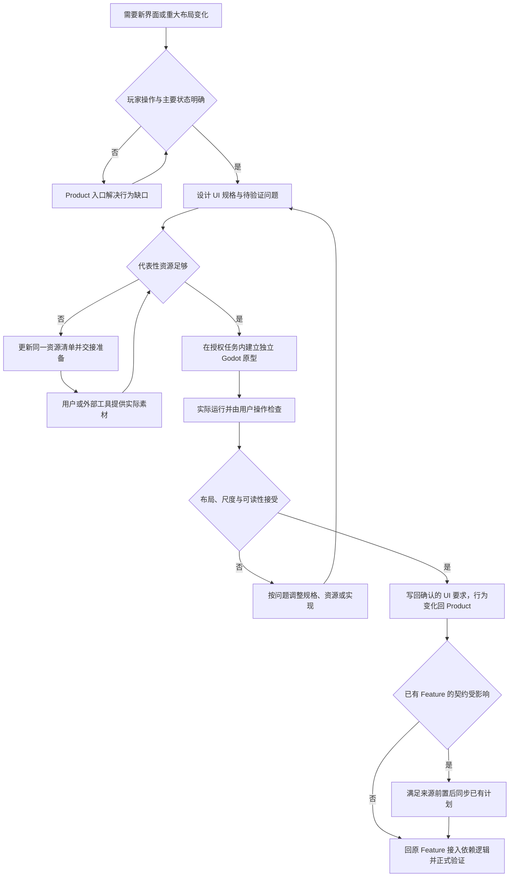
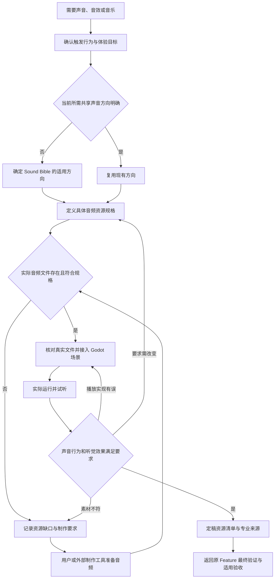
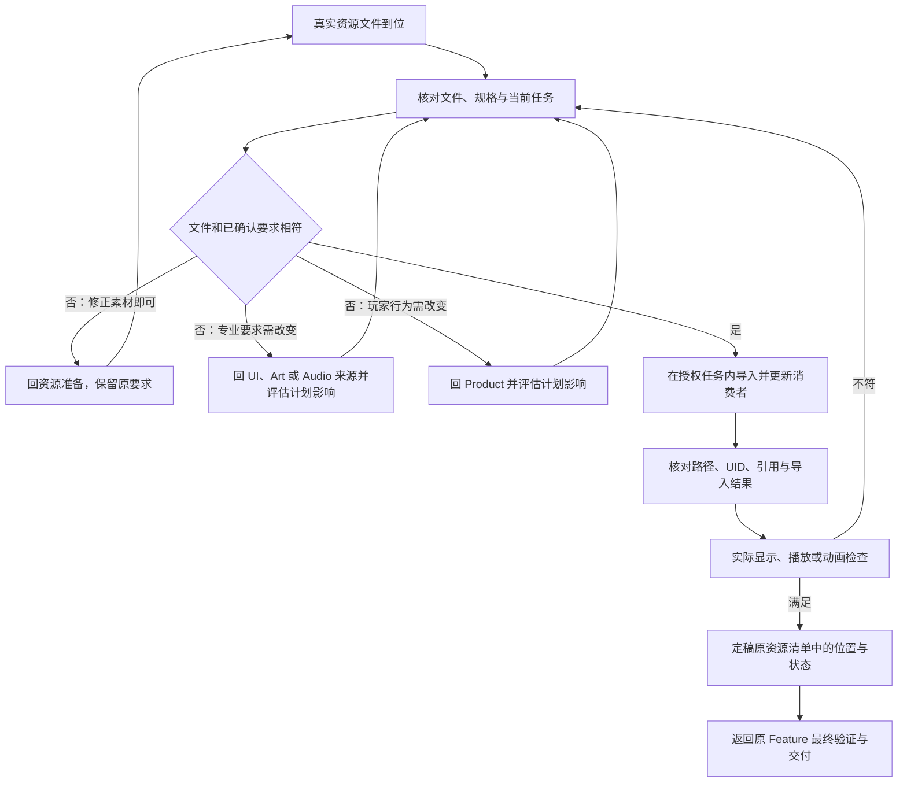

# 场景处置：界面、音频与资源

[场景索引](scenario-procedures.md) · [需求与设计](scenarios-requirements-design.md) · [验证与恢复](scenarios-verification-recovery.md) · [上下文与交接](scenarios-context-handoff.md)

本组把界面设计、音频准备和已有资源接入编排为可执行路径。专业 Skill 维护各自来源，运行修改归当前已授权 Feature 或限定实验；仅请求规格时交付规格与缺口，不自动开始制作或实现。已有有效决定、资源和验证直接复用。

## 设计 UI 界面并验证视觉原型

**适用条件：** 需要新 UI、明显的布局或资源变化，尚未确认实际尺寸、信息层级和可读性。已有验收过且适用的界面基础可直接复用；纯逻辑工作不必等待无关原型。

**目标：** 先确认玩家操作，再取得可单独运行的 Godot 视觉原型与真实体验结论，让依赖布局的正式实现有明确基础。

**首选 Prompt：** “Godot 项目开发 → 需求设计 → 设计界面与交互”。提供 Product、界面目标、显示条件和现有资源。

仅在出现对应缺口时换用下列入口，均位于“Godot 项目开发”：

| 当前情况 | 对应入口与输入 |
| --- | --- |
| 缺少原型必需资源 | “资源、性能与数据 → 分析并整理任务资源清单”；提供当前界面范围、已有文件及清单位置。 |
| 只探索一个视觉问题 | “需求设计 → 验证视觉、玩法或技术假设”；填写问题、资源、允许范围和预算。 |
| 确认的专业要求影响已有计划 | “任务规划 → 需求变化后同步已有任务”；提供已保存的来源变化，再回原 Feature。 |
| 规格和资源已齐备，开始或继续实现 | “日常开发 → 执行指定或下一项 Feature”；提供实际任务与本次范围。 |

已有 Feature 的原型工作沿用其具体授权，无需逐条重发整套 Prompt；规格入口本身不授权场景实现。

| 步骤 / 操作 | 输入与需要检查的内容 | 执行说明与条件分支 | 预期输出与完成判据 |
| --- | --- | --- | --- |
| 1. 确认界面任务 | Product、当前 Feature/实验范围、已有 UI 文件、适用 Art Bible | Agent 明确玩家要完成什么、核心状态、目标窗口和输入条件。行为不清先回 `product-author`；共享风格确有缺口才用美术方向入口。 | 用途、主要操作、状态及其来源明确；未决行为不会被节点实现偷偷决定。 |
| 2. 建立 UI 规格 | 现有或待建 `docs/ui/<interface>-design.md`、真实内容和资源引用 | `design-ui-spec` 维护 ASCII 布局、信息层级、状态差异、显示条件和原型问题。确认要求与试验参数分开，节点属性留在实现中。 | 规格足以指导当前原型；空、密集、焦点、Hover、选中、禁用等状态按实际用途覆盖。 |
| 3. 检查代表性资源 | UI 规格、实际图片/字体/动画、同范围资源清单 | 核对文件尺寸、显示尺寸和透明留白后的主体尺度。缺少当前评估必需样本时更新最小清单，由用户或外部工具准备；只暂停依赖缺口的部分。 | 已有资源足够，或有明确资源编号、规格、来源/目标位置及待准备项；占位文字不算真实显示效果。 |
| 4. 建立独立原型 | 已授权 Feature 或限定实验、规格、实际样本 | Agent 建立可单独运行的 `.tscn`，仅接本地样例状态和评估所需交互，展示界面周围上下文。正式业务规则、存档和数据流程后续接入。 | 独立入口、初始状态与操作步骤可复现，主要界面状态可展示。规格 Skill 本身不承担场景实现。 |
| 5. 实际体验与修正 | Godot 运行场景、目标窗口/缩放、适用人工清单 | 用户检查裁切、相对尺度、层级、文字密度、按钮操作和状态辨识；涉及声音则实际试听。记录接受或具体问题，失败按资源、布局或实现归属返回。 | 有明确实际体验结论；未操作就是待验收，截图、静态检查或场景能启动不能替代接受。 |
| 6. 写回并返回正式开发 | 体验结论、UI/资源来源、当前计划和原型文件 | 专业 Skill 保存获确认要求，行为变化回 Product。实质影响已有任务时走 [计划对齐](scenarios-requirements-design.md#已确认要求变化后对齐已有计划)；文档定稿后恢复失效验证。采用布局/主题时移除样例状态，原型失去用途后按授权处理。 | 正式 Feature 使用确认的基础且有自己的验证；不长期维护两套竞争界面，不以原型接受证明正式逻辑完成。 |

**最终产物与返回入口：** UI 规格、实际原型与资源引用、真实体验结论及必要计划调整；返回 [Feature 开发与交付](feature-delivery.md)。只做实验时交付观察、采纳决定和文件去向。依据：[视觉原型规范](../../../../project-source/methodology/01-product-doc-structure.md#visual-prototype-before-dependent-implementation)、[资源准备说明](product-and-planning.md#按清单准备资源再继续原型)。

## 确定声音、准备音效或音乐并接入游戏

**适用条件：** 功能需要声音反馈、音效、音乐或氛围音，希望从讨论声音要求推进到真实播放。已有合格文件且要求明确时，直接进入 [资源接入检查单](#已有资源文件后接入或替换)。

**目标：** 明确声音触发与体验目的、取得真实文件、完成场景内接入和试听，再回原功能验证。当前框架的音乐制作、音效制作仍为占位能力，必须保留用户或外部制作工具的交接点；`design-audio-asset-spec` 不生成音频。

**可用 Prompt：** “Godot 项目开发 → 需求设计 → 确定或调整声音风格 / 设计音效与音乐需求”，分别提供共享方向或当前触发场景、参考样本与限制。文件缺口用“资源、性能与数据 → 分析并整理任务资源清单”，到位后用“接入或替换游戏资源”。专业要求变化影响已有任务时使用“任务规划 → 需求变化后同步已有任务”。

| 步骤 / 操作 | 输入与需要检查的内容 | 执行说明与条件分支 | 预期输出与完成判据 |
| --- | --- | --- | --- |
| 1. 明确声音行为 | Product、Feature、实际触发场景 | 说明何时播放、为何播放、玩家应获得什么反馈；区分正式触发与原型试听按钮。玩家行为尚不明确时回 Product，不默认每次操作都要加声音。 | 触发、停止/切换条件与体验目的有来源。 |
| 2. 确定声音方向 | 适用 `docs/audio/sound-bible.md`、已有样本 | 仅在当前所需共享方向缺失或确需调整时使用 `design-audio-direction`；复用已确定的音色、情绪、层次与重复使用原则。 | 当前声音的共同约束明确；无需先设计全游戏音频。 |
| 3. 定义具体资源 | Sound Bible、触发来源、`docs/resource-requirements/<scope>.md` | `design-audio-asset-spec` 维护同一清单中的时长、循环、重复/叠加、优先关系、样本和待试听问题；建议值不冒充确认值或实测值。 | 当前资源可供制作和核对，未知项明确；占位文件名不表示文件已生成。 |
| 4. 交接制作与取得文件 | 清单资源编号、制作要求、现有文件 | 文件不存在或不符合要求时，用户/外部制作流程复用、录制、生成或加工音频。Agent 交付缺口与目标位置，暂停依赖素材的接入，继续不受影响的已授权工作。 | 实际 `.wav`、`.ogg` 等适用文件可读取，并核对格式、时长、声道和可用来源记录；未取得文件保持缺失。 |
| 5. 接入与试听 | 实际文件、目标场景/节点、原 Feature 或实验 | 按下方接入检查单，由 `content-asset-integration` 处理导入、UID/路径、播放器/总线和触发引用。实际检查时机、相对音量、循环接缝、重复播放、截断、叠加和听觉体验。 | 游戏内能实际触发，技术播放与用户听觉结论分别记录；静音、文件存在和播放器正常都不能代替试听。 |
| 6. 定稿并回原任务 | 真实试听结论、规格/清单、计划和已有证据 | 实现问题在原任务修复；素材不符回准备；确认要求改变回所属专业入口，行为改变回 Product，并核对已有计划影响。Stage 3 定稿位置与状态，再做最终验证；晚改恢复失效依据。 | 音频成为原功能的一部分，缺口和适用验收清楚；准备试听不能抵消原 Feature 的测试或最终人工义务。 |

**最终产物与返回入口：** 适用声音方向、具体规格、真实文件及接入、实际试听结论和更新后的同一清单；回 [交付核对](scenarios-verification-recovery.md#实现完成后判断能否交付)。素材尚缺时交付制作输入并停在明确交接点。依据：[专业职责与制作边界](../../../../project-source/methodology/11-specialist-workflows.md#design-production-integration-and-review)、[音频规格 Skill 源](../../../../project-source/skills/design-audio-asset-spec/SKILL.md)。

## 已有资源文件后接入或替换

**适用条件：** 已拿到图片、字体、动画、场景、音效或音乐文件，需要接入、替换或修好引用。这里处理真实文件，不重新设计资源；要求不清或文件缺失时先回对应准备步骤。

**目标：** 在原任务中完成合格资源的映射、导入与场景核对，维护原清单并返回功能交付。

**可用 Prompt：** “Godot 项目开发 → 资源、性能与数据 → 接入或替换游戏资源”，填写实际资源路径、目标场景/用途、应保持的行为、已有清单及本次范围。独立技术替换由既有工程维护入口承接，当前 Feature 内接入不重复建任务。

| 步骤 / 操作 | 输入与需要检查的内容 | 执行说明与条件分支 | 预期输出与完成判据 |
| --- | --- | --- | --- |
| 1. 核对真实文件 | 实际来源路径、现有清单、Product/专业规格、原任务 | Agent 检查文件内容、格式、尺寸/透明度、时长/声道或动画属性，以及已有来源/使用约束记录。先判断是样本还是最终资源，不凭扩展名或路径推断已合格。 | 文件确实存在，当前用途与质量缺口明确；未知来源不虚构许可。 |
| 2. 处理不符 | 实际检查结果、仍有效的确认要求 | 可在原要求下修正文件→回资源准备；要求本身需要变→回 UI/Art/Audio 所属入口；玩家行为变化→回 Product。已有计划受影响时走同步前置，不用接入顺手重设计。 | 接入对象、适用要求和任务授权一致；未决分支不进入依赖写入。 |
| 3. 接入与引用核对 | 合格文件、目标目录、使用它的场景/主题/资源/代码 | 遵循 `content-asset-integration` 与相应资产、场景和资源规则，映射实际消费者，保存外部原件及无关资源。仅调整所需导入设置，核对 UID/路径、绑定与导入结果。 | 当前消费者指向正确资源，没有丢失有效引用；不盲目重导整个资源库。 |
| 4. 场景内验证 | 可运行入口、目标显示/播放条件、实际资源 | 运行检查显示裁切/尺度、字体与状态、动画时序或音频播放；按适用范围取得真实人工体验结果。失败回文件、要求或引用归属排查。 | 分清文件存在、导入成功、实际表现和人工接受，未运行部分如实保留。 |
| 5. 更新清单并返回 | 原资源编号、实际位置、准备/接入状态、原 Feature 验证义务 | 在同一清单更新必要状态与位置，不复制一份接入台账；最终验证前定稿。回原 Feature 做受影响测试、专项检查和适用验收，晚改专业文档则恢复失效依据。 | 清单、引用和最终资源一致；接入完成不自动将原功能记为 `done`。 |

**最终产物与返回入口：** 实际资源、正确引用和导入设置、场景表现检查及同一清单；返回 [交付核对](scenarios-verification-recovery.md#实现完成后判断能否交付)。规则与核对细节以 [接入 Skill 源](../../../../project-source/skills/content-asset-integration/SKILL.md) 为准，文件准备字段见 [资源清单说明](product-and-planning.md#按清单准备资源再继续原型)。
