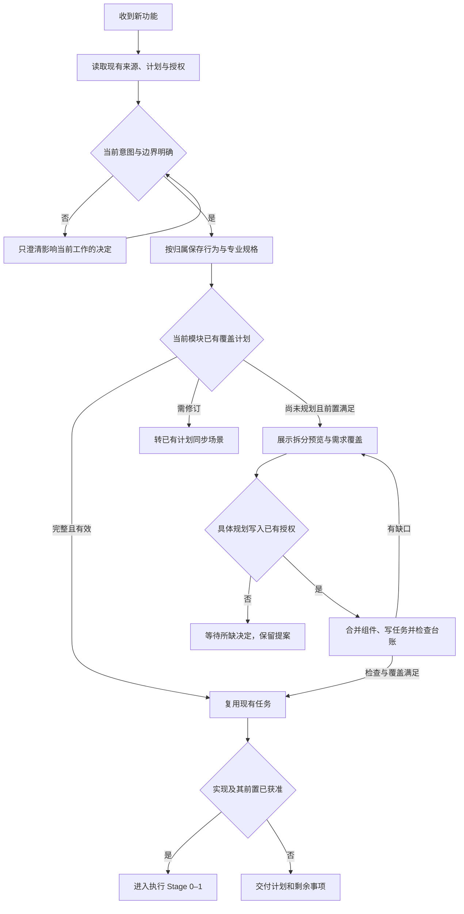
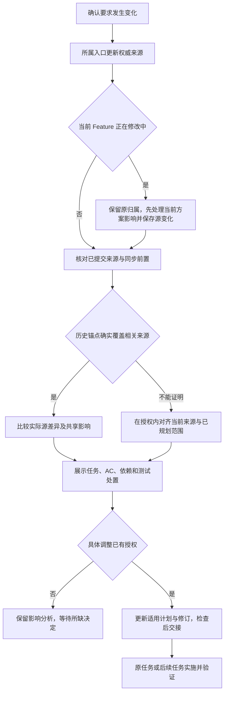
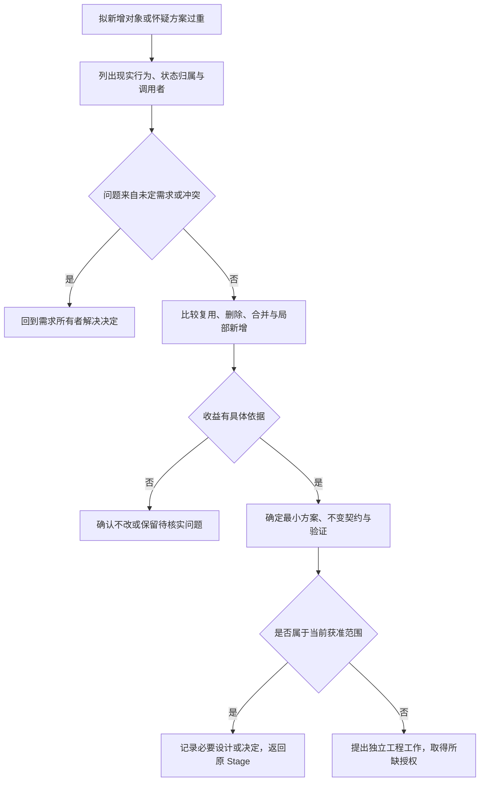
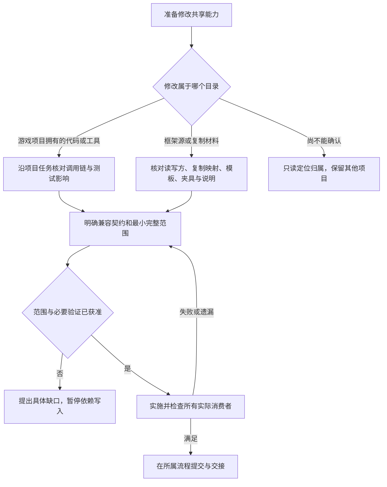

# 场景处置：需求与设计

[场景索引](scenario-procedures.md) · [验证与恢复](scenarios-verification-recovery.md) · [上下文与交接](scenarios-context-handoff.md)

本组处理正式实现前或实现中出现的来源、设计与影响范围问题。步骤中的文件路径相对实际游戏项目；最后一个场景另外区分框架维护源。操作由 Agent 在本次授权内执行，用户负责未决需求和重要取舍。只读调查结束后不会自动取得实施授权。

## 收到新功能后进入正式开发

**适用条件：** 有一个新玩法或功能目标，尚未形成当前模块的完整计划。已有对应 Feature 时复用它，不重新拆分；只是实现违背现有要求时转 Bug 路线。只有空目录、缺少框架文件时先走创建流程。

**目标：** 把已确认的当前需求落到权威来源，得到可追溯、可验证的当前模块计划；本次包含实施授权时交给执行入口。计划完成不等于功能完成。

**可用 Prompt：** “Godot 项目开发 → 需求设计 → 从想法或已有 GDD 整理 Product 并衔接规划”，填写材料、限制和文档/规划范围；已有完整 Product 时可直接用“任务规划 → 拆分当前 Product 的 Feature”。要开始实现再按已有授权使用“日常开发 → 执行指定或下一项 Feature”。

| 步骤 / 操作 | 输入与需要检查的内容 | 执行说明与条件分支 | 预期输出与完成判据 |
| --- | --- | --- | --- |
| 1. 定位工作 | 用户目标、GDD 原件、项目 `AGENTS.md`、`docs/methodology-config.json`、Git 状态、`docs/progress.md` 和 `docs/feature-list.json` | Agent 确认真实项目、当前模块和文档语言，区分只讨论、写需求、规划、实施。正在进行的任务先核对归属；新任务存在未知差异时保留现场，不清理后继续。 | 明确本次模块、允许动作与已有任务。目录、修改归属或关键范围不明时，停在具体缺口。 |
| 2. 确定可观察意图 | `docs/product.md`、相关 `docs/product/NN-name.md`、专业来源、项目规则；有相关术语、ADR 和知识时读取 | `product-standardizer` 复用已明确的规则，检查输入、状态、输出、边界和不做的部分。缺少会改变验收的决定时用户补充；不能把 GDD 的备选方案视为已采用。 | 每项当前行为有来源与可判断结果；矛盾已解决或明确阻塞。后续版本保留范围，不强行细化。 |
| 3. 写入所属来源 | 已确认决定、Product 模板、适用专业规格与当前差异 | 行为、反馈意图归 Product；布局、风格、资源规格归对应专业 Skill。只保存有用内容和必要引用；独立来源任务按 Git 规则提交，Feature 内辅助写入沿原归属。 | 权威文件能找到已确认要求，Product 不复制整份专业规格；本次自有文档及链接已核对，提交限制如实说明。 |
| 4. 检查是否需要拆分 | 当前模块完整要求、总览依赖、Feature 来源/状态、测试登记表和修订记录 | 已有有效计划则复用；范围已有计划但要求变化，转下一场景。尚未规划时确认前置 Product 已交付，只拆当前模块；不能因全局 GDD 很完整就提前生成所有模块。 | 明确复用、同步或初次拆分的选择。仅有“没有 eligible 任务”不能证明前置模块已完成。 |
| 5. 预览并保存计划 | 当前需求、适用专业验证条件、已有组件和安全网 | Agent 展示数量、逐项范围、可观察结果、依赖及“来源 → Feature/AC → 检查 → 缺口”。普通规划先确认具体方案；已明确授权自主拆分则展示后继续。批准后先合并缺少的组件，再追加详情/索引及适用记录，不重置历史。 | `docs/feature-list.json`、`docs/features/F0XX.json`、Registry 和必要修订文件一致；完整台账检查通过，覆盖核对无未说明遗漏。格式通过仍不能代替语义覆盖。 |
| 6. 交接执行 | 实际写入的 ID、AC、来源链接、依赖及尚缺事项 | 按授权保存规划提交，报告仍待实现和验证的范围。已有实施授权且环境/依赖满足时进入 Stage 0–1；只请求规划则结束。方案实质变化时更新对应预览或批准范围。 | 用户能定位具体任务、预期结果与第一步。交接不生成虚假测试 ID、PASS、人工接受或 done。 |

**示例判断：** “增加离线收益”不是立即新增一个自动加载单例的指令。先确定离线时间来源、上限、存档关系和收益反馈；若这些决定未明确，新增系统仍没有可验收依据。

**最终产物与返回入口：** 已确认的 Product/专业来源、当前模块计划、必要组件、检查结果和交接结论；进入 [Feature 开发](feature-delivery.md#stage-08-的使用路线)，或停在已说明的规划边界。详细依据见 [需求主线](product-and-planning.md#先走需求到当前模块计划的主线) 与 [拆分预览规范](../../../../project-source/methodology/02-feature-list-schema.md#decomposition-preview)。

## 已确认要求变化后对齐已有计划

**适用条件：** 用户已经决定改变行为、专业要求或适用规则，且已有计划可能受影响。尚不清楚文档还是代码错误时先走 [一致性核对](scenarios-context-handoff.md#文档与实际状态不一致时确定修复位置)。仅有建议、尚未采纳时保持提案。

**目标：** 明确变更的来源、受影响任务/验证及后续责任；既保留历史完成事实，又避免当前任务继续按旧契约执行。

**可用 Prompt：** 行为变化用“Godot 项目开发 → 需求设计 → 新增、删除或调整玩法需求”；专业要求用相应设计 Prompt。来源已保存后用“任务规划 → 需求变化后同步已有任务”，填写真实文件、提交或变化范围。该同步入口不执行 Feature。

| 步骤 / 操作 | 输入与需要检查的内容 | 执行说明与条件分支 | 预期输出与完成判据 |
| --- | --- | --- | --- |
| 1. 明确改变哪项契约 | 用户决定、旧/新要求位置、当前 Feature 与相关 Product/专业文档/规则 | 对比前后可观察行为或约束。实现错误但预期不变→修复原契约；行为变化→Product；仅专业要求变化→所属专业 Skill；规则修改→既有写前自检。 | 变更归属与采用决定明确。未经确认的建议不进入 AC，不为了让现有实现通过而改要求。 |
| 2. 保存来源并保护 WIP | 当前 Git 差异、原任务授权、来源文件及未完成任务 | 当前 Feature 内先解决对本任务的影响，辅助写入沿原任务；不能在混合 WIP 上另起要求干净工作区的 sync。独立同步前来源应已提交且前置满足；不提交要求导致前置缺失时说明阻塞，不伪造锚点。 | 真实源提交或明确未满足的前置；无关工作完整保留。没有可用同步前置时不继续写同步结论。 |
| 3. 验证比较依据 | `docs/feature-list-revisions.json` 中的 `synced_at_commit`、相关历史来源/计划和当前文件 | 验证旧锚点确实被计划吸收，不能只看提交时间。新增专业来源即使早于锚点，也要核对历史覆盖；无法证明时明确历史未知，在已有具体授权内对齐当前来源和受影响已规划任务。 | 可解释的差异基线，或标明限制的当前文档对齐；不把空 diff 当作“完全同步”。 |
| 4. 展开实际影响 | 全部轻量索引、涉及任务详情、共享规格适用范围、模块依赖、AC 与 Registry | 从主来源、AC/设计引用及共享适用范围找消费者，缺链接不代表不适用。区分当前/待做、已完成、后续未拆分；评估旧测试是否仍保护有效行为。 | 变化 → 受影响 Feature/AC → 保留/修订/替代 → 验证责任的对应。只复跑有效下游测试时纳入负责变更任务，不新建纯复跑任务。 |
| 5. 按批准结果更新计划 | 影响分析、已明确的范围、Feature 演进与测试退役规则 | 先展示具体调整，再按已有授权落盘。已完成任务保留原验收事实，必要新行为用后续工作承接；删除需求沿既有退役/替代规则，不抹掉历史。过期测试的实际代码清理写入负责实现任务，此处不假装已删除。 | 索引、详情、Registry、适用修订一致，台账检查通过；新 ID、退役/替代关系和剩余清理均能追溯。 |
| 6. 回到实施与验证 | 本次实际计划、源提交、测试影响与当前证据 | 计划对齐后，由原 Feature 或后续任务执行。最终验证前完成必要规格/资源清单更新；改动使旧证据失效时重新取得所需依据。后续未规划 Product 保留规格，轮到时再拆。 | 明确哪个任务接手、验收什么及旧证据能否复用；只有计划变更时不宣称实现已同步。 |

**示例判断：** 已确认“所有库存图标在目标尺寸下可辨认”，现在只修改 UI 规格中的目标尺寸。即使 Product 一字未改，也要找所有适用库存界面任务，补足显示检查；不能只同步恰好直接链接该文件的一个 Feature。

**最终产物与返回入口：** 来源变化、影响结论、适用任务修订与验证安排；实现进入原执行流程。约束以 [同步 Skill](../../../../project-source/skills/sync-feature-list/SKILL.md)、[来源发现规范](../../../../project-source/methodology/11-specialist-workflows.md#discover-and-map-sources) 和 [需求变化历史](product-and-planning.md#需求变化后怎样保留历史) 为准。

## 新增核心对象或发现设计过重时重新判断边界

**适用条件：** 准备新增模块、系统、核心实体或抽象层；或当前方案需要协调的对象明显多于已确认行为。仅有“文件很多”“类很长”不足以证明过度设计；明确的功能缺陷先按 Bug 处理。

**目标：** 得到针对当前需求的最小完整设计选择、需要保持的契约和可验证的收益；允许结论是复用现有结构或确认不改。

**可用 Prompt：** “Godot 项目开发 → 修复与改进 → 只读调查架构改进机会”，填写具体痛点和下一项已确定变化；纯设计讨论可用“需求设计 → 轻量讨论与澄清”。选定需要独立实施的行为保持调整后使用“行为保持的重构”。当前 Feature 的局部方案修正留在原任务。

| 步骤 / 操作 | 输入与需要检查的内容 | 执行说明与条件分支 | 预期输出与完成判据 |
| --- | --- | --- | --- |
| 1. 说清要解决的事 | 当前 Product/专业要求、Feature/AC、痛点、下一项已确定需求 | 把“需要一个系统”改成具体触发与结果，指出现有结构在哪一步无法满足。新功能不存在需求依据→先澄清；无法指出当前困难→不为假想未来新增层。 | 一段可验证的问题描述，能区分业务结果和实现偏好。 |
| 2. 读取真实边界 | 相关代码/场景/资源、调用者、现有 Feature 设计、可选架构/ADR 与知识条目 | Agent 查清谁拥有状态，谁创建/释放，谁可以修改，Signal、异步和跨场景调用如何结束。沿真实依赖补读；文本搜索不足以证明运行时动态依赖不存在。 | 关键状态、调用、生命周期及未知点明确；已有相同职责时优先评估复用。没有架构图不要求先画全仓图。 |
| 3. 比较具体方案 | 当前协调步骤、现有可复用实现及规则 | 比较不改、局部调整、删除/合并与必要新增。尝试在推理中移除某层：若调用者更简单且契约不丢，可简化；若校验、顺序、错误处理被散到调用者，保留或重新安置责任。 | 有依据的选择与接受的成本。更少文件、更短 API 或更多接口不单独构成收益；未知运行行为只标待测。 |
| 4. 确定验证与记录位置 | 所选方案、获准新增行为、不变外部契约、测试登记表与真实场景 | 明确需保护的规则、协作/引擎行为和受影响测试。局部解释放 notes，长设计放 `docs/features/F0XX-design.md`；跨任务当前边界变化更新已有架构图；只有符合撤销成本、理由难恢复、真实取舍三项阈值时才写 ADR。 | 新对象对应明确需求及其验收；行为保持调整对应具体维护收益和回归检查。记录只在有价值且获准时写，不生成空 ADR 或第二份 AC。 |
| 5. 返回正确任务 | 当前 Feature 范围、方案批准、独立工作授权 | 当前获准方案内的局部修正返回原 Stage；范围或验收实质变化先更新方案/决定；独立重构由工程入口规划。只读调查只交付候选或“不改”结论，不能自动实施。 | 具体实施责任和验证路径，或已完成的只读判断。新设计不能绕过 Product、专业要求或硬规则。 |

**示例判断：** 为一个当前只需计数与复位的对象加入事件总线、注册器和多级工厂，应分别说明它们解决哪个真实调用或生命周期问题。删除后若只是更直接，考虑局部实现；若一层负责取消跨场景等待，则不能因为它短就删掉。

**最终产物与返回入口：** 有依据的设计决定或明确不改结论，必要的局部设计/ADR 与验证义务；返回原 Feature，或 [重构入口](engineering-changes.md#重构应解释实际收益)。依据：[架构判断规范](../../../../project-source/methodology/10-architecture-overview.md)。

## 修改共享能力前界定归属与影响

**适用条件：** 即将改多个模块使用的组件、存档/数据接口、测试工具、插件接入或框架源材料。普通局部修改无需做全仓扫描；已有游戏不会因框架源更新自动获得修改。

**目标：** 在写入前明确唯一目标目录、实际消费者、需保持的契约及验证范围，防止修一个调用者却破坏其他使用者。

**可用 Prompt：** 游戏项目内用“Godot 项目开发 → 修复与改进 → 工程维护与工具调整”或“行为保持的重构”；框架源用“Yaya 框架维护 → 维护与复盘 → 修复、删减与整理框架”。填写具体对象、必须保留的行为、版本/目录和允许检查；这两种位置不能混用。

| 步骤 / 操作 | 输入与需要检查的内容 | 执行说明与条件分支 | 预期输出与完成判据 |
| --- | --- | --- | --- |
| 1. 锁定修改位置 | 目标绝对路径、Git 状态、项目/框架规则、本次请求 | 生成项目自有问题在该项目处理；框架公共材料才改维护源。若业务 WIP 被工具问题阻塞，保留业务现场，按项目工程规范处理有边界的工具修复，不把未知差异一并提交。 | 修改目录和归属明确；没有授权的其他项目只作已允许的参考，不自动同步。 |
| 2. 追踪契约与消费者 | 定义/配置字段、读写调用、公开方法、场景/资源引用及实际测试 | 检查新增/改名/删除在所有真实读写方的含义。框架路径/字段变化还追到 `framework/project-files.json`、源模板、调用 Skill、回归夹具和手册。动态路径无法静态确定时列出需运行核对的情景。 | 具体受影响文件和行为清单，包含失败路径及兼容要求；不以搜索零结果断言无影响。 |
| 3. 决定最小方案 | 当前技术目标、消费者约束、已有工具与方法 | 优先复用、局部修正或删除无用层；会改变玩家行为或专业契约时转其来源入口。只是框架源更新，不承诺升级既有项目。 | 可实施的边界、保留条件及明确不覆盖范围；重大未决选择已解决。 |
| 4. 确定验证对象 | 项目 Registry 与组件、必要原始样本；框架维护的修改类型与允许运行范围 | 项目按 Required/affected/full 规则选范围，不因“共享”标签一律全量。框架按实际读写/复制风险选检查；仅静态授权不生成项目，真实引擎回归必须在明确指定且对应本次材料的外部项目运行。 | 验证能覆盖改变的接口与实际消费者；缺少环境或不允许运行的部分标未验证，不虚报通过。 |
| 5. 实施并收尾 | 已批准方案、实际差异、检查输出和所属任务 | 完整更新必要调用者和说明；验证失败回到具体原因。按所属仓库规则检查差异与本地提交；独立问题分批，不夹带无关业务。 | 真实变更、覆盖证据、未完成项及提交。返回项目执行流程或框架维护交付，不自动发布或开始下一项。 |

**最终产物与返回入口：** 有边界的实现/配置/文档变化、相称验证及本地交付。项目依据 [工程规范](../../../../project-source/methodology/07-engineering-change.md)；框架依据 [维护与验证范围](../maintenance/updating-the-blank-project.md#按修改选择验证范围)。不额外创建全局依赖登记表。
