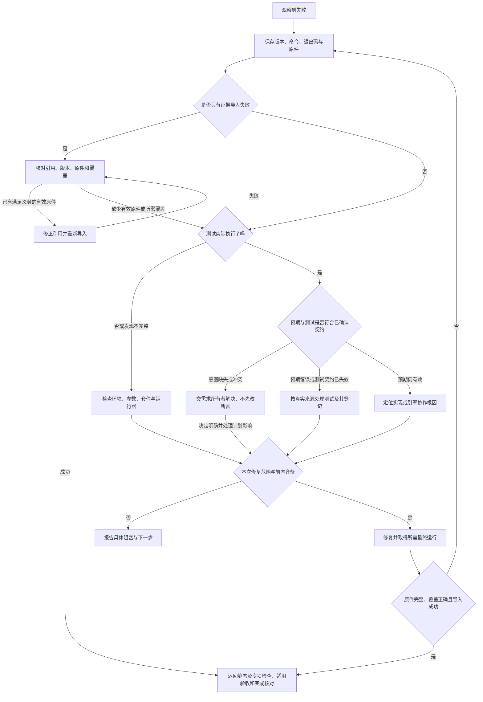
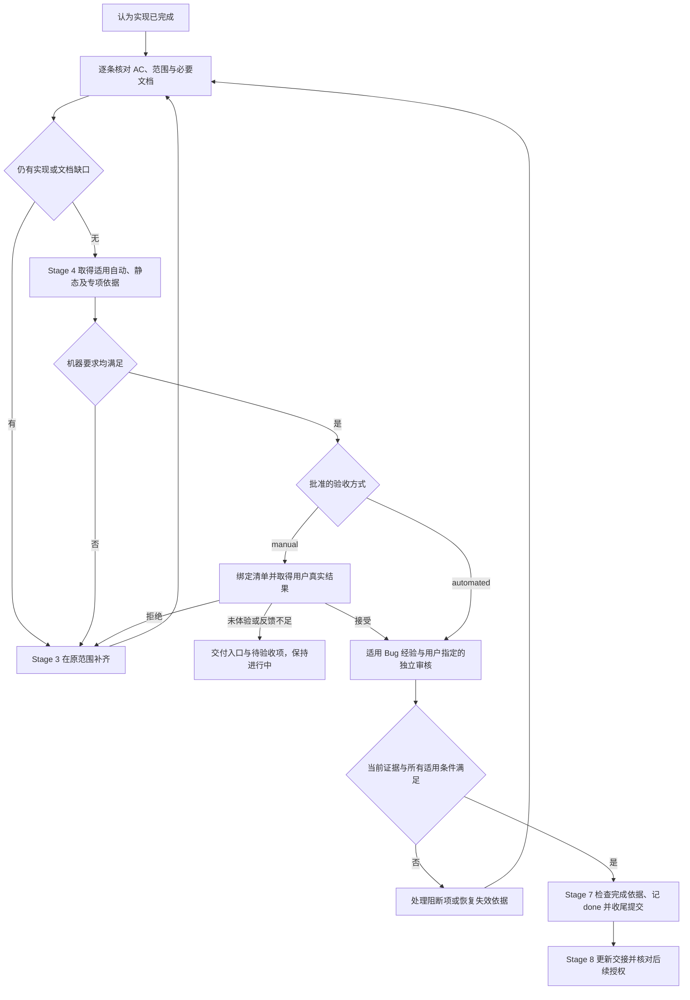

# 场景处置：验证与恢复

[场景索引](scenario-procedures.md) · [需求与设计](scenarios-requirements-design.md) · [上下文与交接](scenarios-context-handoff.md)

本组从一次实际失败或一项待交付 Feature 开始。先确定当前版本、批准的验证义务与原始证据，再判断下一步。命令参数沿用 [命令参考](../reference/commands-and-validation.md)，本页不维护第二份 CLI 清单。

## 测试或证据导入失败时定位并恢复

**适用条件：** 测试未启动、发现不完整、断言/引擎诊断失败、结果无法导入，或旧成功不能用于当前内容。只知道“好像有 Bug”但尚无运行时，先提供预期来源和复现条件；性能/长测等专项失败不能伪装成 gdUnit 结果。

**目标：** 找到失败发生的层次与责任，完成获准的最小修复及所需复验；若缺少环境、决定或证据，则给出可操作的阻塞，保持未完成状态。

**可用 Prompt：** 只测与诊断用“Godot 项目开发 → 验证与收尾 → 单独验证某次变更”，填写对象与允许的静态/测试/导入/启动范围；已授权修复时用“修复与改进 → 定位与修复 Bug”，提供明确预期、实际现象与日志。当前 Feature 内已有修复授权时直接续接原任务。

| 步骤 / 操作 | 输入与需要检查的内容 | 执行说明与条件分支 | 预期输出与完成判据 |
| --- | --- | --- | --- |
| 1. 固定失败现场 | 真实工作目录、Git 差异、Feature ID、批准验证计划、命令/退出码和本次报告路径 | Agent 记录实际版本及未提交变化。gdUnit 优先保留 `reports/gdunit-wrapper/run-<id>/` 原件；无法写报告时保存已有输出并说明文件未生成。运行未结束先查进程状态，不并发重跑同一问题。 | 能指出哪次尝试、哪个版本、哪个范围失败。失败原件不覆盖、不删除，摘要不替代原件。 |
| 2. 判断失败层 | `result.json` 的状态/errors/process、`engine.log`、`discovery.json`、本次 JUnit 与诊断原件 | 未启动或缺类/解析失败→查配置、首次扫描和实际调用；零测试/集合不匹配→查真实套件及映射；断言或引擎诊断失败→进入契约判断。JUnit 绿色但包装器失败仍是未通过；退出 0 且只有帮助也不算执行测试。 | 区分环境/调用/发现、行为断言、引擎诊断和证据导入。无法判断时列出缺失原件与最小补查，不能直接修改业务逻辑。 |
| 3. 核对谁定义预期 | 对应 Product/专业规格/工具契约、Feature AC、测试断言、当前变更及需求修订 | 实现违反仍有效要求→查实现；断言与确认要求不符→修正测试；已批准需求变化使旧契约失效→按现有计划和测试清理规则处理；要求缺失/互相矛盾→由所属入口解决。怀疑设计有问题须指出哪个状态、接口或生命周期导致违约。 | 有文件依据的分类与最短触发。测试失败本身不决定“测试错”或“实现错”；技术假设与已确认根因分开。 |
| 4. 确定责任与修复 | 当前 Feature 状态、问题来源、修复授权和受影响组件 | 当前未完成任务内的问题留在原任务；已完成行为的独立回归走工程 Bug；测试工具问题按工具契约处理。只验证请求先交诊断，不顺手改实现。回归 RED 必须是目标行为失败，环境错误不算。 | 明确归属、最小修复与回归方式；关键前置未满足则保留阻塞。可自动化的缺陷用针对性回归，确实不适合时说明原因与可重复人工路径。 |
| 5. 复验正确范围 | 修复后源码、当前 Feature/Registry、失败范围、有效的已有结果 | 修复后先证明原触发恢复，再完成当前义务。Required/affected/full 按计划与真实组件选；同一内容上较新失败须有后来成功且覆盖失败范围的运行，不能拿旧成功或更窄运行顶替。内容与覆盖均满足的结果可复用。 | 真实运行及覆盖证据；必要 full 未取得就是未完成。诊断版本和最终交付版本分开，临时埋点改变结论时须对最终版复测。 |
| 6. 导入并恢复流程 | 实际打印的结果路径、`docs/feature-completion-evidence.json`、完整原件与当前内容 | 需要自动证据时用现有 `record-tests`。引用错误且有合格原件→修正引用重新导入；缺少合格运行、哈希或覆盖不符→补齐验证。失败导入会清除旧测试引用，不能手改结果或哈希恢复通过。 | 导入成功且覆盖当前义务，才回到下面的交付核对。导入失败即使指纹未变，也不能转去让用户验收抵消机器缺口。 |

**常见分支：** 配置 `ready` 但引擎没能加载套件，只证明配置检查曾满足，不能证明业务失败；旧需求已正式删除时也不能简单跳过旧测试，应在负责变更的任务里协调测试代码、Registry 和必要替代覆盖。

**最终产物与返回入口：** 失败原件、诊断及根因/未知、获准修复和真实复验，或具体阻塞；继续 [交付核对](#实现完成后判断能否交付)。具体错误看 [故障排查图与恢复表](../reference/troubleshooting.md#测试运行和完成依据)，证据规则以 [测试策略](../../../../project-source/methodology/08-testing-strategy.md#artifact-backed-completion-and-semantic-freshness) 为准。

## 实现完成后判断能否交付

**适用条件：** 当前 Feature 已有实现，希望进入最终验证、人工验收或完成记录。不是“代码存在就补 done”；早于正式计划的实现先走 [已有实现接管](feature-delivery.md#接管已有实现的交付)。

**目标：** 得到三种明确结果之一：满足完成条件并正式收尾；已备妥人工验收且保持 `in_progress`；存在具体实现/验证/审核缺口并返回对应步骤。

**可用 Prompt：** 正常交付沿用“Godot 项目开发 → 日常开发 → 执行指定或下一项 Feature / 继续中断的当前任务”。只做验证用“验证与收尾 → 单独验证某次变更”，不能借它修改完成状态。需要用户体验时用“整理人工验收与反馈”，填写真实任务、清单与结果。

| 步骤 / 操作 | 输入与需要检查的内容 | 执行说明与条件分支 | 预期输出与完成判据 |
| --- | --- | --- | --- |
| 1. 对照整个交付范围 | Feature/AC、专业主/次来源、批准方案、相关依赖、本项全部提交与未提交差异 | Agent 逐条核对实际行为与排除项，检查遗漏、越界和边界情况；分批提交时不能只审最后一次差异。发现新的产品决定不能用现状自动替代。 | 每项 AC 对应实际实现和检查方式；尚缺行为回 Stage 3，意图冲突转来源处理。 |
| 2. 完成必要文档定稿 | 实现结果、术语、规格/资源清单、Feature 设计、规则和适用架构/ADR | Stage 3 更新本次确实改变的有用内容；不需要时明确无更新即可。要求不能仅放 notes、知识或报告。规则变化沿写前自检与授权；不为套检查单创建空设计。 | 权威来源与本次决定一致，准备状态/资源位置等必要编辑已完成。晚改纳入指纹的文档，必须恢复失效依据。 |
| 3. 检查实际验证义务 | 当前 `verification`、`affected_components`、Registry、环境配置与专项计划 | 自动义务存在→运行并导入满足 Required/affected/必要 full 的结果；有效 manual 计划确无自动义务且无未解决失败/未完成运行→保留空引用，报告 `not_required`。直接解析/lint 和性能、长测、显示/试听义务分别核对，不由 evidence 工具代判。 | 所有适用机器与专项条件满足，有真实范围、版本和原件；环境缺失或报告无效仍是缺口，不能转人工通过。 |
| 4. 处理人工分支 | 已批准验收方式、manual checks/regression、当前最终内容与用户结果 | manual→将实际入口、初始状态、操作和可观察结果写入 pending 清单，用 `prepare-manual` 绑定；用户返回结果或明确口头判断后按契约记录。未体验→等待；拒绝→修复复验；有效全通过结果→接受，无需再索取同一确认。automated 不造空清单或假人工接受。 | 对当前内容的实际人工决定，或清楚的等待项。Agent 编写样本、用户沉默、实现授权均不算接受；原件/版本无效先处理错误。 |
| 5. 检查附加条件与新变化 | Bug 根因/回归记录、用户是否指定独立审核、审核结果与最终差异 | Bug 按 Stage 5.5 留有用经验；只有指定审核才执行。报告返回不等于审核条件满足；存在阻断发现或重要未验证项先处理。最终验证后改变契约或源码时核对指纹与覆盖，并取得失效的验证及适用人工接受。 | 用户指定条件确已满足；没有指定审核则跳过。仅过程记录变更不机械重跑，但不能按“没改代码”豁免专业文档。 |
| 6. 正式完成与交接 | 当前证据、实际全部 AC 覆盖、必要检查输出与自有差异 | 依 [完成命令](../reference/commands-and-validation.md#记录完成依据) 运行 evidence validate 与 `check-feature-list.py --completion-feature`；满足后才记 `done`/真实完成时间并检查最终台账。Stage 7 完成必要知识与证据整理，将执行历史归档一次，Progress 留当前状态及历史链接，按 Git 规则提交剩余工作。Stage 8 核对剩余事项与后续授权。 | 完成记录、台账与实际结果一致，提交不夹带无关修改。未满足时保留真实状态；后续仅在授权和前置齐备时继续，否则交付本次结果。 |

**示例判断：** 数值计算测试全部通过，但按钮是否易辨认属于已批准要求，仍要取得实际体验结果。若验收后改了 UI 规格或资源清单，不能只凭旧截图和旧接受完成；应核对当前内容绑定与需重验的范围。

**最终产物与返回入口：** 当前版本的测试/专项证据、适用人工结果与指定审核结论、完成记录和本地提交，或明确的等待/失败状态。续接记录的具体处置见 [上下文与交接](scenarios-context-handoff.md#上下文不足时恢复现场并续接)。判据以 [Stage 3–8](../../../../project-source/methodology/03-execute-loop.md#stage-4--automated-verification-and-human-checklist) 和 [人工文件契约](../../../../project-source/methodology/manual-acceptance-files.md) 为准。
