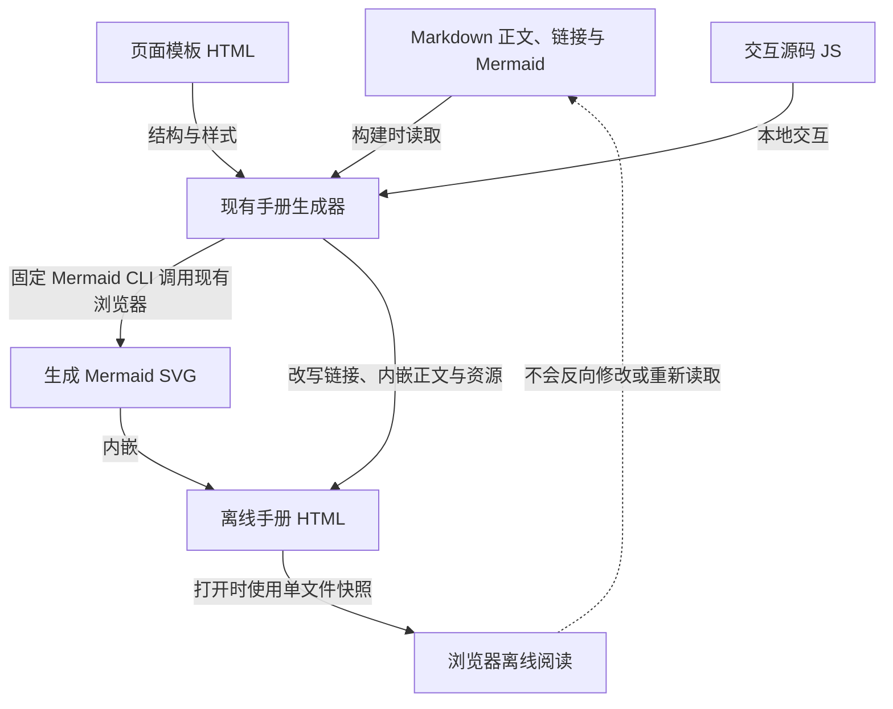

# 修改空白项目与同步使用说明

[返回手册](../README.md) · [框架规则](../../../../AGENTS.md) · [维护工具](../../../README.md)

本页面向框架维护者。处理修改时，先定位材料归属，再同步受影响说明，选择相称的验证并提交交付。首次读者的操作说明见手册入口；审核、复盘和交接提示词的详细用法在本页后半部按需查阅。

## 先判断修改属于哪里

| 内容 | 应维护的位置 |
| --- | --- |
| 新项目应携带的文件 | `project-source/`；需要调整目标位置时同时核对复制清单 |
| 创建项目如何复制 | `framework/commands/create_project.py` 与 `framework/project-files.json` |
| 详细使用导览、框架与项目边界 | 本手册 |
| 项目内简短入口 | `project-source/Project_README.md`，保持概括与项目自身导航 |
| 某条流程、Skill 或工程语义 | 对应源规范；只在任务明确涉及该行为时调整 |
| 给用户发送的正式操作提示词 | `framework/prompts.json` |
| 框架维护约束 | 根 `AGENTS.md` |
| 某个已有游戏的独有需求或修复 | 明确指定的外部项目，不顺带回灌或同步 |

`project-source/Project_AGENTS.md` 是待复制规则源文件，在维护仓库中不激活项目开发流程。阅读 Skill 源文档以核对手册，也不表示当前维护任务已经进入那项 Skill 的执行流程。

## 找到受影响的说明

按实际变化选择对应章节，不要求每次修改整本手册。

| 本次变化 | 优先核对的手册章节 | 同时查看的实际来源 |
| --- | --- | --- |
| 复制范围、目录、重命名、目标限制 | [创建项目](../getting-started/create-project.md)、[目录参考](../reference/project-layout.md) | 创建器、复制清单、默认文件 |
| 环境字段、工具路径、就绪或初始化 Git 行为 | [首次使用](../getting-started/first-use.md)、[配置参考](../reference/configuration.md)、[故障排查](../reference/troubleshooting.md) | 配置源、环境检查器、初始化提示词 |
| Product 结构、Feature 字段或依赖演进 | [需求与规划](../guides/product-and-planning.md)、[目录参考](../reference/project-layout.md) | methodology、模板、相关检查实现 |
| Stage、验收、复审、完成或续接 | [Feature 开发流程](../guides/feature-delivery.md)、[命令与验证](../reference/commands-and-validation.md) | 执行 Skill、执行规范、完成依据实现 |
| 专业来源归属、共享影响或资源交接 | [专业工作](../guides/specialist-workflows.md)、[需求与规划](../guides/product-and-planning.md)、[Feature 开发流程](../guides/feature-delivery.md)、[工程变更](../guides/engineering-changes.md) | [专业职责与来源规范](../../../../project-source/methodology/11-specialist-workflows.md)、对应 Skill 与规划/同步来源规则 |
| 专业审核方法、独立上下文或角色配置 | [专业审核](../guides/specialist-workflows.md#审核保持独立)、[Skill 导航](../reference/skills.md)、[目录参考](../reference/project-layout.md) | [独立审核规范](../../../../project-source/methodology/12-independent-review.md)、审核 Skill、角色源文件及复制映射 |
| Bug、重构、维护、实验边界 | [工程变更](../guides/engineering-changes.md) | 对应 Skill 与方法总览 |
| 测试选择、命令参数、报告或错误语义 | [命令与验证](../reference/commands-and-validation.md)、[故障排查](../reference/troubleshooting.md) | 测试策略、实际 CLI、共享实现 |
| 术语、设计、架构、规则、资产记录、Progress 或历史 | [项目文档维护与交接](../guides/project-knowledge.md) | 需求/设计、架构/生命周期规范与工程规则 |
| Skill 名称、职责或提示词入口 | [Skill 导航](../reference/skills.md) | 实际 SKILL.md、prompts.json 和场景用途清单 |
| 场景入口、操作分支、恢复或交接判据 | [场景索引及三篇分组检查单](../guides/scenario-procedures.md)，以及该场景引用的原专题 | 对应 methodology、实际工具与 prompts.json；同步说明，不另建规范或提示词正文 |
| Godot / lint / 插件默认值 | [配置参考](../reference/configuration.md)、[命令与验证](../reference/commands-and-validation.md) | 默认配置、plugin.cfg、补丁记录 |

手册概括不能替代源文件核对。若发现规范、脚本与手册存在冲突，应分清当前实际行为和待修问题；在任务范围内修正，或如实报告尚未解决的差异。不要为了让文字一致顺手改写 Skill 流程或测试门槛。

## 文档同步应包含什么

行为或默认值变化后，更新对应操作步骤、参数、路径、初始状态、输出解释和必要故障说明。目录结构、阅读路线或职责关系改变时，同时修改入口索引、相关链接与 Mermaid 图。

以最终行为组织说明，不长期保留“旧方式/新方式”两套并行教程。需要历史原因时链接 Git 历史或现有补丁说明；不建立说明版本状态、同步收据、哈希清单或发布资格文件。

仅内部实现调整、使用契约完全不变时，核对相关说明仍适用即可，无需制造无意义的文档差异。涉及用户可见使用方式的修改，应在本次提交中同步完成说明。

### 说明的组织与措辞

入口页回答“当前情况从哪里开始”，专题指南按“输入与前置 → 操作 → 产物 → 下一步”解释使用过程，参考页集中保存路径、字段、参数和异常含义。同一细节选定一处展开，其他章节只保留理解当前步骤必需的摘要与链接；不把整套提示词或源规范复制成另一份正文。

说明文件时写清位置、职责和读写关系；说明动作时写清执行主体、目标与结果。区分外部 GDD、Product 总览、Product 模块、Feature 计划和实际完成依据，避免用“文档”“内容”“处理完成”等泛称混淆层次。条件、例外和未验证范围紧跟对应操作，不在每节重复通用提醒。

先核实事实再压缩表达：删除空泛引导、同义复述和无关历史，保留影响操作的条件、字段语义和失败处理。同类比较用表格，有先后或依赖关系时用步骤或合适图表；信息密度来自准确分工，不靠长句堆叠。编辑性整理不改变实际流程，图表与文字使用同一套名称。

## 保持初始化边界

本手册全部文件放在 `framework/docs/blank-project/`，不要加入 `project-files.json`，也不要复制或移动到 `project-source/`。不增加“先复制再删除手册”的动作。

`Project_README.md` 保持短入口，描述项目自身用法；不要求已生成项目访问本手册或查询框架版本。框架根 README 和 `framework/README.md` 负责引导维护者找到手册。

新增正式任务提示词仍只写入 `framework/prompts.json`。说明可以引用提示词名称和用途，正文不散落进 README、规则或本手册。advisor 的精选表达参考是受控派生文件：修改入选正文、选择范围或相关 Skill 名称后，运行 [精选导出](../../../README.md#导出-advisor-精选表达参考) 并检查输出；这些参考随 Skill 复制，不让创建器或生成项目承担转换、回查与同步职责。

## 按修改选择验证范围

| 变化类型 | 合适的检查 |
| --- | --- |
| 仅使用文档、目录导航和 Mermaid 说明 | 对照当前源文件检查事实、路径、链接、代码围栏、示例与复制排除边界；检查 Git 差异 |
| 复制器或清单行为变化 | 检查源/目标映射与路径边界，按任务需要运行已有复制器回归 |
| 项目工具实现变化 | 静态审查相关实现与调用点；需要执行时在明确指定的外部项目运行相应回归 |
| GDScript / Godot / 插件行为变化 | 根据影响在指定外部项目进行真实引擎验证，保留实际输出 |
| 只读或只要求静态检查 | 仅做授权的静态范围，不生成项目、不启动 Godot、不运行测试 |

已有维护命令从框架根目录调用，使用本机已确认的解释器：

```powershell
# 维护层回归会使用系统临时目录；仅在本次任务需要实际回归时执行。
& 'C:\Users\89523\anaconda3\envs\codex-python\python.exe' -B -m unittest discover -s framework/tests -p test_*.py
$LASTEXITCODE
```

上述入口包含复制器、文档指纹边界和人工验收文件契约回归；后两者只用中立临时 Git 夹具检查
使用说明与验证契约的指纹边界、清单覆盖、结果往返及版本匹配，不创建游戏，也不替代外部项目工具回归或真实人工体验。

```powershell
# 替换成用户明确指定的外部验证项目。
& 'C:\Users\89523\anaconda3\envs\codex-python\python.exe' -B framework/commands/run_project_tool_tests.py --project 'D:\Games\MyGodotGame'
$LASTEXITCODE
```

后一个入口运行现有项目工具 unittest，不替用户创建或更新目标项目，不启动 Godot，也不建立示例业务台账。读取测试源码、通过 Python 工具回归与执行真实引擎检查分别报告，不能互相替代。

手册改动无需为了证明排除边界创建一个真实游戏：静态读取清单、展开选中源路径并确认与本手册无交集即可。若只检查 Mermaid 源码，报告语法或静态核对范围；只有真正渲染过才声称完成视觉检查。

## 提交与交付

按根 `AGENTS.md` 在修改前检查已有差异，保护无关工作；完成本次必要验证后，只暂存本次逻辑变更。提交前检查暂存区 whitespace、统计与完整差异，再创建本地提交，除非用户明确要求不提交。

交付说明实际新增或改变的用法、文档入口、验证范围和任何未完成项。仅修改文档的任务不宣称项目运行或测试通过。框架提交不会更新已有游戏，也不自动触发发布或下一项工作。

## 生成离线阅读版

[HTML 使用手册](../blank-project-handbook.html) 是构建时读取 Markdown 得到的完整快照。打开时使用内嵌正文、SVG、样式与交互，不会再读取 Markdown；只维护来源并重新构建，不手改派生正文。



实线表示构建与读取，虚线表示打开时的边界。图表生成调用 Chromium，并不运行 Godot 或业务测试。

| 来源 | 对应文件 |
| --- | --- |
| 唯一手写正文、章节、链接与图示 | 本目录 Markdown |
| 页面结构、样式与控件 | [页面模板](../../../commands/blank-project-handbook-page.html) |
| 搜索、跟随、设置、图表与复制 | [交互源码](../../../commands/blank-project-handbook-interactions.js) |
| 排序、链接校验、渲染与内嵌 | [现有生成器](../../../commands/build_blank_project_handbook.py) |
| 派生快照 | `blank-project-handbook.html` |

在**框架根目录**，使用已经核实的 Python 和现有 Edge/Chromium 路径：

```powershell
$handbookPython = 'C:\Users\89523\anaconda3\envs\codex-python\python.exe'
$handbookBrowser = 'C:\Program Files (x86)\Microsoft\Edge\Application\msedge.exe'
& $handbookPython -B framework/commands/build_blank_project_handbook.py --browser $handbookBrowser
$LASTEXITCODE
```

这两个路径是当前机器的调用示例，其他机器按真实位置替换。构建需要 `markdown-it-py`（当前使用 4.0.0）、Node.js/npx 及生成器固定的 `@mermaid-js/mermaid-cli@11.17.0`。生成器通过 npx 调用该版本并使用指定浏览器，不下载额外浏览器；首次缺少 npm 缓存时会尝试取依赖。先确认现有环境，缺失或失败时记录具体原因，依赖安装按本次授权另行处理，不静默安装、升级或改配置。

生成器按 README 中手册链接**首次出现顺序**排章，未链接的 Markdown 按路径追加。先建立“入口 → 创建 → 首次使用 → 需求规划 → Feature 交付”主线链接，再列分支和参考；提前出现的参考链接同样会改变章节顺序。沿用当前目录分组，分组标签不重排主线。

| 验证层次 | 实际检查与成功判据 |
| --- | --- |
| 源码静态核对 | 说明、示例、参数、调用关系及复制排除边界对应真实材料 |
| 链接与锚点 | 手册内链接、图下来源、入站引用及标题锚点有效；构建会检查正文链接及 HTML ID |
| Mermaid 渲染 | 固定 CLI 真实生成所有 SVG；语法检查不能代替实际渲染 |
| HTML 构建 | 命令退出 0，输出预期 HTML 与文档/图表数量；正文与资源内嵌且无远程运行依赖 |
| 用户外部检查 | 用户在浏览器中核对真实目录和上下章、正常宽度/窄窗口/放大显示、图中文字/箭头/标签/裁切与展开操作 |

更新使用说明的验证分工遵循 [根 AGENTS.md](../../../../AGENTS.md#维护边界与查阅)：Agent 完成静态核对与现有构建，排版和浏览器交互由用户在外部检查。交付时提供阅读版入口及需要关注的位置；渲染成功不等于图易读，构建成功不等于外部检查通过。输出后按当前授权提交受影响来源与生成 HTML；普通阅读操作见 [入口页](../README.md#html-阅读操作)，不需要创建验证游戏。

## 阅读版交互维护原则

后续改动先按“寻找内容 → 判断当前位置 → 连续阅读 → 调整视图 → 离开后恢复”的实际阅读过程判断是否完整，再调整颜色、字号与留白。不要把完成格式转换、控件存在或静态检查通过等同于阅读体验完成。

| 关注点 | 维护时遵循的取舍 |
| --- | --- |
| 正文空间与可发现性 | 导航和工具按需出现，同时保留清晰的重新打开入口；桌面、分屏窄窗口和大字号下的正文可读性由用户在外部检查，不用强制整页最小宽度或裁切正文解决布局问题。 |
| 用户控制优先 | 自动跟随避开目录内的手动操作、搜索与焦点；恢复上次阅读须由用户选择，字号变化保持阅读锚点。自动动作不抢滚动、不突然跳转，也不改变用户正在输入的内容。 |
| 语义与状态清楚 | 跳转、展开、关闭与复制分别使用有明确名称和状态的原生控件；键盘可达、焦点可见，动画服从减少动态效果偏好。操作反馈尽量贴近触发控件，失败如实提示。 |
| 内容完整与定位稳定 | 导航过滤、视觉换行和图表变换只影响呈现；正文仍可全文查找，复制保持原始代码。阅读位置引用实际锚点，锚点失效或浏览器拒绝保存时正常降级，不依赖旧像素位置或另建阅读台账。 |
| 简单且可维护 | Markdown、页面模板与交互源文件分别负责内容、布局、行为，生成结果保持单文件离线可读；优先复用浏览器能力，不为这些交互引入运行时框架、CDN、服务或第二份手写正文。 |
| 按风险核对成果 | 导航、弹窗、缩放、字号和恢复机制改变时，交付中指出需要用户检查的衔接与内容保留问题，不只列出控件。Agent 报告实际静态核对和构建结果，外部检查结论以用户反馈为准。 |

## 通过提示词开始维护

正式正文只在 [framework/prompts.json](../../../prompts.json) 的“Yaya 框架维护”中维护；选择用途后填写范围与材料。读取手册不扩大授权，已生成项目的业务任务仍使用项目自己的文件。

| 用途 | 入口边界与手册衔接 |
| --- | --- |
| 新增、借鉴、修复删减或整理框架 | 实施范围内同步受影响步骤、导航和必要图示；只讨论时交付建议 |
| 本地或 GitHub 静态审核 | 先核对版本与材料，交付有证据的发现；不改被审材料 |
| 动态全流程审核 | 仅在明确的新建外部项目运行一条实际流程，源框架只读 |
| 外部结果或开发反馈复核 | 先分别判断问题与改法，用户选择实施范围后才修改 |
| 按需验证 | 执行获准检查，分别记录静态、工具与真实引擎结果 |
| 新任务交接 | 只读汇总目标、现场、有效结论与必要阅读；不建立维护 Progress |

### 整体重检与详细报告

选择“维护与复盘 → 静态审核框架与空白项目源材料”。默认检查当前本地框架与源材料，也可限定模块或变更；提供范围、可选基线与输出位置。旧提交用于比较，旧通过记录不代表当前版本已经验证。

报告按实际复杂度说明当前 Git 状态、阅读覆盖、问题证据、影响、最小建议和未验证项。简单局部意见直接给结论与依据，整体审核再展开覆盖和处理顺序；具体字段以提示词正文为准。默认在对话交付，指定 `framework/` 内报告路径仅授权写报告；既有文件无覆盖授权时使用不冲突名称。

静态审核不运行测试或 Godot，不创建项目；需要运行证据时沿已有明确授权，或另选按需验证。报告保持本次观察性质，不进入生成项目，也不成为持续维护台账。

### 通过 GitHub 交给其他模型审核

选择“维护与复盘 → 静态审核 GitHub 框架快照”，交给能读取仓库的模型。默认仓库 `yxy823/Game_idle_yaya_frame`，将实际分支解析为完整提交 SHA 后固定证据链接；本地未提交、未推送内容不属于该快照。

审核只读代码、规范与相关历史，指出不可读材料和未运行范围，不能用提交说明代替验证。支持文件输出的平台可交付 `Game_idle_yaya_frame-audit-report.md`；否则在对话给出报告。收到结果后进入下文复核，不直接执行外部建议。

### 用一个实际任务动态审核流程

选择“维护与复盘 → 通过实际任务动态审核框架流程”。填写**明确的新建外部空目录**、一个微型任务和报告位置；只有发送并执行该请求才启动验证，阅读本说明不会创建项目。

这个入口由当前任务亲自创建并运行验证项目。若你是在另一个任务或项目开发，再把实际输出转发到框架维护任务审核，使用下文“依据实际开发反馈复盘框架”，不需要重跑开发流程。

该入口授权目标内必要环境、需求规划、实现、验证及本地提交，包括初始基线与规划提交；Stage 1 仍展示方案并沿用具体授权。默认任务按自动化验收，适用时保留真实人工决定；独立评审只在用户明确指定时执行。图表浏览器渲染与这类 Godot 实际项目验证分别记录。

报告保留实际命令、文件、原始结果、失败和未执行阶段。一个样例只证明经过的路径；框架缺陷保持现场并给最小建议，不修改源材料或既有游戏，验证产物不自动清理。

### 复核外部审核结果与讨论取舍

选择“维护与复盘 → 复核外部审核结果并讨论取舍”，提供原报告、被审版本线索与输出位置。按原条目对照当前文件和调用链，分别判断事实是否成立、建议是否值得采用；区分已修复、旧版本适用和证据不足，未知版本如实说明。

多条或有争议时用对应表，只展开必要论证；简单意见直接说明依据和最小改法。默认只分析讨论，不写补丁、不运行测试；指定报告位置只授权报告。用户明确选定修复范围后才实施，外部报告的优先级不是修改授权。

### 从实际开发反馈复盘框架

选择“维护与复盘 → 依据实际开发反馈复盘框架”，在框架维护任务附上另一个任务、另一个项目的实际 Codex 输出；原目标与授权、项目路径、日志、文件与版本线索有则补充，无需先制作正式报告。这是审核外部开发反馈的入口，与亲自运行“动态审核”分开。

先区分可核实结果与 Agent 的解释，再比较项目副本、定制差异和当前框架。结论说明归属、证据、原因及最小建议；仅转述或缺少运行证据时保留限制。当前框架已修复不否定原现场曾出错，也不要求重复修复。

默认只读复盘，不接管业务项目、不启动动态审核；需要真实复现时说明最小范围并按授权执行。后续新反馈复用仍有效的上下文，没有新增定时监控、同步系统或反馈台账。

### 后续用口语继续

同一会话的具体授权、职责边界、文档同步和如实验证要求继续有效，口语续接不要求重发完整提示词。后续明确选择调整本次目标与范围；此前已被替代的只读、格式或停止要求不永久约束后续工作。

例如先只读复盘，再说“按刚才的方案修改这两处”，可以在该范围转入实施；“这样改合适吗”仍是讨论。已有未变决定不重复批准，实质新决定仍由用户选择，人工验收不由实施授权替代。交接区分有效原则、当前限制与已替代要求；长期规则以根 AGENTS.md 为准。
