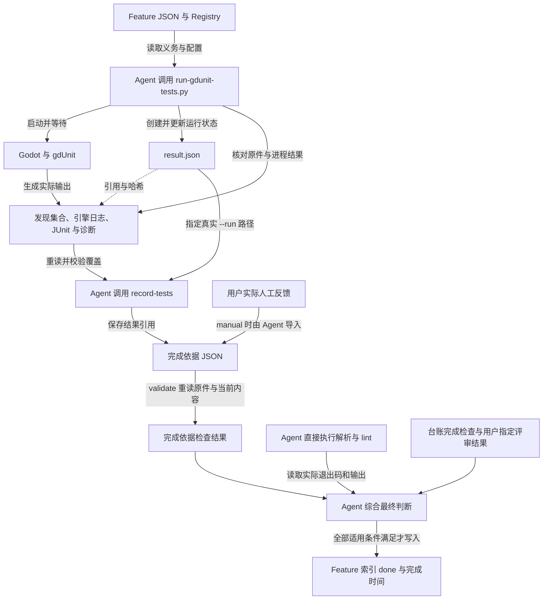

# 命令、测试范围与结果解释

[返回手册](../README.md) · 相关：[配置参考](configuration.md)、[故障排查](troubleshooting.md)

所有项目命令在**生成后的项目根目录**运行。按当前任务调用所需入口，以下命令参考不意味着每次都要整页执行。涉及写记录的命令遵循对应 Skill 和已有授权。

## 从运行结果到完成状态

Stage 2 初始化记录，Stage 4 产生最终验证结果，Stage 5 按需接收人工结果，Stage 7 完成检查。下面是实际读写关系；它不会因编辑文件自动触发。



实线表示实际调用、读写与结果交接，虚线表示原件引用。完成依据 JSON 位于 `docs/feature-completion-evidence.json`。`record-tests`、`validate` 均属于完成记录工具；不运行测试、不评估直接静态检查、不获取用户决定，也不修改 Feature 状态。人工文件导入还会核对清单与结果原件，具体操作见 [人工验收](../guides/feature-delivery.md#人工验收应如何操作)。

| 文件交接 | 输入与产出 | 结果判定 |
| --- | --- | --- |
| 测试运行器 | 当前 Feature、Registry、配置与源码 → 运行目录、result.json 和实际报告 | 等待进程结束，读取结果、发现集合、覆盖与诊断；仅打印路径不证明文件保存成功 |
| `record-tests` | 实际 final Feature 的 result.json 路径 → 完成依据中的路径/哈希引用 | 重新核对当前内容、原件、覆盖及未解决失败；不接受手写“通过次数” |
| 人工反馈导入 | 绑定当前内容的清单 + 用户结果，或明确的口头决定 → 人工记录 | 命令成功只代表记录成功，状态仍可能 pending/rejected |
| `validate` | 当前合同与完成依据 → 只读结论 | 重新计算测试义务并读取原件，核对适用人工接受；不替代其他检查 |
| Agent 更新台账 | 完成依据、直接解析/lint、AC/差异、台账与用户指定评审条件 | 满足后写 done/真实完成时间，再检查最终台账并收尾 |

## 调用准备

先确认项目配置已经就绪。本页 PowerShell 示例共用以下变量：

```powershell
$projectConfig = Get-Content -LiteralPath 'docs/methodology-config.json' -Raw | ConvertFrom-Json
$projectPython = $projectConfig.python_executable
$projectGodot = (Resolve-Path -LiteralPath $projectConfig.environment_bootstrap.engine_executable -ErrorAction Stop).Path
$featureId = 'F001' # 教学占位，必须换成当前真实 Feature ID
```

在本机，`python_executable` 应是个人规则指定并已确认的完整解释器路径。`F001` 和示例脚本路径都需换成实际存在的任务与文件。每条原生命令后立即读取 `$LASTEXITCODE`；缺失退出码不能当作 0。

新项目首次 CLI 测试或项目脚本运行前，按 [首次扫描说明](../../../../project-source/tools/README.md#首次-godot-扫描) 处理编辑器准备；配置 ready 不代替这次扫描。

## 入口与副作用

| 入口 | 常用参数 | 行为 |
| --- | --- | --- |
| `tools/checks/check-project-environment.py` | `--require-ready`、`--config` | 读配置；就绪检查可能启动 Godot `--version`，不写配置 |
| `tools/checks/check-feature-list.py` | `--eligible`、`--completion-feature F001`、`--repo-root` | 读 Feature/测试登记表/历史和依赖，不修改台账、不运行测试 |
| `tools/testing/run-gdunit-tests.py` | `--godot-binary`、`--feature` 或 `--target`、`--phase`、`--scope` | 启动真实 Godot 测试进程，写隔离的运行目录 |
| `.agents/skills/feature-execute/scripts/record-feature-completion.py` | 子命令与 `--feature`；全局 `--repo-root` 在子命令之前 | 写入测试/人工记录，或只读展示、校验已有依据 |
| `.agents/skills/feature-plan/scripts/merge_test_registry.py` | `--components` | 在项目根目录运行，将批准的组件合并到固定的 `docs/test-registry.json`；属于规划写操作 |

组件候选为完整组件对象的 JSON 数组，或含 `components` 数组的对象。Agent 将批准的候选写入临时文件，使用 `--components <实际候选文件>` 调用合并器；现存同 ID 不同内容是冲突，不能覆盖。工具保留现存测试并报告 added_components/preserved_tests，候选不提交。它只合并组件，不生成测试或证明测试通过；结构见 [feature-plan](../../../../project-source/skills/feature-plan/SKILL.md#test-registry-docstest-registryjson)。

## 环境与台账检查

```powershell
& $projectPython -B tools/checks/check-project-environment.py --require-ready
$LASTEXITCODE
& $projectPython -B tools/checks/check-feature-list.py
$LASTEXITCODE
& $projectPython -B tools/checks/check-feature-list.py --eligible
$LASTEXITCODE
```

环境检查器的精确能力见 [配置检查边界](configuration.md#检查能力边界)；首次操作顺序见 [首次使用](../getting-started/first-use.md)。台账检查读取完整索引、详情、测试登记表和修订关系，检查 ID、字段、引用、路径、依赖与历史规则。`--eligible` 校验后输出依赖已满足的 pending Feature ID 集合，不能代替实现授权。

规划或同步完成后使用这个完整入口即可，它已经包含 JSON 解析；单文件语法检查只用于定位具体错误。Agent 仍需核对需求覆盖、真实依赖和历史保留，这些语义不能由结构检查代替。

`--completion-feature F001` 额外要求当前待完成任务的直接自动验证映射处于 active 状态。正常历史检查可以接受可追溯退役的旧测试；当前完成不能拿已退役测试替代实际验证。

## 三种常见测试调用

在已经批准的任务范围内，按用途选用：

```powershell
# Stage 3：已有安全网，不包含尚未创建的 planned 测试。
& $projectPython -B tools/testing/run-gdunit-tests.py --godot-binary $projectGodot --feature $featureId --phase baseline --scope auto
$LASTEXITCODE
```

```powershell
# TDD 或定点诊断：替换成实际已存在的套件或目录。
& $projectPython -B tools/testing/run-gdunit-tests.py --godot-binary $projectGodot --target tests/features/F001/example_test.gd
$LASTEXITCODE
```

```powershell
# Stage 4：读取当前 Feature/测试登记表和已批准范围。
& $projectPython -B tools/testing/run-gdunit-tests.py --godot-binary $projectGodot --feature $featureId --scope auto
$LASTEXITCODE
```

`--feature` 与 `--target` 互斥；两者都不传时 target 默认为 `tests`。`--phase` 支持 `baseline`、`final`，默认 final。baseline 和 focused/target 运行用于基线或调试，不能直接作为当前 Feature 完成依据。

其他参数：`--timeout-seconds` 默认 120，必须是大于 0 的有限数；`--require-test` 使用 `<suite-path>::<test-case>` 格式，要求原始报告确实覆盖该用例；`--continue` 传给 gdUnit 的 `-c`，不表示继续一个已有 Yaya 任务或复用上次报告。

运行器启动真实引擎和测试，而非纯文件检查。所需权限、窗口行为与运行范围按当前项目和任务确认；不能因为名字含“测试”就认为无副作用。

## 测试范围怎样计算

Stage 1 的完整测试范围规则见测试规范中的 [Test Impact Review](../../../../project-source/methodology/08-testing-strategy.md#test-impact-review) 与 [Runtime Test Impact selection](../../../../project-source/methodology/08-testing-strategy.md#runtime-test-impact-selection)。下文用中文说明 Required、affected、full 与命令的对应关系。

```text
Required Test Set =
  当前 Feature 的自动验收测试
  + 当前 Feature 的回归测试
  + 影响组件已登记的 unit_test_paths
  + 与影响组件相交的 active 历史回归
  + 与影响组件相交的 active 不变量
  + 已批准的 additional_tests

affected = Required + 与影响组件相交的 active 验收测试
```

| `--scope` | 用途 |
| --- | --- |
| `auto` | 默认执行 affected；当前计划需要全量时升级为 full |
| `required` | 显式运行 Required，适合局部迭代；不能据此绕过最终 affected/full 要求 |
| `affected` | Required 加相关验收测试 |
| `full` | 运行配置的现有测试根目录范围，并核对必需覆盖 |

影响组件设有 `full_suite_on_change`、已批准的 `full_suite_reasons`、广泛工具链影响或无法界定影响时，需要按规范执行 full；工程维护标签本身不触发升级。附加测试及理由保存在 Feature 的 `verification.test_impact`，没有独立计划文件。

没有单元套件的组件使用 `unit_test_paths: []`，不产生虚构选择器。已登记路径丢失、被选中目录零测试、必需用例跳过或报告缺失都不能记为通过。不存在且未登记的测试层不会贡献全量选择器；这不把空项目变成有成功测试证据的项目。

## 一次运行留下什么

每次调用创建 `reports/gdunit-wrapper/run-<id>/`，输出真实 `result.json` 路径。使用命令打印的路径，不猜测 run ID 或报告文件夹编号。

```text
reports/gdunit-wrapper/run-<id>/
├── result.json                 同一个文件从运行中更新为成功或失败
├── engine.log                  原始引擎输出
├── discovery.json              实际展开后的测试发现集合
└── report_<...>/
    ├── results.xml             原始 JUnit
    └── diagnostics.jsonl       运行诊断
```

启动或中途失败时，部分原件可能尚未产生；缺失本身就是要读取的结果，不应补造空报告。实际报告还可能包含 gdUnit 生成的其他文件。

运行器核对过程结果、实际发现集合、JUnit 用例和诊断。参数化用例需要对应真实展开后的集合，源码里存在 `test_*` 方法不证明它实际执行。JUnit 看起来成功也不能遮住引擎错误或未完成运行。

同一内容上的较新失败需要由之后覆盖该失败范围的成功解决；更早成功或更窄的通过不能盖掉它。保留原始失败，再说明修复与后续结果。

## 记录完成依据

完成依据入口位于执行 Skill 的 `scripts/`。下表是参数速查，不是让使用者批量填“通过”的步骤：

| 子命令 | 何时使用 |
| --- | --- |
| `initialize --feature F001` | Stage 2 初始化当前 Feature 依据；会写入当前记录，不作为失败恢复按钮 |
| `record-tests --feature F001 --run <result.json>` | 导入真实 final Feature 运行；必要时重复 `--run` 覆盖不同运行 |
| `prepare-manual --feature F001 --checklist <清单.json>` | 检查 Agent 编写的 pending 清单并绑定最终内容；已绑定清单不能重新绑定 |
| `record-acceptance --feature F001 --checklist <清单.json> --result <结果.json>` | 读取用户真实结果，与原清单和当前内容对照；记录 accepted、rejected 或 pending |
| `record-acceptance --feature F001 --status accepted` | manual 模式下，用户已经明确接受当前范围之后 |
| `record-acceptance --feature F001 --status rejected` | 记录真实拒绝与后续修复需要 |
| `show --feature F001` | 只读查看已有记录 |
| `validate --feature F001` | 检查当前内容对应的完成依据 |

人工文件均保留在 `reports/manual-acceptance/`，输入/结果格式和命令示例见 [人工验收文件契约](../../../../project-source/methodology/manual-acceptance-files.md)。`--result` 与 `--checklist` 配对，不能与口头决定的 `--status` 混用。有效全通过结果本身就是该范围的人工接受；注释存在实质矛盾时先澄清。命令退出 0 表示成功记录实际状态，`pending`、`rejected` 仍不能完成。无效导入退出非零且保留已有记录，Agent 必须处理本次错误，不能退回旧接受绕过。

真实报告导入示例：

```powershell
& $projectPython -B .agents/skills/feature-execute/scripts/record-feature-completion.py record-tests --feature $featureId --run reports/gdunit-wrapper/run-actual-id/result.json
$LASTEXITCODE
```

把 `run-actual-id` 换成运行器实际输出的目录，并确认文件确已写入。一次 `record-tests` 用本次所有 `--run` 参数替换当前测试引用，并非逐次累加；需保留的兼容运行在同一次调用中列全。原件引用和当前内容绑定用于发现错误复用；脚本不接受手填通过次数来创建成功。`record-tests` 失败会清除旧测试引用并保留原始报告，不能改写结果文件绕过失败。

若有效 manual 计划的 Required、affected 都为空且不要求全量测试，省略自动运行和 `record-tests`，保留 `initialize` 生成的 `test_runs: []`。后续仍按真实结果记录人工接受，再运行完成检查；工具从当前计划计算 `not_required`，不生成空的成功报告。任何自动测试义务、无效映射或当前内容上的未解决失败都会阻止这个分支，不能用重新初始化消除失败。

完成依据保存测试原件引用与适用的人工决定，新任务按当前模板初始化。独立评审的范围和时机由用户选择；遇到旧命令或旧记录时，查阅 [故障排查](troubleshooting.md#测试运行和完成依据)。

完成检查由两部分配合，Agent 还要单独确认直接静态检查与用户指定的评审条件：

```powershell
& $projectPython -B .agents/skills/feature-execute/scripts/record-feature-completion.py validate --feature $featureId
$LASTEXITCODE
& $projectPython -B tools/checks/check-feature-list.py --completion-feature $featureId
$LASTEXITCODE
```

## 内容绑定与失效判断

内容指纹是工具计算的文件摘要，**不等于 Agent 对“含义是否改变”的判断**。当前实现先通过 Git 列出已跟踪文件与未被忽略的未跟踪文件，按路径排序；对纳入的文件记录路径、存在类型与内容，再计算摘要。它读取当前工作区字节，不依据修改时间，也不只看本 Feature 的差异。

| 输入类别 | 当前实际计算 |
| --- | --- |
| 术语、专业规格/资源清单、项目规则、Feature design、架构与 ADR | 通常按文件原始字节纳入；换行、措辞、准备状态或排版变化即使不改行为，也可能改变指纹 |
| 源码、测试、配置和其他未豁免文件 | 纳入路径与当前内容；增删、移动同样可能改变摘要 |
| `docs/features/` 下的 JSON、Feature 索引、Registry、修订记录、methodology-config | 指定 JSON 先解析并排序对象键、统一序列化；数组顺序仍保留，只排除下表约定字段 |
| `docs/feature-completion-evidence.json`、`docs/progress.md`、`reports/` | 从源码指纹排除；报告仍由结果导入/人工原件契约单独核对，不可随意改写 |
| `docs/progress/`、`docs/knowledge/`、`docs/research/` 中以 `.md` 结尾的文件 | 解释性 Markdown 排除；非 Markdown 文件仍参与，要求正文不能只放在这些目录 |
| 普通 `README.md`（文件名大小写不敏感） | 排除；但在 `.agents/`、`agent-rules/`、`methodology/`、`docs/product/`、`docs/features/` 下仍参与 |

未被 Git 列出的忽略文件不会进入这次摘要；这不是把正式需求、规则或可执行输入迁入豁免位置的许可。知识只保留参考经验，普通 README 只保存用法与导航。其他 Markdown 没有通用豁免。

`semantic_json()` 只在特定位置移除过程字段，不递归移除所有同名键：

| JSON 位置 | 不参与摘要的字段 |
| --- | --- |
| Feature 详情顶层、索引每条 Feature 顶层 | `notes`、`status`、`completed_at`、`created_at`、`updated_at`、`recorded_at` |
| 索引/Registry 的 `meta`，配置的 `environment_bootstrap` | 上述过程字段及以 `_at` 结尾的键 |
| 修订记录的每条 `revision_log` | `revised_at`、`created_at`、`updated_at`、`recorded_at`、`summary`、`notes` |

AC 文本、验证计划、组件、嵌套测试 status、退役关系、修订 ID、源提交锚点和未知合同字段仍参与。notes 中的链接是过程记录，**被链接的 F0XX-design.md 自身仍纳入**。Git 提交号另作来源记录；仅提交了过程字段且指纹相同，不会凭提交号要求重跑或取得新接受。

治理文档尽量在 Stage 3 完成。最终测试或人工接受后再改了纳入的内容，包括 Stage 5.5 采纳新规则时，先核对当前指纹与验证义务，补齐失效的最终运行、导入和适用人工接受，不能只凭“未改代码”沿用旧结果。内容相同且覆盖仍满足的结果才可复用；只读评审不改变内容。

直接依据是 [内容指纹与完成检查实现](../../../../project-source/tools/lib/feature_completion_evidence.py) 的 `_is_fingerprint_input()`、`semantic_json()`、`working_tree_fingerprint()`，以及 [测试策略](../../../../project-source/methodology/08-testing-strategy.md#artifact-backed-completion-and-semantic-freshness)。静态解析/lint 的实际影响仍由 Agent 单独判断。

性能、长测、显示或试听证据按原任务 AC/设计中的验证义务判断；当前适配器只接收实际 gdUnit 结果，不把专项测量包装为 gdUnit 通过。完成工具也不判断专项证据是否充分，详见 [专业验证边界](../guides/specialist-workflows.md#实现测量与完成)。独立审核产生的隔离报告、日志或缓存不得覆盖原证据或被审成果。

## 直接脚本解析与 lint

从项目根目录，使用同一个已确认 Godot 可执行文件：

```powershell
# 替换成实际变更脚本，并按影响解析必要依赖。
& $projectGodot --headless --path . --check-only --script res://path/to/changed_script.gd | Out-Host
$LASTEXITCODE
```

```powershell
# 替换成实际 Feature；需保留不同轮次时，选择尚未使用的运行子目录。
$reportDirectory = "reports/features/$featureId"
New-Item -ItemType Directory -Path $reportDirectory -Force | Out-Null
& $projectGodot --headless --path . --script res://addons/gdscript-linter/analyzer/analyze-cli.gd -- --json --output "$reportDirectory/lint.json" res:// | Out-Host
$LASTEXITCODE
```

未归属 Feature 的工作使用 `reports/maintenance/<任务>/`；需要保存的解析输出也放入相应报告目录。不要覆盖仍被引用的原件，目录选择见 [报告保留与清理](../guides/project-knowledge.md#报告保留与清理)。

对 Windows GUI 可执行文件，`Out-Host` 管道用于等待进程，立即检查退出码。lint 扫描完整 `res://` 并遵循项目配置；修改了被默认排除的依赖时，仍需验证该依赖变更本身。

当前 lint CLI 的退出码：0 表示无问题或仅 Info，1 表示 Warning，2 表示 Critical，3 表示输入无效、空发现、配置错误或 JSON 报告写入失败。`--severity` 和 `--top` 只影响显示，不会抹去真实判定。`--output` 支持 JSON 和 HTML 文件；默认文件名 `code_quality_report.html` 仅用于 HTML。报告真实范围与 Critical/Warning/Info 数量，未知数量不能写成零。

解析证明脚本在实际引擎中的相关语法/类型契约，lint 检查配置的质量规则；两者都不替代运行、资源、场景、导出或人工质量判断。需要编辑器检查时遵循本机项目规则的沙箱外审批路径。仅执行解析或 lint 时不额外增加导入步骤或包装程序；已授权资源导入和新项目首次运行所需扫描按对应环境规范处理，普通 Feature 不增加单独导入阶段。

## 退出码和结果边界

环境与台账检查成功通常为 0、校验失败为 2；gdUnit 包装器成功为 0、运行失败为 1，参数解析错误可为 2。最终结论仍结合原始输出和检查范围，不能将不同工具的非零值统一解释为业务测试失败。

| 已有结果 | 可以报告 | 不应推断 |
| --- | --- | --- |
| 配置就绪 | 实际环境检查通过 | 游戏或测试通过 |
| 台账通过 | 数据结构、引用和依赖满足该检查 | AC 已实现 |
| focused 通过 | 指定套件在本次运行成功 | 最终 Required/affected/full 已满足 |
| 完成依据校验通过 | 它负责的测试与适用人工接受契约满足 | 脚本解析、lint、独立评审或所有目标平台已检查 |
| 静态检查通过 | 已执行静态范围通过 | 手感、外观、声音和导出质量已接受 |

实现来源：[项目工具说明](../../../../project-source/tools/README.md)、[测试运行器](../../../../project-source/tools/testing/run-gdunit-tests.py)、[完成依据入口](../../../../project-source/skills/feature-execute/scripts/record-feature-completion.py)、[直接 lint 契约](../../../../project-source/methodology/gdscript-lint.md)。
