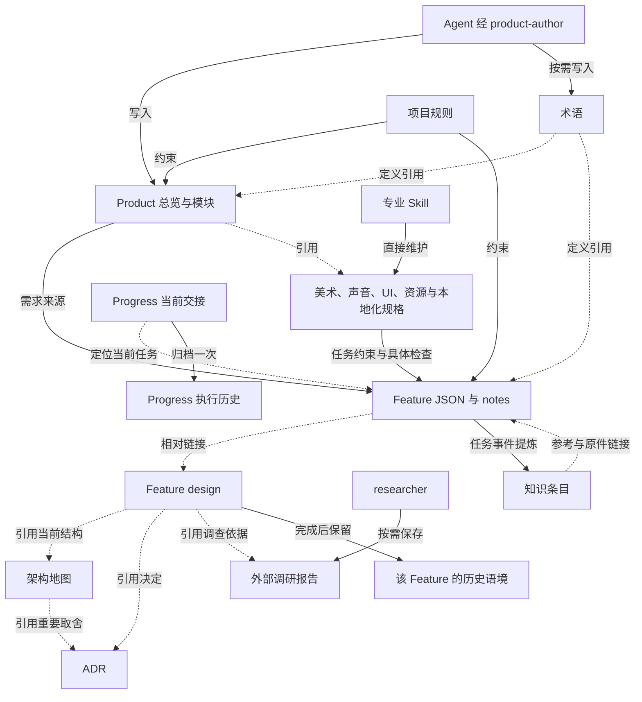

# 项目目录与文件职责

[返回手册](../README.md) · 相关：[配置参考](configuration.md)、[项目文档维护与交接](../guides/project-knowledge.md)

本页回答“哪个文件负责什么、何时出现、从哪里复制”。先看职责表，再查初始目录与复制映射；开发步骤见对应指南，字段与命令见参考页。

## 文档与执行文件如何配合

以下路径相对**生成项目根目录**。先用关系图区分需求、约束、计划、说明与历史，再按表查具体位置。固定文档预置简短用途与待定说明，多文件目录预置导航；实际需求、设计、任务与结果按真实工作形成，占位不代表内容已确认。



实线表示写入、约束、来源或保留关系，虚线表示引用。知识是带条件的参考，不能覆盖规则或需求。架构地图维护当前结构；已完成设计与 ADR 的旧理由保留历史，不能用后来的决定改写过去。

### 项目入口与执行约定

| 项目文件或目录 | 完整职责与边界 | 出现时机、主要读写方 | 用户关注方式 |
| --- | --- | --- | --- |
| `README.md` | 项目自身的简短导航 | 创建时复制；Agent 按项目用法维护 | 找当前项目入口 |
| `AGENTS.md` | 任务路由与仓库执行约束 | 创建时复制；Agent 按任务读取 | 确认任务与授权边界 |
| `agent-rules/` | Core 与按领域组织的工程语义 | 创建时复制；Agent 按路由读取、按规则维护流程修订 | 有具体规则冲突时查原文 |
| `methodology/`、`.agents/skills/` | 流程/数据契约；Agent 遵循的具体工作方法 | 创建时复制；工具与 Skill 引用相关规范 | 按本次任务查依据，不必通读 |
| `.codex/agents/independent-reviewer.toml` | 独立审核角色，按范围加载审核方法 | 创建时复制；客户端实际加载与权限另行核实 | 不因文件存在就认定上下文和文件隔离成立 |
| `.codex/agents/researcher.toml` | 调研角色，定义搜索方法、报告内容和保存约定 | 创建时复制；主 Agent 按需委派，anysearch 保持用户级安装 | 调研使用见[搜索与报告](../guides/project-knowledge.md#按需搜索与保存调研) |
| `methodology/templates/` | 实例的结构或可选提纲 | 创建时复制；Agent 按任务取用 | 模板不是任务或已批准正文 |
| `docs/methodology-config.json` | 机器路径、文档语言、真实测试命令 | 创建时 incomplete；Agent 准备环境写入，工具读取 | 核对当前机器现值和检查结果 |

### 需求、专业规格与约束

| 项目文件或目录 | 完整职责与边界 | 出现时机、主要读写方 | 用户关注方式 |
| --- | --- | --- | --- |
| `docs/product.md`、`docs/product/NN-name.md` | 总览保存核心循环/模块关系，模块保存行为、数据含义、体验与验收意图 | 总览初始只有用途与待定说明，模块目录只有 README；product-author 按实际需求写入 | 确认“应做什么”和暂缓边界；README 不算模块 |
| `docs/terminology.md` | 共享标准名称、定义、概念关系与别名；不保存完整行为或计划 | 初始只有用途说明，无已确认术语；product-author 按授权维护 | 核对是否同名异义或定义过期 |
| `docs/art/art-bible.md`、`docs/audio/sound-bible.md`、`docs/ui/<interface>-design.md`、`docs/localization/localization-spec.md` | 各领域已确认专业要求，Product 只保留行为与引用 | 美术、声音、本地化初始只有用途与待定说明，UI 目录只有 README；对应专业 Skill 按需补充 | 参见[专业文档归属](../guides/specialist-workflows.md#文档由谁维护)，占位不代表已确定方向或语言 |
| `docs/unadopted-ideas.md` | 尚未采纳的玩法、功能和改进设想，不是开发承诺 | 初始只有用途说明，无记录；有需留存设想时按授权维护 | 采纳后将确定内容整理到所属来源并保留去向链接 |
| `docs/project-rules.md` | 跨 Product/Feature 的约束、协作规则、默认原则；区分 MUST/PREFER/REVIEW | 创建时由模板复制；Agent 写前自检并核对授权，需求/设计/实现持续读取 | 决定实质新增、删除、强度和适用范围 |
| `docs/resource-requirements/<scope>.md` | 任务或原型的最小资源清单、规格、来源与目标位置 | 初始只有 README；按稳定业务范围与用途建立清单，Agent 更新、用户准备素材 | 从目录导航或原任务进入；具体规格和状态只留在清单正文，不把齐备当验收 |

### Feature、测试与完成依据

| 项目文件或目录 | 完整职责与边界 | 出现时机、主要读写方 | 用户关注方式 |
| --- | --- | --- | --- |
| `docs/feature-list.json` | 任务 ID、标题、状态、依赖、完成时间和详情定位 | 初始空索引；规划和执行 Agent 更新，检查器读取 | 查任务状态与依赖；状态不是验证证据 |
| `docs/features/F0XX.json` | 本任务范围、source、组件、AC、验证义务；notes 保存短记录与链接 | 目录初始只有 README；任务规划时建立，执行维护，选择器/完成检查读取 | 审批具体方案，核对覆盖与剩余项 |
| `docs/features/F0XX-design.md` | 详细设计、规则的具体应用、实现理由与实际偏差；不复制 AC/测试台账 | 按需建立；Stage 1 判断、2 保存、3 对齐，后续保留历史 | 从对应 JSON notes 的相对链接进入 |
| `docs/test-registry.json` | 组件、逻辑测试 ID、path/case 与 planned/active/retired 关系；不存通过结论 | 初始空表；合并器登记组件、Agent 维护测试映射，运行器/检查器读取 | 核对测试是否存在、被选择并实际执行 |
| `docs/feature-list-revisions.json` | 源变化影响、同步锚点、替代与依赖演进；不替代 Git 历史 | 初始空记录；同步 Agent 追加，检查器与后续同步读取 | 追查计划为何变化 |
| `docs/feature-completion-evidence.json` | 当前 Feature 的测试原件引用与适用人工决定，绑定当前内容 | 首次记录真实结果时创建，完成记录工具写入/复核 | 查看引用的真实原件；不是全部 Feature 历史 |
| `reports/` | 测试、诊断、初始化、人工验收与其他真实输出 | 创建时只有 .gdignore；运行器/Agent/用户产生原件，检查工具和交接读取 | 分清失败、未执行、接受与已通过 |

### 架构、知识与交接

| 项目文件或目录 | 完整职责与边界 | 出现时机、主要读写方 | 用户关注方式 |
| --- | --- | --- | --- |
| `docs/game-organization.md` | 共同骨架、模块归属与命名的判断指南；引用现有工程规则 | 创建时复制；新建或调整模块、场景、资源时按需查阅 | 先判断内容归谁，再选择目录与职责名称 |
| `docs/architecture.md`、`docs/architecture/<subsystem>.md` | 当前模块职责、状态归属、依赖和必要运行流程 | 总览初始只有用途说明；结构需要解释时补充，子系统文件按需建立 | 从总览进入实际地图与子系统，不重复建立目录索引 |
| `docs/architecture/adr-NNNN-<slug>.md` | 达到阈值的重要取舍、理由、成本与替代关系 | 真实决策触发；Agent 保存已确认决定，相关任务引用 | 决定候选，保留已取代原因 |
| `docs/knowledge/` | 有适用条件和证据的经验，索引只放链接；不存规则或可执行输入 | 初始仅索引；Agent 在任务中提炼、开始相关工作时查阅 | 判断经验是否适用于当前版本 |
| `docs/research/` | 带来源、版本与限制的外部调研 Markdown，纳入 Git；不拥有需求或本地验证结论 | 初始只有 README；researcher 按授权写有留存价值的报告，主 Agent 核对采纳 | 从任务链接进入；数量增加后在 README 补主题导航，区分建议和已采用决定 |
| `docs/progress.md`、`docs/progress/<key>.md` | 当前阶段/阻塞/待决定/下一步与索引；单份执行历史 | 当前模板和历史目录 README 随创建复制，实际历史按需归档 | 当前 Progress 统一维护历史索引；目录说明不算历史记录 |

外部 GDD 是需求输入，默认不在初始目录内，见 [GDD 接入](../guides/product-and-planning.md#接入已有-gdd)。以上详细制度与维护时机在 [项目文档维护与交接](../guides/project-knowledge.md) 中展开；实际字段由源规范负责。

## 刚复制完成的目录

```text
MyGodotGame/
├── AGENTS.md
├── README.md
├── .agents/skills/                  27 项 Skill，含需要的脚本或参考资料
├── .codex/agents/independent-reviewer.toml
├── .codex/agents/researcher.toml
├── .editorconfig
├── .gitattributes
├── .gitignore
├── project.godot
├── gdlint.json
├── main/
│   └── main.tscn                   已配置的最小启动场景
├── game/                          当前游戏模块，初始为空
├── assets/                        跨模块共享素材，初始为空
├── addons/
│   ├── gdUnit4/
│   ├── gdscript-linter/
│   └── sound_manager/              固定提交；默认不启用全局插件
├── components/feedback/            示例共用表现组件与薄音频封装
├── examples/asset_workbench/        独立预览、消费场景与 example_* 素材
├── tests/                         初始仅有空目录占位，无业务套件
│   ├── unit/
│   ├── features/
│   └── invariants/
├── agent-rules/                     按工程领域路由的规则
├── methodology/                     流程规范与 templates/
├── tools/
│   ├── checks/                     环境与 Feature 台账检查
│   ├── testing/                    gdUnit 运行器及 GDScript 扩展
│   ├── asset_workbench/             单项查看、组合试调与保存界面
│   └── lib/                        共享实现
├── docs/
│   ├── .gdignore
│   ├── methodology-config.json
│   ├── product.md                  游戏总览用途与待定说明
│   ├── product/README.md           模块目录说明；初始无模块
│   ├── art/art-bible.md            美术圣经；风格待确定
│   ├── audio/sound-bible.md        声音圣经；方向待确定
│   ├── terminology.md             术语用途说明；初始无定义
│   ├── localization/localization-spec.md  本地化用途说明；范围待确定
│   ├── architecture.md            架构用途说明；子系统与 ADR 按需出现
│   ├── unadopted-ideas.md          未采纳想法；初始无记录
│   ├── ui/README.md               界面规格目录说明与导航
│   ├── resource-requirements/README.md  清单命名、用途与导航
│   ├── features/README.md         任务目录说明；初始无任务详情
│   ├── research/README.md         调研目录说明；初始无报告
│   ├── progress/README.md         历史目录说明；初始无归档
│   ├── game-organization.md        模块归属与命名判断指南
│   ├── knowledge/                  知识索引；初始无实际条目
│   │   ├── README.md
│   │   ├── godot-runtime/
│   │   ├── gdscript/
│   │   ├── debugging-testing/
│   │   └── tools-pipeline/
│   ├── feature-list.json           features 为空
│   ├── feature-list-revisions.json revision_log 为空
│   ├── test-registry.json           components 与 tests 为空
│   ├── progress.md                 当前状态模板
│   └── project-rules.md            项目约束、协作规则与默认原则
└── reports/
    └── .gdignore
```

树中省略插件内部文件与空目录占位文件。创建器复制最小启动场景与配置中的入口，但不创建 `.git/`、`.godot/`、正式玩法或业务测试；`tests/unit` 等初始占位根与配置对应，套件按真实任务添加。工作台的单对象、图像/音频组合、Shader 组合及粒子/动画组合四个入口可单独运行，不替换 `main/main.tscn`，也不预填业务需求或完成状态。

固定文档采用“标题、用途、当前待定或无记录状态”的短占位；替换为真实内容时遵循已确认的 `document_language`。目录 README 只保存用途和必要导航，Product 模块表、Feature 索引与 Progress 历史索引仍由已有文件统一维护。具体模块、Feature、资源清单、子系统、ADR、报告和验收记录不提前实例化。占位文件不使初始化、设计、实现或验收自动完成。

## 游戏目录如何归属

`main/` 负责入口与顶层组装；`game/` 按当前游戏功能划分，设置、存档和全局 UI 也放在各自模块。`components/` 保存可复用能力，`assets/` 保存跨模块共享素材，插件与测试分别属于 `addons/`、`tests/`。场景、专属脚本、配置和素材尽量就近，模块有实际需要再细分目录。

项目随带的[游戏代码组织与命名指南](../../../../project-source/defaults/docs/game-organization.md)提供归属问题、目录示例与可选职责词。Autoload 按真实生命周期决定，文件按职责放置；不因共同骨架预制存档、设置、全局 Manager 或一整套游戏类型模块。具体规则仍由项目约束及工程规则负责。

## 源材料到项目的映射

以下以仓库根目录为源路径起点，以新项目根目录为目标起点。真正的复制范围始终以 [project-files.json](../../../project-files.json) 为准。

| 源材料 | 新项目位置 |
| --- | --- |
| `project-source/Project_AGENTS.md` | `AGENTS.md` |
| `project-source/Project_README.md` | `README.md` |
| `project-source/Project_Workflow_Config.json` | `docs/methodology-config.json` |
| `project-source/skills/` | `.agents/skills/` |
| `project-source/agents/independent-reviewer.toml` | `.codex/agents/independent-reviewer.toml` |
| `project-source/agents/researcher.toml` | `.codex/agents/researcher.toml` |
| `project-source/methodology/` | `methodology/` |
| `project-source/agent-rules/` | `agent-rules/` |
| `project-source/tools/` | `tools/` |
| `project-source/addons/gdUnit4/` | `addons/gdUnit4/` |
| `project-source/addons/gdscript-linter/` | `addons/gdscript-linter/` |
| `project-source/addons/sound_manager/` | `addons/sound_manager/` |
| `project-source/components/feedback/` | `components/feedback/` |
| `project-source/examples/asset_workbench/` | `examples/asset_workbench/` |
| `project-source/defaults/.editorconfig` | `.editorconfig` |
| `project-source/defaults/.gitattributes` | `.gitattributes` |
| `project-source/defaults/.gitignore` | `.gitignore` |
| `project-source/defaults/docs/` | `docs/`，包含固定文档用途占位、目录导航、组织命名指南、`.gdignore` 和分层知识索引 |
| `project-source/defaults/docs/.gdignore` | 另复制为 `reports/.gdignore` |
| `project-source/defaults/gdlint.json` | `gdlint.json` |
| `project-source/defaults/main/` | `main/`，包含最小启动场景 |
| `project-source/defaults/game/` | `game/`，初始空目录占位 |
| `project-source/defaults/assets/` | `assets/`，初始空目录占位 |
| `project-source/defaults/tests/` | `tests/`，包含与配置对应的空测试根目录 |
| `project-source/defaults/project.godot` | `project.godot` |
| `project-source/methodology/templates/feature-list.json.tmpl` | `docs/feature-list.json` |
| `project-source/methodology/templates/feature-list-revisions.json.tmpl` | `docs/feature-list-revisions.json` |
| `project-source/methodology/templates/test-registry.json.tmpl` | `docs/test-registry.json` |
| `project-source/methodology/templates/progress.md.tmpl` | `docs/progress.md` |
| `project-source/methodology/templates/project-rules.md.tmpl` | `docs/project-rules.md` |

部分模板既保留在项目 `methodology/templates/` 中，又复制为初始 `docs/` 文件。复制为初始文件时仅重命名，不执行变量渲染或语言转换。

例如 `docs/project-rules.md` 来自 `project-source/methodology/templates/project-rules.md.tmpl`，并非创建器临时编写，也无需在 `defaults/docs/` 再维护一份正文。初始规则保留框架通用约定，具体游戏的硬约束随已确认需求增量维护。

## 开发中按需出现的内容

[文件职责表](#文档与执行文件如何配合) 已说明文档出现时机。以下是测试、报告与辅助输入的位置；目录名示例不表示已存在或已运行。

| 路径 | 建立时机 | 主要内容 |
| --- | --- | --- |
| `tests/unit/` | 初始空目录，创建组件单元测试时添加套件 | 局部代码契约 |
| `tests/features/` | 初始空目录，创建 Feature 验收或 Bug 回归时添加套件 | 用户行为与历史缺陷覆盖 |
| `tests/invariants/` | 初始空目录，确实需要跨 Feature 不变量测试时添加套件 | 可执行的通用约束 |
| `reports/initialization.md` | 环境准备时 | 实际初始化过程与结果 |
| `reports/gdunit-wrapper/run-<id>/` | 每次显式测试运行时 | `result.json`、日志、发现集合及原始测试报告 |
| `reports/manual-acceptance/F001/` 等 | manual Feature 准备验收时 | 分别保存绑定版本的清单 JSON 与用户结果 JSON；复验按需要另存目录保留原件 |
| `reports/features/<Feature-ID>/`，如 `reports/features/F001/` | Feature 自定义验证产生结果时 | 保存该 Feature 的日志、结果和截图，工程 Feature 同样适用；需要保留不同轮次时再设子目录 |
| `reports/maintenance/<任务>/` | 未归属 Feature 的维护或调查产生结果时 | 按有意义的任务名归组报告，例如框架迁移或架构调查 |
| `reports/scratch/<任务>/` | 需要临时工作区时 | 隔离验证工程及其缓存、临时探针、参考源码片段和命令辅助文件；按用途与生命周期保留 |

工具或流程已约定的报告路径继续沿用；自定义目录按需创建，根目录不散放 Feature 文件或每轮运行目录。工具支持指定输出位置时，将需保留的结果放入任务报告目录，与 scratch 中的临时输入分开；证据仍在验证副本内时保留所需工作区并链接原件。阅读入口沿用 Progress 和 Feature 历史，存放与清理约定见 [报告保留与清理](../guides/project-knowledge.md#报告保留与清理)。

游戏源码、场景、资源和素材源文件按游戏实际模块组织。项目规则目录中的 `10-gdscript`、`20-scenes` 等数字是规则导航，不要求业务目录也按文件类型分组。

## 模板怎么使用

| 模板组 | 用途 |
| --- | --- |
| `product.md.tmpl`、`product-module.md.tmpl` | Product 总览与模块规格 |
| `feature-detail.json.tmpl` | 产品 Feature，省略 `engineering_change` |
| `engineering-feature-detail.json.tmpl` | Bug、重构、维护 Feature |
| `feature-design.md.tmpl` | 可选的详细 Feature 设计与实际实现说明 |
| `feature-list.json.tmpl`、`feature-list-revisions.json.tmpl` | 任务索引与源需求演进记录 |
| `test-registry.json.tmpl`、`feature-completion-evidence.json.tmpl` | 测试索引与完成依据结构 |
| `manual-acceptance-checklist.json.tmpl` | 单 Feature 人工清单与结果共用结构，按需填写后绑定版本 |
| `progress.md.tmpl`、`feature-learning-summary.md.tmpl` | 当前交接与任务结束时的简短经验 |
| `project-rules.md.tmpl` | 项目级约束、协作约定与默认设计原则 |
| `architecture-overview.md.tmpl`、`architecture-subsystem.md.tmpl` | 按需架构地图 |
| `architecture-decision-record.md.tmpl` | 按需 ADR |

`feature-design.md.tmpl` 是可选提纲，不要求每个 Feature 创建文件或填写全部章节。其余模板按各自契约保留必需章节，不适用时说明原因。Agent 遵循 Skill 生成正文时遵循 `document_language`，保留机器字段、ID、状态和路径。不要一次性把所有模板实例化成空文档；例如没有真实架构决定就不创建占位 ADR。模板要求见 [模板说明](../../../../project-source/methodology/templates/README.md)。

Markdown 模板的普通段落按自然段保存，不按固定字符数手动拆行；段落间保留空行，标题、列表、表格和代码块保留必要结构换行。阅读宽度由编辑器自动折行控制，这项格式约定不改变代码的 lint 规则。

## 工具为什么分成几处

| 位置 | 职责 |
| --- | --- |
| `tools/checks/` | 跨任务的环境和台账检查 |
| `tools/testing/` | 真实测试入口与引擎扩展 |
| `tools/lib/` | 工具共享实现 |
| `.agents/skills/feature-execute/scripts/record-feature-completion.py` | 执行流程专用的完成依据记录与检查 |
| `.agents/skills/feature-plan/scripts/merge_test_registry.py` | 规划流程专用的组件登记合并 |

这些是直接入口，没有根目录转发脚本，也没有自动工具事件。`project.godot` 中的 gdUnit session hook 是引擎测试诊断扩展，不是监督 Agent 编辑动作的 Hook。

## Git、Godot 忽略文件与报告

默认 `.gitignore` 排除 `.godot/`、从 CSV 导入生成的 `*.translation`、Python 字节码和测试缓存、操作系统目录元数据，以及项目根 `reports/` 下除 `.gdignore` 外的内容。本地 `.env` 和 `.env.*` 被忽略，`.env.example` 与 `.env.template` 可提交，模板中不填写真实凭据。

原始图片、音频、模型、字体、`*.import`、`*.uid`、`export_presets.cfg`、插件和 `.agents/skills/` 保留版本管理；`docs/` 下的需求、台账和完成依据也不整体忽略。导出目录与其他工具缓存按实际使用情况添加到项目 `.gitignore`，不直接套用忽略所有资源或测试目录的通用清单。

`.gdignore` 是提供给 Godot 的扫描边界；它与 `.gitignore` 的作用不同。报告未被 Git 跟踪，也不代表可以删除。当前验证、人工验收或未解决失败仍引用的原件要保留，具体见 [历史与报告](../guides/project-knowledge.md)。

## 留在框架的材料

根维护 `AGENTS.md`、根 README、`framework/commands/`、`framework/tests/`、`framework/review/`、`framework/prompts.json` 和本手册都属于框架。它们不属于空白项目初始化输出，也不构成生成项目后续运行的依赖。
