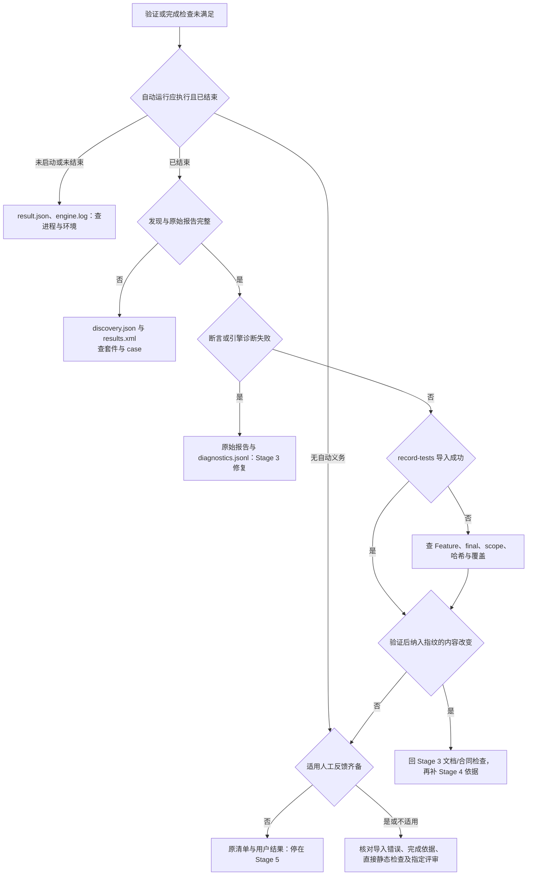

# 故障排查

[返回手册](../README.md) · 相关：[命令与验证](commands-and-validation.md)、[首次使用](../getting-started/first-use.md)

先保留实际命令、工作目录、退出码和原始输出，再区分路径、机器环境、项目数据、实现和验收问题。不要为了得到通过结果降低规则、伪造报告或删除未解决失败。

## 创建与首次使用

| 现象 | 优先核对 | 处理方向 |
| --- | --- | --- |
| `Project path must not contain Chinese characters or whitespace` | 用户输入与解析后的完整目标路径，包括父目录 | 选择符合要求的位置；只改最后一级目录名可能不够 |
| `Project path must be outside the source directory` | 输出是否在维护源内部，或是其祖先目录 | 使用独立的外部项目目录 |
| `Project path must be absent or an empty directory` | 目标是文件、已有项目，还是上次复制失败的半成品 | 先检查内容与归属；创建器不会覆盖、合并已有项目 |
| `Copy failed` 指向缺失源文件 | 清单源路径和文件实际存在性 | 在框架中修正真实来源或清单，不把部分输出当作成功 |
| 复制中途发生权限或 I/O 错误 | 原始失败位置及已经复制的内容 | 保留现场，解决权限或文件问题，再明确处理半成品 |
| 项目中找不到详细手册 | 是否只查看生成项目 | 详细手册设计上留在框架；项目使用自身 README、methodology 和工具说明 |
| Product 是空的、没有业务目录 | 是否为刚复制的项目 | 属于初始状态；从需求规划和获批任务建立内容 |
| Godot 运行要求选择主场景 | `project.godot` 是否已有 `run/main_scene` | 空白项目没有预置主场景，由后续任务建立 |
| 初始化后有未提交文件 | 使用的初始化请求及 Git 输出 | 首次配置默认不提交；已有明确初始基线提交授权时沿用，核对初始化报告与 Git 结果后续接同一次初始化 |

创建错误处理细节见 [创建项目](../getting-started/create-project.md)。不要通过自动清理目标目录来规避非空保护。

## 配置和机器环境

| 现象 | 可能的具体原因 | 应检查什么 |
| --- | --- | --- |
| 普通配置检查通过，`--require-ready` 失败 | 普通检查允许合法的 `incomplete` | status、文件存在检查、Godot 实时版本输出；Python 版本与测试后续参数须另行核实 |
| Godot 路径不可用 | 配置指定文件不存在、不可读或无执行权限 | 已配置路径本身；没有更换授权时不搜索替代版本 |
| `engine version mismatch` | 实际工具输出与记录不同 | 是否更换了工具，是否完整保存 `--version` 输出 |
| `engine executable must report Godot 4.7.x` | 实际输出不符合项目目标版本 | 核对真实引擎，不改配置标签伪装兼容 |
| Python 路径带参数后无法调用 | 把命令写进可执行文件字段 | 路径单独存放，`-B` 和脚本放在调用参数中 |
| `test_cmd` 有内容但入口失败 | 引号、JSON 转义、脚本参数或目录不正确 | [配置写法](configuration.md) 和项目根目录 |
| 环境 ready 后测试仍失败 | 就绪检查不执行测试命令全部逻辑 | 实际运行器输出、发现集合和引擎诊断 |
| 新项目首次 CLI 测试找不到 `GdUnitTestCIRunner` 或 `GdUnitTestSuite` | Godot 编辑器可能尚未完成全局类扫描 | 按 [首次扫描说明](../../../../project-source/tools/README.md#首次-godot-扫描) 核对并处理；仍失败时追查插件和解析错误，未执行用例的失败不能算业务 RED |
| PowerShell 中退出码为空 | GUI 程序未按预期等待结束 | 使用直接检查约定的 `Out-Host` 管道并立即读取退出码 |

本机如果 Godot 编辑器检查报 `Could not create editor data directory`、`Could not create editor config directory` 或 `AppData/Roaming/Godot` 访问失败，应按项目 `AGENTS.md` 中已记录的环境权限问题处理。这类编辑器检查走沙箱外审批路径，失败后不继续宣称依赖该检查的验证通过。

项目规则还要求此类操作前后比较根目录列表，包括空目录。若出现 `export_templates`、`feature_profiles`、`script_templates`、`text_editor_themes` 等异常目录，先核对是否由本次操作生成且为空，再按现有规则处理；Git 不记录空目录，不能只看 Git 状态判断。此条仅适用于实际执行的编辑器操作。

## Feature、依赖与测试登记表

| 现象 | 优先核对 |
| --- | --- |
| `--eligible` 没有候选 | 是否还有 pending；其依赖是否均为 done；台账是否先通过校验 |
| 索引数量或详情不一致 | `meta.total_features`、索引 ID、详情文件名与详情 `id` 是否一一对应 |
| 依赖图报错 | 重复、自身引用、缺失依赖、循环，或未完成任务依赖 obsolete 项 |
| 组件没有单元测试 | 合法状态使用 `unit_test_paths: []`；不要登记未来目录 |
| 已登记单元路径丢失 | 文件移动、删除或拼写是否同步；不能静默过滤缺失套件 |
| 当前完成仍引用 planned | 测试是否真正创建并登记路径、case 和 active 状态 |
| 已完成历史引用 retired | 核对规范允许的退役来源和替代链；不要重写历史 AC |
| 当前任务引用 retired | 当前完成需要 active 的直接验证映射，历史兼容不能替代当前测试 |
| 需求已变化，旧测试仍失败 | 对照 Product、修订记录和替代计划，先确认旧契约是否仍有效 |

正常编辑可以先协调修改相关文件，再显式运行完整台账检查。没有逐文件自动 Hook，不必为了每次中间编辑制造额外状态。

## 测试运行和完成依据

下面先定位测试与完成链的失败，再用表格查具体恢复动作。没有自动测试义务的有效 manual 计划跳过运行节点，直接核对适用静态检查与人工反馈。

| 图中定位 | 原件位置与恢复入口 |
| --- | --- |
| 运行、发现、断言与诊断 | 运行器实际打印的 `reports/gdunit-wrapper/run-<id>/`；从 [一次运行留下什么](commands-and-validation.md#一次运行留下什么) 读取原件 |
| 导入与当前内容 | `docs/feature-completion-evidence.json`、本次命令错误和被引用 result.json；按 [完成依据](commands-and-validation.md#记录完成依据) 与 [指纹边界](commands-and-validation.md#内容绑定与失效判断) 修复 |
| 人工反馈 | `reports/manual-acceptance/` 原清单、用户结果或明确口头决定；从 [Stage 5](../guides/feature-delivery.md#人工验收应如何操作) 继续 |

| 现象 | 应如何解释和处理 |
| --- | --- |
| 发现零测试 | 检查目标是否存在、是否有真实套件以及继承/命名；不能记为测试通过 |
| 窄范围通过但不能完成 | 检查是否为 target/baseline，是否缺少 affected/full 或批准的附加测试 |
| JUnit 通过但包装器失败 | 同时检查 discovery、diagnostics、引擎日志和进程结果；不要只读绿色计数 |
| 参数化测试集合不匹配 | 核对实际展开的用例标识与 JUnit；源码方法数量不足以证明执行 |
| 超时 | 读取超时和进程结果，判断卡住或必要运行时长；调整超时要有真实依据 |
| `result.json` 停在 running | 本次可能中断或尚未结束，不能自行改为 passed |
| 新运行提示 `WARNING: invalid run history` | 历史警告不阻止本次测试，实际成败看本次 result.json；保留警告指出的原件。完成检查只排除 schema、运行身份有效且 Feature ID 明确属于其他 Feature 的历史；被引用、当前 Feature 或归属不明的坏记录仍须查明来源后按授权处理，不能用新测试通过掩盖证据缺口 |
| 报告目录或 `result.json` 写入失败 | 先解决实际 I/O 或权限问题；本次可能没有结果文件，不能将打印出的目标路径当作保存成功 |
| 已有旧成功，较新失败仍阻止完成 | 修复后运行能够覆盖失败范围的实际验证，保留失败原件 |
| `record-tests` 拒绝导入 | 核对 Feature、final 阶段、scope、当前源码绑定、原件和真实覆盖 |
| 代码或术语、规则、设计、ADR 等变动后旧依据不可用 | 核对纳入文件的实际字节和 JSON 投影；含义未变也可能改变指纹。更新失效验证及适用人工接受，不能手改哈希或结果 |
| 整理历史后担心必须重跑 | 纯 Progress 历史整理不自动失效；核对是否同时修改了语义内容 |
| 仍要求 `record-smell` 或复审计数 | 核对项目是否仍使用旧规则/工具；当前完成依据不登记复审计数，独立评审按用户选择执行，不能只混用新版工具放行旧流程 |
| manual 没有 accepted | 需要用户针对实际检查作出决定；实现批准和自动测试不能替代 |

## lint、静态检查和资源问题

lint 的 Warning、Critical、输入错误与仅 Info 有不同退出码。先看准确位置、当前配置和源代码，再判断是实现问题、词法检查边界还是明确的引擎接口契约。行数警告不自动要求拆文件，Info 也不表示每个数字都必须提取常量。

静态解析遇到资源或缓存问题时保留原始错误，核对当前项目准备情况。导入、解析、lint、真实场景和导出分别验证不同内容；其中一项通过不抵消另一项必要检查失败。被默认排除的插件发生修改时，仍需对修改本身验证。

本仓库 linter 有本地补丁，诊断与上游示例不完全一致时先读 [YAYA_PATCH.md](../../../../project-source/addons/gdscript-linter/YAYA_PATCH.md)，不要直接覆盖插件文件。

## 运行退出时的 StringName 诊断

verbose 日志出现 `Orphan StringName` 或 `Unclaimed StringNames` 时，结合原始上下文、进程退出码、实际行为和其他诊断判断，不能仅凭这类文字认定业务对象泄漏。

需要定位时，在已有运行授权内使用相同 Godot 版本和启动参数，以不加载业务代码的最小入口作对照。两者出现相同记录只能说明尚不能归因于当前业务逻辑，不能直接确认引擎根因；退出码为 0 也不能证明没有泄漏。依据不足时保留未知结论，不屏蔽诊断或改写为“已修复”；已定位的资源释放问题仍按其实际原因处理。

## 哪些结论应明确保留为未知

没有运行的测试、没有启动的场景、没有观察的声音和画面、没有执行的导出，以及缺失原件的历史结果，均说明实际未验证范围。若缺少的检查对当前任务必要，报告原因和剩余事项；若不在本次范围内，也不扩展成新的自动流程。

详细依据：[环境检查](../../../../project-source/tools/checks/check-project-environment.py)、[测试策略](../../../../project-source/methodology/08-testing-strategy.md)、[执行恢复与例外](../../../../project-source/methodology/03-execute-loop.md)、[项目规则](../../../../project-source/Project_AGENTS.md)。
