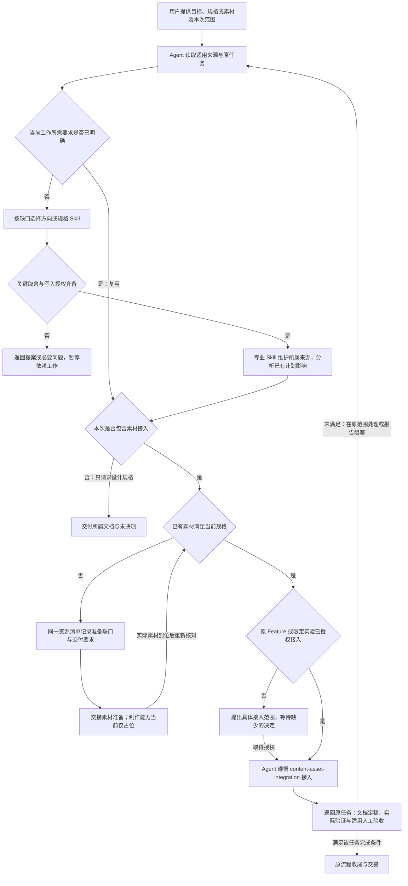
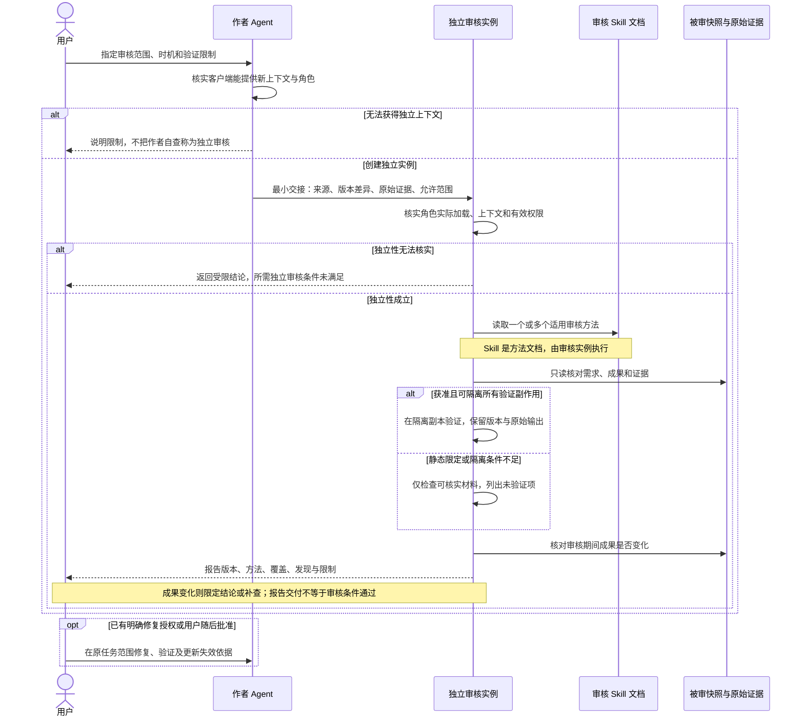

# 专业设计、资源与独立审核

[返回手册](../README.md) · 相关：[需求与规划](product-and-planning.md)、[Feature 交付](feature-delivery.md)、[Skill 导航](../reference/skills.md)

专业 Skill 提供方法并维护自己的文档，Agent 是执行这些方法的实例。当前共有 27 项 Skill；一个任务只调用需要的能力，不要求逐项走完。正式审核使用独立的新上下文，与设计、制作和实现的作者分开。

需要从当前情况一路处理到返回 Feature 时，使用 [界面、音频与资源检查单](scenarios-interface-audio-assets.md)：分别覆盖 UI 原型、声音准备及已有资源接入。本页解释这些步骤使用的专业职责、来源和审核边界。

## 按实际目标选能力

| 要解决的问题 | 方法入口 | 主要结果 |
| --- | --- | --- |
| 确定游戏或资产族的美术风格 | `design-art-direction` | 共享视觉语言、色彩/形状/比例与适用范围；按需引用已有样张 |
| 确定声音风格和反馈层次 | `design-audio-direction` | 音乐、氛围、音效的角色、优先关系和共同约束 |
| 设计界面布局与状态 | `design-ui-spec` | 独立 UI 规格、线框、交互呈现和原型问题 |
| 明确一批视觉资源怎样制作 | `design-visual-asset-spec` | 资源清单中的用途、尺寸、主体尺度、状态、格式等具体要求 |
| 明确音乐或音效的具体交付 | `design-audio-asset-spec` | 同一资源清单中的触发、时长、循环、样本与声音要求 |
| 把现有素材放入游戏并连好引用 | `content-asset-integration` | 导入、路径/UID、场景绑定与实际显示/播放核对 |
| 制定本地化要求或实现语言支持 | `content-localization` | 本地化规范或原任务内的翻译资源、字体与界面适配 |
| 缺少判断问题所需的运行信息 | `diagnostics-instrumentation` | 有明确用途、单位和开销的日志、计数、计时或调试显示 |
| 查卡顿、加载慢或内存成本 | `diagnostics-performance` | 可复现负载、原始测量、瓶颈证据和修复建议 |
| 查长时间后累积或退化 | `diagnostics-soak-test` | 有时长和停止条件的运行记录、趋势、失败及覆盖限制 |

Art Bible 不只是风格名称，也说明这种风格怎样用于当前游戏，例如轮廓如何区分物品、目标尺度下保留多少细节。它可以用于选择风格，但不要求开工前完成整款游戏的美术设计。Sound Bible 同样只维护当前有用的共享方向；单个图标、音效或曲目的规格留在资源条目。

设计、规格、制作、接入可以分别请求。已有合适素材优先复用；框架目前仅为**视觉美术制作、音乐制作、音效制作**保留说明和路由占位，尚未提供生产 Skill，也没有选定生成或加工工具。参考图、参考音频不是已生产成果。宿主是否另外具有图像或音频工具是另一项事实；若单独授权使用，应明确作为制作任务处理，不能冒充规格 Skill 已经完成制作。

## 从专业要求到接入交付

先说明本次要设计、准备还是接入，提供已有需求/规格、资源路径、目标场景以及所属 Feature 或实验范围。下图按缺口选择入口；不是要求每次接入先重做 Bible，也不是一条新的交付流水线。

| 当前输入 | 操作与产物 | 可继续的判据 / 返回入口 |
| --- | --- | --- |
| 只有体验目标，缺共享方向 | 美术用 `design-art-direction`、声音用 `design-audio-direction`，只保存已决定且当前适用的方向 | 未决方向保留提案；确定后交具体规格，位置见下表 |
| 已有方向，缺局部交付要求 | UI、视觉或音频规格方法维护自己的文档或同一资源清单条目 | 用途、目标尺度/播放条件和检查结果可判定；变更影响按 [专业来源怎样进入任务](#专业来源怎样进入任务) 处理 |
| 已有素材与适用规格 | 对照真实文件、来源记录、目标场景及原任务范围；使用 `content-asset-integration` 配置导入并连接引用 | 实际显示/播放等检查满足后返回原 Feature 或实验；不以文件存在替代验证 |
| 素材缺失或不适用 | 在资源清单保留缺口，交接具体准备要求；不调用尚不存在的制作 Skill | 素材到位后继续；缺样本的视觉/听觉结果保持未验证，不宣称接入完成 |

例如“接入现有音效”应提供实际音频、触发与循环要求、目标场景和接入授权；已有声音规格直接复用。接入结果是资源及其实际播放行为，最终检查和收尾仍在原任务中完成。

## 文档由谁维护

| 内容 | 默认位置与责任 |
| --- | --- |
| 玩家行为、规则和触发 | Product；`product-author` 维护 |
| 共享视觉方向 | `docs/art/art-bible.md`；`design-art-direction` 维护 |
| 共享声音方向 | `docs/audio/sound-bible.md`；`design-audio-direction` 维护 |
| 界面规格 | `docs/ui/<interface>-design.md`；UI Skill 维护 |
| 局部视觉/音频规格与准备信息 | `docs/resource-requirements/<scope>.md`；对应专业 Skill 维护自己的条目 |
| 本地化惯例与词汇 | `docs/localization/localization-spec.md`；`content-localization` 维护，实际翻译保存在运行资源 |

空白项目预置美术圣经、声音圣经和本地化规范的用途与待定说明，以及 UI、资源清单目录的 README；实际规格和清单内容仍按当前需要形成。文件存在不代表风格已确定、需要某种语言或资源已经制成。Product 保留必要引用，专业 Skill 无需把内容交给 Product 入口代为保存。已有具体授权沿用；有权维护文件不等于有权采用尚未决定的要求。复杂资源可另有按编号链接的规格，临时调查通常在对话交付，需留存时使用现有报告目录。

专业要求改变时，由所属入口更新来源并分析已有任务影响；涉及玩家行为再同步 Product。实现违反已确认的专业要求时，可直接据此修复当前未完成 Feature，或为已完成行为建立独立 Bug，不需要为了证明缺陷再抄一份 Product。未被采用的设计建议不能作为缺陷依据。

## 专业来源怎样进入任务

Feature 保留一个主 `source`，其他相关规格在具体 AC 或已有设计文档中引用。共享 Art Bible 可以约束多个模块；规划与同步会沿引用、适用范围和真实依赖寻找所有受影响的已规划任务，缺少直接链接不等于不适用。

“符合 Art Bible”不足以验收，应写明本任务实际要核对的状态、尺度和结果，并关联验证。不要只在 `notes` 中保存唯一的约束正文，因为它属于过程记录。同步检查器接受非空来源字符串，并不自动证明来源真实、获准或覆盖完整，这些仍需要 Agent 核对。

新纳入的专业文档可能早于旧同步锚点存在；旧 `synced_at_commit` 不能证明它已经被规划吸收。无法确认历史覆盖时，按已有授权对受影响的当前计划做文档对齐，报告历史未知。后续 Product 仍延后拆分，已完成任务保留历史，不为此新建来源登记表或改写旧验收。

## 实现、测量与完成

资源接入、本地化和运行埋点涉及持久代码、资源或配置时，由现有授权 Feature 或实验承接，完成后返回原流程验证与收尾。它们各自可独立调用，但不另建交付阶段。观测提供信号，性能或长测取得证据，诊断解释原因，修复由已有授权覆盖，再核对修复结果。

专业规格与资源清单在 Stage 3 文档定稿点更新完毕。当前证据指纹计算整个工作树的相关源内容，即使只是专业文档措辞或资源状态变化，也可能让当前完成证据失效；不能因为任务同步判为编辑性变化就跳过。要求正文不放进被排除的普通 README、知识、调研或报告目录。审核报告保存在 `reports/`，不反复改动要求正文。

性能和长测记录实际版本、环境、场景、负载、测量条件、时长、结束原因及缺口。临时埋点版本和最终版本不能混称；计划 6 小时、实际 40 分钟的长测仍有未完成范围。专项结果不伪装成 gdUnit 测试结果，完成工具通过也不证明所有专项要求已经满足。

### 只定位性能问题，还是继续优化

使用“Godot 项目开发 → 资源、性能与数据 → 定位并优化性能”，提供现象、复现场景、目标设备和限制，并选择本次范围。沿用已有授权；缺少测量条件时先说明缺口，不把静态猜测写成已定位瓶颈。

| 本次范围 | 执行入口与操作 | 结果与停止位置 |
| --- | --- | --- |
| 仅测量与诊断 | `diagnostics-performance` 获取可复现负载的基线，区分观察与原因解释；不为调查强行建立 Feature | 交付原始测量、瓶颈证据、修复建议与限制，不自动开始优化 |
| 已有授权任务内测量后优化 | 在原 Feature 或限定实验中测量、局部修改并复测，不另起维护任务 | 将可比结果、正确性检查和副作用交回原任务，沿原流程完成 |
| 独立优化工作 | 由工程维护入口明确范围，再用 `diagnostics-performance` 测量和核对修改效果 | 完成获准的维护工作；不把优化需求扩成玩法或专业要求变更 |

需要额外信号时，先核对本次是否已授权相应埋点，授权覆盖后才调用 `diagnostics-instrumentation`；未覆盖则交付缺口和建议。临时埋点标明诊断版本，保留的代码或配置修改仍由原任务承接。测量可能产生日志、缓存和报告，应在允许的运行范围安排；“只诊断”不等于没有任何文件副作用，也不授权持久优化。

## 审核保持独立

| 审核方法 | 判断对象 |
| --- | --- |
| `review-code` | 需求符合性、代码质量和测试实际覆盖 |
| `review-ux` | 指定操作流程的可理解性、可操作性与相关无障碍需求 |
| `review-art` | 实际显示效果与美术/界面规格的符合程度 |
| `review-audio` | 实际音频与场景播放、反馈和声音规格 |
| `review-assets` | 文件、引用、导入、技术规格与可核实的来源记录 |
| `review-localization` | 语言覆盖、含义、术语与实际界面呈现 |
| `review-balance` | 规则和数值组合与已确认的策略、成长、节奏目标 |

审核只在用户指定的范围与时机启动。同一个独立实例可以加载多个适用方法，不要求每项 Skill 各审一轮。证据充分性由对应审核负责，本轮没有 `test-evidence-review`；也不引入试玩分析或发布流程。

新项目会得到 `.codex/agents/independent-reviewer.toml`，不固定模型或覆盖整个客户端配置。该角色继承运行环境的实际权限，因此需要核实客户端支持、角色加载、新上下文及有效权限；文件存在不是隔离已经成功的证明。框架中的源角色不会在维护仓库自动启用。

传给审核者的是范围、需求与规则位置、版本差异、原始证据和允许的验证范围；作者总结只作待核实陈述。作者自己加载审核 Skill 仍是自查，不能称为独立审核。

审核者不能修改被审成果、原验收记录或原证据。默认允许范围内必要的针对性验证，但日志、缓存、导入和测试数据必须一并隔离；只换报告输出目录不够。只读沙箱或缺少隔离条件时，保留未验证项。缺少实际显示或听取证据时不能宣称视觉/音频体验通过。

报告说明检查版本、实际覆盖、问题与限制；审核期间成果变化时，结论限定于已审版本或补查受影响内容。报告交付完成与必要审核条件通过是两件事。正式审核始终不代替用户人工体验验收，也不自动授权修复。

### 独立审核怎样交接

用户提出“独立审核界面效果”时，提供界面范围、版本、UI/美术要求及实际截图或可运行场景，明确允许的验证。按问题选择 `review-ux`、`review-art` 或其组合；不用先通读全部 Skill。

被审快照包括相关未提交差异；仅从 HEAD 创建干净副本可能遗漏正在审核的内容。角色文件存在不证明调用或隔离成功，作者解释仍是待核实陈述。

| 交接结果 | 保存位置与后续动作 |
| --- | --- |
| 审核报告 | 默认在对话交付；需留存时放 `reports/features/<ID>/` 或 `reports/maintenance/<任务>/`，保留原证据 |
| 发现缺陷或证据不足 | 报告具体触发、依据与缺口；存在阻断项时不越过约定审核条件，由原任务/用户处理 |
| 范围覆盖充分且无阻断项 | 只满足本次约定的审核条件；返回原交付流程，适用的实际人工验收仍由用户完成 |

## 本任务下一步

从 [Skill 与提示词导航](../reference/skills.md) 选当前需要的一项。维护专业要求后处理实际计划影响；已有明确实施授权时返回 [Feature 交付](feature-delivery.md)，只请求设计或调查时交付该范围即可。

权威边界见 [专业职责与来源规范](../../../../../project-source/methodology/11-specialist-workflows.md) 和 [独立审核规范](../../../../../project-source/methodology/12-independent-review.md)。
