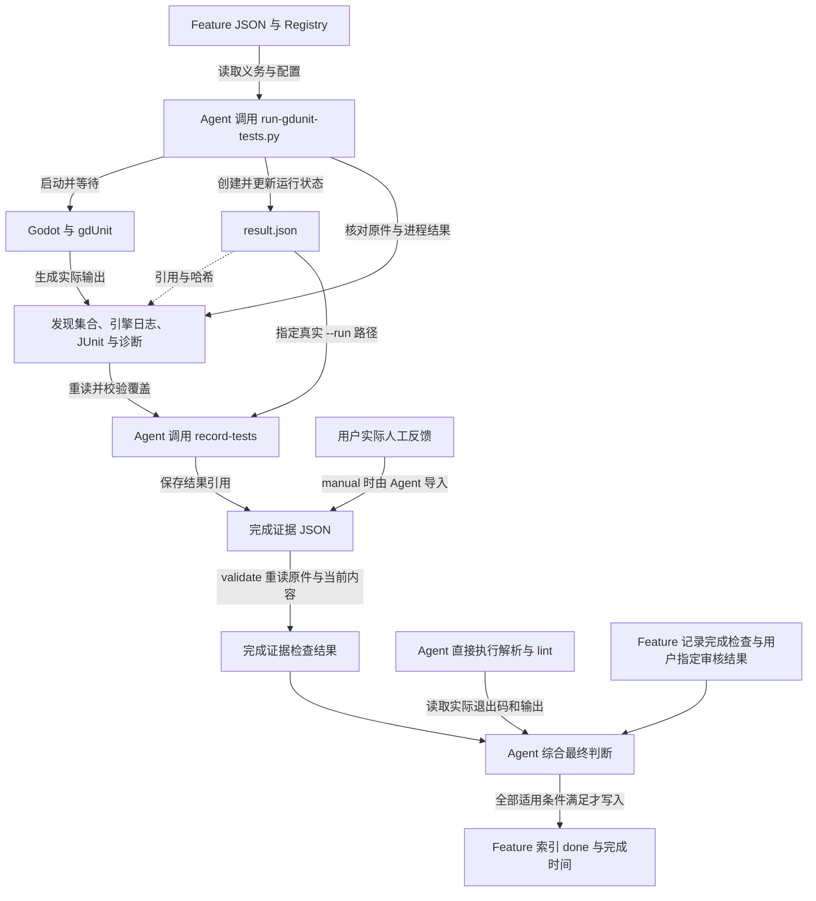

# 命令与验证证据

[Godot 项目手册](../README.md)

本页说明生成项目中检查、测试与完成记录命令的用法，以及每种结果能证明什么。所有命令都在**生成后的项目根目录**运行；按当前任务选用需要的入口，不必每次整页执行。写入记录的命令只在对应 Skill 和已有授权范围内使用。

## 每种结果能证明什么

本节是手册中“证据之间不能互相替代”这条规则的唯一正文，其他页面需要时链接到这里。

一个结果只能证明它实际检查过的范围。下表列出常见结果的含义：

| 已有结果 | 可以报告 | 不能据此推断 |
| --- | --- | --- |
| 文件或模板存在 | 文件已就位 | 环境就绪、需求已定、示例已验证或业务已完成 |
| 环境检查通过 | 配置结构与工具路径满足该检查 | 测试、导入、场景启动或游戏可玩 |
| Feature 记录检查通过 | 数据结构、引用和依赖满足契约 | AC 已实现、需求覆盖完整 |
| focused / baseline 测试通过 | 指定范围在本次运行成功 | 最终 Required / affected / full 已满足 |
| 最终测试通过 | 选中的自动测试在当前内容上成功 | 解析、lint、性能、画面、声音或手感合格 |
| 解析或 lint 通过 | 执行过的静态范围没有问题 | 运行行为、资源、导出或人工质量合格 |
| 完成证据校验通过 | 测试引用与适用的人工接受满足记录契约 | 直接静态检查、独立审核或导出包已检查 |
| 人工验收清单已生成 | 待验收材料已交给用户 | 用户已验收或已接受 |
| 用户在调试台采纳到游戏 | 选定的参数和实现已写进游戏文件，是用户当时的选择 | 已收尾提交、测试通过或人工验收通过；人工验收另外检查收尾后的游戏原值 |
| 技术验证得出“可行” | 该做法在验证的版本、环境和条件下可行 | 正式功能已实现或已通过验收 |

判断时还要遵守三条规则：

- **新失败优先**：同一内容上较新的失败，只能被之后覆盖同一范围的成功解决；更早的或范围更窄的通过不能抵消它。保留失败原件，再说明修复与后续结果。
- **退出码只说明工具本身**：退出码为 0 表示该工具按自身契约完成，不等于任务完成；缺失的退出码不能当作 0；不同工具的非零值含义不同，不能一律当作业务测试失败。
- **未知保持未知**：原件缺失、报告未写入或命令未执行时，如实报告缺口；不补造报告、不手填哈希或通过次数，也不用旧版本的成功代替。

工具的完整错误含义见[错误与结果的含义](errors-and-results.md)。

## 调用准备

先确认项目配置已经就绪。本页 PowerShell 示例共用以下变量：

```powershell
$projectConfig = Get-Content -LiteralPath 'docs/methodology-config.json' -Raw | ConvertFrom-Json
$projectPython = $projectConfig.python_executable
$projectGodot = (Resolve-Path -LiteralPath $projectConfig.engine_executable -ErrorAction Stop).Path
$featureId = 'F001' # 教学占位，必须换成当前真实 Feature ID
```

- `python_executable` 应已改为确认过的解释器，见[环境与流程配置](../foundations/configuration.md#环境与流程配置)。
- `F001` 和示例脚本路径都要换成实际存在的任务与文件。
- 每条原生命令后立即读取 `$LASTEXITCODE`。

新项目第一次运行 CLI 测试或项目脚本前，先按[首次 Godot 扫描](../../../project-source/tools/README.md#首次-godot-扫描)完成编辑器扫描；环境检查通过不包含这一步。

## 命令一览

| 入口 | 常用参数 | 读写与副作用 |
| --- | --- | --- |
| `yaya/tools/checks/check-project-environment.py` | `--require-ready`、`--config` | 只读配置；就绪检查会启动 Godot `--version` |
| `yaya/tools/checks/check-feature-list.py` | `--eligible`、`--completion-feature F001`、`--repo-root` | 只读 Feature、测试登记表、修订历史和依赖；不运行测试 |
| `yaya/tools/checks/check-godot-resource-format.py` | 可选的文件列表 | 只读项目的场景、资源、脚本、Shader 和图片、音频、字体素材，跳过插件、Godot 忽略的目录，以及调试台的插槽预设与组合 |
| `yaya/tools/testing/run-gdunit-tests.py` | `--godot-binary`、`--feature` 或 `--target`、`--phase`、`--scope` | 有测试时启动 Godot 并写运行目录；合法的空选择集返回 `not_required`，不写报告 |
| `yaya/tools/features/record-feature-completion.py` | 子命令与 `--feature`；全局参数 `--repo-root` 写在子命令之前 | 写入测试或人工记录，或只读展示、校验已有依据 |
| `yaya/tools/features/merge-test-registry.py` | `--components` | 把已批准的组件合并进 `docs/test-registry.json`；属于规划阶段的写操作 |
| `yaya/tools/ui-trial/prepare-trial-copy.py`、`run-ui-trial.py` | `--copy`、`--script`、`--window` | 在项目外建立并同步改名的项目副本，只在副本中启动 Godot 运行驱动脚本，输出写进副本的 `reports/ui-trial/`；`--window` 会在用户桌面上打开真实窗口。参数与退出码见 [按界面任务试用](../../../project-source/tools/ui-trial/README.md) |

组件合并器的输入与行为：

- **候选格式**：完整组件对象的 JSON 数组，或含 `components` 数组的对象。
- **调用方式**：Agent 把已批准的候选写入临时文件，再用 `--components <候选文件>` 调用；候选文件不提交。
- **冲突处理**：已有同 ID 但内容不同的组件视为冲突，不会被覆盖。工具保留现有测试，并报告 `added_components` 与 `preserved_tests`。
- **能力边界**：只合并组件，不生成测试。组件结构见 [测试登记表：`docs/test-registry.json`](../../../project-source/skills/feature-plan/SKILL.md#测试登记表docstest-registryjson)。

## 环境与 Feature 记录检查

在当前终端完成[调用准备](#调用准备)后运行：

```powershell
& $projectPython -B yaya/tools/checks/check-project-environment.py --require-ready
$LASTEXITCODE
& $projectPython -B yaya/tools/checks/check-feature-list.py
$LASTEXITCODE
& $projectPython -B yaya/tools/checks/check-feature-list.py --eligible
$LASTEXITCODE
```

环境检查器各模式检查什么，见配置参考的[检查能力边界](../foundations/configuration.md#检查能力边界)。

Feature 记录检查读取完整的 Feature 索引、详情、测试登记表和修订关系，核对 ID、字段、引用、路径、依赖与历史规则。它已经包含 JSON 解析，规划或同步完成后运行这一个入口即可；单文件语法检查只在定位具体错误时使用。需求覆盖、真实依赖和历史保留这些语义，仍由 Agent 核对。

- **`--eligible`**：校验后输出依赖已满足的 pending Feature ID。它只说明哪些任务可以开始，不授予实现权限。
- **`--completion-feature F001`**：额外要求该 Feature 直接对应的自动验证映射处于 active 状态。日常历史检查接受可追溯的已退役测试，但当前任务完成时不能用已退役测试代替实际验证。

测试路径的登记规则：

- 组件套件和 active 测试登记项目内的相对路径，不带 `res://` 前缀。合并器与 Feature 记录检查都会拒绝绝对路径、`..` 跳转和解析后指向项目外的链接，避免到选择测试时才发现路径不可用。
- planned 和 retired 测试的 `path` 可以是 `null`；已填写的路径不要求文件当前存在，已知的历史路径仍要保留。

## 运行测试

在当前终端完成[调用准备](#调用准备)后，在已批准范围内按用途选用：

```powershell
# Stage 3 基线：运行已有安全网，不含尚未创建的 planned 测试。
& $projectPython -B yaya/tools/testing/run-gdunit-tests.py --feature $featureId --phase baseline --scope auto
$LASTEXITCODE
```

```powershell
# TDD 或定点诊断：换成实际存在的套件或目录。
& $projectPython -B yaya/tools/testing/run-gdunit-tests.py --target tests/features/F001/example_test.gd
$LASTEXITCODE
```

```powershell
# Stage 4 最终验证：按当前 Feature、测试登记表和已批准范围选择测试。
& $projectPython -B yaya/tools/testing/run-gdunit-tests.py --feature $featureId --scope auto
$LASTEXITCODE
```

| 参数 | 说明 |
| --- | --- |
| `--feature` / `--target` | 两者互斥；都不传时 target 默认为 `tests`，项目有 `dev/debug` 时加上它 |
| `--phase` | `baseline` 或 `final`，默认 `final`。基线和 `--target` 运行只用于建立基线或调试，不能作为 Feature 的完成证据 |
| `--timeout-seconds` | 默认 120，必须是大于 0 的有限数 |
| `--require-test` | 格式为 `<suite-path>::<test-case>`，要求原始报告确实包含该用例 |
| `--continue` | 传给 gdUnit 的 `-c`；与“继续一个 Yaya 任务”或“复用上次报告”无关 |

运行器会启动真实引擎，不是纯文件检查。所需权限、窗口行为和运行范围按当前项目与任务确认。

## 测试范围怎样计算

完整规则见测试规范的 [测试影响评估](../../../project-source/methodology/08-test-traceability-and-evidence.md#测试影响评估) 与 [运行时的测试影响选择](../../../project-source/methodology/08-test-traceability-and-evidence.md#运行时的测试影响选择)，这里用中文说明各范围的组成：

```text
Required Test Set =
  当前 Feature 的自动验收测试
  + 当前 Feature 的回归测试
  + 影响组件已登记的 unit_test_paths
  + 与影响组件相交的 active 历史回归
  + 与影响组件相交的 active 不变量
  + 已批准的 additional_tests

affected = Required + 与影响组件相交的 active 验收测试
```

| `--scope` | 用途 |
| --- | --- |
| `auto` | 默认运行 affected；当前计划要求全量时升级为 full |
| `required` | 只运行 Required，适合局部迭代；最终验证仍要满足 affected 或 full |
| `affected` | Required 加相关验收测试 |
| `full` | 递归运行 `tests/`，以及存在时的 `dev/debug/`，并核对必需覆盖；空的分层目录不算义务，但测试总数为零仍然失败 |

以下情况要按规范运行 full：影响组件设置了 `full_suite_on_change`、计划中有已批准的 `full_suite_reasons`、改动影响范围很广的工具链，或影响范围无法界定。“工程维护”这个任务标签本身不触发 full。附加测试及理由保存在 Feature 的 `verification.test_impact` 中，没有单独的计划文件。

没有单元套件的组件写 `unit_test_paths: []`，不会产生虚构的选择器。以下情况都不能记为通过：已登记的路径丢失、选中的目录里没有测试、必需用例被跳过、报告缺失。空项目没有测试层时，full 也不会因此变成“已有成功测试”。

## 一次运行留下什么

运行目录的位置：

- Feature 运行：`reports/gdunit-wrapper/<Feature-ID>/run-<id>/`
- `--target` 定点运行：`reports/gdunit-wrapper/focused/run-<id>/`

完成检查只读取对应 Feature 的目录。使用命令实际打印的 `result.json` 路径，不要猜测 run ID。

```text
reports/gdunit-wrapper/F001/run-<id>/
├── result.json                 运行中持续更新，结束时记录成功或失败
├── engine.log                  原始引擎输出
├── discovery.json              实际展开后的测试发现集合
└── report_<...>/
    ├── results.xml             原始 JUnit
    └── diagnostics.jsonl       运行诊断
```

启动或中途失败时，部分文件可能还没有生成，缺失本身就是需要报告的结果。gdUnit 还可能生成其他文件。

运行器会同时核对进程结果、实际发现集合、JUnit 用例和诊断：

- 参数化用例以实际展开后的集合为准；源码里有 `test_*` 方法，不代表它真的执行了。
- JUnit 显示成功，也可能同时存在引擎错误或未完成的运行，以运行器的整体结果为准。

## 记录完成证据

### 从运行结果到完成状态

Stage 4 记录最终测试结果，Stage 5 按需记录人工结果，第一次记录时为该 Feature 创建完成证据文件 `docs/features/F0XX-evidence.json`，Stage 7 检查完成条件。每个 Feature 一份，互不覆盖。下图是实际的读写关系，编辑文件不会自动触发其中任何一步：



实线表示实际调用、读写与结果交接，虚线表示对原件的引用。完成记录工具（`record-tests`、`validate` 等）不运行测试、不做解析和 lint、不替用户做决定，也不修改 Feature 状态；状态由 Agent 在全部条件满足后更新。

| 环节 | 输入 → 产出 | 判定方式 |
| --- | --- | --- |
| 测试运行器 | 当前 Feature、测试登记表、配置与源码 → 运行目录、`result.json` 与报告 | 等进程结束后读取结果、发现集合、覆盖与诊断；只打印路径不代表文件已保存 |
| `record-tests` | 最终运行的 `result.json` 路径 → 完成证据中的路径与哈希引用 | 重新核对当前内容、原件、覆盖和未解决的失败 |
| 人工结果导入 | 绑定当前内容的清单 + 用户结果，或用户明确的口头决定 → 人工记录 | 命令成功只代表记录成功，状态仍可能是 pending 或 rejected |
| `validate` | 当前契约与完成证据 → 只读结论 | 重新计算测试义务并读取原件，核对适用的人工接受 |
| Agent 更新 Feature 记录 | 完成证据、直接解析与 lint、AC 与差异、Feature 记录、用户指定的审核条件 | 全部满足后写入 done 和真实完成时间，再检查最终的 Feature 记录 |

### 子命令

入口为 `yaya/tools/features/record-feature-completion.py`。下表是参数速查，用来记录真实结果，不是批量填写“通过”的步骤：

| 子命令 | 何时使用 |
| --- | --- |
| `record-tests --feature F001 --run <result.json>` | 导入真实的最终 Feature 运行；多个运行在同一次调用中列出多个 `--run`，整组替换旧引用 |
| `prepare-manual --feature F001 --checklist <清单.json>` | 检查 Agent 编写的 pending 清单并绑定最终内容；已绑定的清单不能重新绑定 |
| `record-acceptance --feature F001 --checklist <清单.json>` | 清单的状态已按用户的结论填写后，核对定义未变并记录 accepted、rejected 或 pending |
| `record-acceptance ... --confirm-unrelated-changes` | 绑定之后项目又有变化，Agent 逐个核对工具列出的文件后使用：列表可能包含绑定时未提交、之后没改过的文件，真正改过的都不涉及本 Feature 时才可用；列表会写进记录 |
| `show --feature F001` | 只读展示记录；检查文件结构和 Feature 身份，不判断能否完成 |
| `validate --feature F001` | 检查当前内容对应的完成证据是否满足 |

`show` 退出 0 只表示记录可读取：没有通过的测试、仍在等待人工结果的记录也能正常展示。判断能否完成要用 `validate`。两者都不改 Feature 状态；记录结构损坏或身份不匹配时都会报错。

### 导入测试结果

1. 在当前终端完成[调用准备](#调用准备)。
2. 确认运行器输出的 `result.json` 确实已写入。
3. 运行 `record-tests`，命令见下面两个示例。调用前注意两个副作用：
   - 每次 `record-tests` 都用本次传入的全部 `--run` **整组替换**当前测试引用，不会累加。需要同时保留的运行必须一次列全。
   - 导入校验失败时会**清除旧的测试引用**，原始报告仍然保留。要处理失败原因，不能改写结果文件来绕过。
4. 核对退出码与实际结果。

只有一个有效运行时：

```powershell
& $projectPython -B yaya/tools/features/record-feature-completion.py record-tests --feature $featureId --run "reports/gdunit-wrapper/$featureId/run-actual-id/result.json"
$LASTEXITCODE
```

需要同时保留两个运行时，在一次调用中写两个 `--run`（路径同样是占位）：

```powershell
& $projectPython -B yaya/tools/features/record-feature-completion.py record-tests --feature $featureId --run "reports/gdunit-wrapper/$featureId/run-actual-first/result.json" --run "reports/gdunit-wrapper/$featureId/run-actual-second/result.json"
$LASTEXITCODE
```

完成证据文件在第一次记录测试结果或人工验收结果时自动创建，不需要提前建空记录；已有文件损坏或格式不受支持时会报错，不会被覆盖。独立审核的范围和时机由用户决定。

### 不需要自动测试的情况

运行器会自己判断是否有需要运行的测试，统一调用即可：

- **适用条件**：有效的 manual 计划中 Required 和 affected 都为空、且不要求全量时，退出码为 0，并输出含 `status: not_required` 的 JSON。合法的空基线同样返回 `not_required`。
- **运行与记录**：这时不启动 Godot、不写报告，也不调用 `record-tests`。之后用真实的人工验收结果创建完成证据，其中 `test_runs: []`。
- **仍会报错的情况**：显式指定 `--scope full` 或 `--require-test`、映射无效、路径缺失，或当前内容上还有未解决的最终失败。

这里的退出码 0 只表示“不需要自动测试”，不是测试通过。

### 记录人工验收结论

清单本身就是验收记录，保存在 `reports/manual-acceptance/`，格式和命令示例见[人工验收文件](../../../project-source/methodology/contracts/manual-acceptance-files.md)。你在对话里说“通过”或指出问题，Agent 把结论写进清单对应项的状态和备注；你也可以自己改清单。两种方式记到同一个地方，不另存结果文件。

- 清单全部通过，就是该范围的人工接受；备注里有实质矛盾时先向用户澄清。
- 命令退出 0 表示如实记录了状态；`pending` 和 `rejected` 都不能完成任务。
- 导入无效时命令以非零退出，并保留已有记录。Agent 要处理本次错误，不能退回使用旧的接受记录。

### 检查完成证据与 Feature 记录

在当前终端完成[调用准备](#调用准备)后运行下面三条命令；直接解析、lint 和用户指定的审核条件由 Agent 另外确认：

```powershell
& $projectPython -B yaya/tools/features/record-feature-completion.py validate --feature $featureId
$LASTEXITCODE
& $projectPython -B yaya/tools/checks/check-feature-list.py --completion-feature $featureId
$LASTEXITCODE
& $projectPython -B yaya/tools/checks/check-godot-resource-format.py
$LASTEXITCODE
```

其他失败的含义见[测试与完成证据](errors-and-results.md#测试与完成证据)。

## 内容指纹与失效判断

内容指纹是工具对当前文件计算出的摘要，用来判断已有测试和人工记录是否仍对应当前内容。它只比较字节，**不判断含义是否改变**：

- 工具通过 Git 列出已跟踪文件和未被忽略的未跟踪文件，按路径排序，对纳入的文件记录路径、类型与内容后计算摘要。
- 读取的是当前工作区的字节，不看修改时间，也不只看本 Feature 的差异。
- 删除或重命名纳入的文件会改变指纹；已经不存在、只残留在 Git 索引中的路径不参与计算。
- 在一次删除或重命名之后取得的证据，不会因为随后只是暂存或提交同一变化而失效。之后如果再改纳入的内容，仍要补做验证。

各类文件的计算方式：

| 文件 | 计算方式 |
| --- | --- |
| GDD、Product、术语、专业规格与表现文档、项目规则、Feature 设计稿、架构与 ADR | 按原始字节纳入；换行、措辞或排版变化即使不改行为，也会改变指纹 |
| 源码、测试、配置和其他未列出的文件 | 纳入路径与内容；增删、移动都会改变指纹 |
| `docs/features/` 下的 JSON、Feature 索引、测试登记表、修订记录、`methodology-config.json` | 先解析 JSON、排序对象键再计算；数组顺序保留，下表列出的过程字段除外 |
| `docs/features/F0XX-evidence.json`、`docs/progress.md`、`reports/` | 不纳入；报告由结果导入和人工验收契约单独核对，仍不能随意改写 |
| `docs/progress/`、`docs/knowledge/`、`docs/research/` 下的 `.md` 文件 | 不纳入；这些目录里的非 Markdown 文件仍纳入 |
| 调试台的插槽预设、组合与 `dev/debug/adoption-log.md` | 不纳入；它们是调试过程中的草稿与收尾记录，验收针对游戏调参资源。`dev/debug/adoption-queue/` 仍纳入 |
| 普通 `README.md`（不区分大小写） | 不纳入；但 `.agents/`、`yaya/agent-rules/`、`yaya/methodology/`、`docs/gdd/`、`docs/product/`、`docs/features/` 下的 README 仍纳入 |

不纳入只是计算规则，不是存放许可：正式需求、规则和可执行输入不能为了避开指纹而放进这些位置。知识目录只存参考经验，普通 README 只写用法和导航；其他 Markdown 没有豁免。

JSON 中不参与计算的过程字段只在下列位置移除，不会递归移除所有同名键：

| JSON 位置 | 不参与计算的字段 |
| --- | --- |
| Feature 详情顶层、索引中每条 Feature 的顶层 | `notes`、`status`、`completed_at`、`created_at`、`updated_at`、`recorded_at` |
| 索引与测试登记表的 `meta` | 上述字段，以及所有以 `_at` 结尾的键 |
| 修订记录中每条 `revision_log` | `revised_at`、`created_at`、`updated_at`、`recorded_at`、`summary`、`notes` |

- **仍参与计算的字段**：AC 文本、验证计划、组件、嵌套测试的 status、退役关系、修订 ID、源提交锚点，以及未知的契约字段。
- **notes 中链接的设计稿**：notes 本身不参与，但被链接的 `F0XX-design.md` 文件仍按原始字节纳入。
- **Git 提交号**：另作来源记录。只提交了过程字段、指纹没有变化时，不会因为提交号变化要求重跑或重新验收。

指纹是全局的：即使改的是尚未开发的 GDD 章节，也可能让当前未完成 Feature 的测试和人工接受失效；已完成的历史记录不会因此重开。所以治理文档在最终验证之前的 Stage 3 文档检查点定稿。最终测试或人工接受之后又改了纳入的内容（包括 Stage 5.5 采纳新规则），要先核对当前指纹和验证义务，补齐失效的最终运行、导入和人工接受；不能因为“没改代码”就沿用旧结果。只读审核不改变内容。

直接依据是[验证快照实现](../../../project-source/tools/lib/verification_snapshot.py)中的 `_is_fingerprint_input()`、`semantic_json()`、`working_tree_fingerprint()`，以及测试追溯与证据中的[基于原始结果的完成判断与语义时效](../../../project-source/methodology/08-test-traceability-and-evidence.md#基于原始结果的完成判断与语义时效)。

性能、长测、画面和听感证据按原任务 AC 与设计中的验证义务判断。完成记录工具只接收 gdUnit 结果，不判断专项证据是否充分，见专业来源与资源的[测量与实现](../specialist-work-and-records/specialist-work.md#测量与实现)。独立审核产生的报告、日志和缓存要隔离保存，不能覆盖原证据或被审成果。

## 脚本解析与 lint

在当前终端完成[调用准备](#调用准备)后，从项目根目录使用同一个已确认的 Godot 可执行文件：

```powershell
# 换成实际改动的脚本，并按影响解析必要的依赖。
& $projectGodot --headless --path . --check-only --script res://path/to/changed_script.gd | Out-Host
$LASTEXITCODE
```

```powershell
# 换成实际 Feature；需要保留多轮结果时，使用尚未用过的子目录。
$reportDirectory = "reports/features/$featureId"
New-Item -ItemType Directory -Path $reportDirectory -Force | Out-Null
& $projectGodot --headless --path . --script res://addons/gdscript-linter/analyzer/analyze-cli.gd -- --json --output "$reportDirectory/lint.json" res:// | Out-Null
$LASTEXITCODE
```

- **报告目录**：不属于某个 Feature 的工作使用 `reports/maintenance/<任务>/`。不要覆盖仍被引用的报告，目录选择见[报告与历史](../specialist-work-and-records/knowledge-and-records.md#报告与历史)。
- **等待进程**：Godot 在 Windows 上是 GUI 程序，`| Out-Host` 或 `| Out-Null` 让 PowerShell 等它结束，之后立即读取退出码。
- **lint 的输出**：结果从 `--output` 指定的报告读取，先看其中的 `summary`；`Out-Null` 丢弃标准输出，避免整份 JSON 打到终端，错误输出仍会显示。
- **lint 范围**：扫描完整 `res://` 并遵循项目配置；改了默认被排除的依赖时，仍要单独验证那处改动。

lint CLI 的结果约定：

| 项目 | 约定 |
| --- | --- |
| 退出码 | 0 无问题或只有 Info；1 有 Warning；2 有 Critical；3 输入无效、没有发现文件、配置错误或 JSON 报告写入失败。只有 2 和 3 算 lint 失败、阻塞完成；1 只列出 Warning 数量 |
| `--severity`、`--top` | 只影响显示，不改变实际判定 |
| `--output` | 支持 JSON 和 HTML；默认文件名 `code_quality_report.html` 只用于 HTML |
| 报告内容 | 写明实际范围以及 Critical、Warning、Info 的数量；未知数量不能写成 0 |

项目根目录的 `gdlint.json` 必须能读取，缺失或损坏时不会悄悄换成插件内置阈值；显式 `--config` 也一样。`--check` 中只要有一个未知检查 ID 就以 3 退出，零检查不算成功。

只做解析或 lint 时，不需要额外的导入步骤或包装程序。已授权的资源导入和新项目首次运行所需的扫描，按对应环境规范处理。

通用交付不默认加截图或像素比较。任务明确约定了客观的渲染契约时，可以补充限定范围和环境的检查；构图、美术一致性和动画体验仍靠人工验收，边界见[视觉验证边界](../../../project-source/agent-rules/70-tests/test-levels.md#视觉验证边界)。

## 工具退出码速查

| 工具 | 退出码 |
| --- | --- |
| 环境检查、Feature 记录检查 | 0 成功；2 校验失败 |
| gdUnit 运行器 | 0 成功；1 运行失败；2 参数错误 |
| lint CLI | 见上节 |

实现来源：[项目检查与测试工具](../../../project-source/tools/README.md)、[测试运行器](../../../project-source/tools/testing/run-gdunit-tests.py)、[完成记录工具](../../../project-source/tools/features/record-feature-completion.py)、[GDScript lint 的约定与证据](../../../project-source/methodology/contracts/gdscript-lint.md)。
