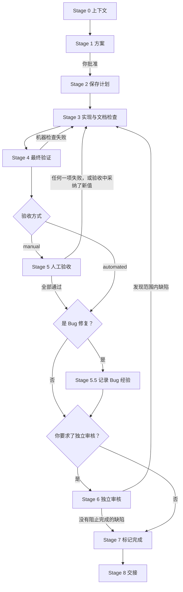

# 任务类型、开发阶段与完成语义

[Godot 项目手册](../README.md)

本页说明生成项目中有哪些任务类型、一个 Feature 经过哪些阶段、怎样才算完成，以及 Git 提交和持续任务的规则。

先区分四个容易混淆的概念：**任务**是要做的事，**阶段（Stage）**标记做到了哪一步，**Git 提交**保存代码，**人工验收**由用户确认实际效果。它们各自独立：阶段编号只用来定位进度，不是自动推进的状态机，也不需要逐阶段审批。

依赖游戏设计的任务，开始前要满足的条件见 [GDD 是项目开发的前提](requirements-and-planning.md#gdd-是项目开发的前提)。写 GDD 和审核 GDD 草稿本身不进入下面的实施阶段。

## 任务类型

| 类型 | 做什么 | 什么时候算完成 |
| --- | --- | --- |
| 普通 Feature | 交付已确认的玩家行为 | 对应的 AC 全部满足 |
| Bug | 修复违反仍有效的 GDD、Product 交付要求、专业规格或工具契约的实现 | 恢复原有预期 |
| 重构 | 在外部行为不变的前提下，降低有具体依据的维护成本 | 行为保持、收益可说明；文件变少或指标下降本身不算收益 |
| 工程维护 | 工具、依赖、性能、资源或数据方面的明确技术目标 | 技术目标达成；不借机增加玩法 |
| 限定实验 | 在约定的假设、范围、预算和文件去向内取得证据 | 证据取得；实验结论不会自动成为已批准的需求 |
| 只读调查或审核 | 提供证据与结论 | 结论交付；发现问题不代表获得修复权限 |

几条边界：

- **正式交付的判断**：以项目规定的 Feature 完成状态和完成证据为准，测试通过、代码提交或用户试玩都不能单独作为依据。
- **交付前后的缺陷**：交付前发现的、属于原任务范围的缺陷，由原 Feature 继续处理；交付后发现的独立缺陷，新建工程 Bug 处理，原 Feature 的完成历史保持不变。
- **不是 Bug 的情况**：需求本身不明确，或用户改变了要求，都不按“修 Bug”处理。
- **按层描述**：“逻辑 / 表现 / 跨层”可以和任务类型组合使用。例如“购买失败却播放成功动画”是跨层接入的 Bug，“更换已确定的图标飞行方案”主要涉及表现。这只帮助定位要求和验证范围，不新增阶段，也不决定要建多少任务。例子见[游戏逻辑、表现与协作](../foundations/02-game-logic-and-presentation.md)。

Bug 的实际表现、预期及其来源、复现方式和根因都要有证据对应；还没证实的解释保持为假设。能自动回归的缺陷，用“修复前失败、修复后通过”的测试保护；确实不适合自动化时，记录原因和可重复的人工检查步骤。

## 修改代码的共同要求

修 Bug、实现功能、重构、维护工具、接入资源、迁移和性能优化，都按实际影响遵守下面三步；具体方法由各任务自己决定：

1. **修改前**：读取当前实现和直接调用它的代码，找到行为实际所在的位置，简要说明打算改什么、怎样验证。已有有效计划可以直接沿用，不需要额外审批。
2. **修改时**：完成最小而完整的目标；不需要变化的 API、依赖和代码风格保持不变；契约确实要变时，同步修改实际使用方；不顺手改无关代码。
3. **交付前**：完成相关测试和项目支持的静态检查，检查最终差异；说明关键文件、修改理由、实际做了哪些验证，以及有依据的剩余风险。

规则正文见[任务范围](../../../project-source/Project_AGENTS.md#任务范围)、[验证与完成汇报](../../../project-source/Project_AGENTS.md#验证与完成汇报)。这些要求不会扩大只读任务的权限。

## Feature 的执行阶段

下图是阶段之间的走向，下表是每个阶段的执行条件和产出。之后几节分别写用户会在哪里停下、各阶段怎样依赖前一步，以及几处设计的原因。

| 阶段 | 执行条件 | 产出 |
| --- | --- | --- |
| 0 上下文 | 总会执行 | 明确当前目标、来源、规则、已有改动、有效授权和必要环境 |
| 1 方案 | 总会执行 | 确定范围、实际影响、所需资源、测试策略、验收方式和必要的设计决定 |
| 2 保存计划 | 总会执行 | 把已批准的方案写入 Feature、测试登记表、Progress 和必要的设计稿；状态改为 `in_progress` |
| 3 实现 | 总会执行 | 运行相关基线，按“小步 RED → GREEN → 必要重构”推进，每个逻辑改动验证通过后即可提交 |
| 3D 文档检查 | 总会执行 | 让本次涉及的 GDD、Product、术语、专业规格、表现文档与资源章节、设计、规则和架构都与实际决定一致；用户在调试台的采纳在这之前完成收尾，文档链接调参资源而不抄数值 |
| 4 最终验证 | 总会执行 | 取得当前义务对应的自动测试、直接静态检查和专项结果；改动了有界面任务的界面或调试台界面时，先按界面任务试用；需要时准备人工验收清单 |
| 5 人工验收 | 仅 manual 模式 | 取得用户对当前内容的真实结果 |
| 5.5 Bug 经验 | 仅 `engineering_change: bug` | 保存根因、触发条件、回归测试和有用的预防原则 |
| 6 独立审核 | 仅用户要求时 | 按用户指定的范围和时机审核；可以集中审核多项 |
| 7 标记完成 | 总会执行 | 满足适用条件和提交条件后，写入 done、完成时间和记录，再收尾提交；提交受阻时按 Stage 7 恢复未完成状态 |
| 8 交接 | 总会执行 | 报告实际交付内容与限制，核对还剩哪些授权；已授权的后续工作继续推进 |

流程的唯一正文是[Stage 0–8 `feature-execute` 执行循环](../../../project-source/methodology/03-execute-loop.md)和 [feature-execute](../../../project-source/skills/feature-execute/SKILL.md)。普通的实现细节由 Agent 判断。

**授权在阶段和 Skill 之间延续**：用户给出的具体授权，只要没有变化，就在各阶段、各 Skill 之间一直有效；某个 Skill 执行结束，不代表整项授权结束。

**需要实施指导时**，使用 [implementation-guidance](../../../project-source/skills/implementation-guidance/SKILL.md) 准备，仍按“Stage 1 提方案、Stage 2 保存设计”的顺序进行，不增加单独的指导阶段或额外批准。默认由主 Agent 自己准备，只有用户明确要求时才委派给指定的顾问。主 Agent 核对关键规则和实际代码后继续执行。拿到设计稿不代表 Feature 已经实现、验收或经过独立审核。

### 用户会在哪里停下

| 停点 | 用户要决定什么 | 拒绝或修改之后 |
| --- | --- | --- |
| Stage 1 批准材料 | 范围、设计选择、测试计划和验收方式。材料开头三行写做什么、改哪些文件、怎样验证，之后是要决定的项 | Agent 按修改重新给方案；批准前不写代码，也不改测试计划 |
| Stage 3D 视觉决策（仅视觉决策 Feature） | 在调试台里选定并采纳哪组设定 | 采纳前 Agent 停在这里；采纳后从收尾继续 |
| Stage 4 测试失败但不是本 Feature 造成的 | 选择怎样处理这个失败 | Agent 停下当前 Feature，不修改触发失败的文件 |
| Stage 5 人工验收（仅 manual 模式） | 清单每一项通过还是不通过 | 有一项不通过，或验收中在调试台采纳了新值，回到 Stage 3，重跑 Stage 4 后重新验收 |
| Stage 4、Stage 5 或审核发现设计有漏洞 | 是否批准设计稿的变化部分 | 批准后回到 Stage 3；Agent 说明哪些已完成的小循环保留，旧证据是否失效按内容指纹判断 |

停点会随条件增减：已有明确批准覆盖 Stage 1 的材料时，Agent 直接沿用，不再问；automated 模式没有 Stage 5。独立审核不是停点，Agent 不会例行询问，由用户主动提出。

### 后一步怎样依赖前一步

Stage 2 保存的是 Stage 1 批准过的方案，没批准的内容不进计划。Stage 3 按 Stage 2 保存的测试计划写测试和实现。Stage 4 按计划和实际改动选择测试范围，manual 模式下再把人工验收清单绑定到当前内容。Stage 5 只对这份绑定后的内容验收。Stage 7 要求前面适用的测试和人工验收都对应当前内容，任何一项因后来的修改失效，都要先补做。

### 为什么这样设计

- **机器检查失败时先回 Stage 3，不进入人工验收**：因为人工验收针对的是最终内容。先验收再修改，修改会改变内容指纹，验收结果随之失效，用户要再验一次。
- **验收中采纳新值等于拒绝本次验收**：因为采纳会改写游戏文件，清单绑定的内容随之失效，这份清单不能再记录结论。
- **设计有漏洞时先改设计稿，再请用户批准**：因为用户批准的是方案。只改代码会让设计稿和实现不一致，后续 Feature 按设计稿工作时会出错。
- **等待验收期间可以先做别的 Feature，但两边都要停在 GREEN**：因为两个 Feature 的测试选择都会包含对方改动选中的测试。留在 RED 的测试，会让另一个 Feature 的验证失败。
- **独立审核由用户选时机**：因为作者自查不算独立审核，而独立审核要另开一个新实例。用户可以把几个 Feature 集中审一次，不必每个都审。

## 自动与人工验收

**选择验收方式**：从要求出发。画面辨识、声音、动画、操作手感等需要人来判断的，用 manual；只有所有 AC 都能被自动检查充分验证时，才用 automated。manual 模式同样可以有自动测试义务。

**什么算人工接受**：只有用户的真实结果才算。实现授权、自动测试通过、用户没有表态都不算（定义见[框架术语](../../terminology.md)）。

**跨层功能要分别检查**：例如扣费是否正确、奖励反馈是否只在成功后播放、关闭再打开界面后余额是否正确，是三项不同的检查。计算测试通过不能说明动画体验好，在调试台采纳了购买反馈也不能说明正式购买规则已接入。

人工验收清单与结果的分工：

- **清单内容**：对应项目的 AC 或必要的回归，写明入口、起始状态、操作、可观察的结果和重置方法；设备、时长、随机种子等只在影响结果时补充。
- **Agent 与工具**：Agent 编写 pending 状态的原清单，工具把清单绑定到当前内容版本。
- **用户结论**：结论写在同一份清单的 passed / failed / pending 和备注里。用户可以在对话中说，由 Agent 写进清单并注明原话；也可以自己改清单。不能通过改 ID、步骤或预期来消除失败。
- **何时算接受**：所有有效的必需项都通过、反馈中没有矛盾，就已经表示接受，不需要再向用户要一次同样的确认。
- **涉及调试台时**：清单的入口是项目 `dev/debug/README.md` 中的启动命令和登记的固定局面，检查的是收尾后的游戏原值，插槽预设和组合不算验收内容。验收中用户又在调试台采纳了新值，本轮按不通过处理：回到 Stage 3 收尾，再重跑 Stage 4。规则见Stage 0–8 `feature-execute` 执行循环的[Stage 5 · 明确的人工验收（仅 manual 模式）](../../../project-source/methodology/03-execute-loop.md#stage-5--明确的人工验收仅-manual-模式)。

无论结论来自对话还是用户自己编辑，都记在清单里，用同一个命令记录。清单缺失、定义被改或反馈有歧义时，如实保留缺口；记录命令成功，记录的状态也可能是 rejected 或 pending。automated 模式不生成空清单，也不伪造接受。文件契约和命令见[人工验收文件](../../../project-source/methodology/contracts/manual-acceptance-files.md)与[记录人工验收结论](../methods-and-tools/commands-and-evidence.md#记录人工验收结论)。

测试运行器返回 `not_required` 的条件很严格：有效的 manual 计划确实没有自动测试义务，且没有未解决的失败或未结束的最终运行。它不是跳过测试的开关，直接静态检查、专项检查和人工要求照常适用。

## 测试节奏

- **基线**：修改前运行的 baseline 用来确认已有的安全网。环境故障、解析错误或测试发现失败，都不算目标行为的 RED。
- **小步循环**：一条 AC 可以经过多个“小行为 RED → GREEN”循环，不需要先写完全部测试再统一实现。接手已有实现时，不要为了制造 RED 而故意破坏代码。
- **最终范围**：按实际影响的组件和计划选择 Required 或 affected，符合全量条件时选择 full；“维护”标签本身不要求全量。各范围的计算方式和全量条件见[测试范围怎样计算](../methods-and-tools/commands-and-evidence.md#测试范围怎样计算)。
- **复用结果**：当前内容上、覆盖充分的结果可以复用；新失败的处理和各类证据的含义见[每种结果能证明什么](../methods-and-tools/commands-and-evidence.md#每种结果能证明什么)。

已有的测试和人工接受可能因文档变化而失效：GDD、Product、规格、规则、表现文档及资源章节被纳入全局内容指纹，即使只改文字或准备状态，也可能使当前未完成任务的旧结果失效，尚未开发的 GDD 章节也不例外。notes 不参与计算，但它链接的设计稿仍参与。只整理过程历史不算业务变化，已完成的记录也不会因此重开。后来采纳的 Bug 经验或规则，同样要核对实际影响。规则细节见[内容指纹与失效判断](../methods-and-tools/commands-and-evidence.md#内容指纹与失效判断)。

## Git 与暂停续接

**工作区有改动不是阻塞。** 单人项目中：

- Agent 查看当前改动，保留与本任务无关的内容及其暂存状态；同一任务之前留下的改动，核实后可以继续完成并提交。
- 只有在出现具体的覆盖冲突、无法分开提交，或必要的来源无法保存时，才说明受阻。不需要证明改动是谁做的，也不会自动 stash、还原或清空。

**暂停与切换。** 续接时使用当前任务目录中的 Progress、原任务和真实文件。在同一目录中续接，不需要新建工作目录、状态记录文件，也不需要强行提交半成品。已经指定了 worktree 时，以那个目录的真实内容和 Git 状态为准，具体操作按任务授权进行。

**本地提交。** 项目默认按完整的逻辑成果自动创建本地提交：

- 一个 Feature 可以多次提交，中途保持 `in_progress`。
- 用户提出的提交条件优先，例如“不要提交”“先验收再提交”“提交前问我”。这些条件按其范围在各 Skill 和续接中一直有效；验收通过本身不等于允许提交。
- 提交不设额外的审核关卡；提交后发现问题，新建一个修正提交，不改写历史。
- Feature 提交的主题写成 `<type>(F0XX): <中文行为摘要>`，正文用 `Feature:` 写真实标题，用 `Work item:` 指向详情文件；不属于任何 Feature 的任务不虚构这些字段。

提交边界、暂存保护、提交说明和禁止操作的唯一正文是 [Git 与提交](../../../project-source/Project_AGENTS.md#git-与提交)。

## 持续任务（Goal）

Goal 只是让工作持续进行的方式，本身不授予额外权限：

- **交接终点**：现有专用入口可以授权逐个 Product 推进，直到第一个准备好人工验收的 Feature。到达这里不代表该 Feature 已经 done。
- **视觉决策等用户在调试台选定时**：只暂停依赖该决定的部分，不能因此宣称最终验收材料已经齐备。
- **结束状态**：失败、预算用完或前置受阻都不是成功完成；后续怎么走，取决于用户给出的结果和是否继续授权。

独立审核的范围、真实性与修复权限见专业来源与资源的[独立审核](../specialist-work-and-records/specialist-work.md#独立审核)，工程任务的分类见[工程变更流程](../../../project-source/methodology/07-engineering-change.md)。
