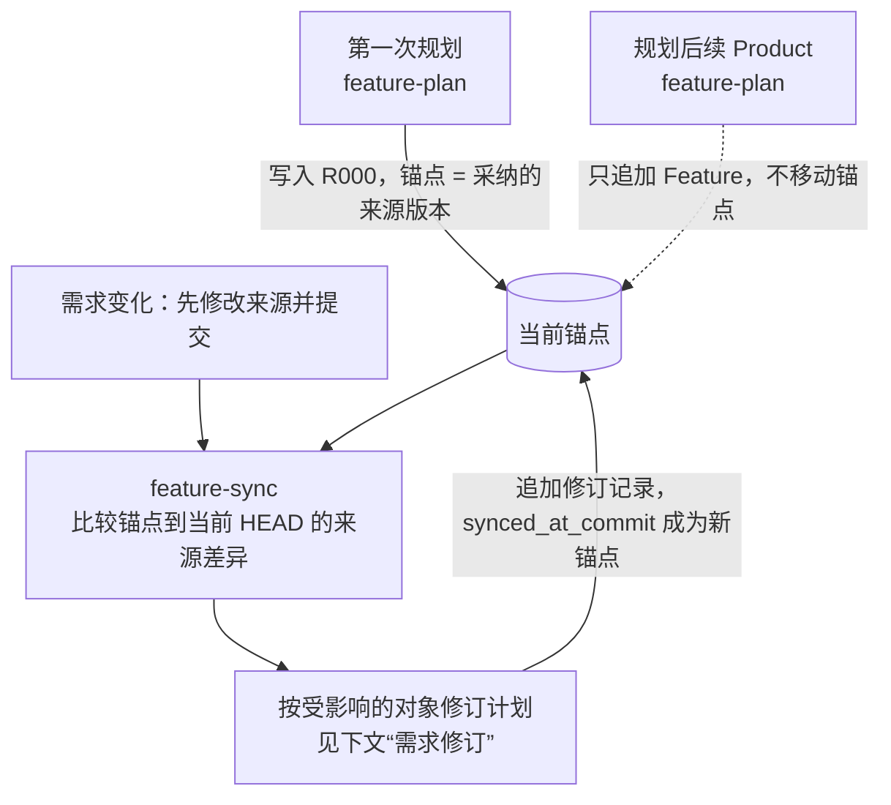

# 需求、Feature 与规划基线

[Godot 项目手册](../README.md)

生成项目用三层文档管理需求：

- **GDD**：游戏设计——游戏是什么、规则怎样、要带给玩家什么体验。
- **Product**：交付范围——这一次交付哪些内容。
- **Feature**：开发任务——由谁实现、怎样验证。

现有代码、讨论中的提案和这些正式文档各自说明不同的事实。某个文件更新、或某段代码已经写好，都不代表其中的要求已被采纳。

用[游戏逻辑与表现](../foundations/game-logic-and-presentation.md)可以帮助识别一项要求包含什么：哪些规则和状态要成立，哪些反馈要让玩家感知，两者怎样连接。GDD 同时写两方面的设计目标，专业文档再细化各自的部分；这种划分不改变“先预拆分、再逐个细化 Product”的顺序。

## GDD 是项目开发的前提

### 什么时候需要 GDD

规划、实现、专业接入或实验只要依赖游戏设计，开始前 `docs/gdd/` 中就必须有足以支撑**当前范围**的真实设计。空目录、用途说明和待填模板都不算。

- 设计缺失或无法读取时，说明哪一部分因此受阻，在已有授权内回到设计工作；不能自己编造规则继续实现。
- 不需要一开始就写完整个 GDD。讨论概念、审核草稿时可以保留明确标注的未知项。
- 项目里用 `design-gdd` 从想法开始形成 GDD，也可以整理外部资料或修改已有设计；不需要先有 Product。

### GDD 的结构与位置

- **入口**：`docs/gdd/README.md`。
- **主题文件**：使用[标准文件名与职责](../../../project-source/methodology/01-product-doc-structure.md#gdd-文件名)中预先规定的名称和多实例命名方式。位置由内容决定，不随游戏规模、篇幅或复杂程度变化。
- **按需创建**：保存设计时才按各主题的建立条件写入正文，不为填满目录而预建空文件。
- **导入非标准 GDD**：已有主题暂时沿用原来的位置；新增的主题或系统使用标准路径，并从原入口链接过去。获准整体标准化时，同步修改受影响的文件和章节引用。
- **修改已有设计**：只整理受影响的范围；路径或章节变化时，同步修改实际引用它们的地方。

GDD 包含游戏定位、体验目标、核心循环、系统规则、状态与数值、内容进程和版本范围。其中两份固定文档值得单独说明。

### 设计范围与边界

`docs/gdd/design-scope-and-boundaries.md`（中文标题《设计范围与边界》）集中保存整体范围、明确的排除项和版本边界。局部机制和表现的限制留在各自的主题里。建立和读写要求见 GDD 与 Product 文档结构的[设计范围与边界](../../../project-source/methodology/01-product-doc-structure.md#设计范围与边界)。

例如：

- 已确认只做单机，讨论时就可以直接排除多人同步问题。
- “本版本不做交易”只约束这个版本；“交易玩法尚未决定”也不等于永久排除。

各 Skill 先从 GDD 入口找到适用的边界，再读具体主题；开发约束和工程原则另见项目规则。

### 开放问题

`docs/gdd/open-questions.md`（《开放问题》）集中记录设计中尚未决定的选择和缺少的证据。每个条目链接相关主题，说明它影响什么、需要什么才能解决；GDD 入口直接引用这个文件。

| 谁用它 | 用来做什么 |
| --- | --- |
| 设计讨论 | 继续未决的问题 |
| Product 与 Feature 规划 | 判断哪些工作因此受阻 |
| 审核 | 判断设计能否支撑下一步 |
| 调研或实验 | 确定要取得什么证据 |

例如“背包满时，采集应该失败还是把资源掉在地上”还没决定，就记为一个开放问题，采集 Product 引用它说明交付为何受影响。决定之后，把规则写进所属的 GDD 主题，更新引用它的地方，再删除这个条目。与当前交付无关的问题可以一直保留；文件为空也不说明设计已经完整。读写规则见 GDD 与 Product 文档结构的[开放问题](../../../project-source/methodology/01-product-doc-structure.md#开放问题)。

### 谁维护什么

| Skill | 职责 |
| --- | --- |
| `design-gdd` | GDD 的整体设计和跨主题一致性 |
| `design-balance` | 数值模型、公式、参数、曲线与计算说明；在写入授权内直接维护所属的数值主题。调参需要新增玩法或改变体验目标时，先回到 `design-gdd` |
| `product-author` | 交付预拆分和当前 Product |
| `product-spec-elicitor` | 澄清交付上的取舍；不代写 GDD |

已授权的 GDD 写作随决定更新正文；只是讨论时，结论留在对话里，并说明还没有保存。来源变化后，还要分析对专业规格和已有 Feature 的实际影响。

### 候选值与未采纳的想法

候选内容按[候选与未采纳想法](../../../project-source/methodology/01-product-doc-structure.md#候选与未采纳想法)的规则分别存放：

- **正在比较、尚未决定的选择**：写进开放问题。
- **已采纳规则的备选数值**：写在该规则或数值模型旁边。
- **当前没有待决问题依赖的设想**：写进 `docs/unadopted-ideas.md`。

“保存了候选值”“采纳了参数”“验证了效果”是三件不同的事。获准保存草案时，可以写入清楚标注的候选，但不会自动替换已确认的设计。已有具体的采纳和写入授权，切换 Skill 时直接沿用，不需要重新批准。数值模型能复算，也不代表玩家体验已经验证。

## Product 与专业来源

| 位置 | 保存什么 |
| --- | --- |
| `docs/gdd/` | 游戏设计正文；玩法规则和版本范围只在这里写一份 |
| `docs/product.md` | Product 总览：GDD 入口、约定交付范围的预拆分、各单元的粗略边界、来源、依赖、建议顺序，以及影响拆分的未决项 |
| `docs/product/NN-<delivery>.md` | 当前交付单元：目标、本次采用与暂缓的范围、来源、前置衔接、交付验收场景和已知缺口 |
| 专业文档 | 从 GDD 细化的美术、声音、UI、游戏表现、本地化和资源规格；GDD 已定义的细节直接引用 |
| `docs/terminology.md` | 已确认的项目术语定义；完整的行为规则仍在 GDD |

**Product 是可验收的交付单元。** 它可以是一个系统、系统的一部分，或跨系统的完整体验，不必和 GDD 章节一一对应。例如可以先交付手动采集，同一采集设计中的自动化留作后续。所以游戏的系统清单和 Product 的交付清单可以不同。

**Product 编号是稳定的身份，不是排序。** 新单元使用下一个可用编号；它成为别的单元的前置时，调整总览中的依赖和建议顺序，不重命名旧文件。删除或废弃时保留真实历史和替代关系，不为了编号连续而重排引用。

**未决的交付选择只写一处**，规则见[交付决定归属](../../../project-source/methodology/01-product-doc-structure.md#交付决策的归属)：

- 涉及多个 Product 的分工、前置或顺序，以及尚未细化的候选单元自身的选择，写在总览的“待决定的规划问题”。
- 只涉及一个已有详细文档的 Product，写在该文档的“待定决策”。
- 细化某个候选单元时，把它的局部问题迁到详细文档，总览改为引用。
- 属于游戏规则、尚未确定的问题，引用 GDD 的开放问题。

**各来源只维护自己的正文。** Product 不复制核心循环、系统清单或版本内容；专业规格补足具体交付要求，专业工作中改变了整体设计时要写回 GDD。共享要求按适用范围和实际依赖影响任务，没有直接链接不等于不适用。无法读取的材料、缺失的图片、相互矛盾之处和未采用的方案都要保持可见。代码只能说明当前的行为，不能说明用户批准过它。

## Feature 的组成

| 记录 | 含义 |
| --- | --- |
| 索引 | `docs/feature-list.json`：ID、依赖、状态、详情路径等轻量信息 |
| 详情 | `docs/features/F0XX.json`：范围、来源、可观察的 AC、组件和验证义务 |
| AC | 一个可以客观判断的预期结果；ID 在需求演进中保持不变 |
| 组件 | 一段可复用的真实影响范围，用来把实现和相关测试连起来；不是每个文件一个组件 |
| 验证方式 | `manual` 或 `automated`，按要求选择；规划时未定可以是 `null`。人工验收清单为空不能反推为 automated |
| notes | 任务提醒、事件教训、TODO 和正文链接 |
| `F0XX-design.md` | 实施设计、局部决定和理由；不代替 AC、测试义务或专业要求 |

测试 ID 可以是 `F012-AC01`、`F052-RT01` 或项目定义的不变量 ID，这些只是格式示例。

- **测试状态**：测试登记有 `planned`、`active`、`retired` 三个阶段。还没写的测试先登记为 planned，真实的文件和用例就绪后改为 active。
- **组件的测试路径**：没有测试套件的组件写 `unit_test_paths: []` 是合法的；填写一个不存在的路径则不合法。

## 先预拆分，再逐个细化与交付

规划分三步：

1. **预拆分**：在 `docs/product.md` 中把当前约定的交付范围粗分为多个 Product，检查有无遗漏、边界和依赖。后续的 Product 只保留总览条目，不提前写详细文档、分配 Feature ID、写 AC 或登记测试。
2. **细化当前 Product**：轮到某个 Product 时，依据最新的 GDD 和已交付的结果编写它的文档，一次覆盖它的全部必要范围，拆成多个可以独立理解和验证的小到中等规模 Feature。
3. **交付后再细化下一个**：完成这些 Feature 后，复核并细化下一个 Product。已有且仍然有效的计划直接沿用，不因为资料充足就提前展开未来的任务。

影响当前实现的跨系统问题要先在 GDD 中解决。例如后续的背包设计会决定“容量满时采集失败还是资源掉落”，这条规则要先明确，但不需要为此提前写完整的背包 Product。预拆分会随实际结果调整，不是固定的承诺。

### 拆分与依赖

- **说清每项工作**：在什么条件下、经过什么操作或检查、得到什么可观察的结果。
- **依赖表示真实的前置**：说明前一项提供了哪种必要的能力或决定，不按编号把所有任务串起来。“建议先做”不等于“必须等它完成”。例如新的采集界面拆成三个 Feature：
  1. **骨架**：在游戏里做这次固定局面需要的最小真实状态，外观用占位，参数放进调参资源；自动验证。
  2. **视觉决策**：依赖骨架，因为调试台要在真实状态上比较候选；AC 写采纳后调参资源的取值并链接这份资源，人工验收。
  3. **完整逻辑**：依赖骨架。只有读取视觉参数（例如采集动画时长）的部分才依赖视觉决策，其余规则可以和视觉决策同时进行。

  拆法与 AC 写法见 [Feature 列表与测试追溯结构](../../../project-source/methodology/02-feature-list-schema.md)，顺序的理由见[界面的开发顺序](../../../project-source/methodology/13-debug-console-and-validation.md#界面的开发顺序)。
- **只有依赖都已完成的 pending 任务才可以开始**（eligible）。没有可开始的任务，也可能只是依赖受阻，不能推断当前 Product 已经交付。
- **“逻辑 / 表现 / 跨层”只描述范围**，不是 Feature 类型，也不是拆分规则。一个购买 Feature 可以同时包含条件判断、扣费和获得反馈，各写可观察的 AC；也可以按真正能独立交付的结果拆开。不能仅因为跨层就安排两个 Agent，或规定必须先完成全部逻辑。有明确技术结果的 Feature 也不必附带界面。

### 规划预览与确认

规划预览要说明：

- 任务数量；与先前预期不同时，解释原因。
- 每项任务的名称、范围和可观察的完成结果。
- 依赖的理由，以及尚未覆盖的部分。

普通规划需要用户确认具体方案；用户已明确授权自主拆分时，展示预览后直接继续。Goal 的名称或持续执行模式本身不授予规划权限。

需求覆盖要能追溯到“来源要求 → Feature 与 AC → 自动测试或人工检查 → 未覆盖项”。Feature 记录格式检查通过，只说明结构符合工具契约。

## 基线与需求修订

基线记录计划已经吸收到哪个来源版本，也叫锚点。下图是锚点在规划和同步之间怎样传递：

### 基线

- **R000**：第一次规划时记录当时真正采纳、已经提交、并被计划吸收的 GDD、Product、专业与规则来源。创建器生成的初始提交不是需求基线。
- **后续规划**：规划新的 Product 时不重置已有基线；`synced_at_commit` 记录实际分析过的来源版本，不能随手填最新的 HEAD。
- **历史未知**：新采纳的 GDD 或专业来源，可能在旧基线之前就已存在，旧提交的时间不能证明它当时被纳入了计划。没有可证实的基线时，只能说明历史未知，在授权内让当前来源和已规划范围对齐，不能把“没有差异”写成“完全同步”。

### 需求修订

已确认的要求变化时，在所属文档中修改来源，再由 `feature-sync` 处理对已有计划的影响。来源链接本身也属于输入：

- **需要修正来源时**：先保存并提交有效的来源，再基于实际的 HEAD 分析影响。
- **只修 Feature 中的引用时**：不需要额外提交来源。
- **在调试台改了已完成 Feature 的值时**：被文档或 AC 链接的调参资源也是来源。用户采纳到游戏后，Agent 先收尾提交；如果写入的资源被已完成 Feature 链接，再用 `feature-sync` 从资源的差异建变更，见[完成后再调值](../../../project-source/methodology/13-debug-console-and-validation.md#完成后再调值)。

相关来源要能单独保存；仓库里有无关的改动，不是通用的阻塞理由。

| 受影响的对象 | 处理原则 |
| --- | --- |
| 当前或待做的 Feature | 修订范围、AC、依赖与验证；拆分或合并时保留替代关系和引用 |
| 已完成的 Feature | 保留原来的验收事实，新要求由后续任务承担；不改旧 AC 来掩盖变化 |
| 不再有效的任务 | 使用 `obsolete` / `obsolete_done`，保留完成或废弃的历史 |
| `blocked` 的未开始任务 | 按当前来源修订或撤回，同步替换依赖；前置条件恢复后回到 `pending`，再按依赖是否全部完成判断能否开始 |
| 旧测试 | 保留仍然有效的保护。登记为退役和删除测试代码是两件事，清理范围由负责实现的任务决定 |
| 只需要重跑的下游测试 | 并入负责修改的任务，不单独建一个“只重跑”的 Feature |
| 尚未规划的后续 Product | 更新 GDD 和总览，轮到时再写文档、拆 Feature |

其他注意事项：

- 登记为 retired 的旧测试方法，只要还在被选中的套件里，仍然会执行。删除或替换它时要同时检查调用、文件、测试登记表和历史引用，不能抹掉失败的原件。
- `blocked` 的具体原因和恢复条件写在 notes 里，不能用这个状态保留已失效的 ID 或已废弃的前置。正常等待尚未完成的依赖时，状态仍是 `pending`；已经开始实施的任务保持 `in_progress`，在执行记录中说明受阻情况。恢复状态不代表已经开始或完成实施，见[状态转换](../../../project-source/methodology/02-feature-list-schema.md#状态流转)。

## 先有实现、后补记录

功能先写出来、之后再补记录时，同样需要真实的 GDD：用已确认的设计核对交付范围，复用符合要求的实现和测试。补齐文档不等于交付。不能补造过去的 RED、批准、测试或完成时间；正式完成时间使用本次实际满足条件的时间。新写的测试立即通过，只说明当前行为符合预期，不说明过去用过 TDD。

例如 GDD 已确认“初始资源为 0，每次点击加 1”，Product 可以选择交付“手动收集”，Feature 再用“初始值”和“连续点击后的结果”两条 AC 关联真实测试。这个例子只演示对象之间怎样连接，不代表任何项目已批准这些数值、文件名、Feature ID 或测试结果。

权威结构见 [GDD 与 Product 文档结构](../../../project-source/methodology/01-product-doc-structure.md)、[Feature 列表与测试追溯结构](../../../project-source/methodology/02-feature-list-schema.md)和[测试追溯与证据](../../../project-source/methodology/08-test-traceability-and-evidence.md)。
