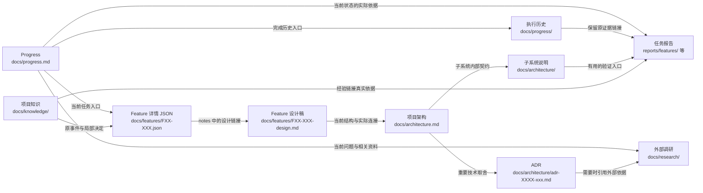
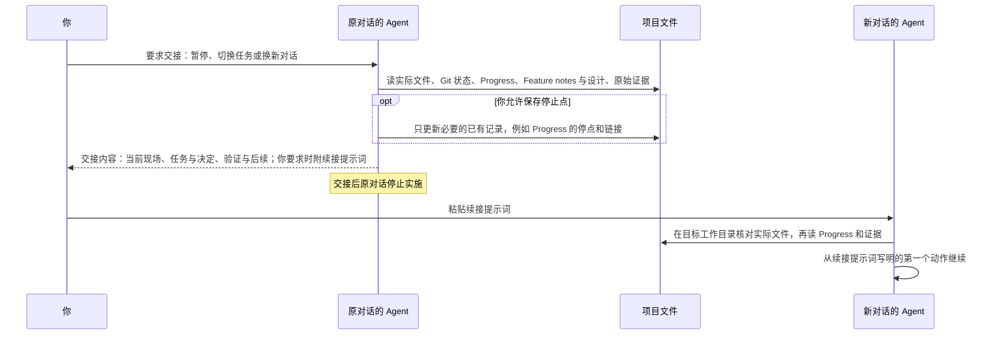

# 知识、设计与记录

[Godot 项目手册](../README.md)

本页说明术语、Feature 设计稿、架构、ADR、规则、调研、知识、报告与续接信息分别放在哪里。要写下一项长期内容或过程记录、又不确定放在哪里时读。

长期定义、当前结构、历史决定、外部调研和执行进度，分别有各自的存放位置。每项内容只按实际需要保存一次，其他地方链接它；有模板不代表要把所有文件都建出来。要求必须写在工具会读取的正式文档里，不能只写在过程记录中。

## 该写在哪里

下表列出术语、设计、架构、知识和过程记录的位置；GDD、Product、专业规格和项目规则的位置见[主要对象及读写关系](../foundations/03-project-layout.md#主要对象及读写关系)。

| 位置 | 写什么 | 不写什么 |
| --- | --- | --- |
| `docs/terminology.md` | 已确认的项目术语：标准名称、定义、关系与别名 | 详细数值和行为规则（写在 GDD） |
| `docs/features/<Feature ID>-design.md` | 该 Feature 的实施设计、局部技术决定与理由：职责、生命周期、接口、失败处理、实施顺序和验证理由 | AC、测试映射等结构化验证字段（写在 Feature JSON）；范围内额外的性能、时长、显示或试听检查可以写在这里 |
| `docs/architecture.md` | 项目级的模块关系、装配与依赖，以及项目级的独立技术决定（与当前结构分开写） | 子系统内部细节 |
| `docs/architecture/<subsystem>.md` | 子系统内部的结构、状态、接口与运行流程，以及该子系统的独立技术决定 | 项目级关系 |
| `docs/architecture/models/<subsystem>.tla` 和同名 `.checks.json` | 子系统当前行为的 TLA+ 模型和检查配置，随行为变化由后续 Feature 更新 | 需求正文（写在 GDD 和 AC）；检查结果（写在 `reports/model-checks/`，设计稿链接） |
| `docs/architecture/adr-NNNN-<slug>.md` | 符合 ADR 条件的跨 Feature、跨模块或项目级技术决定的理由 | Feature 内部的普通选择 |
| Feature 的 notes | 任务提醒、简短的事件教训、TODO 和正文链接 | 实施决定与理由（写在设计稿） |
| `docs/knowledge/` | 可复用的项目实践及其适用条件 | 规则或需求的正文 |
| `docs/lessons.md` | Agent 自己的流程失误、出现次数和升级条件，见[Lessons](../../../project-source/methodology/09-records-reports-and-handoff.md#lessons) | 引擎、语言、工具怎样运作（写知识条目） |
| `docs/research/` | 外部来源的结论、证据、建议和未知项 | 项目自己实测得到的经验 |
| `docs/unadopted-ideas.md` | 暂不采纳的设想及原因；变成当前比较的选择或被采纳时，迁走正文并留下去向链接 | 开发承诺 |
| `docs/progress.md` | 当前任务和阶段、真实的阻塞、待决定事项、下一步和资料链接 | 已完成任务的完整历史 |

下图是这些记录之间的主要关系，箭头的三种含义见[主要对象及读写关系](../foundations/03-project-layout.md#主要对象及读写关系)：

用文字说：

| 起点 | 终点 | 关系 |
| --- | --- | --- |
| Progress | Feature 详情、执行历史、外部调研 | 入口：当前任务、完成历史和当前问题的相关资料 |
| Progress | 任务报告 | 引用依据：当前状态所依据的实际报告 |
| 执行历史 | 任务报告 | 引用依据：归档时保留原证据链接 |
| Feature 详情 | Feature 设计稿 | 入口：notes 中的设计链接 |
| Feature 设计稿 | 项目架构 | 引用依据：设计依据当前结构与实际连接 |
| 项目架构 | 子系统说明、ADR | 入口：子系统内部契约和重要技术取舍 |
| 子系统说明 | 任务报告 | 引用依据：有用的验证入口 |
| ADR | 外部调研 | 引用依据：需要时引用外部依据 |
| 项目知识 | Feature 详情、任务报告 | 引用依据：知识条目链接原事件、局部决定和真实依据 |

GDD 内部的主题分工见[GDD 是项目开发的前提](../requirements-and-tasks/requirements-and-planning.md#gdd-是项目开发的前提)。这里补充几个常被问到的位置：世界观、角色与故事梗概写在 `concept-and-experience.md`；内容定义的目录跟随所属系统；内容的排布与节奏写在 `progression.md`。草案、已采纳的决定和实际验证状态要分开写。

备选方案和暂不采纳的想法怎样分流，见需求与规划的[备选方案与未采纳想法](../requirements-and-tasks/requirements-and-planning.md#备选方案与未采纳想法)。除 `design-gdd` 外，`grill-me` 也可以保存用户明确要求“以后再考虑”的想法；纯讨论不写文件。

### 项目术语

项目术语的定义固定由 `terminology-register` 维护在 `docs/terminology.md`；即使某个术语目前只用于一个主题，也写在这里。

- 编写或整合 GDD 时，一并保存当前范围内已确认的术语，并把其他正文中重复的定义改为引用。
- 普通的解释和例子仍留在对应主题里，不另建词表。
- 只有含义确实有歧义时才向用户提问；已确认的含义不重复询问。还没有确认的术语时，文件只保留用途说明。

例如三消游戏中“棋子 / 方块”“重新随机 / 洗牌”和“死局”的简明定义写在项目词表；匹配条件、死局的检测时机、洗牌保留哪些对象和恢复流程写在 GDD；按钮状态和反馈形式写在表现文档。缺少的决定会影响哪些后续工作，按 [GDD 是项目开发的前提](../requirements-and-tasks/requirements-and-planning.md#gdd-是项目开发的前提)判断。

## 局部设计与当前架构

### Feature 设计稿

实施设计和局部决定固定写在同编号的 `<Feature ID>-design.md` 中，简短的说明也写在这里；notes 只保留提醒、事件教训和引用。有真实内容时才创建设计稿，不按游戏规模、篇幅或复杂度换位置，也不预建空文件。

- **怎样引用**：在该 Feature JSON 的 notes 中使用相对链接 `[设计说明](<Feature ID>-design.md)`。
- **何时写、何时改**：方案获批后保存；实际实现与设计不一致时同步修改。
- **怎样写理由**：引用适用的工程规则并说明为什么适用，不复制整份规则。规则链接按设计稿所在目录写相对路径，例如 `../../yaya/methodology/03-execute-loop.md`。

需要实施指导时，[implementation-guidance](../../../project-source/skills/implementation-guidance/SKILL.md) 也写这同一份设计稿：

- 只支持已有的 Feature（包括工程 Feature），不额外生成带模型名、日期或“guide”后缀的副本。
- 内容说明关键约束怎样影响设计、接口与生命周期、必要的依赖顺序和验证理由，不预先规定每个函数怎么写。

保存时机：

- **普通实施**：Stage 1 提出方案和未决的选择，Stage 2 获批后保存；已有设计稿就更新原文件。
- **只授权交付指导文档时**：同样在获批后保存，但不进入完整的 Stage 2，不推进实施状态，也不改测试计划。
- **明确委派了顾问时**：顾问只能写获批的设计稿；Feature notes 中的链接、Progress 等记录由原负责人按本次授权维护。

设计稿是解释材料，不能代替需求、规则、AC 或测试登记表。它的修改同样会改变内容指纹，旧的验证结果不会自动适用于新的设计。

### 架构文档

- **`docs/architecture.md`**：项目级的模块关系、装配与依赖。它链接各子系统文档和已有的模块 README，不预设 Bootstrap 或 Autoload。
- **`docs/architecture/<subsystem>.md`**：子系统内部的职责、状态、接口和运行流程。运行说明按需要写出触发条件、状态变化、Godot 生命周期和失败路径。
- **`docs/architecture/models/`**：有命名状态、按事件或时间转换的子系统，在 Stage 1 用 [behavior-model-check](../../../project-source/skills/behavior-model-check/SKILL.md) 建立 TLA+ 模型，用 TLC 在写代码前检查设计。模型描述当前行为，之后改这个子系统的 Feature 更新同一个模型；写模型依据的状态 × 事件对照表写在子系统文档里，同样增量更新。TLC 通过只说明设计在模型范围内成立；代码是否正确由从模型改写的 GdUnit4 测试证明，模型检查的结果不进入完成证据。

两者都根据已有事实补充，按作用范围（项目级还是子系统级）选择文件，而不是按复杂度。

架构记录的是真实的协作关系，不重新定义玩法（参见[游戏逻辑、表现与协作](../foundations/02-game-logic-and-presentation.md)）。以商店为例：GDD 写购买条件，UI 文档写商店操作，表现文档写获得物品的反馈；架构说明哪个对象处理购买、谁维护余额和背包、界面怎样读取状态并响应结果。某个任务改变了这些连接时，实施理由写进它的设计稿，当前结构按作用范围更新到对应的架构文档。不需要为了“逻辑 / 表现”两层而虚构模块或预建空文档。

画结构图时：

- 箭头要标明含义：代码依赖、装配、继承、消息还是时序。
- 静态的引用搜索看不出动态加载、运行时 Signal 和真实的状态归属。
- 观察到的、推断的、建议的和已实现的行为要分开写。
- 职责、路径、入口和理由引用各自所属的正文。旧设计如果准确记录了过去的状态，保留为历史，不要改写成“一直如此”。

设计新的核心对象或调整结构时，依据已确认的行为、状态与生命周期、调用方的负担和真实的依赖来判断，比较复用、不改、局部修正、删除或合并、必要的新增这几种做法。API 更短、文件更少或用了某种设计模式，本身都不算收益；枚举状态、Command、序列化或新的管理层只为实际用途服务，不为假想的未来预建体系。方法见[架构概览](../../../project-source/methodology/10-architecture-overview.md)。

## ADR 的阈值

跨 Feature、跨模块或约束项目后续工作的技术选择，**同时**满足以下三个条件时，理由必须写进 `docs/architecture/adr-NNNN-<slug>.md`：

- 撤销它有实质成本。
- 只看源码和当前结构，难以还原当初为什么这样做。
- 确实存在其他备选方案和重要的取舍。

其他情况：

- **Feature 内的普通选择**：写在该 Feature 的设计稿里。
- **理由已经写在别处**：不能因此跳过符合条件的 ADR；把当前正文迁到 ADR，更新引用，保留必要的历史。
- **不属于任何 Feature 的技术决定**：按[独立技术决定](../../../project-source/methodology/10-architecture-overview.md#独立技术决定)保存，符合 ADR 条件的仍写 ADR，其余按作用范围写进架构文档的固定章节；不为此虚构 Feature。

ADR 记录问题、约束、备选方案、决定、收益、成本、依据，以及什么情况下值得重新考虑。状态有 Proposed、Accepted、Superseded：被取代的 ADR 保留原来的理由并链接替代它的决定；Accepted 只表示决定已确认，不表示代码运行通过。已有具体授权时直接沿用，不需要额外批准。

## 探索结果与工作目录

[wayfinder](../../../project-source/skills/wayfinder/SKILL.md) 的结论按本页的分工存放：

- 一次性的讨论可以只留在对话里。
- 需要续接、并且获准记录时，在 Progress 中保存当前问题、待决定事项、下一步和材料链接。
- 局部的实施决定写进 Feature 设计稿，notes 只保留提醒和引用。
- 外部调研的结论写进研究资料，真实运行的结果放在已有的报告位置。
- 重要的技术决定仍按 ADR 阈值判断；采纳的游戏规则和交付边界回到各自的 GDD 和 Product。

不为探索另建记录文件或默认报告。

使用 worktree 时，续接信息还要写明实际的工作目录和当前版本，让下一次工作能找到正确的现场。源码、被忽略的本机材料和运行证据仍各有存放位置；只看代码提交，无法确认另一个目录有相同的数据或证据。记录了结论不等于批准采用某套实现，采用了成果也不等于可以清理它所在的目录。准备和整合由对应的 Skill 负责，见[逐步探索与 worktree](../methods-and-tools/skills-and-agents.md#逐步探索与-worktree)。

## 项目规则与领域规则

| 位置 | 作用 |
| --- | --- |
| 根目录 `AGENTS.md` | 规则入口 |
| `docs/project-rules.md` | 项目的开发约束、协作与工程原则；需要游戏设计边界时引用 GDD |
| `yaya/agent-rules/` | 按领域划分的工程规则 |
| `yaya/methodology/` | 流程与验证规范 |

领域规则可以叠加，例如测试用的 `.gd` 文件同时遵守脚本规则和测试规则。按当前修改涉及的领域读取对应 README 中的路由，不需要每次通读全部目录。

| 领域 | 规则目录 |
| --- | --- |
| 通用、GDScript | `00-core/`、`10-gdscript/` |
| Scene、Resource、Shader | `20-scenes/`、`21-resources/`、`30-shaders/` |
| 项目配置、导出 | `40-project-config/`、`41-export-config/` |
| 数据、资产、测试 | `50-data-files/`、`60-assets/`、`70-tests/` |

### 怀疑规则有问题时

规则可能过时或范围过宽。怀疑时，指出具体条款、相关事实和影响，把“代码是否符合规则”和“规则本身是否正确”分开判断。

- 有理由地偏离一条“建议：”规则，不必因此修改规则。
- 不能因个人偏好暗中豁免规则。
- 不要把每个 Bug 的教训都升级成硬性规则。

### 修改规则前的自查

增加、修改或删除规则之前，先做一次自查。自查结果默认只写在对话里；用户明确要求或交接需要时，按[规则的增量维护](../../../project-source/methodology/04-project-rules.md#规则的增量维护)另存，但不建规则记录文件；同时改多条规则时，可以合写一份说明，但每条修改都要能在说明里找到对应内容。自查回答这些问题：

- **改了什么、依据是什么**：原文和修改后的内容、真实的依据、长期价值，以及这条规则该归哪里。
- **范围与影响**：强度和适用范围，与其他规则是否重复或冲突，对下游的影响。
- **结论与授权**：判断结论，以及已有的授权。
- **删除或只改措辞时**：删除要说明谁承接了原来的作用，或为什么不再需要；只改措辞或链接时，说明含义和强度没有变化。

规则变化后，先处理它对当前任务的实际影响，已有的具体授权继续有效；只有出现新的决定才需要等用户确认。修改原 Feature 中的辅助文档，不需要另开一个“必须先清空工作区”的任务。相关记录在最终验证前定稿；规则在最终测试或人工接受之后才采纳时（例如 Stage 5.5），也要检查哪些已有证据因此失效。细则见[规则的增量维护](../../../project-source/methodology/04-project-rules.md#规则的增量维护)。

## 调研与项目知识

### 调研

调研按问题需要进行，可以直接查询，也可以委派给 researcher，不是每个 Feature 的必经步骤。

- **版本**：涉及引擎或 API 时写明实际版本，并核对读过的页面；“stable”“latest”不能代替版本号。
- **来源区分**：一手资料的事实、项目上的推断和本地实测分开写。资料抽取不完整或代码缺失时，保留原文链接并说明限制。
- **何时保存**：有长期价值时写到 `docs/research/<明确主题>.md`；同一主题优先更新已有的报告。重要结论变化时，保留日期、原因和被引用的历史。
- **至少包含**：问题与范围、日期和适用环境、结论、依据、建议和未知项；详细的报告格式由 researcher 的角色配置维护。
- **调研不等于采纳**：被采纳的游戏设计回到 GDD，交付安排回到 Product，其他决定回到专业来源、设计稿或 ADR。研究建议不会自动变成要求。

### 项目知识

知识目录初始有 `godot-runtime/`、`gdscript/`、`debugging-testing/`、`tools-pipeline/` 四个主题索引。

- **怎样保存**：每条独立的经验一个 Markdown 文件，在主题索引中加链接和简述。按真实内容扩展，不为每个 Feature 建目录，也不在多处复制。
- **写什么**：场景、有效的做法或根因、适用范围和真实依据；成功的经验不需要编造根因。原始事件留在 Feature notes 中，知识条目提炼方法并链接原件。
- **怎样查阅**：规划、调试、实现或审核时，按问题找到相关的已有经验，并核对版本条件；索引为空不影响工作，续接时可以复用已经读过的有效内容。
- **何时写入**：只读请求不授权写入知识。已授权且有价值的知识，在收尾提交前保存。
- **对验证的影响**：知识和调研中的 Markdown 不参与内容指纹，修改它们不会让业务测试失效；可执行文件、规则和契约仍按实际范围检查。

## 报告与历史

工具生成的原件使用固定路径，自定义的结果按[模板与按需记录](../foundations/03-project-layout.md#模板与按需记录)中的位置存放；正式证据和临时输入分开。直接引用 gdUnit 的原件，额外的控制台日志只补充原件里没有的信息。不新建报告总索引，也不用“final”这样的文件名代替有效的结果。

- **临时材料要跨任务保留时**：在现有的 notes 或 Progress 中说明用途，以及什么时候可以不再保留。
- **哪些证据要保留**：当前验收、未解决的失败、后续工作、历史和知识条目所引用的证据。
- **重新归组时**：同时核对生成报告的命令、读取报告的脚本和引用，不能只移动文件；工具原件不要随意迁移。
- **清理**：清理是需要明确范围的维护操作。文件旧、未被跟踪、之后有成功的结果、所在目录叫 scratch，都不代表可以删除。

Progress 保存真实的停点和必要的链接；不能从“下一步：实施”推断出已获批准。当前状态只写仍在进行、正在等待或接下来要做的事：Feature 完成并归档后，从当前状态删掉它的条目，只在历史索引留链接；已经不成立的说法随更新一并删掉。正式完成的执行历史，每项归档一份到 `docs/progress/<key>.md`：已有记录先读，保留原文和证据；尚未解决的事项仍留在当前的交接内容中，不在每个阶段重复复制报告。提交代码不能保证默认被忽略的报告也出现在另一个目录或另一台机器上。

## 任务续接需要的信息

交接内容按三个主题组织：

- **当前现场**：真实的项目路径、分支和现有的改动。
- **任务与决定**：目标和最新的要求、有效的决定和授权、实际所处的阶段。
- **验证与后续**：做了和没做的验证、证据，以及下一步。

未知的内容保持未知；还没结束的命令，说明已知的状态。

下图是换对话续接时，交接内容从哪里来、新对话从哪里恢复：

用文字说：原对话的 Agent 从实际文件、Git 状态和记录里找回停点，你允许时只更新必要的已有记录，再交出交接内容。新对话的 Agent 拿到续接提示词后，先在目标工作目录核对实际文件，再从写明的第一个动作继续。续接提示词的格式见记录、报告与交接的[续接提示词](../../../project-source/methodology/09-records-reports-and-handoff.md#续接提示词)。

- **交接后**：原对话停止实施。接收方先在任务的目标工作目录核对实际文件，再继续。同一目录续接时沿用原目录；已明确指定 worktree 时，以该 worktree 为准。
- **会话摘要**：只帮助定位，不能代替权威文件。换对话不需要清空现场、提交半成品、另开分支、新建 worktree 或重跑全部检查。
- **临时限制**：交接过程中的临时只读或输出限制，不会一直约束接收方之后获得授权的工作。

不建立 Handoff 文件、`CONTEXT.md` 或平行的任务状态表。

权威依据：[记录、报告与交接](../../../project-source/methodology/09-records-reports-and-handoff.md)、[项目术语文件](../../../project-source/methodology/14-project-terminology.md#项目术语文件)、[架构概览](../../../project-source/methodology/10-architecture-overview.md)。
