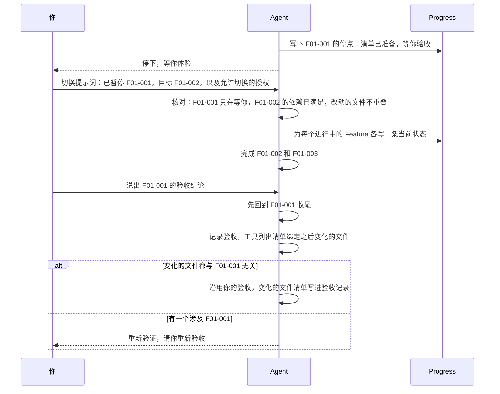

# 教程二：完成第一个 Feature：视觉样例、等待验收与收尾

[Godot 项目手册](../README.md) · 上一篇：[教程一：从空白项目到第一份 Feature 计划](01-blank-project-to-feature-plan.md) · 下一篇：[教程三：交付后维护：修正时过时不过的测试](03-fix-a-flaky-test.md)

本篇接着三消示例，完成第一个 Feature：F01-001 棋盘主界面的视觉样例。它需要你亲眼看过才能定下参数，正好走完一个 Feature 的全部环节：

1. Agent 实现视觉样例，准备人工验收清单；
2. 等你体验期间，Agent 先推进不相关的 F01-002、F01-003；
3. 你说出验收结论，Agent 记进清单；
4. Agent 收尾，把 F01-001 标记为完成。

示例项目、提交编号和路径的读法见教程一的[示例项目与阅读方式](01-blank-project-to-feature-plan.md#示例项目与阅读方式)。

## 开始执行 F01-001

使用「实施与调参 → Feature 已规划并可开始，现在实施这一项」，材料填 `F01-001`。

Agent 按 Stage 0～8 执行，各阶段的产出见[Feature 的执行阶段](../requirements-and-tasks/feature-lifecycle.md#feature-的执行阶段)。本篇只讲你会直接感受到的几处：

- **Stage 2**：Agent 把实现方案写进 `docs/features/F01-001-design.md`，Feature 状态变为 `in_progress`。
- **Stage 4**：Agent 准备人工验收清单，停下来等你。
- **Stage 5**：你体验后给出结论。
- **Stage 7、8**：Agent 记录完成，报告下一步。

## 视觉样例怎样做

示例的样例（`9218fde`）是一个独立运行的场景 `game/board/prototype/board_visual_prototype.tscn`。它只用本地示例状态展示 8×8 棋盘、背景与格色、6 色棋子、按钮预留区、选中标识和两种轻抖，不接正式的游戏规则。这个示例早于调试台。现在同类工作这样做：

1. **骨架**：先在游戏里做棋盘最小的真实状态，外观用占位。格子尺寸、色值、轻抖的幅度和时长放进 `game/board/tuning/` 下的调参资源。
2. **在调试台定画面**：Agent 为棋盘登记插槽、候选和固定局面。你用项目 `dev/debug/README.md` 中的启动命令打开调试台，比较候选、调参，满意后点“采纳到游戏”。
3. **收尾再验收**：Agent 收尾提交，再准备人工验收清单。

**文档只链接资源**：`docs/ui/game-board-design.md` 和 `docs/art/art-bible.md` 链接采纳后的调参资源，不另抄一份数值，所以文档和游戏不会出现两套参数。

- **你验收的是什么**：收尾后游戏文件里的值，即游戏原值。
- **你要求调整时**：在调试台改好再采纳一次。这一轮验收按不通过处理，Agent 收尾后重新准备验收。

规则见[界面的开发顺序](../../../project-source/methodology/13-debug-console-and-validation.md#界面的开发顺序)与[采纳到游戏](../../../project-source/methodology/13-debug-console-and-validation.md#采纳到游戏)。

**观察要分清实测和推断**：设计稿记录样例的观察结果时，写明是实际运行看到的，还是推断的。

示例的教训：F01-001 把“窗口不是 16:9 时会露出默认清屏色”当成事实写下，F01-006 照此把清屏色设成背景色。实测后发现，那条边是引擎画的黑边，设置清屏色没有作用，返工了一次（`eea1851`）。

## 准备人工验收清单

F01-001 的每条 AC 都带有人工检查项。Stage 4 时，Agent 把它们整理成一份清单，保存在 `reports/manual-acceptance/F01-001/manual-acceptance-checklist.json`，并绑定当时的内容。F01-001 的清单共 8 项。

清单的每一项写明入口、操作和应该看到的结果，例如：

> 点击棋子后所在格四角出现中性浅色标识，同一时刻只有一处，转选时标识移到新格，棋子本身不被高亮。

Agent 把停点写进 `docs/progress.md`，然后停下等你体验。清单格式见[人工验收文件](../../../project-source/methodology/contracts/manual-acceptance-files.md)。

## 等待验收时先做别的 Feature

人工验收要等你有空，但 Agent 不必干等。下图是示例中你和 Agent 怎样轮流推进几个 Feature，图后各段写每一步的条件和做法：

**可以并行的条件**：

- 原 Feature 只在等外部输入（你的验收结果、你的决定或你提供的文件），停点已记在 Progress。
- 新 Feature 的依赖已经满足。
- 新 Feature 要改的文件和原 Feature 不重叠。

**怎样发起**：使用「现状、暂停与续接 → 当前任务已经暂停，准备切换到另一项工作」，材料填已暂停的 F01-001、目标 F01-002，以及你允许切换的授权。规则见 [Stage 0 · 选择 Feature 并加载上下文](../../../project-source/methodology/03-execute-loop.md#stage-0--选择-feature-并加载上下文)中的等待例外。

**示例怎样做的**：F01-001 等验收期间，F01-002（生成合格的初始棋盘，`dfc3e78`）和 F01-003（结算一轮消除与连锁，`3c673ab`）都完成了。它们没有改动 F01-001 的样例、清单或参数。

**Progress 怎样写**：同时有多个进行中的 Feature 时，“当前状态”为每个各写一条：所处 Stage、停点、正在等什么，以及输入到达后的第一个动作。

**你回来验收时**：Agent 先回到 F01-001 收尾，再继续别的工作。

并行期间，别的 Feature 也会提交改动。所以记录 F01-001 的验收时，工具会发现清单绑定之后项目内容变了，并列出变化的文件。Agent 逐个核对：

- **都与 F01-001 无关**：沿用你的验收，变化的文件清单写进验收记录。
- **有任何一个涉及 F01-001**：需要重新验证、重新请你验收。

细节见[绑定之后内容又有变化](../../../project-source/methodology/contracts/manual-acceptance-files.md#绑定之后内容又有变化)。

## 记录验收结论

**体验**：你实际运行样例，对照清单逐项检查。

**告诉 Agent 结论**：使用「审核与人工验收 → 已经实际体验，记录验收结果」，材料填 Feature ID、你接受或拒绝的范围，以及你的原话。例如“F01-001 全部接受，参数也接受”。

**Agent 怎样记录**：

- 它把你的结论写进清单对应项的状态，备注写明“来自对话”和你的原话，再用记录命令保存。
- 结论没覆盖全部检查项、或者含义不清时，它会追问。
- 你也可以直接编辑清单，两种方式记到同一个地方。

**什么不算接受**：只有你的真实结论才算。“继续”、没有表态、自动测试通过，都不算接受，见[自动与人工验收](../requirements-and-tasks/feature-lifecycle.md#自动与人工验收)。

示例中，用户体验后接受了全部 8 项和参数（`f3d8a36`）。

## 收尾：记录验收不等于完成

记录验收只保存你的结论，本身不推进 Stage，F01-001 此时仍是 `in_progress`。接下来是否要你再发提示词，取决于在哪里记录：

- **在执行 F01-001 的原对话里**：你当初授权的是完整执行 F01-001，这个授权仍然有效。Agent 记录完验收会直接继续收尾，不需要再发提示词。
- **单独发了登记提示词**（例如换了新对话），或你要求先暂停：记录完就停下。要收尾时，不论是否换了对话，都用「现状、暂停与续接 → 继续上次没做完的 Feature」。新对话只凭项目里的文件就能找到停点。

**Agent 收尾时做什么**：

1. **Stage 7**：检查完成证据和 Feature 记录，全部满足后把 F01-001 标记为 `done` 并写入完成时间。F01-001 没有自动测试义务，测试运行器返回 `not_required`，这表示“不需要自动测试”，不是“测试通过”。
2. **归档**：把执行历史移到 `docs/progress/F01-001.md`。`docs/progress.md` 的当前状态删掉 F01-001 的条目，只在历史索引留一个链接。
3. **Stage 8**：报告交付内容，找出下一个可以开始的 Feature。示例中是 F01-004 和 F01-005。

示例的收尾提交是 `5373eea`。命令与完成证据的关系见[记录完成证据](../methods-and-tools/commands-and-evidence.md#记录完成证据)。

**示例的教训**：示例是单独发登记提示词记录验收的，登记完 F01-001 一直停在进行中，又续接了一次才走完 Stage 7、8。单独登记时，记得接着发续接提示词。

## 之后的 Feature

示例接着用同样的方式完成了 F01-004～F01-007，然后按教程一的第 4、6 步细化第二个 Product（死局恢复与洗牌），拆出并完成 F01-008～F01-012。

两个 Product 交付之后，示例在测试中发现一个时过时不过的测试，见下一篇：[教程三：交付后维护：修正时过时不过的测试](03-fix-a-flaky-test.md)。
