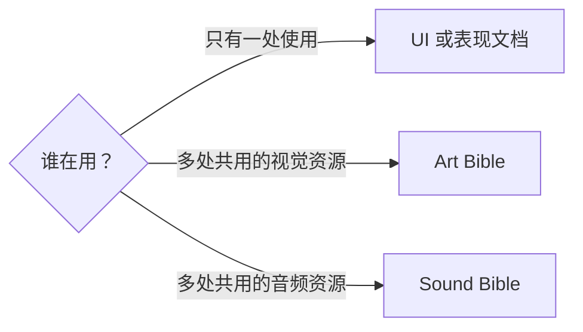
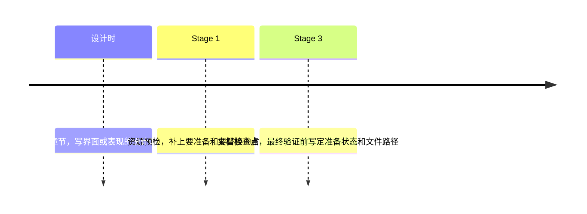
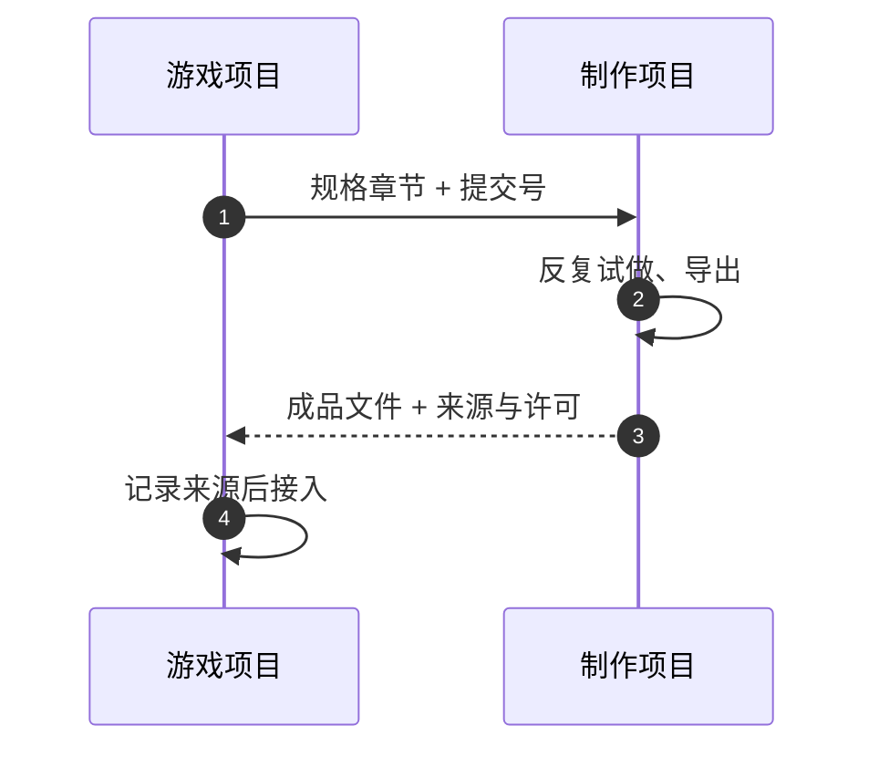
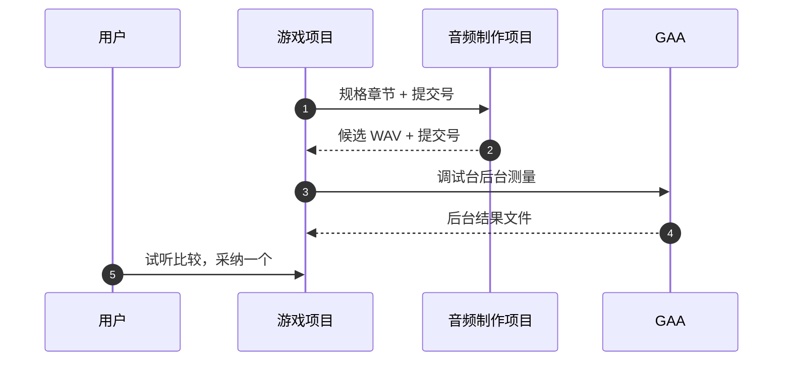
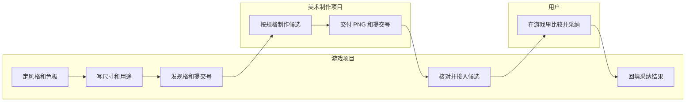
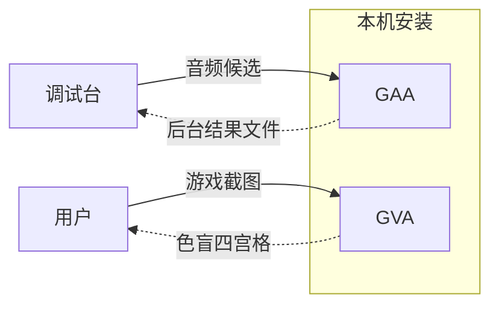

本页收集关于游戏资源的问答：规格写在哪里、在哪些项目制作和交换、能用什么方式制作，以及字体授权。

## 资源需求清单写在哪里，什么时候产生？

**结论**：框架不建单独的资源清单。资源的规格和准备情况，写在用到它的那份设计文档里，放在资源章节，交付时由 Agent 在回复中汇总要准备什么。

**为什么**：同一个资源的要求如果同时写在设计文档和一份清单里，改了一处就会和另一处不一致。所以框架按“谁在用”决定位置：

资源条目在三个时间点出现或更新：

负责写规格的是 `design-visual-asset-spec` 和 `design-audio-asset-spec` 两个 Skill，它们只写规格，不制作文件。

**依据**：[资源需求与交接](../../project-source/methodology/11-specialist-workflows.md#资源需求与交接)、[1B. 资源](../../project-source/methodology/03-execute-loop.md#1b-资源)、[3D. 最终验证前的文档检查点](../../project-source/methodology/03-execute-loop.md#3d-最终验证前的文档检查点)、[资源规格随所属设计保存](../godot-project-manual/specialist-work-and-records/specialist-work.md#资源规格随所属设计保存)

## 图片和音频为什么不在游戏项目里制作？

**结论**：游戏项目负责资源的方向、规格、接收、接入和审核；制作放在项目外独立的制作项目里做。游戏项目交出规格章节和提交号，收回成品后记下来源再接入。

**为什么**：制作和游戏开发的节奏不同。两边只交换规格和成品：

分开的原因：

- 制作要反复试：调合成参数、改图形、重新导出、试听或对比。这些中间文件和脚本放进游戏仓库，会让提交历史混乱；而且游戏项目的来源文档每改一次，已有的验证证据就可能失效。
- 美术和音频的工具链完全不同，各自需要自己的母版、导出步骤和检查方法，放在同一个游戏项目里没有好处。
- 游戏项目只需要知道“要什么”（规格）和“拿到了什么”（实际文件、来源和许可）。中间怎样做出来，由制作项目自己记录。

制作项目只能单独听、单独看。放进实际画面和操作节奏里好不好，仍然要接入游戏后由用户判断；需要比较几个版本时，把它们作为调试台候选在游戏中对比。

**依据**：[在项目外制作](../../project-source/methodology/11-specialist-workflows.md#在项目外制作)、[交接与接收文件](../../project-source/methodology/11-specialist-workflows.md#交接与接收文件)

## 游戏项目和制作项目之间交换什么，提交号有什么用？

**结论**：只交换两样东西，一来一回，各带一个提交号。游戏项目交出资源规格所在的文件和章节；制作项目交回成品文件。提交号说明指的是哪一版。制作项目内部怎样做，游戏项目不管，框架也不写。

**为什么**：以“给购买按钮做一个成功音效”为例：

| 方向 | 交出什么 | 提交号回答什么问题 |
| --- | --- | --- |
| 游戏项目 → 制作项目 | 规格所在的文件和章节，例如商店界面设计的资源章节 | 这批成品按哪一版规格做；规格改了以后，看它判断要不要重做 |
| 制作项目 → 游戏项目 | 成品文件、母版位置和一句生成方法 | 游戏里用的是哪一版成品；以后要改，从哪份母版接着改 |

游戏项目接收时，把这些写进资源条目的来源。制作项目可以把规格抄进自己的作品记录当制作说明，但规格正文仍只在游戏项目那一节。

两边只交换内容、不引用对方的规则文件，是因为各自改做法时不用通知对方。例如制作项目换了合成方法或测量命令，只要交出的成品仍符合规格，游戏项目和框架都不用跟着改。反过来，框架如果复述了制作项目的内部步骤，对方一改，这段复述就过期了。

**依据**：[在项目外制作](../../project-source/methodology/11-specialist-workflows.md#在项目外制作)、[资源需求与交接](../../project-source/methodology/11-specialist-workflows.md#资源需求与交接)

## 资源规格要先转成提示词再制作吗？

**结论**：不需要。制作项目直接按游戏项目的资源规格制作，中间不加一层提示词格式。只有制作时用 AI 生图或生音频工具，才需要写提示词；这时提示词是制作项目内部的母版，游戏项目不写，框架也不规定格式。

**为什么**：

- **制作方式用不上提示词**：Agent 读规格后直接写源文件，例如 SVG 母版或合成脚本，再导出成品。中间没有按提示词出图的工具。
- **整理需求的一步已经存在**：制作项目接活时，把规格抄进作品记录的制作需求表，按用途、尺寸、风格、验收条件逐项填写。再加一层提示词，同一份需求就有三份，改一处其余两处就会对不上。
- **规格缺内容时回去补规格**：转写提示词时，Agent 只能自己补出规格没写的细节，这些细节没人确认，也不在游戏项目里。应该由制作项目写出缺口，请游戏项目补规格。规格普遍太粗时，改写规格的两个 Skill，而不是在中间加转换。

| 制作方式 | 需不需要提示词 | 放在哪里 |
| --- | --- | --- |
| 手写 SVG、代码合成 | 不需要 | 母版就是源文件本身 |
| AI 生图、AI 音频服务 | 需要 | 制作项目的作品源文件目录，和工具、版本、许可一起记录 |

制作派给其他 Agent 时，派活提示词要写得规整，但那是派工内容，不是资源规格的一部分。

**依据**：[在项目外制作](../../project-source/methodology/11-specialist-workflows.md#在项目外制作)、[编写资源条目](../../project-source/methodology/11-specialist-workflows.md#编写资源条目)

## 做一个音效会用到哪几个项目，各管什么？

**结论**：三个。游戏项目提要求、接入和判断效果；音频制作项目把声音做出来；Game Audio Analyzer（GAA）只负责测量，调试台调用它显示候选的指标。GAA 不是第二个制作项目。

**为什么**：以“给购买按钮做一个成功音效”为例，游戏项目和制作项目之间只交换内容：

| 项目 | 做什么 | 不做什么 |
| --- | --- | --- |
| 游戏项目 | 写规格、接收候选、在调试台比较 | 不写合成脚本，不保存母版 |
| 音频制作项目 | 按规格制作并交付成品；怎样制作由它自己的规则决定 | 不判断游戏里的实际效果 |
| GAA | 测量 | 不制作声音；调试台只读数值，不画图 |

三者分开，是因为变化原因不同：制作要反复试，中间文件不该进游戏仓库；测量方法要在多个游戏之间保持一致，所以作为独立工具，不复制进任何一个项目。GAA 装在本机分析用的 Python 环境里，游戏项目通过配置项指向这个解释器。美术那边同样有一个测量工具 Game Visual Analyzer（GVA）；游戏项目不配置它，要检查游戏画面时，用户截图后在 GVA 里运行。

**依据**：[在项目外制作](../../project-source/methodology/11-specialist-workflows.md#在项目外制作)、[框架术语](../terminology.md)中的“制作项目”、[分析](../../project-source/defaults/dev/debug/_shared/README.md#分析)

## 做一张游戏图片会经过哪些项目和步骤？

**结论**：会经过游戏项目和美术制作项目，检查游戏画面时还会用到测量工具 GVA。

- 游戏项目：定美术方向、写规格，接收成品、接入，并由用户在游戏里采纳。
- 美术制作项目：按规格做出候选并交付；用什么工具、怎样测量和看图，由制作项目自己的规则决定。
- Game Visual Analyzer（GVA）：只做测量；游戏画面由用户截图后在 GVA 里测。

游戏项目只接收运行时文件，例如 PNG；可编辑母版留在制作项目。框架仓库本身不参与制作，它提供游戏项目里的规则和 Skill。

**为什么**：以“给放置游戏的蘑菇棚做一张图”为例，游戏项目和制作项目之间只交换内容：

游戏项目这一侧各步骤由哪项能力负责：

| 步骤 | 负责的能力或规则 |
| --- | --- |
| 定风格、色板、最小细节尺寸 | `design-art-direction`，写进 Art Bible |
| 写单张图的尺寸、透明度、用途 | `design-visual-asset-spec`，写进用到它的设计文档 |
| 接收、比较候选、采纳 | 接收步骤、调试台候选、`content-asset-integration` |
| 导入设置和游戏里的最终显示 | 素材与导入规则；画面由用户人工验收 |
| 独立审核（用户要求时） | `review-art` 看风格，`review-assets` 看导入和来源 |

分开制作，是因为两边变化的原因不同：

- 制作要反复试做和导出，中间文件放进游戏仓库会弄乱提交历史。
- 游戏项目只保留规格正文和最终文件。色板、风格的正文只在 Art Bible 一处；制作项目使用时记下所读的提交号，不另存一份。

测量只排除明显问题；轮廓好不好看、候选选哪个，要靠人在目标尺寸和实际背景上看。文件导出成功、测量通过、导入成功和用户在游戏里看过，是四件独立的事，前三件不能代替最后一件。

**依据**：[在项目外制作](../../project-source/methodology/11-specialist-workflows.md#在项目外制作)、[资源需求与交接](../../project-source/methodology/11-specialist-workflows.md#资源需求与交接)、[交接与接收文件](../../project-source/methodology/11-specialist-workflows.md#交接与接收文件)、[分析](../../project-source/defaults/dev/debug/_shared/README.md#分析)

## 字体的内容分在好几处，合适吗？

**结论**：合适。各处写的是字体的不同方面，彼此不重复。共享字体方向写在 Art Bible，专用字体归所属的表现或界面设计。

**为什么**：各处由不同的原因决定，变化时各改各的：

| 内容 | 位置 | 什么时候会改 |
| --- | --- | --- |
| 字体的选择、风格 | 共享方向归 Art Bible；专用字体归所属设计 | 美术方向或所属设计变化 |
| 各语言要覆盖哪些字符、缺字时回退到哪款字体 | 本地化规范的“字体覆盖” | 增加或删除语言 |
| Godot 中怎样导入、复用和设置回退 | 工程规则「字体素材」 | Godot 用法变化 |

如果合成一份“字体文档”，换语言要改它，换美术风格也要改它，还容易和 Art Bible、本地化规范里的同类内容重复。实际字体文件、来源和许可按[资源需求与交接](../../project-source/methodology/11-specialist-workflows.md#资源需求与交接)写在所属资源条目中。单个表现、界面或组件专用的字体留在所属设计；多个独立使用方共享的字体归 Art Bible。

**依据**：手册[资源规格随所属设计保存](../godot-project-manual/specialist-work-and-records/specialist-work.md#资源规格随所属设计保存)一节末尾的字体说明、[字体素材](../../project-source/agent-rules/60-assets/font-assets.md)

## 调试台自己能测量音频和图片吗？

**结论**：调试台只测量音频，测量由本机安装的 Game Audio Analyzer（GAA）完成，调试台负责调用和显示，并把有效的基础频率换算成音名。调试台不分析图片；要检查游戏画面的色盲效果时，用户截图后在 Game Visual Analyzer（GVA）里运行。

**为什么**：

音效候选旁的九项指标直接读取 GAA 的后台结果文件，并按每项状态显示数值或原因；音名按十二平均律、A4=440 Hz 换算。未配置 GAA 时音频分析显示“未配置 GAA”，其他功能仍可使用。测量指标不代替实际试听或观察游戏画面。

**依据**：[分析](../../project-source/defaults/dev/debug/_shared/README.md#分析)

## 能用代码生成音效和音乐吗？能做到什么程度？

**结论**：能。界面反馈类的短音效最适合用代码合成；简单的循环背景音乐能做，但达不到专业配乐的水平；写实的环境声和有感染力的配乐不适合。

**为什么**：程序化音频（procedural audio，用代码按参数合成声音）有几类成熟做法：

| 做法 | 例子 | 适合做什么 |
| --- | --- | --- |
| 复古音效生成器 | sfxr 系列（jsfxr、Bfxr、ChipTone）、ZzFX | 点击、金币、升级、提示音 |
| 用脚本直接合成波形 | Python + numpy 写出 WAV；SuperCollider、Csound、Faust | 任何能用振荡器、包络、滤波和噪声描述的声音，参数全部可复现 |
| 用代码作曲再渲染 | 用 mido、music21 写 MIDI，用 FluidSynth 加音色库（SoundFont）渲染；Sonic Pi、Strudel | 旋律简单的循环音乐 |
| 游戏运行时合成 | Godot 的 `AudioStreamGenerator` | 随游戏状态实时变化的声音，不需要音频文件 |

各类声音是否适合用代码生成（按合成方法的能力判断，没有实测某个工具）：

| 声音 | 是否适合 | 原因 |
| --- | --- | --- |
| 点击、购买、升级、解锁这类短反馈音 | 很适合 | 本来就是合成音色，改几个参数就能得到明显不同的版本 |
| 氛围类循环背景音乐 | 能做 | 达不到专业配乐的水平 |
| 脚步、自然环境这类写实拟音 | 不适合 | 要靠录音或采样 |
| 需要编曲水平的配乐 | 不适合 | 要靠专业制作 |

Agent 能写合成脚本、导出文件，并测量时长、峰值、是否削波和循环接缝；但 Agent 听不到声音，好不好听只能由用户试听判断。用 SoundFont 或 AI 音频服务时，许可要单独核实。

**依据**：各工具的官方文档；Godot 文档中的 `AudioStreamGenerator`

## 游戏美术适合用 SVG 制作吗？

**结论**：图标、按钮、扁平或几何风格的角色和道具适合；手绘、厚涂、纹理质感、写实插画和像素画不适合。

| 美术类型 | 是否适合 SVG |
| --- | --- |
| 图标、按钮 | 适合 |
| 扁平或几何风格的角色和道具 | 适合 |
| 人物、动物这类有机造型 | 能做，但 Agent 手写效果偏弱 |
| 手绘、厚涂、纹理质感、写实插画 | 不适合 |
| 像素画 | 不适合 |

**为什么**：SVG 是矢量图，用路径和颜色描述形状，可以用脚本按统一的色板批量生成，风格容易一致。如果在制作项目里用 SVG 做母版、导出 PNG 交给游戏，就不会遇到下面这些限制；只有游戏直接导入 SVG 时才会遇到。Godot 中的限制有：

- **导入时就变成位图**：Godot 导入 SVG 时按 `svg/scale` 光栅化成普通纹理，运行时不是矢量。显示尺寸变大时，要调高 `svg/scale` 重新导入，不能直接放大节点。运行时也可以用 `Image.load_svg_from_string()` 按指定倍率重新光栅化。
- **文字先转成路径**：SVG 中的文字在绘图工具中先转为路径再导入，否则显示结果取决于字体是否可用。
- **不支持 SVG 自带的动画**：动画要把图拆成部件，在 Godot 中用 Tween 或 AnimationPlayer 做。
- **只支持 SVG 的一部分功能**：Godot 用 ThorVG 光栅化，效果可能和浏览器不同；模糊、阴影这类滤镜很可能不生效。这一点没有在 Godot 4.7 中实测，用到这类效果前先导入一张样图核对。所以检查 SVG 资源的效果，以 Godot 中的显示为准，不以浏览器预览为准。

Agent 手写 SVG 时，几何图形和图标的质量可以接受；人物、动物这类有机造型偏弱，这是对生成效果的判断，不是实测结论。

另一种选择是不做独立素材：直接用 Godot 的绘制代码或 Shader 画出图形。框架允许已采用的程序化方案不准备独立文件。

**依据**：[缩放与 SVG](../../project-source/agent-rules/60-assets/textures-and-images.md#缩放与-svg)；Godot 文档中的 SVG 导入和 `Image.load_svg_from_string()`

## 商业字体能直接打包进游戏吗？

**结论**：不一定。商业字体（尤其中文字体）可能把“在电脑上安装使用”和“嵌入软件或游戏发布”分开授权。要核实许可证允许嵌入和随游戏分发。

**为什么**：能在本机装上、能做设计稿，只说明有桌面使用授权。游戏发布时字体文件会进入安装包，相当于再分发字体，需要嵌入授权。SIL Open Font License（OFL）字体允许随游戏分发，例如思源黑体和 Noto 系列。

| 许可情况 | 能否打包进游戏 |
| --- | --- |
| 只有桌面使用授权 | 不能，只能在本机做设计稿 |
| 商业字体，许可证写明允许嵌入和分发 | 能 |
| SIL OFL 字体 | 能 |

**依据**：[字体素材](../../project-source/agent-rules/60-assets/font-assets.md)、[第三方素材的来源与许可证](../../project-source/agent-rules/60-assets/source-and-derived-assets.md#第三方素材的来源与许可证)
