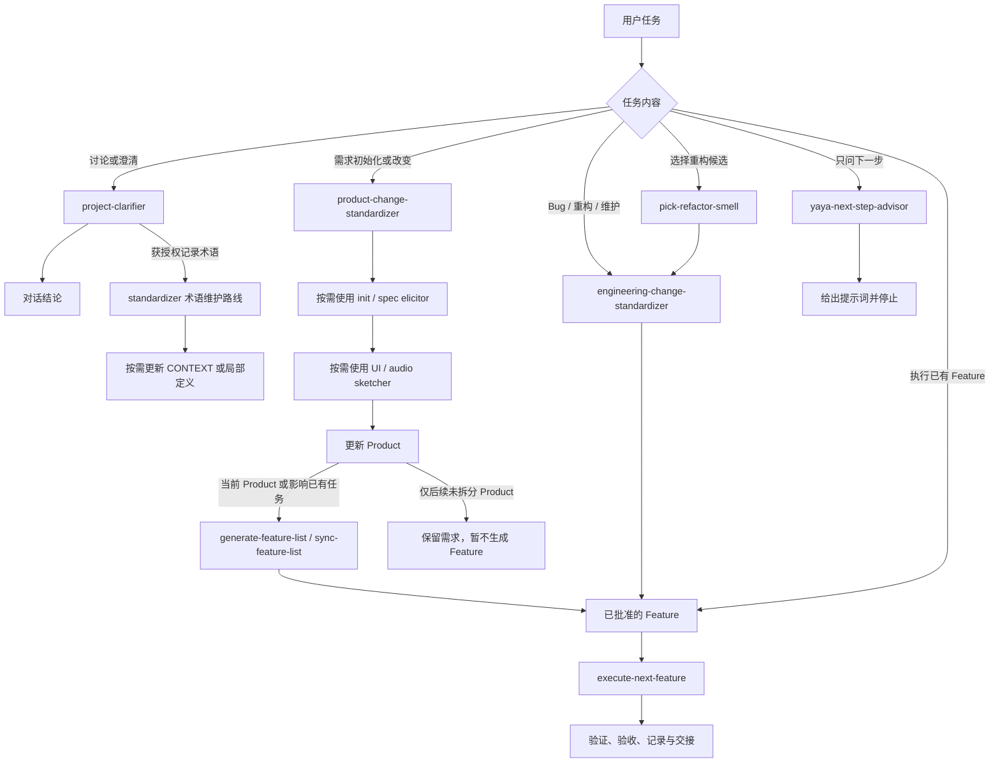
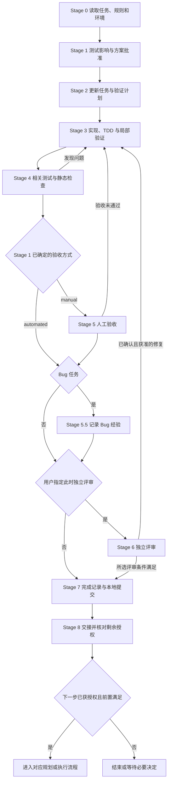

# Godot 游戏项目

使用 Windows 11、PowerShell 7、Godot 4.7、GDScript 和 gdunit4。
项目名称、工具路径和具体玩法由当前项目决定。

## 开发环境

实际工具路径、Godot 版本和检查命令记录在 `docs/methodology-config.json`。
环境配置说明见 [环境配置约定](methodology/05-document-language.md#project-environment-bootstrap)；
命令用法见 [检查工具](tools/README.md)。配置就绪与实际测试通过分别记录。

## 文档与代码

| 位置 | 内容 |
| --- | --- |
| AGENTS.md | 项目规则与 Skill 路由 |
| .agents/skills/ | 12 项开发 Skill |
| docs/product.md、docs/product/ | 产品目标、模块和用户可观察行为 |
| docs/CONTEXT.md | 按需维护的项目术语与概念关系，见[术语约定](methodology/01-product-doc-structure.md#project-terminology-and-context-optional) |
| docs/feature-list.json、docs/features/ | 任务索引、验收条件和长期任务记录 |
| docs/progress.md、docs/progress/ | 当前进度和必要历史 |
| [docs/knowledge/](docs/knowledge/README.md) | 按主题积累实际开发经验、成功做法与失败教训；开始相关任务时优先查阅 |
| docs/architecture.md、docs/architecture/ | 按需使用的架构地图、子系统说明和重要技术决定 ADR，见[架构约定](methodology/10-architecture-overview.md) |
| docs/coding_rules.md、agent-rules/ | 项目约定与具体 Godot 工程规则 |
| docs/methodology-config.json | 本机环境与实际检查命令 |
| methodology/ | 当前 Skill 使用的详细流程和模板 |
| tools/ | 显式调用的项目工具 |
| addons/ | gdUnit4、GDScript linter |
| gdlint.json | GDScript lint 配置 |
| project.godot | Godot 项目配置 |

知识目录先分 Godot 运行时、GDScript、调试与测试、工具与管线四个主题，
实际内容需要时再按领域或游戏模块细分。每条经验单独成篇，索引只保存链接。
初始只有目录说明，实际内容随任务积累。
经验是带适用条件的参考；项目规则、Product 和实际验证仍各自负责其事实。

场景、业务源码、资源和测试目录按游戏实际需要组织。Product 初始为空，
不预设玩法、业务模块、主场景或已完成任务。

## 根据任务使用 Skill

| 任务 | Skill |
| --- | --- |
| 讨论想法、澄清概念，或按授权整理术语 | project-clarifier |
| 产品初始化或改变需求 | product-change-standardizer |
| 从想法梳理产品蓝图 | product-init-elicitor |
| 澄清模块、新行为或需求修改 | product-spec-elicitor |
| 界面线框、视觉基础规格与可选 HTML 探索 | product-ui-sketcher |
| 音效、音乐需求与真实样本或占位约定 | product-audio-sketcher |
| 只拆当前 Product，完成后再拆下一 Product | generate-feature-list |
| 增量对齐已有 Feature | sync-feature-list |
| Bug、重构或工程维护 | engineering-change-standardizer |
| 执行一个已批准 Feature | execute-next-feature |
| 从记录中选择重构项 | pick-refactor-smell |
| 只读理解现状并撰写下一步提示词 | yaya-next-step-advisor |

新界面或明显布局变化先按 [视觉原型约定](methodology/01-product-doc-structure.md#visual-prototype-before-dependent-implementation)
验证真实资源、布局与尺寸，再接入依赖它的逻辑；场景实现复用现有执行或限定实验入口。



只讨论时不写文件，也不要求先准备环境或完整 Product。`docs/CONTEXT.md`
有实际内容才创建；由 `product-change-standardizer` 统一写入已确认的定义。
保持含义和行为的术语整理不拆分 Feature，实质行为变化仍走 Product 流程。

Product 按实际执行顺序逐个拆分：只生成当前 Product 所需的 Feature，
完成它们后再复核并拆下一 Product。计划追加到同一台账，保留历史；
后续 Product 先保留需求，不提前展开全部任务。见[逐个 Product 规划](methodology/02-feature-list-schema.md#product-by-product-planning)。

## 当前 Feature 流程

具体行为以 [execute-next-feature](.agents/skills/execute-next-feature/SKILL.md)
和 [执行流程](methodology/03-execute-loop.md) 为准。



先按需求决定验收方式，再填写对应检查项。涉及画面、声音、手感等人工判断时保留 Stage 5；
全部 AC 可自动验证且已选择 automated 时省略 Stage 5，不伪造人工接受。交接后按已有具体授权继续；范围完成或缺少必要决定时停止。
独立评审默认不启动；用户可以指定单项或多个已完成 Feature 合并评审，具体范围与时机遵循执行流程 Stage 6。
用户在当前会话给出的具体授权和检查范围优先于默认流程。

## 显式检查

当前项目没有自动工具事件。Git 状态由 Agent 读取，任务与证据检查由 Skill 中的
显式命令执行；编辑文件或结束回复不会触发另一套拦截流程。

例如：`tools/checks/check-feature-list.py` 检查台账，
`.agents/skills/execute-next-feature/scripts/record-feature-completion.py validate --feature F001` 检查已有完成依据。
具体命令见
[tools/README.md](tools/README.md)。

## 常用项目命令

在本项目根目录，用实际 Python 解释器执行：

```powershell
python -B tools/checks/check-project-environment.py
python -B tools/checks/check-project-environment.py --require-ready
```

前一条检查配置结构，后一条检查 ready 状态、Python/Godot 文件路径、测试命令的首个可执行文件与实际 Godot 版本。
测试脚本是否存在、后续参数是否正确仍由准备环境的 Agent 核对；READY 不代表整条测试命令已可运行。
它们不配置环境、不运行测试，也不初始化 Git。
测试使用配置中的实际命令；脚本解析和 lint 按 [直接检查说明](methodology/gdscript-lint.md) 调用 Godot 与插件自身入口。
首次 CLI 运行前按需完成 [Godot 编辑器扫描](tools/README.md#首次-godot-扫描)，后续 Feature 复用已有准备。
失败、未执行和人工待验收分别记录，具体说明见 [tools/README.md](tools/README.md)。
