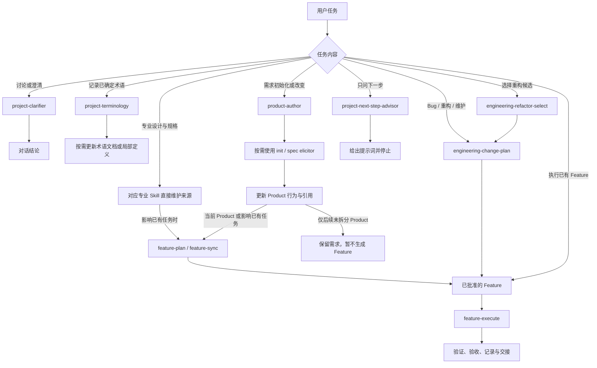

# Godot 游戏项目

使用 Windows 11、PowerShell 7、Godot 4.7、GDScript 和 gdunit4。 项目名称、工具路径和具体玩法由当前项目决定。

适用于一位项目使用者与 Agent 配合开发，在同一项目目录内暂停、切换和续接任务。多人协作、改动归属流程和 worktree 隔离不在支持范围内；按需调研与独立审核仍可使用。

## 开发环境

- **配置内容**：`docs/methodology-config.json` 保存文档语言以及 Python、Godot 可执行路径。
- **实际检查**：环境检查结果、观察到的版本及所用命令记录在初始化报告和必要的 Progress 中，不添加到配置字段。环境可用与实际测试通过分别记录。
- **查阅入口**：[环境配置约定](methodology/05-document-language.md#project-environment-bootstrap)说明配置要求，[检查工具](tools/README.md)说明命令用法。

## 文档与代码

| 位置 | 内容 |
| --- | --- |
| AGENTS.md | 项目规则与 Skill 路由 |
| .agents/skills/ | 开发、专业设计与独立审核 Skill |
| .codex/agents/independent-reviewer.toml | 独立审核角色；实际加载、上下文和权限需核实，见[审核契约](methodology/12-independent-review.md) |
| .codex/agents/researcher.toml、[调研目录](docs/research/README.md) | 调研角色与报告入口；初始只有目录说明，报告按需保存，见[调研入口](methodology/00-overview.md#external-research) |
| [游戏总览](docs/product.md)、[模块目录](docs/product/README.md) | 总览初始为用途说明；确定需求后维护产品目标、模块和用户可观察行为 |
| [项目术语](docs/terminology.md) | 初始尚无定义；按需维护共享名称与概念关系 |
| [美术圣经](docs/art/art-bible.md)、[声音圣经](docs/audio/sound-bible.md) | 初始方向待确定；随设计决定维护共享视觉与声音规范 |
| [本地化规范](docs/localization/localization-spec.md) | 初始是否需要与目标语言待确定；按需维护语言表达与格式约定 |
| [UI 规格目录](docs/ui/README.md)、[资源清单目录](docs/resource-requirements/README.md) | 初始只有说明与导航；具体界面规格和素材准备清单按需建立 |
| [未采纳想法](docs/unadopted-ideas.md) | 初始无记录；保存尚未采纳的设想，不代表开发承诺 |
| [任务索引](docs/feature-list.json)、[Feature 目录](docs/features/README.md) | 初始无任务；具体任务详情、验收条件与设计文档由实际规划产生 |
| [项目进度](docs/progress.md)、[历史目录](docs/progress/README.md) | 当前交接与历史入口；初始无执行历史 |
| [docs/knowledge/](docs/knowledge/README.md) | 按主题积累实际开发经验、成功做法与失败教训；开始相关任务时优先查阅 |
| [项目架构](docs/architecture.md) | 初始只有用途说明；需要时维护实际结构，并导航到子系统与重要决定 ADR |
| docs/project-rules.md、agent-rules/ | 所有适用 Product、Feature 遵守的项目约束与具体 Godot 工程规则 |
| docs/methodology-config.json | 文档语言和 Python、Godot 可执行路径 |
| methodology/ | 当前 Skill 使用的详细流程和模板 |
| tools/ | 显式调用的项目工具 |
| main/main.tscn | 已配置的最小启动场景；`main/` 负责入口与顶层组装 |
| game/ | 当前游戏的功能模块；玩法、设置、存档和全局 UI 按实际需求建立 |
| components/、assets/ | 可复用能力与跨模块共享素材；专属脚本、配置和素材跟随所属模块 |
| tests/ | 项目测试区域；初始没有业务测试套件 |
| [docs/game-organization.md](docs/game-organization.md) | 目录归属、模块增长与命名判断指南 |
| addons/ | gdUnit4、GDScript linter、SoundManager，以及下列编辑器效率插件 |
| [examples/asset_workbench/](examples/asset_workbench/README.md) | 可按 F6 运行的图像/音频/Shader/粒子与动画组合预览及消费示例；`example_*` 资源不代表正式游戏素材 |
| components/feedback/、tools/asset_workbench/ | 示例共用的表现组件、局部音频封装与工作台界面 |
| gdlint.json | GDScript lint 配置 |
| project.godot | Godot 项目配置 |

知识目录先分 Godot 运行时、GDScript、调试与测试、工具与管线四个主题， 实际内容需要时再按领域或游戏模块细分。每条经验单独成篇，索引只保存链接。 初始只有目录说明，实际内容随任务积累。 经验是带适用条件的参考；项目规则、Product 和实际验证仍各自负责其事实。

创建后的初始内容与状态如下：

- **项目入口**：已有最小启动场景 `main/main.tscn`，业务模块按游戏实际需要展开；随带的工作台示例是独立开发入口。
- **文档与台账**：Product 和专业文档只有用途与待定说明，任务及测试索引为空；后续内容遵循已确认的文档语言。
- **验证状态**：环境尚未验证，没有正式玩法、业务测试或已完成任务；入口存在不代表已运行或验收通过。

## 编辑器效率插件

在 Godot 的“项目 → 项目设置 → 插件”中启用或停用。新项目默认启用 Script-IDE、Inspector Tabs 和 Kanban Tasks；Edit Resources as Table 与 Signal Lens 已安装，按需启用。gdUnit4 保持启用，GDScript linter 面板和 SoundManager 全局插件保持停用。

| 插件 | 使用入口与用途 |
| --- | --- |
| Script-IDE | Script 编辑区的标签页、成员大纲和快速搜索；偏好在编辑器设置的 `Plugin / Script Ide` 中调整 |
| Inspector Tabs | 检查器属性分类标签；在高级编辑器设置的 `Inspector Tabs` 中调整布局或切换滚动定位模式 |
| Kanban Tasks | 顶部 `Tasks` 工作区；个人灵感看板默认保存到项目根的 `kanban_tasks_data.kanban`，与开发任务记录各自独立，无同步关系 |
| Edit Resources as Table | 启用后进入顶部 `ResourceTables` 工作区，以表格浏览和编辑 Resource；当前组合在退出编辑器时有资源泄漏诊断，因此默认停用 |
| Signal Lens | 启用后在调试器中查看运行中节点的信号连接与触发；插件会注册 `SignalLens` Autoload，停用时移除，发行导出前先停用 |

## 根据任务使用 Skill

| 任务 | Skill |
| --- | --- |
| 讨论想法、澄清尚未确定的概念 | project-clarifier |
| 保存已确认的术语定义、别名和引用 | project-terminology |
| 产品初始化或改变需求 | product-author |
| 从想法梳理产品蓝图 | product-init-elicitor |
| 澄清模块、新行为或需求修改 | product-spec-elicitor |
| 界面线框、布局状态与视觉基础规格 | design-ui-spec |
| 音效、音乐需求与真实样本或占位约定 | design-audio-asset-spec |
| 只拆当前 Product，完成后再拆下一 Product | feature-plan |
| 增量对齐已有 Feature | feature-sync |
| Bug、重构或工程维护 | engineering-change-plan |
| 执行一个已批准 Feature | feature-execute |
| 从记录中选择重构项 | engineering-refactor-select |
| 只读理解现状并撰写下一步提示词 | project-next-step-advisor |
| 共享美术/声音方向、具体视觉资源规格 | design-art-direction、design-audio-direction、design-visual-asset-spec |
| 确定语言覆盖与本地化规格 | design-localization-spec |
| 资源接入与已批准规格下的本地化实现 | content-asset-integration、content-localization |
| 诊断信号、性能测量与长期运行 | diagnostics-instrumentation、diagnostics-performance、diagnostics-soak-test |
| 用户指定的独立专业审核 | review-code、review-ux、review-art、review-audio、review-assets、review-localization、review-balance |

新界面或明显布局变化先按 [视觉原型约定](methodology/01-product-doc-structure.md#visual-prototype-before-dependent-implementation) 验证真实资源、布局与尺寸，再接入依赖它的逻辑；场景实现复用现有执行或限定实验入口。



只讨论时不写文件，也不要求先准备环境或完整 Product。`docs/terminology.md` 初始提供用途说明；由 `project-terminology` 按需维护已确认的定义。保持含义和行为的术语整理不创建 Feature，实质行为变化仍由 `product-author` 处理。

术语、Feature 设计、架构与项目规则在开发中持续维护，Stage 3 在最终验证前检查必要更新。项目规则增删改须先输出对话自检并核对授权，见[规则维护约定](methodology/04-coding-rules-4-layers.md#incremental-rule-maintenance)。

Product 按实际执行顺序逐个拆分：只生成当前 Product 所需的 Feature， 完成它们后再复核并拆下一 Product。计划追加到同一台账，保留历史； 后续 Product 先保留需求，不提前展开全部任务。见[逐个 Product 规划](methodology/02-feature-list-schema.md#product-by-product-planning)。

## 当前 Feature 流程

具体行为以 [feature-execute](.agents/skills/feature-execute/SKILL.md) 和 [执行流程](methodology/03-execute-loop.md) 为准。


用户在当前会话给出的具体授权和检查范围优先于默认流程。各环节的边界如下：

- **验收方式**：先按需求决定方式，再填写对应检查项。
  - 涉及画面、声音、手感等人工判断时，保留 Stage 5。
  - 全部 AC 可自动验证且已选择 automated 时，省略 Stage 5，不伪造人工接受。
- **交接后续**：按已有具体授权继续；范围完成或缺少必要决定时停止。
- **独立评审**：默认不启动。用户可以指定单项或多个已完成 Feature 合并评审，具体范围与时机遵循执行流程 Stage 6。
  - 审核方法与作者分开，使用独立实例。
  - 被审成果和原证据只读，获准验证须隔离副作用。
- **素材制作**：美术、音乐、音效制作目前仅保留说明占位，没有生产 Skill。

## 显式检查

当前项目没有自动工具事件。Git 状态由 Agent 读取，任务与证据检查由 Skill 中的 显式命令执行；编辑文件或结束回复不会触发另一套拦截流程。

例如：`tools/checks/check-feature-list.py` 检查台账， `tools/features/record-feature-completion.py validate --feature F001` 检查已有完成依据。 具体命令见 [tools/README.md](tools/README.md)。

## 常用项目命令

在本项目根目录，用实际 Python 解释器执行：

```powershell
python -B tools/checks/check-project-environment.py
python -B tools/checks/check-project-environment.py --require-ready
```

- **配置结构检查**：前一条命令检查配置结构。
- **实际可用性检查**：后一条命令检查 Python/Godot 文件路径、固定测试入口文件与实际 Godot 版本。READY 不代表测试已经执行或通过。
- **命令副作用**：这两条命令不配置环境、不运行测试，也不初始化 Git。
- **测试与静态检查**：
  - 测试使用配置中的 Python 调用 `tools/testing/run-gdunit-tests.py`，默认读取 Godot 路径。
  - 脚本解析和 lint 按 [直接检查说明](methodology/gdscript-lint.md) 调用 Godot 与插件自身入口。
- **首次准备**：首次 CLI 运行前按需完成 [Godot 编辑器扫描](tools/README.md#首次-godot-扫描)，后续 Feature 复用已有准备。
- **结果记录**：失败、未执行和人工待验收分别记录，具体说明见 [tools/README.md](tools/README.md)。
