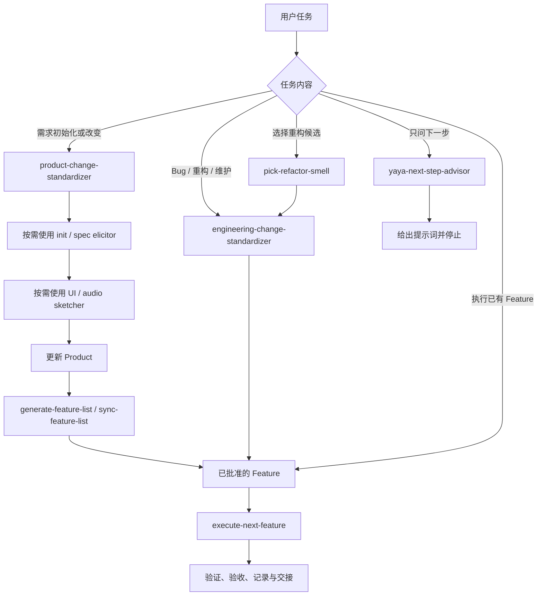
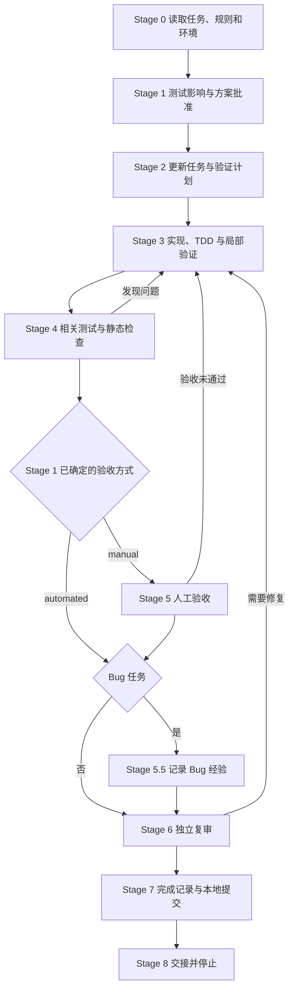

# Godot 游戏项目

使用 Windows 11、PowerShell 7、Godot 4.7、GDScript 和 gdunit4。
项目名称、工具路径和具体玩法由当前项目决定。

## 开发环境

实际工具路径、Godot 版本和检查命令记录在 `docs/methodology-config.json`。
环境配置说明见 [环境配置约定](methodology/05-document-language.md#project-environment-bootstrap)；
命令用法见 [检查工具](tools/README.md)。配置就绪与实际测试通过分别记录。

## 文档与代码

| 位置 | 内容 |
| --- | --- |
| AGENTS.md | 项目规则与 Skill 路由 |
| .agents/skills/ | 11 项开发 Skill |
| docs/product.md、docs/product/ | 产品目标、模块和用户可观察行为 |
| docs/feature-list.json、docs/features/ | 任务索引、验收条件和长期任务记录 |
| docs/progress.md、docs/progress/ | 当前进度和必要历史 |
| docs/architecture.md、docs/architecture/ | 按需使用的架构地图、子系统说明和重要技术决定 ADR，见[架构约定](methodology/10-architecture-overview.md) |
| docs/coding_rules.md、agent-rules/ | 项目约定与具体 Godot 工程规则 |
| docs/methodology-config.json | 本机环境与实际检查命令 |
| methodology/ | 当前 Skill 使用的详细流程和模板 |
| tools/ | 显式调用的项目工具 |
| addons/ | gdUnit4、GDScript linter |
| gdlint.json | GDScript lint 配置 |
| project.godot | Godot 项目配置 |

场景、业务源码、资源和测试目录按游戏实际需要组织。Product 初始为空，
不预设玩法、业务模块、主场景或已完成任务。

## 根据任务使用 Skill

| 任务 | Skill |
| --- | --- |
| 产品初始化或改变需求 | product-change-standardizer |
| 从想法梳理产品蓝图 | product-init-elicitor |
| 澄清模块、新行为或需求修改 | product-spec-elicitor |
| 界面线框与可选 HTML 探索 | product-ui-sketcher |
| 音效、音乐需求与占位文件名 | product-audio-sketcher |
| 首次拆分 Feature | generate-feature-list |
| 增量对齐已有 Feature | sync-feature-list |
| Bug、重构或工程维护 | engineering-change-standardizer |
| 执行一个已批准 Feature | execute-next-feature |
| 从记录中选择重构项 | pick-refactor-smell |
| 只读理解现状并撰写下一步提示词 | yaya-next-step-advisor |



## 当前 Feature 流程

具体行为以 [execute-next-feature](.agents/skills/execute-next-feature/SKILL.md)
和 [执行流程](methodology/03-execute-loop.md) 为准。



先按需求决定验收方式，再填写对应检查项。涉及画面、声音、手感等人工判断时保留 Stage 5；
全部 AC 可自动验证且已选择 automated 时省略 Stage 5，不伪造人工接受。完成后由用户决定下一项任务。
用户在当前会话给出的具体授权和检查范围优先于默认流程。

## 显式检查

当前项目没有自动工具事件。Git 状态由 Agent 读取，任务与证据检查由 Skill 中的
显式命令执行；编辑文件或结束回复不会触发另一套拦截流程。

例如：`tools/checks/check-feature-list.py` 检查台账，
`.agents/skills/execute-next-feature/scripts/write-gate-evidence.py validate --feature F001` 检查已有完成依据。
具体命令见
[tools/README.md](tools/README.md)。

## 常用项目命令

在本项目根目录，用实际 Python 解释器执行：

```powershell
python -B tools/checks/check-project-environment.py
python -B tools/checks/check-project-environment.py --require-ready
```

前一条检查配置结构，后一条检查路径、命令入口与实际 Godot 版本。
它们不配置环境、不运行测试，也不初始化 Git。
测试使用配置中的实际命令；脚本解析和 lint 按 [直接检查说明](methodology/gdscript-lint.md) 调用 Godot 与插件自身入口。
资源导入交给 Godot，不另设 Feature 导入步骤。
失败、未执行和人工待验收分别记录，具体说明见 [tools/README.md](tools/README.md)。
