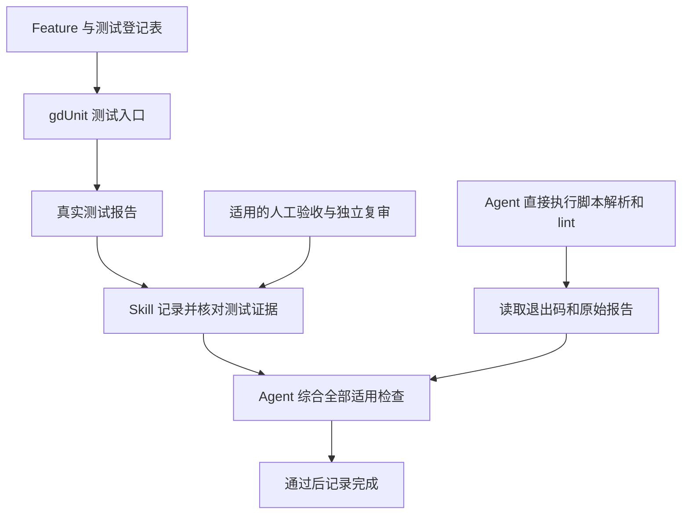

# 项目检查与测试工具

这些命令由 Agent 或使用者显式调用，不监听编辑、对话或工具事件。
使用 `docs/methodology-config.json` 中实际的 Python/Godot 路径。

```text
tools/
├── checks/      环境与台账检查
├── testing/     gdUnit 测试入口及其 Godot 辅助脚本
└── lib/         共享实现
```

| 入口 | 用途 |
| --- | --- |
| [check-feature-list.py](checks/check-feature-list.py) | 检查 Feature、测试登记表、引用和依赖；`--eligible` 列出可开始项 |
| [check-project-environment.py](checks/check-project-environment.py) | 检查配置；`--require-ready` 核对工具与版本 |
| [run-gdunit-tests.py](testing/run-gdunit-tests.py) | 读取 Feature/测试登记表，选择并运行 gdUnit 测试，保留实际报告 |

完成记录属于 `execute-next-feature/scripts/write-gate-evidence.py`；
测试登记表合并属于 `generate-feature-list/scripts/merge_test_registry.py`。
它们位于 `.agents/skills/` 对应 Skill 内，不另设转发命令。

## 调用

`python_executable` 和 `environment_bootstrap.engine_executable` 保存完整路径，
不包含引号或参数。`test_cmd` 保存测试命令，全量范围由同一入口的 `--scope full` 指定。

```powershell
python -B tools/checks/check-project-environment.py --require-ready
python -B tools/checks/check-feature-list.py
python -B tools/testing/run-gdunit-tests.py --godot-binary C:\Godot\Godot.exe --feature F001 --scope auto
python -B .agents/skills/execute-next-feature/scripts/write-gate-evidence.py record-tests --feature F001 --run reports/gdunit-wrapper/run-ID/result.json
```

将上述 Python、Godot 换成实际路径；配置 `test_cmd` 时保留测试入口及
`--godot-binary` 参数，执行时追加 Feature 和 scope。
测试的 `--target <path>` 用于 focused/TDD，`--phase baseline` 用于已有安全网。
`auto` 按批准范围选择 affected/full；没有独立计划文件。

脚本解析与 lint 由 Agent 直接调用 Godot 和插件，见
[直接检查说明](../methodology/gdscript-lint.md)。没有静态检查 Python 包装器、
静态 manifest 或静态结果登记命令。资源导入由 Godot 处理。

每次测试只写一份 `result.json`，关联引擎日志、实际发现集合、JUnit 和诊断原件。
运行中、失败与通过都保存在该文件；完成检查从原件计算覆盖，不维护第二份尝试日志。

## 结果如何使用



`record-tests` 只导入测试报告。证据脚本通过不能证明静态检查已执行。
Agent 必须单独确认解析和 lint 的真实结果；未解决的必要检查失败不能宣称完成。
失败报告和未完成任务需要的历史保留，不用旧成功掩盖后来失败。

## 内部实现

| 文件 | 职责 |
| --- | --- |
| `feature_evolution.py` | Feature/测试登记表演进与引用规则 |
| `test_selection.py` | 根据已确定的验收方案和台账选择测试；不从空清单猜测验收方式 |
| `run_evidence.py` | 核对真实 JUnit、发现集合、诊断及运行报告 |
| `gate_evidence.py` | 当前源码指纹、测试、适用人工接受和复审结果 |
| `gdunit_process.py` | Windows 子进程归属、超时与退出处理 |
| `gdunit_diagnostics.py` | 解释真实引擎诊断，保留失败事实 |

`testing/` 中 `gdunit_evidence_runner.gd` 启动测试并记录发现，
`gdunit_diagnostic_session.gd` 关联运行诊断，
`gdunit_diagnostic_logger.gd` 接收 Godot Logger 回调。
这是 gdUnit 运行扩展，不是 Agent 动作 Hook。
