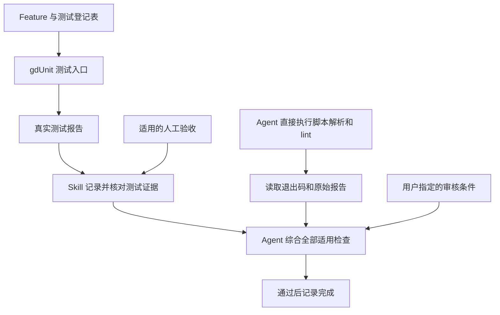

# 项目检查与测试工具

这些命令由 Agent 或使用者显式调用，不监听编辑或工具事件。只有三处自动运行：[提交钩子](#提交钩子)在 `git commit` 时运行其中八项检查和 Skill 目录一致性检查；[提交说明钩子](#提交说明钩子)在同一时刻对提交说明运行术语检查；[用词提示钩子](#用词提示钩子)在用户每次向 Claude Code 发消息时对消息正文运行术语检查。下文示例中的 `python` 与 Godot 一律换成 `docs/methodology-config.json` 中实际配置的路径。

```text
yaya/tools/
├── checks/      环境、Feature 记录与文件格式检查
├── features/    Feature 登记合并、完成记录与人工验收
├── testing/     gdUnit 测试入口及其 Godot 辅助脚本
├── godot/       由 Godot 执行的项目文件维护脚本和 3D 占位测量
├── ui-trial/    在项目副本中按界面任务试用界面，及界面静态扫描
└── lib/         共享实现
```

| 工具 | 用途 |
| --- | --- |
| Feature 记录检查 [check-feature-list.py](checks/check-feature-list.py) | 检查 Feature、测试登记表、引用和依赖；`--eligible` 列出可开始项 |
| 环境检查 [check-project-environment.py](checks/check-project-environment.py) | 检查配置；`--require-ready` 核对 Python/Godot 文件、已配置的 GAA 解释器、固定测试入口文件及实际 Godot 4.7.x 版本，不写配置状态 |
| 链接检查 [check-markdown-links.py](checks/check-markdown-links.py) | 检查 Markdown 中的相对链接目标和标题锚点是否存在 |
| 链接文字检查 [check-link-text.py](checks/check-link-text.py) | 列出链接文字不是目标标题、也不是目标 Skill 名、文件名或目录名的链接 |
| 术语检查 [check-terminology.py](checks/check-terminology.py) | 按术语文件找出文档中登记为“不用的说法”的写法；`--discover` 另列与术语开头相同的候选写法 |
| 用词提示钩子 [check-prompt-terminology.py](checks/check-prompt-terminology.py) | Claude Code 的用户消息钩子：消息中有不用的说法时，提示 Agent 在回复最前面列出用词对照表 |
| 措辞检查 [check-wording.py](checks/check-wording.py) | 按配置 [wording-check.json](checks/wording-check.json) 中的检查项，找出规则文件中不用的写法（如表示要求的“应”）和全部文档中待复核的含糊词、空洞写法与超长句；`--list` 列出全部检查项 |
| 资源格式检查 [check-godot-resource-format.py](checks/check-godot-resource-format.py) | 检查 `.tscn`、`.tres` 是否按编辑器格式保存：带 UID、没有 `load_steps`；检查 `.gd`、`.gdshader` 都有同名 `.uid`，图片、音频、字体都有同名 `.import` |
| GDScript 文本检查 [check-gdscript-text.py](checks/check-gdscript-text.py) | 找出测试里没有 `await` 的协程断言，以及游戏代码和测试往 `res://` 写文件的调用 |
| 引用检查 [check-godot-references.py](checks/check-godot-references.py) | 检查 `res://` 路径存在且大小写一致、`uid://` 已登记、没有两个文件登记同一个 UID，以及导出预设排除了测试和调试文件 |
| 增量检查 [check-staged-changes.py](checks/check-staged-changes.py) | 提交钩子用：列出本次暂存放宽检查和改已有文件 UID 的地方，拒绝项目场景里新增的编辑器信号连接 |
| 测试入口 [run-gdunit-tests.py](testing/run-gdunit-tests.py) | 读取 Feature、测试登记表和起点以来的改动，选择并运行 gdUnit 测试，保留实际报告；`--changed` 不需要 Feature |
| 起点写入 [record-base-revision.py](features/record-base-revision.py) | 把验证点写进 Feature 的 `base_revision`；`--dry-run` 预览起点以来的改动会选中什么 |
| 登记表合并 [merge-test-registry.py](features/merge-test-registry.py) | 将批准的组件合并到测试登记表；同一组件的 `source_paths` 取并集 |
| 完成记录 [record-feature-completion.py](features/record-feature-completion.py) | 准备人工验收清单，记录测试原件引用与人工决定，查看和检查完成证据 |
| 资源重存 [resave_godot_files.gd](godot/resave_godot_files.gd) | 用 Godot 自己的格式重新保存 `project.godot` 和指定的 `.tscn`、`.tres` |
| 3D 占位测量 [measure_3d.gd](godot/measure-3d/measure_3d.gd) | 在真实窗口里测 3D 物体的屏幕轮廓尺寸、伸出 Slot 的比例、被相邻物品遮挡的比例和帧时间，与请求里的阈值对照 |
| 界面试用 [ui-trial/](ui-trial/README.md) | 准备改名的项目副本，在副本中运行驱动脚本按界面任务试用界面（带看门狗与外层超时），以及界面静态扫描 |

命名约定：

- Python 入口脚本使用连字符命名（如 `run-gdunit-tests.py`），只作为命令运行，不被其他代码导入；GDScript 脚本按 GDScript 约定使用下划线。
- `lib/` 中的共享模块使用下划线命名，供入口以 `tools.lib.<模块>` 导入；`yaya/tools/__init__.py` 与 `lib/__init__.py` 使这种导入成立。
- Skill 只引用这些命令并说明调用时机，不另写命令副本。

调试台的音频测量调用本机安装的 Game Audio Analyzer（GAA），配置和后台契约见[分析](../../dev/debug/_shared/README.md#分析)。

Feature 记录检查、登记表合并和运行选择共用同一套 JSON 解码规则：

- 重复对象键、非标准数值（`NaN`、`Infinity`）以及解析后溢出为无穷的浮点数（如 `1e400`）都会报错；
- 合并器在写回前拒绝这类输入，并保留原件；共享 JSON 写入也拒绝非有限数值；
- 组件候选接受数组，或含 `components` 数组的对象；各入口分别校验自身的数据结构。

## 首次 Godot 扫描

适用条件见[项目环境准备](../methodology/06-project-environment.md#项目环境准备)。在已获准的首次 CLI 测试或项目脚本运行前，尚未由编辑器扫描的新项目可在项目根目录执行：

```powershell
$projectConfig = Get-Content -LiteralPath 'docs/methodology-config.json' -Raw | ConvertFrom-Json
$projectGodot = (Resolve-Path -LiteralPath $projectConfig.engine_executable -ErrorAction Stop).Path
& $projectGodot --headless --editor --path . --quit | Out-Host
$LASTEXITCODE
```

- 按项目 `AGENTS.md` 的本机权限约束执行；`Out-Host` 用于等待 Windows GUI 程序结束。
- 读取退出码和扫描、导入诊断。失败时保留原文，并停止依赖这次准备的运行。
- 正常完成后执行原定测试或脚本；扫描成功本身不证明用例或业务行为通过。

新增脚本或资源后，Godot 在下一次扫描时才为它们生成 `.uid`；`.uid` 计入内容指纹，所以先用上面的命令扫描一次，再做最终测试运行，避免运行结束后才生成的 `.uid` 让证据失效。

首次测试若报找不到 `GdUnitTestCIRunner` 或 `GdUnitTestSuite`，先核对项目是否已完成扫描。没有发现或执行用例的解析失败，不是 TDD 的业务 RED。完成扫描后仍失败时，继续核对插件文件和具体解析错误，不反复扫描或删除缓存来掩盖原因。生成的 `.import`、`.uid` 与 `.godot` 按[60 素材与导入规则](../agent-rules/60-assets/README.md)和[Godot 资源与身份引用](../agent-rules/00-core/godot-resource-references.md)处理；首次扫描为插件资源生成的 `.import` 随项目提交。

## 启动场景冒烟检查

确认一个场景能加载并运行指定帧数时，在项目根目录执行（`$projectGodot` 的取法同上一节）：

```powershell
& $projectGodot --headless --path . res://main/main.tscn --quit-after 120 2>&1 | Tee-Object -FilePath <日志路径> | Out-Host
$LASTEXITCODE
```

- 把 `res://main/main.tscn` 换成要检查的场景；`--quit-after` 是运行的帧数上限，到达后 Godot 自行退出。
- `| Out-Host` 让 PowerShell 等 Godot 结束后再读退出码；`2>&1` 把错误输出一起写进日志。日志目录按 09 号规范的[报告与清理](../methodology/09-records-reports-and-handoff.md#报告与清理)选择。
- 退出码非 `0` 表示启动失败，例如场景文件不存在或无法加载。
- 退出码 `0` 不代表没有脚本错误：脚本解析错误和运行时脚本错误都只打印在输出里，退出码仍是 `0`。所以要检查输出中的 `ERROR`、`SCRIPT ERROR` 和紧随其后的 `at:` 行（错误所在的文件和行号）。
- 这项检查只证明场景能加载并运行到帧数上限。`--headless` 不渲染画面，不能说明画面正确；能启动也不等于人工验收。

## 本地导出检查

导出一个 debug 包，在本机独立运行，确认游戏离开编辑器也能正常工作。这不是发布：不涉及签名、商店或分发配置。

**一次性准备**：

- **导出模板**：版本必须和项目的 Godot 一致，在编辑器的“编辑器 → 管理导出模板”中下载安装，由用户完成。
- **导出预设**：新项目没有 `export_presets.cfg`。第一次导出前，在项目根目录写一份只含一个 Windows Desktop 预设的最小文件，名称 `Windows Local`，导出路径留空：

  ```ini
  [preset.0]

  name="Windows Local"
  platform="Windows Desktop"
  runnable=true
  export_filter="all_resources"
  include_filter=""
  exclude_filter="tests/*, addons/gdUnit4/*, addons/gdscript-linter/*, addons/script-ide/*, addons/inspector_tabs/*, addons/kanban_tasks/*, addons/resources_spreadsheet_view/*, addons/signal_lens/*, reports/*, dev/*, yaya/tools/*"
  export_path=""

  [preset.0.options]

  binary_format/embed_pck=false
  ```

  `addons/` 下除 gdUnit4 外的几个目录是随项目分发的编辑器插件，游戏运行不需要。Signal Lens 启用时会注册 `SignalLens` Autoload，排除它之后导出包启动会报错，所以导出前先停用它，并确认 `project.godot` 不再含 `autoload/SignalLens`。项目自己新增插件时，先按导出规则区分它是不是运行时需要，再决定是否排除。排除的依据见 [导出资源与过滤器](../agent-rules/41-export-config/resources-and-filters.md) 和 [测试目录与导出](../agent-rules/70-tests/production-isolation.md#测试目录与导出)。没有写出的字段由 Godot 使用默认值，写好后直接用实际导出验证，通过后提交。注意：`[preset.0.options]` 下至少要有一个键，空段会被当成不存在，导出时报 `Cannot get keys from nonexistent section`。之后结构性的预设修改，在编辑器的“项目 → 导出”中进行。

**导出并启动**（在项目根目录执行，`$projectGodot` 的取法见[首次 Godot 扫描](#首次-godot-扫描)）：

```powershell
$exportDirectory = 'reports/exports/<日期>'
New-Item -ItemType Directory -Path $exportDirectory -Force | Out-Null
& $projectGodot --headless --path . --export-debug 'Windows Local' "$exportDirectory/game.exe" 2>&1 | Tee-Object -FilePath "$exportDirectory/export.log" | Out-Host
$LASTEXITCODE
& "$exportDirectory/game.exe" --headless --quit-after 120 2>&1 | Tee-Object -FilePath "$exportDirectory/run.log" | Out-Host
$LASTEXITCODE
```

- 输出放在 `reports/exports/` 下：这个目录不进 Git，也不会被 Godot 当成项目资源扫描。目标目录必须事先存在，否则导出失败。
- 导出成功时，目录中有 `game.exe`、`game.pck` 和 `game.console.exe`（带控制台窗口的启动器，双击它可以看到运行输出）。导出退出码非 `0`、缺少这些文件，或日志中有退出时资源泄漏提示（`leaked`、`still in use`、`PagedAllocator`）以外的 `ERROR`，表示导出有问题；常见原因是缺少对应版本的导出模板，或预设名称写错。
- 导出包的启动检查和[启动场景冒烟检查](#启动场景冒烟检查)一样：退出码 `0` 不代表没有脚本错误，要检查输出中的 `ERROR`、`SCRIPT ERROR` 和 `at:` 行。常见的问题是运行时用到的文件被过滤掉了，或者代码引用了 `res://` 下只在编辑器中存在的路径。
- 这项检查只证明导出包能启动并运行到帧数上限。画面、声音和操作是否正常，需要用户直接双击 `game.exe` 实际试玩。

## 提交钩子

`.githooks/pre-commit` 在每次 `git commit` 时运行，按本次暂存的文件类型选择检查，任何一项失败就拒绝提交：

| 检查 | 范围 | 失败条件 |
| --- | --- | --- |
| [check-terminology.py](#check-terminologypy) | 本次新增、修改或改名的 `.md` 与 `.json` 文件，删除的不查。框架复制进来的 `yaya/`、`addons/`、`.agents/skills/`、`.claude/skills/`、`.claude/agents/`、`.codex/agents/` 和 `AGENTS.md` 不查，因为它们按框架术语写，同步时会被覆盖 | 有不用的说法 |
| [check-wording.py](#check-wordingpy) `--level hard` | 同上 | 有硬性检查项的命中 |
| [check-markdown-links.py](#check-markdown-linkspy) | 扫描整个项目，因为改标题或删文件会让其他文档中的链接失效；只报告本次暂存的 `.md`、`.json`（含删除和改名前的路径）里的链接，以及指向它们的链接，所以同一目录里另一个任务没暂存的文件不会挡住提交。本次新增、修改、改名或删除了 `.md`、`.json` 时运行 | 报告的范围内有失效链接 |
| [check-link-text.py](#check-link-textpy) | 同上，因为改标题会让其他文档中的链接文字过时 | 报告的范围内有链接文字与目标标题不符的链接 |
| [check-godot-resource-format.py](#check-godot-resource-formatpy) | 本次新增、修改或改名的场景、资源、脚本、Shader 和图片、音频、字体素材；插件目录等默认范围排除的位置不查 | 场景或资源没按编辑器格式保存，脚本、Shader 缺 `.uid`，素材缺 `.import` |
| [check-gdscript-text.py](#check-gdscript-textpy) | 本次新增、修改或改名的 `.gd` | 测试里有没 `await` 的协程断言，或游戏代码、测试往不该写的 `res://` 位置写文件 |
| [check-godot-references.py](#check-godot-referencespy) `--related-to` | 每次提交都运行。扫描整个项目，只报告本次暂存的文件（含删除和改名前的路径）里的引用、指向它们的引用、涉及它们的重复 UID；暂存了 `export_presets.cfg` 时检查导出过滤 | 报告的范围内有失效引用、重复 UID 或导出过滤问题 |
| [check-staged-changes.py](#check-staged-changespy) | 每次提交都运行，只看本次暂存相对 HEAD 的改动 | 项目场景里新增了编辑器信号连接。放宽检查和改 UID 只列出，不拒绝 |
| Skill 目录一致性（钩子内置，没有单独的脚本） | 本次暂存了 `.agents/skills/` 或 `.claude/skills/` 下的任何文件时，比较暂存区中两个目录的内容 | 两个目录不同。Codex 读前者，Claude Code 读后者，所以两份必须相同 |

暂存的文件都不属于这些类型时直接通过。资源格式检查拦住的是不经 Feature 完成步骤的改动，例如实验或 Feature 外的修复：场景和资源用 [`resave_godot_files.gd`](#resave_godot_filesgd) 重存，缺 `.uid` 或 `.import` 时运行[首次 Godot 扫描](#首次-godot-扫描)的命令，把生成的文件一起暂存。除 Skill 目录一致性外，钩子检查的是工作区中的文件内容，不是暂存区：同一个文件只暂存了一部分修改时，未暂存的部分也参与检查。钩子用 PATH 中的 `python` 运行检查；找不到时会拒绝提交。

Skill 目录不一致时，把改过的那份完整复制到另一份，再暂存两个目录。例如改的是 `.agents/skills/`，在项目根目录运行：

```powershell
robocopy .agents\skills .claude\skills /MIR
```

被拒绝后，按输出中的位置改正文件，重新 `git add` 再提交。创建器已经在新项目中设置好钩子；重新 clone 项目后，在项目根目录运行一次：

```powershell
git config core.hooksPath .githooks
```


## 提交说明钩子

`.githooks/commit-msg` 用 [check-terminology.py](#check-terminologypy) 检查提交说明，有不用的说法就拒绝提交。它把整份说明从标准输入交给 `--stdin-text`。提交钩子只查暂存的文件，所以提交说明由这个钩子单独检查；它和提交钩子在同一目录，创建器设置 `core.hooksPath` 后一起生效。

用 `-m` 或 `-F` 提交时，`#` 开头的行也会写进提交说明，所以钩子不跳过它们，只截掉 `git commit -v` 附带的差异；用编辑器写说明时，git 模板里的注释行也一起检查。找不到 python 时拒绝提交并单独说明原因。

说明改名时只写新名称；直接写出旧名称会被拒绝，旧名称已登记在术语表里。

项目的 `docs/terminology.md` 还没有登记不用的说法时，这个钩子不会拒绝任何提交。

## 用词提示钩子

`.claude/settings.json` 把 `checks/check-prompt-terminology.py` 注册为 Claude Code 的 `UserPromptSubmit` 钩子：用户每次发消息，钩子把消息正文交给[check-terminology.py](#check-terminologypy)的 `--stdin-text`，按 `docs/terminology.md` 查找登记为“不用的说法”的写法。

- **有命中**：向 Agent 附加一段提示，列出每处的原文、正式名称、在消息中的行号和术语定义位置，并提醒按个人沟通规则中的用词对照规则，在回复最前面列出对照表。
- **没有命中，或术语文件缺失、无法解析、钩子出错**：不输出任何内容。

钩子总是以退出码 `0` 结束，不拦截用户消息，也不记录消息或 Agent 的动作。它只认术语文件中已登记的不用说法；没有登记的写法和一词多义仍要 Agent 自己核对。消息里放在引号或行内代码中的写法不算出现，规则见[术语检查与措辞检查的共同约定](#术语检查与措辞检查的共同约定)。钩子命令使用 PATH 中的 `python`；找不到时 Claude Code 只会报告钩子失败，消息照常发送。

## 调用

`python_executable` 支持完整路径、项目相对路径或 PATH 中的命令名；`engine_executable` 使用完整路径或项目相对文件路径，不查询 PATH。两者都不包含 shell 引号或参数。

```powershell
python -B yaya/tools/checks/check-project-environment.py --require-ready
python -B yaya/tools/checks/check-feature-list.py
python -B yaya/tools/testing/run-gdunit-tests.py --feature F01-001 --scope auto
python -B yaya/tools/features/record-feature-completion.py record-tests --feature F01-001 --run reports/gdunit-wrapper/F01-001/run-ID/result.json
```

参数名以各脚本的 `--help` 为准。除特别说明外，`--repo-root` 默认是脚本所在的项目，相对路径以目标项目为准，不依赖命令启动时所在的目录。

### check-feature-list.py

| 参数 | 作用 | 默认值 |
| --- | --- | --- |
| `--repo-root <目录>` | 要检查的项目 | 脚本所在项目 |
| `--completion-feature <Feature ID>` | 另外要求该 Feature 当前映射的自动测试均为 `active` | 不检查 |
| `--eligible` | 通过检查后，以 JSON 输出依赖已满足的待开始 Feature | 不输出 |

通过时打印 `FEATURE LIST CHECK: PASS`；带 `--eligible` 时标准输出只有 JSON，便于直接解析。

退出码：`0` 检查通过；`2` Feature 记录无效或参数错误。

### check-project-environment.py

| 参数 | 作用 | 默认值 |
| --- | --- | --- |
| `--config <文件>` | 要检查的配置文件；项目根目录取该文件的上两级 | `docs/methodology-config.json` |
| `--require-ready` | 额外核对工具文件（含已配置的 `audio_analyzer_python_executable`，不核对其中的 Python 包）、固定测试入口和实际 Godot 版本 | 只检查配置结构 |

退出码：`0` 配置有效（带 `--require-ready` 时表示已就绪）；`2` 配置无效、未就绪或参数错误。

### check-markdown-links.py

移动、重命名文档或修改标题后运行，也可以在整理文档后整体运行一次：

```powershell
python -B yaya/tools/checks/check-markdown-links.py
```

只检查本次改过的文件时，把文件路径列在后面，例如 `python -B yaya/tools/checks/check-markdown-links.py docs/progress.md docs/ui/main-design.md`。改了标题、移动或删除了文件时，仍要不带文件参数检查整个项目，因为别的文档里指向它们的链接也会失效。

检查范围：

- **检查的链接**：行内链接、`<路径>` 写法与引用式定义中的本地目标；目标是 Markdown 文件且带 `#锚点` 时，再核对锚点。
- **锚点规则**：按 GitHub 规则由标题生成，即去掉标点和格式符号、转小写、空格变 `-`，中文保留；重名标题依次加 `-1`、`-2`。`<a id="…">` 也算锚点。
- **不检查**：外部网址、代码块和行内代码里的内容。以 `/` 开头的路径不可移植，直接报告。
- **默认排除**：任意层级名为 `.git`、`.godot`、`.claude`、`tmp`、`addons`、`__pycache__` 的目录，以及测试和界面试用的运行目录 `reports/gdunit-wrapper/`、`reports/ui-trial/` 中的 Markdown 不检查；指向这些目录的链接仍会核对目标。

| 参数 | 作用 | 默认值 |
| --- | --- | --- |
| `<文件>…` | 只检查列出的文件；路径相对当前目录，须在 `--root` 下；列出文件时 `--exclude` 不生效 | 扫描整个 `--root` |
| `--root <目录>` | 要检查的目录 | 脚本所在项目 |
| `--exclude <路径>` | 另外排除相对 `--root` 的路径，可重复 | 只用默认排除 |
| `--related-to <清单>` | 仍扫描整个 `--root`，但只报告位于清单所列文件中、或指向清单所列文件的问题；清单每行一个相对 `--root` 的路径，`-` 从标准输入读取，可以列出已删除的文件。提交钩子用它把检查限定在本次暂存的文件上 | 报告全部 |
| `--json` | 以 JSON 输出文件数、链接数和失效列表 | 逐行输出 |

退出码：`0` 没有失效链接；`1` 存在失效链接；`2` 参数或读取错误。通过只证明链接目标存在，不证明读者能找到所需内容。链接文字是否用了目标标题由 [check-link-text.py](#check-link-textpy) 检查。

### check-link-text.py

链接文字检查。写完或改过文档后运行，找出链接文字不是目标标题的链接：

```powershell
python -B yaya/tools/checks/check-link-text.py <改过的文档>
python -B yaya/tools/checks/check-link-text.py
```

按 Godot 项目文档编写 Skill 写作指南的[把项目讲清楚](../../.agents/skills/technical-documentation-writing-godot/references/writing-guide.md#把项目讲清楚)中「链接文字用目标标题」一条比较。满足下面任一条的链接合规，其余每处以规则名 `LINK-TEXT` 报告：

- **带锚点的链接**（包括页内的 `#锚点`）：链接文字等于锚点所在章节的标题，前后多出任何文字都报告，例如标题是“启动”时，“启动命令”“项目的启动”都不合规；文件说明写在链接外面。比较时去掉行内代码标记、`*` 和首尾空白，中间的空白合并为一个空格，不区分大小写。
- **只链到 Markdown 文件的链接**：链接文字按上一条的方式等于该文件的一级标题，标题开头的“NN · ”编号可以省略；或者链接文字去掉反引号、首尾空白、开头的 `$` 和结尾的 `/` 后，按 `/` 分段，与目标路径的最后几段逐段相同（区分大小写），最后一段可以是文件名、去掉扩展名的文件名或目标所在的目录名。例如链到 `skills/design-gdd/SKILL.md` 时，`design-gdd`、`$design-gdd`、`SKILL.md`、`design-gdd/SKILL.md` 都合规；链到 `research/README.md` 时，`research/` 合规。
- **不比较**：图片、引用式定义、外部网址、非 Markdown 目标、目标或锚点不存在的链接（由 [check-markdown-links.py](#check-markdown-linkspy) 报告）、`<a id>` 锚点、没有一级标题的文件，以及页面顶部只由链接和“·”组成的导航行。页面顶部指这一行之前只有空行、一级标题和其他导航行；正文中只由链接组成的行照常比较。

| 参数 | 作用 | 默认值 |
| --- | --- | --- |
| `<文件>…` | 只检查列出的文件（相对 `--root`），不扫描整个目录；不是 `.md` 的文件、位于默认排除目录或 `--exclude` 中的文件跳过 | 扫描 `--root` |
| `--files-from <清单>` | 另外检查清单中列出的文件，每行一个路径；`-` 从标准输入读取。清单为空时不检查任何文件 | 不使用 |
| `--root <目录>` | 要检查的目录 | 脚本所在项目 |
| `--exclude <路径>` | 另外排除相对 `--root` 的路径，可重复 | 只用默认排除 |
| `--related-to <清单>` | 仍扫描整个 `--root`，但只报告位于清单所列文件中、或指向清单所列文件的问题；清单每行一个相对 `--root` 的路径，`-` 从标准输入读取，可以列出已删除的文件。提交钩子用它把检查限定在本次暂存的文件上 | 报告全部 |
| `--json` | 以 JSON 输出文件数、比较的链接数和 `findings` 列表，每条含 `file`、`line`、`target`、`text`、`expected`、`rule` | 逐行输出 |

只检查列出的文件时，仍按需读取它们链接到的文件的标题。默认排除的目录与 `check-markdown-links.py` 相同。文本输出每处一行 `路径:行号  [LINK-TEXT] [链接文字](目标)  标题：目标标题`，最后一行汇总。

退出码：`0` 没有不符合的链接；`1` 有不符合的链接；`2` 参数错误、列出的文件不存在或读取错误。工具不修改文档；按结果把链接文字改成目标标题，或把文件说明移到链接外面。

### 术语检查与措辞检查的共同约定

[check-terminology.py](#check-terminologypy)和[check-wording.py](#check-wordingpy)按同一套规则读取文档，共用 `lib/document_text.py`：

- **不算出现的位置**：代码块、行内代码、链接目标，`「」`、`“”`、`""` 引号里的文字。所以要在正文中举例某个不用的写法时，把它放进引号或行内代码。默认排除的目录与 `check-markdown-links.py` 相同。扫描时有目录读不出来就停止并以退出码 `2` 报告该目录，不按剩余文件给出结果。
- **JSON 文件**：只检查字符串值，键名不查；每个字符串值当作一段 Markdown，按上面的规则检查，值里的 `\n` 视为换行。报告的行号是该字符串值在 JSON 文件中所在的行；列号是从字符串值解码后的第一个字符算起的字符位置（`\n` 算 1 个字符），不是 JSON 原文中的列。
- **输出**：文本输出每条结果一行，格式固定为 `路径:行号:列号: [规则编号] 说明 | 上下文`：路径相对 `--root`，列号从 1 开始按字符计，上下文是该行去掉首尾空白后的片段，过长时截断并加 `…`。最后一行汇总扫描的文件数和各层的数量。`--json` 输出汇总和每条结果的字段。

两项检查共有的参数：

| 参数 | 作用 | 默认值 |
| --- | --- | --- |
| `<文件>…` | 只检查列出的文件（相对 `--root`），不扫描整个目录；位于默认排除目录或 `--exclude` 中的文件跳过 | 扫描 `--root` |
| `--files-from <清单>` | 另外检查清单中列出的文件，每行一个路径；`-` 从标准输入读取。清单为空时不检查任何文件 | 不使用 |
| `--root <目录>` | 要扫描的目录 | 当前目录 |
| `--include <通配>` | 扫描整个目录时要检查的文件，含 `/` 时按相对路径匹配，否则按文件名匹配；可重复 | `*.md` |
| `--exclude <路径>` | 另外排除相对 `--root` 的路径，可重复 | 只用默认排除 |
| `--context-width` | 每条结果附带的上下文最多字数 | `80` |
| `--json` | 以 JSON 输出 | 逐行输出 |

只检查本次改过的文档时，把文件直接写在命令后面，例如 `python -B yaya/tools/checks/check-terminology.py docs/gdd/README.md README.md`。`--include README.md` 按文件名匹配，会把所有目录中的 `README.md` 都选进来。

### check-terminology.py

术语检查。在 `docs/terminology.md` 中登记或修改“不用的说法”后运行，也可以在整理文档后整体运行一次；术语文件的写法见[术语文件的格式](../methodology/14-project-terminology.md#术语文件的格式)：

```powershell
python -B yaya/tools/checks/check-terminology.py
python -B yaya/tools/checks/check-terminology.py --discover
```

检查分两层：

- **不用的说法**（`TERM-FORBIDDEN`，默认执行）：读出术语表“不用的说法”一列的每个写法，报告它在扫描范围内的每处出现。只认表头同时含“术语”和“不用的说法”的表，缺其中一列的表只算条目、不读出术语；“术语”格中用 `/` 分开的写法都是允许的别名。
- **候选写法**（`TERM-CANDIDATE`，加 `--discover` 执行）：中文术语默认取开头“术语字数减 1”个字（最少 2 个字，`--prefix-length` 可改），找出开头相同、结尾不同、出现至少 `--min-count` 次的词，例如“分发源”与“分发材料”；在“的”“中”“和”等虚词处截断，连续超过 `--max-length` 个字的长串当作短语跳过。以术语某个允许写法整体开头的复合词（如“调试台采纳”）默认不列，加 `--include-compounds` 才列出。英文术语只找大小写不同或加 `s`、`es` 的整词，含 `-`、`_` 的标识符不算。已登记的术语、别名和不用的说法不列为候选。这一层误报多，只作人工核对的线索，不影响退出码。

除[术语检查与措辞检查的共同约定](#术语检查与措辞检查的共同约定)中不算出现的位置外，术语文件中该术语自己那一行也不算出现。`--discover` 对 JSON 同样适用。

| 参数 | 作用 | 默认值 |
| --- | --- | --- |
| `--terms <文件>` | 术语文件；相对路径按 `--root` 解析 | `docs/terminology.md` |
| `--stdin-text` | 从标准输入读一段 UTF-8 文字，当作 Markdown 检查，结果中的路径写成 `<stdin>`；不能与 `<文件>` 或 `--files-from` 同用 | 检查文件 |
| `--discover` | 另外输出候选写法 | 不输出 |
| `--prefix-length`、`--min-count`、`--max-length` | 候选写法与中文术语相同的开头字数、最少出现次数、最大字数 | 术语字数减 1（最少 2）、`2`、`6` |
| `--include-compounds` | 候选写法也列出以术语整体开头的复合词 | 不列出 |

其余参数见[术语检查与措辞检查的共同约定](#术语检查与措辞检查的共同约定)。不用的说法的说明写出发现的写法、应改为的正式名称和术语文件中的定义位置。候选写法按术语分组，先用一行 `术语 → 候选词（次数）、…` 汇总，再逐条列出位置。`--json` 的每条结果含 `path`、`line`、`column`、`rule`、`term`、`found`、`suggestion`、`definition`、`context` 和 `message`，另有候选分组。

退出码：`0` 没有不用的说法；`1` 发现不用的说法；`2` 参数错误、列出的文件不存在、扫描的 JSON 文件解析失败、`--stdin-text` 读到的不是 UTF-8 文字、术语文件不存在或无法解析：表格某行的列数少于表头，或文件有条目（`##` 及以下小标题、列表项、表格数据行）却没有从表格读出任何术语，例如每个术语写成一个 `###` 小标题，或表头把“不用的说法”写成了别的列名。只有标题、说明段落和空表头的术语文件（新项目模板）正常通过。工具不修改文档；按结果逐处改写后重跑。候选写法要逐个看上下文，确认指同一概念后再统一。

### check-wording.py

措辞检查。写完或改过文档后运行；[提交钩子](#提交钩子)会对暂存的文档运行它的硬性一层：

```powershell
python -B yaya/tools/checks/check-wording.py <改过的文档>
python -B yaya/tools/checks/check-wording.py --level hard
```

检查项写在同目录的配置 [wording-check.json](checks/wording-check.json) 中，写法与级别的说明见 Godot 项目文档编写 Skill 写作指南的[措辞检查](../../.agents/skills/technical-documentation-writing-godot/references/writing-guide.md#措辞检查)。增删检查项或例外只改配置，不改脚本；用 `--list` 查看全部检查项：

```powershell
python -B yaya/tools/checks/check-wording.py --list
```

配置的格式为 `{"sentence_length": {…}, "checks": [检查项, …]}`。`sentence_length` 正好有两个正整数字段：`descriptive` 是描述句的字数上限，`procedural` 是步骤句（有序列表项）的字数上限；省略时不查句长。每个检查项正好有以下字段，都是非空字符串：

| 字段 | 含义 |
| --- | --- |
| `name` | 检查项名称，出现在报告和 `--list` 中 |
| `level` | `hard` 硬性或 `review` 待复核 |
| `scope` | `rule-files` 只查规则文件，`all` 查扫描到的每个文件 |
| `pattern` | 一条 Python 正则，匹配要找的写法；例外用前向、后向断言写在正则里，例如 `(?<![对相])应(?![用对])` 不匹配“对应”“应用” |
| `suggestion` | 推荐写法，出现在报告和 `--list` 中 |

检查分两层：

- **硬性**（`WORDING-HARD`）：`level` 为 `hard` 的检查项在适用范围内的每一处命中。有一处就返回 `1`。
- **待复核**（`WORDING-REVIEW`）：`level` 为 `review` 的检查项的每一处命中，以及超过 `sentence_length` 上限的句子，只列出供作者看上下文判断，不影响退出码。句子按“。！？；”断开，跳过 Markdown 开头的元数据、标题、表格行、代码和引号内的文字；一个汉字、一个英文单词或数字各算 1 字，标点不算。`--level hard` 时不运行这一层。

每个检查项的正则逐行单独扫描遮蔽后的文字；同一位置被多个检查项命中时，各报告一次。

规则文件按路径判定，满足任一条即是：

- 文件名为 `AGENTS.md` 或 `Project_AGENTS.md`，或路径是 `docs/project-rules.md`（框架仓库中的模板 `project-source/defaults/docs/project-rules.md` 同样算）；
- 路径中有名为 `agent-rules` 或 `methodology` 的目录，例如 `yaya/agent-rules/`、`yaya/methodology/`；
- Skill 包中的 `SKILL.md` 和 `references/` 下的文件，即 `skills/<Skill 名>/SKILL.md` 与 `skills/<Skill 名>/references/**`；
- 名为 `prompts` 的目录中的 `.json` 文件，即提示词库；
- 框架仓库中的 `framework/prompt-scenarios/scenarios/README.md` 和 `framework/maintenance/design-guidelines/` 下的文件。

正则只能排除写出来的例外：表示要求的用法偶尔落在例外里（如“应用”恰好表示“应当使用”）时会漏报，这类情况靠作者阅读时发现并改写。

| 参数 | 作用 | 默认值 |
| --- | --- | --- |
| `--config <文件>` | 措辞检查配置；相对路径按 `--root` 解析 | 脚本同目录的 `wording-check.json` |
| `--level <层>` | `all` 两层都报告；`hard` 只报告硬性 | `all` |
| `--list` | 把配置中的检查项列成表格（名称、级别、范围、推荐写法）后退出，不扫描文档 | 不使用 |
| `--verbose` | 与 `--list` 一起用时，表格另加正则一列 | 不使用 |

其余参数见[术语检查与措辞检查的共同约定](#术语检查与措辞检查的共同约定)。说明写出命中的文字、检查项名称和推荐写法。`--json` 的每条结果含 `path`、`line`、`column`、`rule`、`check`、`found`、`level`、`scope`、`suggestion`、`context` 和 `message`。

退出码：`0` 没有硬性命中（可能列出了待复核的命中），或 `--list` 正常列出；`1` 发现硬性命中；`2` 参数错误、列出的文件不存在、扫描的 JSON 文件解析失败、配置文件不存在或无法解析：不是合法 JSON、缺少 `checks` 列表、检查项字段不对、`level` 或 `scope` 不是上面列出的值、`pattern` 不是合法的正则。工具不修改文档。

### check-godot-resource-format.py

以文本方式写过 `.tscn`、`.tres` 却漏了[resave_godot_files.gd](#resave_godot_filesgd)，下次打开编辑器时会被改写；新建脚本、Shader 或素材后没有运行 Godot 扫描，就没有 `.uid` 或 `.import`，之后的扫描会冒出未提交的文件。两者都会产生与当前工作无关的差异。本检查在 Feature 完成时运行，[提交钩子](#提交钩子)也会对暂存的文件运行它；也可以在重存后单独运行：

```powershell
python -B yaya/tools/checks/check-godot-resource-format.py
```

- **检查内容**：`.tscn`、`.tres` 的文件头带 `uid`、不含 `load_steps`，每条 `[ext_resource]` 带 `uid`；`.gd`、`.gdshader` 旁边有同名 `.uid` 文件；`.png`、`.jpg`、`.jpeg`、`.webp`、`.svg`、`.bmp`、`.tga`、`.wav`、`.ogg`、`.mp3`、`.ttf`、`.otf` 旁边有同名 `.import` 文件。
- **默认范围**：项目内上述类型的全部文件；跳过任意层级名为 `.git`、`.godot`、`.claude`、`tmp`、`reports`、`addons` 的目录、含 `.gdignore` 的目录，以及调试台运行时保存的插槽预设与组合（`dev/debug/*/slots/**/presets/`、`dev/debug/*/combos/`）。也可以在参数中列出相对项目根目录的文件，只查这些；列出的文件落在上述排除位置时同样跳过。
- **局限**：只发现漏掉重存和漏掉扫描这两种情况；编辑器保存时的其他格式调整，以及 `.uid`、`.import` 是否已经提交，不在检查范围内，提交前仍看 `git status`。

退出码：`0` 全部符合；`1` 有文件不符合，逐行列出位置和原因：格式问题用 `resave_godot_files.gd` 重存，缺 `.uid` 或 `.import` 就运行[首次 Godot 扫描](#首次-godot-扫描)的命令并提交生成的文件，然后重跑；`2` 项目根目录不存在或文件读取失败。

### check-gdscript-text.py

漏写 `await` 的协程断言不等结果就继续，失败不计入，测试通过却什么也没证明；编辑器里能往 `res://` 写文件，导出后的游戏写不进去，存档要到发布后才失效。本检查在 Feature 完成时运行，[提交钩子](#提交钩子)也会对暂存的 `.gd` 运行它：

```powershell
python -B yaya/tools/checks/check-gdscript-text.py
```

- **检查内容**：路径中有 `tests` 目录的脚本里，含 `.is_emitted(`、`.is_not_emitted(`、`.is_push_error(`、`.is_push_warning(`、`.is_runtime_error(` 或 `.wait_until(` 的语句没有 `await`；`game/`、`main/`、`components/` 下用 `FileAccess.open*(…WRITE…)`、`ResourceSaver.save(`、`DirAccess.*_absolute(` 写 `res://`；根目录 `tests/` 下的脚本写 `res://tests/` 以外的位置。规则见 [编写测试时的约定](../agent-rules/70-tests/gdunit4-profile.md#编写测试时的约定)和[测试写入的文件](../agent-rules/70-tests/production-isolation.md#测试写入的文件)。
- **语句的划分**：去掉注释和字符串内容后判断；以 `\` 结尾或括号没闭合的行与下一行合成一条语句。
- **默认范围**：项目内全部 `.gd`，跳过的目录与[check-godot-resource-format.py](#check-godot-resource-formatpy)相同，并且也跳过插件。也可以在参数中列出相对项目根目录的文件。
- **局限**：只认字面量路径，路径从变量传入时查不到；`DirAccess.open()` 之后再调用的写方法查不到。

退出码：`0` 没有命中；`1` 逐行列出位置和原因；`2` 项目根目录不存在或文件读取失败。

### check-godot-references.py

移动或改名素材后，按字符串 `load()` 的路径在编辑器里不报错，运行到才失败；大小写不符的路径在 Windows 上能用，导出后的包区分大小写就找不到；复制 `.uid` 或 `.import` 会让两个文件共用一个 UID。导出过滤漏掉 `tests/`、`dev/` 时，测试和调试台会进入正式包。本检查在 Feature 完成时运行，[提交钩子](#提交钩子)每次提交都会运行它：

```powershell
python -B yaya/tools/checks/check-godot-references.py
```

- **检查内容**：
  - `.gd`、`.tscn`、`.tres`、`.gdshader`、`.gdshaderinc`、`.json` 和 `project.godot` 中，整个字符串就是 `res://…` 路径时，目标存在且大小写与磁盘一致。用 `+` 或 `%` 拼接的路径、含 `{`、`*` 等格式或通配符的路径，以及指向 `reports/`、`tmp/`、`.godot/` 等运行输出目录的路径不查。
  - 整个字符串就是 `uid://…` 时，它由某个 `.uid`、`.import` 或场景、资源的文件头登记过。
  - 没有两个文件登记同一个 UID；`[ext_resource]` 的 `uid` 与 `path` 指向的文件登记的 UID 相同。
  - `export_presets.cfg` 每个预设的 `exclude_filter` 排除了 `tests/`、`dev/` 和 `addons/gdUnit4/`，没有整体排除 `addons/`，包含和排除过滤都不用 `*`、`*.*`、`**` 这类宽泛写法。规则见[排除测试与编辑器插件](../agent-rules/41-export-config/resources-and-filters.md#排除测试与编辑器插件)。
- **默认范围**：跳过任意层级名为 `.git`、`.godot`、`.claude`、`tmp`、`reports` 的目录和含 `.gdignore` 的目录。插件内部的引用和路径中有 `tests` 目录的文件不作为引用来源，因为测试用不存在的路径当夹具数据，测试里的错误路径在运行测试时就会失败；插件和测试登记的 UID 仍参与核对。

| 参数 | 作用 | 省略时 |
| --- | --- | --- |
| `--root <目录>` | 指定项目根目录 | 脚本所在的项目 |
| `--related-to <清单>` | 仍扫描整个项目，但只报告位于清单所列文件中的引用、指向清单所列文件的引用和涉及它们的重复 UID；清单列出 `export_presets.cfg` 时才查导出过滤。清单每行一个相对项目根目录的路径，`-` 从标准输入读取，可以列出已删除的文件 | 报告全部 |

退出码：`0` 没有问题；`1` 逐行列出位置和原因；`2` 项目根目录不存在或文件读取失败。

### check-staged-changes.py

只看本次暂存相对 HEAD 的改动，由[提交钩子](#提交钩子)每次提交时运行，也可以在暂存后单独运行。仓库还没有提交时直接通过。

- **拒绝提交**：`game/`、`main/`、`components/` 下的 `.tscn` 新增了 `[connection` 行。项目场景在代码中连接信号，见[场景 UI 与脚本绑定](../agent-rules/20-scenes/ui-and-scripts.md)；已有的连接不报。
- **只列出，不拒绝**：
  - `.gd` 新增的行含 `@warning_ignore`、`gdlint:ignore`、`do_skip` 或 `skip_reason`；
  - `gdlint.json` 的 `limits`、`checks`、`scanning`、`exclude` 有变化；
  - `project.godot` 的 `[gdunit4]` 中 `report/*`、`flaky_check_enable`、`hooks/session_hooks` 有变化；
  - 修改了 `addons/` 下已有的文件；
  - 已有文件的 UID 变了：`.uid` 的内容、`.import` 的 `uid=` 或 `source_file=`、`.tscn` 和 `.tres` 文件头的 `uid`。

  这些改动有时是用户批准过的，拒绝提交就要有放行开关，而放行开关 Agent 自己也能打开，所以只列出。输出以一行说明开头，之后每项一行；Agent 把每一行原样写进完成汇报的「待确认」，由用户确认。

退出码：`0` 没有要拒绝的改动，可能列出了待确认项；`1` 有新增的编辑器信号连接；`2` Git 命令失败或 `gdlint.json` 无法解析。

### run-gdunit-tests.py

| 参数 | 作用 | 默认值 |
| --- | --- | --- |
| `--feature <Feature ID>` | 从当前 Feature、测试登记表和该 Feature 的 `base_revision` 以来的改动选择测试；与 `--target`、`--changed` 互斥 | 不使用 |
| `--changed` | 不需要 Feature：从当前验证点以来的改动选择测试并运行，只输出结果、选择原因和 JUnit 路径，不写任何 Feature 的证据；不能和 `--phase`、`--scope`、`--require-test` 同用 | 不使用 |
| `--target <路径>` | focused/TDD 运行指定路径；可重复，多个路径在同一次运行中全部执行，重叠的目标只运行一次；不产生完成证据 | `tests`，项目有 `dev/debug` 时加上它 |
| `--scope <范围>` | 仅在 `--feature` 时决定选择范围：`required` 为必需测试集，`affected` 为受影响测试（含必需测试集），`full` 为 `tests/` 全量（项目有 `dev/debug/` 时包含它），`auto` 在需要全量升级时运行 `full`，否则运行 `affected` | `auto` |
| `--phase <阶段>` | `baseline` 跳过尚未实现的 `planned` 测试，用于已有安全网，不能支持完成；`final` 为最终验证 | `final` |
| `--require-test <套件路径>::<用例>` | 要求本次运行实际执行该用例，否则判为失败；同时禁止返回 `not_required` | 不要求 |
| `--continue` | 传给 gdUnit 的 `-c`：遇到失败后继续执行完整测试集 | 首个失败即停止 |
| `--verbose` | 把 Godot 的完整输出打印到控制台 | 只打印摘要：用例数、每个未通过用例的位置与原因，以及 `engine.log` 路径；找不到 JUnit 报告时打印输出的最后 20 行 |
| `--timeout-seconds <秒>` | 测试进程的最长墙钟时间，须为大于 0 的有限数 | `120` |
| `--godot-binary <路径>` | 仅为本次运行临时替换 Godot 可执行文件 | 配置中的 `engine_executable` |

完整输出始终保存在运行目录的 `engine.log`；摘要不够判断时先读它，不必重跑。需要全量时，`--scope auto` 会按批准范围自动升级为 `full`；显式 `--scope full` 用于在迭代中主动运行全量。没有独立的计划文件。

退出码：`0` 测试通过，或返回 `not_required`，或 `--changed` 没有需要运行的测试；`1` 测试失败、选择失败、超时或结果与计划不符；`2` 参数错误。

选择结果除了必需、受影响测试集和全量理由，还有这些字段，选择规则见[测试影响评估](../methodology/08-test-traceability-and-evidence.md#测试影响评估)：

- `base_revision`：起点；
- `changed_files`：起点以来的改动文件；
- `inferred_components`：声明之外补上的组件及其触发文件；
- `dependency_suites`：依赖图选中的套件、选择原因和一条最短依赖链；
- `touched_completed_features`：碰到的已完成 Feature，只用于提醒用户判断是否重新人工验收，不参与选择。

`--changed` 没有需要运行的测试时打印 `No tests need to run for changes since <起点>`，不启动 Godot，不创建运行报告，也不打印 PASS。它的运行记录放在 `reports/gdunit-wrapper/focused/`，和 `--target` 一样不产生完成证据。

所选范围的登记用例缺失时报告 FAIL。

`not_required` 的条件与含义：

- 只在使用 `--feature`、未指定 `--scope full` 或 `--require-test`，且必需、受影响测试集均为空、也没有全量义务时出现。合法的空基线，或无自动测试义务的 manual 最终验证，属于这种情况。
- 此时 stdout 只有一份 `status: not_required` 的 JSON，可以整体解析；“Test selection”选择说明改写到 stderr。不启动 Godot、不读取引擎配置、不创建运行报告，也不调用 `record-tests`。
- 这不表示测试通过。显式 full 或必需用例、缺失路径以及未解决的最终失败，仍须处理。

### merge-test-registry.py

| 参数 | 作用 | 默认值 |
| --- | --- | --- |
| `--components <文件>` | 必填。组件候选 JSON，绝对路径或相对目标项目的路径；候选中的测试路径同样以目标项目为准 | 无 |
| `--repo-root <目录>` | 要修改的项目 | 脚本所在项目 |

候选中的组件已在登记表中时，`source_paths` 取并集，输出的 `extended_components` 是因此扩展的组件数；其他字段不同仍算冲突。

退出码：`0` 合并成功；`2` 输入或现有登记表冲突、无效，此时不写入（参数错误同样为 `2`）。

### record-base-revision.py

把当前验证点写进 `docs/features/<Feature ID>.json` 的 `base_revision`，选择测试时以它为起点比较内容差异。验证点的取法：索引中状态为 `done` 或 `obsolete_done` 的 Feature 按 `completed_at` 从晚到早排列。第一个完成证据 `git_revision` 仍是当前 HEAD 祖先的 Feature，取它的完成提交，即 `git_revision` 之后第一个提交了这份证据的提交。证据还没提交时取 `git_revision` 本身。不直接用 `git_revision`，因为记录证据时这个 Feature 的改动还没提交，从那里比较会把它自己的改动算成新改动。没有这样的 Feature 时取仓库的第一个提交。

| 参数 | 作用 | 默认值 |
| --- | --- | --- |
| `--feature <Feature ID>` | 必填。要写入起点的 Feature | 无 |
| `--reset` | 已有 `base_revision` 时改为当前验证点；Feature 放弃回 `pending` 后重新开始，或起点提交已被 Git 回收、选择报错时使用 | 已有起点时保留并报告 |
| `--dry-run` | 不写文件，打印起点（已有时用它，否则用当前验证点）、改动文件、反推组件、依赖图选中的套件、全量理由和碰到的已完成 Feature | 写入 |
| `--repo-root <目录>` | 要修改的项目 | 脚本所在项目 |

预览的全量理由合并改动触发的理由、声明组件与反推组件的 `full_suite_on_change`，以及已批准的 `test_impact.full_suite_reasons`。

删除节点的旧 UID 和全局类名从起点读取。以下情况以 `dependency-graph-unresolved:<路径>` 升级 full：

- 删除的脚本（`.gd`）或资源（`.tscn`、`.tres`）在起点缺少文本，或既无 UID 也无全局类名。
- 起点有对应 `.import`，但其中没有可读 UID。

没有 `.import` 的其他删除文件仍沿路径引用选择消费者，不因缺少标识升级 full。

退出码：`0` 写入、保留已有起点或预览成功；`2` Feature 记录、登记表或 Git 无法读取，此时不写入（参数错误同样为 `2`）。

### record-feature-completion.py

`--repo-root <目录>` 写在子命令之前，默认是脚本所在项目。所有子命令都要求 `--feature <Feature ID>`，记录写在该 Feature 自己的 `docs/features/<Feature ID>-evidence.json`，第一次记录时创建。

| 子命令 | 其他参数 | 作用 |
| --- | --- | --- |
| `prepare-manual` | `--checklist <文件>`（必填，位于 `reports/manual-acceptance` 下的人工验收清单） | 把清单绑定到当前快照，准备人工验收 |
| `record-tests` | `--run <result.json>`（必填，可重复，用于多次不重叠的真实运行） | 导入真实测试结果引用；被拒绝时清除旧引用，原始报告保留 |
| `record-acceptance` | `--checklist <文件>`（必填，已绑定的清单，状态已按用户的结论填写）；`--confirm-unrelated-changes`（可选，核对工具列出的可能变化的文件后，真正改过的都不涉及本 Feature 时使用） | 从清单的状态推导并记录验收结论；同一结论重复记录时给出提示 |
| `show` | 无 | 显示该 Feature 的已存记录，不判断能否完成 |
| `validate` | 无 | 检查当前测试与人工验收证据能否支持完成 |

退出码：`0` 成功（`validate` 表示证据有效）；`2` 证据不足、记录无效、输入被拒绝或参数错误。

人工验收的清单格式、怎样在清单中记录用户的结论，以及确切命令见[人工验收文件](../methodology/contracts/manual-acceptance-files.md)。命令成功只表示记录成功，结果仍可能为 `pending` 或 `rejected`；它不调用任何验收应用，也不判断注释的语义。

### resave_godot_files.gd

Agent 以文本方式新建或修改 `project.godot`、`.tscn` 或 `.tres` 后，调用本工具重新保存。工具在编辑器模式下补齐场景和资源的文件头与外部引用 UID，移除 `load_steps`；重复重存保持稳定。

```powershell
& $projectGodot --headless --editor --path . --script res://yaya/tools/godot/resave_godot_files.gd -- project.godot res://main/main.tscn | Out-Host
$LASTEXITCODE
```

- `--` 之后列出要重新保存的文件：`project.godot`，或 `res://` 下的 `.tscn`、`.tres`。
- 新建的依赖场景或资源也要一起传入，已有但尚无 UID 的依赖同样需要列出。工具只重存传入文件，不自动扩展依赖列表。
- 工具等待编辑器扫描和导入完成，再重存场景和资源；随后主动重扫并重存第二轮，补齐同批资源之间的引用 UID。调用方不需要另跑两轮命令。
- `project.godot` 重新保存时，等于引擎默认值的设置会被删除；依赖默认值时按项目设置规则的[编写](../agent-rules/40-project-config/authoring-and-scope.md#编写)一节，在测试中断言生效值。
- `project.godot` 只在首轮保存，不参与资源的第二轮重存。
- 场景和资源保存回原路径，已有的资源 ID 保留；文字里的 `\n` 转义会改写成真实换行，只发生一次。
- 真正在编辑器中编辑并保存场景，还可能生成节点 `unique_id` 或省略默认属性；本工具不承诺这次编辑器保存后没有文本差异。
- 退出码：`0` 全部保存成功；`1` 路径不支持或有文件无法加载、保存，原因见 `ERROR` 输出；`2` 未在编辑器模式运行或没有传入文件。
- 编辑器模式退出时会打印 RID 和 ObjectDB 泄漏信息：脚本在编辑器启动途中退出，编辑器界面来不及释放。新建项目、不启用任何插件时同样出现，不代表保存失败，不需要诊断，也不记为阻塞；以退出码和上面的 `ERROR` 为准。
- 编辑器开着时，用户切回编辑器窗口，Godot 会弹出“文件已在 Godot 外部被修改”，列出 `project.godot`。选“从磁盘重新加载”即可读到这次修改；选“忽略外部修改”后再在编辑器里保存，会覆盖这次修改。所以修改了 `project.godot` 时，在交付中提醒用户看到这个提示时选“从磁盘重新加载”。

### measure_3d.gd

接入 3D 资源后，按项目 Art Bible 的投影阈值测量模型在屏幕上的样子：轮廓够不够大、伸出 Slot 多远、会不会挡住相邻物品，以及帧时间。每次接入只写一个场景适配脚本，不再为每轮重写截图和测量脚本。

**必须开真实窗口**：无头模式不渲染画面，入口在无头模式下立即以退出码 `2` 结束。运行时桌面会弹出请求里指定大小的窗口，示例约 2 秒，真实场景随对象数和帧时间采样变长；运行前告诉用户。

1. 把 [example_adapter.gd](godot/measure-3d/example_adapter.gd) 复制到 `dev/asset_validation/<主题>/measure_adapter.gd`（[资源验证组件](../methodology/08-test-traceability-and-evidence.md#资源验证组件)），改写其中 4 个方法：
   - `variants()`：要测的变体名，例如每套模型一个；
   - `open(tree, variant)`：打开场景、换好模型、等场景稳定，返回场景根节点；
   - `subjects(scene)`：被测对象，每项 `{"id", "kind": "item" 或 "enemy", "node"}`；物品另给 `slot_corners`（逻辑 Slot 地面方框的 4 个世界坐标角点，按顺序排列）和 `neighbors`（相邻物品的 `id`）；
   - `close(scene)`：释放场景，恢复 `open()` 在场景外改过的东西，例如存档路径。
2. 照 [example_request.json](godot/measure-3d/example_request.json) 写请求文件，放在同一目录。阈值从 Art Bible 抄，请求里缺任何一项都会以 `2` 退出，工具不提供默认值。
3. 运行：

   ```powershell
   & $projectGodot --path . --script res://yaya/tools/godot/measure-3d/measure_3d.gd -- dev/asset_validation/<主题>/measure_request.json | Out-Host
   $LASTEXITCODE
   ```

| 请求字段 | 含义 |
| --- | --- |
| `adapter` | 适配脚本的 `res://` 路径 |
| `out` | 输出目录，相对项目根目录，放在 `reports/` 下 |
| `window` | 窗口大小 `[宽, 高]`，用 Art Bible 的显示基线 |
| `perf` | 可选：`variant` 指定在哪个变体测帧时间，`warmup_frames`、`sample_frames` 默认 120、600 |
| `thresholds` | `max_protrusion_ratio`（伸出距离 ÷ Slot 屏幕宽度的上限）、`max_neighbor_occlusion`（被相邻物品挡住的轮廓比例上限）、`min_long_edge_px`（轮廓包围框最长边的下限，物品和敌人都算） |

**测量口径**：每个对象单独渲染一次，自己用白色无光照材质，其他几何体全部隐藏；物品再和相邻物品一起渲染一次，相邻物品用黑色。两次都用黑背景、线性色调映射、关闭 MSAA，并隐藏所有 `CanvasLayer`，结束后恢复。RGB 三个通道都大于 127 的像素算轮廓，边界约有 1 px 误差。伸出取轮廓像素中心到 Slot 方框投影的最远距离；遮挡取一起渲染时少掉的轮廓像素占单独渲染时的比例。

**输出**：`<out>/<变体>.png` 是正常画面，`<out>/<变体>/<对象>-full.png`、`<对象>-neighbors.png` 是遮罩图。`<out>/measurements.json` 包含 `environment`、`performance`、每个变体的 `subjects` 与 `summary`，以及 `checks`：每项阈值的实测值、阈值和 `pass`。

退出码：`0` 全部阈值通过；`1` 有阈值没通过，标准错误输出列出是哪项；`2` 无头运行、请求无效，或适配脚本给出的对象轮廓为空。

**局限**：只测轮廓尺寸和遮挡，不测颜色、敌我识别和辨认度，这些仍要人工验收；轮廓边界约有 1 px 量化误差；帧时间受本机硬件影响，结果里记录了显卡和 CPU。

### 静态检查与资源导入

脚本解析与 lint 由 Agent 直接调用 Godot 和插件，见[GDScript lint 的约定与证据](../methodology/contracts/gdscript-lint.md)。它们没有 Python 包装器、静态 manifest 或静态结果登记命令。资源导入由 Godot 处理。

### 运行结果的保存

- **位置**：Feature 运行保存到 `reports/gdunit-wrapper/<Feature-ID>/run-<id>/`，focused/TDD 运行保存到 `reports/gdunit-wrapper/focused/run-<id>/`。
- **内容**：每次测试只写一份 `result.json`，关联引擎日志、实际发现集合、JUnit 和诊断原件。运行中、失败与通过都记录在该文件；完成检查从原件计算覆盖，不维护第二份尝试日志。
- **历史读取警告**：历史目录缺少 `result.json`、结果无法读取或头部无效时，启动阶段在 stderr 提示 `WARNING: invalid run history`。保留原件并继续本次验证；警告不决定本次测试成败。扫描只排除本次正在建立的运行目录。
- **快照失败**：当前快照读取失败时，仍保存本次 `failed` 结果并返回非零，不启动 Godot。
- **完成检查范围**：运行顺序和完成检查只读取当前 Feature 目录。历史目录缺少结果，或记录不可读、格式损坏、Feature 不符，都会阻止完成。查明原因后按授权处理。正常的失败须由同一 Feature、同一内容的后续充分验证解决。
- **写入失败**：目录或结果文件写入失败时如实报告 I/O 错误，不能声称结果已经保存。

## 结果如何使用



`record-tests` 只导入测试报告，证据检查通过不能证明静态检查已执行。Agent 必须单独确认解析和 lint 的真实结果；未解决的必要检查失败不能宣称完成。失败报告和未完成任务需要的历史要保留，不用旧的成功掩盖后来的失败。

`show --feature F01-001` 只检查记录可读取、基本结构有效且属于 F01-001，然后显示原文数据。它不查询 Git，不重读测试或人工验收原件；待验收或已失效的引用不构成查看失败。缺失、损坏或属于另一项 Feature 的记录使 `show` 返回非零，且不会修改原件。判断当前测试与人工验收证据能否支持完成，使用 `validate --feature F01-001`。

## 内部实现

| 文件 | 职责 |
| --- | --- |
| `feature_evolution.py` | Feature/测试登记表演进与引用规则 |
| `test_selection.py` | 根据验收方案、Feature 记录和起点以来的内容差异选择测试。读取 Feature 状态以确定验证点和已完成任务的提醒；不从空清单猜测验收方式，不读提交说明 |
| `dependency_graph.py` | 静态解析脚本、场景、资源和 shader 的引用，建文件依赖图并反向搜索依赖者 |
| `test_run_evidence.py` | 核对真实 JUnit、发现集合、诊断及运行报告 |
| `feature_completion_evidence.py` | 完成证据的结构、快照关联及测试与人工验收证据的聚合判断；不记录复审计数 |
| `document_text.py` | 术语检查与措辞检查共用的文档读取、引号与代码遮蔽、文件选择和输出格式；链接文字检查复用其中的文件选择 |
| `markdown_links.py` | 链接检查与链接文字检查共用的标题与锚点解析、链接及链接文字提取、Markdown 文件枚举与排除 |
| `verification_snapshot.py` | Git 提交、当前内容指纹和起点以来的改动文件；测试和人工验收证据共用，不判断任务完成 |
| `engine_executable.py` | 按 `engine_executable` 的配置契约解析 Godot 可执行文件路径；测试运行器、界面试用和就绪检查共用 |
| `atomic_json.py` | 关闭文件流后原子替换 JSON，失败时保留目标原件并清理临时文件 |
| `manual_acceptance.py` | 人工验收清单覆盖与快照绑定、逐项结果对照和原件复核 |
| `gdunit_process.py` | Windows 子进程归属、超时与退出处理 |
| `gdunit_diagnostics.py` | 解释真实引擎诊断，保留失败事实 |

`godot/resave_godot_files.gd` 和 `godot/measure-3d/` 只在显式调用时运行，用法见上文。`testing/` 中的 Godot 脚本是 gdUnit 运行扩展，不是 Agent 动作 Hook：

- `gdunit_evidence_runner.gd` 启动测试并记录发现；
- `gdunit_diagnostic_session.gd` 关联运行诊断；
- `gdunit_diagnostic_logger.gd` 接收 Godot Logger 回调。
